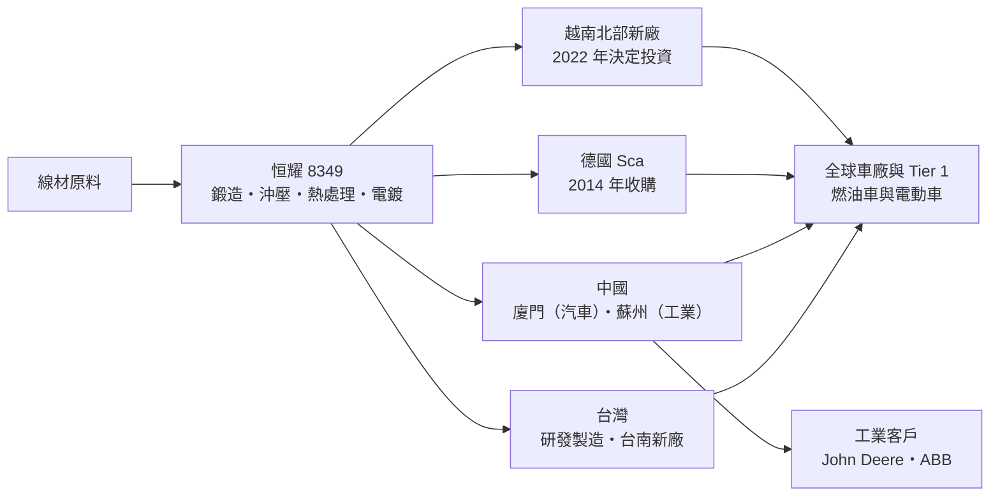
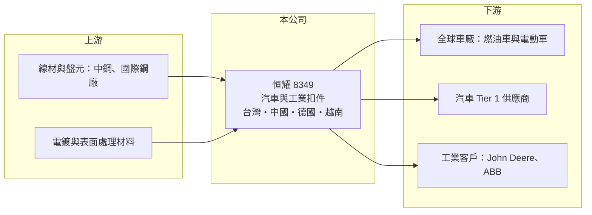

# 8349 恒耀

> 上櫃｜[[產業索引-鋼鐵工業|鋼鐵工業]]｜上市（櫃）日期 2006/03/10

# 第一章：企業模式與商業藍圖

> [!info] 撰寫說明
> 本文由 Claude 依公開資料整理，架構比照 [[2330台積電]] 的四章研究，資料截至 2026-10-08。財務數字來源：MoneyDJ（富邦證券）年度財務比率表、富果研究 2024 年第四季法說會備忘錄（2025 年 3 月）、櫃買中心開放資料（基本資料、資產負債、綜合損益、每月營收、本益比殖利率）。年營收以每股營業額推算，部分年度未查得；產品與地區營收比重未查得；產業描述為整理性內容，尚未逐條比對原始文件。#待校對

在評估單一個股的長期投資價值時，首要步驟是拆解企業的底層獲利邏輯。本章說明恒耀國際（股票代號：8349，以下簡稱恒耀）如何從台灣的螺絲廠，發展成在台灣、中國、德國與越南都有工廠的汽車扣件供應商。

## 一、核心定位：全球車廠的扣件全方位供應商

恒耀成立於 1985 年 4 月，2006 年 3 月上櫃，2026 年實收資本額約 21.9 億元（含特別股），董事長為吳榮彬。恒耀生產精密金屬[[螺絲扣件]]與零組件，主要用於汽車產業，自稱「Full Service Provider」：從線材前處理、鍛造、沖壓、熱處理、機械加工到電鍍都能自行完成，並提供物流與及時供貨（JIT）服務。

汽車扣件和建築用標準螺絲是完全不同的生意。一輛車使用數千顆扣件，其中引擎、底盤、電池包等關鍵部位的螺絲攸關安全，必須通過車廠與 [[IATF 16949]] 品質系統的認證，常需和車廠共同設計。這讓汽車扣件的訂單週期長、轉換成本高，但也代表投入的設備與認證成本很大。

## 二、全球生產據點

* **台灣：** 研發與製造核心，台南新廠占地近 18 公頃，主廠房已完工，規劃為智慧綠能廠。
* **中國：** 廈門廠服務汽車市場與大型工業扣件，蘇州廠服務非汽車客戶，例如農機的 John Deere 與電力設備的 ABB。
* **歐洲：** 2014 年收購德國 Sca，取得歐洲車廠的在地供應能力。
* **越南：** 2022 年決定在北越海防與下龍之間投資，總面積約 35 公頃，規劃總產能 5 萬噸、分兩期，預估產值約 61 億至 71 億元；第一期已投產，營收仍在爬升。

## 三、長期方向：電動車與產能分散

恒耀與燃油車廠、美系與中系電動車品牌都有合作，依 2025 年法說會資料，電動車相關營收占比在 2024 年接近或超過四成，近年年增約 30% 至 40%。電動車的電池包、電驅系統與車身結構需要大量新規格扣件，是恒耀的長期成長動能。同時，越南與台南新廠讓產能從中國分散出來，因應客戶「中國以外」的供應鏈要求與美國關稅。這兩項大型投資也是恒耀現階段資本支出與負債偏高的主因。

# 第二章：護城河深度與競爭優勢

在長期價值投資中，「護城河」指企業抵禦競爭、維持超額利潤的保護機制。本章分析恒耀作為汽車扣件供應商的護城河。

## 一、護城河組成

* **車廠認證與共同設計：** 汽車扣件必須通過車廠認證，並常在新車開發時就參與設計。一旦車型量產，供應商通常會供貨到車型生命週期結束，轉換成本高。
* **一貫化製程：** 從線材處理到電鍍都能自行完成，品質追溯與交期掌控優於需要大量外包的同業。
* **全球據點：** 台灣、中國、德國、越南多點生產，可在客戶所在地附近供貨，符合車廠的在地化採購要求。

## 二、競爭對手格局

| 對手 | 定位 | 對恒耀的影響 |
|---|---|---|
| Würth、Bossard 等國際扣件與通路集團 | 歐洲的扣件與供應鏈管理大廠 | 歐美車廠與工業客戶的主要競爭者 |
| 日系汽車扣件廠 | 綁定日系車廠 | 日系供應鏈難以切入 |
| 中國汽車扣件廠 | 成本低、綁定中國車廠 | 中系電動車市場價格競爭 |
| [[2012春雨]]、[[2062橋椿]] | 台灣扣件廠 | 部分工業扣件市場重疊 |

## 三、守得住與守不住的地方

* **守得住：** 已量產車型的長期訂單與電動車新平台的設計導入。毛利率長期維持在 18% 至 21%，比標準螺絲廠穩定得多。
* **守不住：** 營業費用與新廠折舊。毛利率雖高，營業利益率只有 4% 至 7%，代表全球營運的管銷成本與新廠爬坡期的負擔不輕。
* **觀察重點：** 越南廠產能利用率、電動車客戶的訂單變化，以及費用率能否隨規模擴大而下降。

# 第三章：財務體質與盈利規模

資料日期：2026-10-08，表格是撰寫當時的快照；最新月營收、毛利率、累計 EPS 由自動排程寫在本筆記的屬性欄位（月營收、毛利率、累計EPS 等）。#待校對

財務報表是檢驗護城河是否真實存在的最終標準。本章用多年度三率、ROE 與資本報酬，檢視恒耀在大幅投資期間的獲利品質。

## 一、多年度獲利

| 年度 | 營收（新台幣） | [[毛利率]] | [[營業利益率]] | EPS（元） | [[ROE]] |
|---|---|---|---|---|---|
| 2019 | 未查得 | 18.47% | 3.78% | 2.16 | 5.51% |
| 2020 | 未查得 | 19.23% | 3.90% | 2.52 | 6.43% |
| 2021 | 未查得 | 18.97% | 4.39% | 3.03 | 7.62% |
| 2022 | 未查得 | 18.99% | 5.24% | 4.30 | 11.06% |
| 2023 | 未查得 | 17.69% | 5.77% | 3.03 | 7.70% |
| 2024 | 約 131 億（法說會，年度待校對） | 21.05% | 7.46% | 4.27 | 10.10% |
| 2025 | 約 110 億（推算） | 19.91% | 5.06% | 1.93 | 4.05% |
| 2026 上半年 | 58.9 億 | 21.3%（推算） | 6.09%（推算） | 1.12 | 未查得 |

註：2024 年營收取自法說會備忘錄「全年營收約 131 億元、EPS 4.27 元」，備忘錄標示為 2023 年，但 EPS 與 MoneyDJ 的 2024 年數字相符，推估為 2024 年。2025 年營收以每股營業額 52.33 元乘發行股數推算。#待校對

* **毛利率穩定：** 七年毛利率都在 17.7% 至 21.1% 之間，反映汽車扣件的認證門檻與定價能力。
* **費用率高：** 營業利益率只有 3.8% 至 7.5%，全球多據點營運與新廠籌備的費用吃掉大部分毛利。
* **2025 年獲利下滑：** EPS 從 4.27 元降到 1.93 元，可能與汽車市場與關稅變化及越南新廠爬坡有關（推估）。2026 年 1 至 8 月營收年增約 7%，上半年 EPS 1.12 元。
* **非控制權益虧損：** 2026 年上半年歸屬[[非控制權益]]的淨利為 -0.40 億元，代表有持股未達百分之百的子公司仍在虧損（推估與新廠有關）。

## 二、長期指標

* **平均 ROE：** 2021 至 2025 年平均約 8.1%（推算）。
* **股利：** 最近一次現金股利約 1.54 元；保留盈餘約 18.9 億元。
* **財務結構：** 2026 年第二季資產 256 億元、負債 171 億元，負債比約 67%，流動比率約 1.2 倍（推算）。高負債主要來自越南與台南新廠的資本支出，負債比在 2019 至 2025 年一直維持在 63% 至 66%。
* **自由現金流：** 大規模建廠期間推估為負或偏低（具體數字未查得）。

## 三、[[ROIC]] 與 [[WACC]]：價值創造利差

**ROIC 推算：** 2025 年營業利益約 5.6 億元（約 110 億元 × 5.06%），稅後約 4.5 億元。投入資本以 2026 年第二季權益 85.5 億元加負債 170.8 億元計（以負債總額代替有息負債會高估投入資本），ROIC 約 1.7%（推算）；只以權益計算約 5.2%（推算）。2024 年營業利益約 9.8 億元，同法估算約 3% 至 9%（推算）。

**WACC 推算：** 以 [[CAPM]] 推估，台灣 10 年期公債 1.75%、市場風險溢酬 6%、β 取 1.0（汽車零組件業常見值，非來源數字），權益成本約 7.75%；負債成本假設 2.5%，稅後 2%。依帳面權益約 33%、負債約 67% 計算，WACC 約 3.9%；若只計有息負債，約 4.5% 至 5.5%（推算）。

**結論：** 恒耀的 ROIC 長期在 WACC 附近徘徊，2025 年更明顯低於資金成本。它的汽車扣件業務有真實的護城河（毛利率穩定），但過去的資本報酬被高費用與大量投資稀釋。越南與台南新廠能否在未來幾年拉高產能利用率，是 ROIC 能否超越 WACC 的關鍵。

# 第四章：總體風險與地緣政治

任何企業都無法脫離宏觀環境獨立存在。本章分析恒耀必須面對的地緣政治、產業週期與營運風險。

## 一、地緣政治與貿易風險

* **美國關稅：** 汽車零組件與鋼鐵衍生品受美國 [[232 條款]]與[[對等關稅]]影響，北美製造成本又高（公司在俄亥俄州持有土地但認為設廠成本仍高），出口美國的競爭條件不確定。
* **中國曝險：** 廈門與蘇州廠服務中國與全球客戶，受中美貿易摩擦與中國車市價格戰影響。

## 二、產業週期

* **汽車景氣：** 全球汽車產量、車廠庫存與車型更替會直接影響扣件訂單。
* **電動車轉型速度：** 電動車占比已接近四成，若電動車銷售成長放緩或主要電動車客戶銷量下滑，影響會被放大。

## 三、營運與財務風險

* **新廠爬坡：** 越南與台南新廠帶來折舊與費用，產能利用率爬升不如預期時會壓抑獲利。
* **高負債：** 負債比約 67%，利率上升或獲利下滑時利息負擔加重。
* **匯率：** 營收以美元、歐元、人民幣與越南盾計價，匯率變動影響換算後的獲利。

# 專有名詞解析

## 金融

- **[[非控制權益]]**：合併子公司中不屬於母公司股東的權益部分，相關獲利不計入母公司 EPS。

## 產業

- **[[螺絲扣件]]**：用來鎖固與連接零件的螺絲、螺栓、螺帽等產品，台灣高雄岡山是全球重要的生產聚落。
- **[[IATF 16949]]**：國際汽車業品質管理系統標準，汽車零組件供應商通常必須取得此認證才能供貨給車廠。
- **[[232 條款]]**：美國以國家安全為由對進口鋼鋁等產品加徵關稅的法律依據。
- **[[對等關稅]]**：美國依各國對美貿易條件課徵的對應關稅，2025 年起實施，影響出口美國的產品價格。

# 核心供應鏈

## 1. 上游：原料
- 線材與盤元：[[2002中鋼]] 等鋼廠（實際供應商未查得）

## 2. 本公司與同業
- 台灣扣件同業：[[2012春雨]]、[[2062橋椿]]、[[7718友鋮]]、[[5538東明-KY]]
- 國際同業：Würth、Bossard

## 3. 下游：客戶
- 美系與中系電動車品牌、傳統燃油車廠（具名車廠未查得）
- 工業與農機：John Deere、ABB

## 最新新聞
<!-- news:start -->
<!-- news:end -->

## 相關連結
- [公開資訊觀測站](https://mopsov.twse.com.tw/mops/web/t05st03?step=1&firstin=1&co_id=8349)
- [Goodinfo](https://goodinfo.tw/tw/StockDetail.asp?STOCK_ID=8349)
- [Yahoo 股市](https://tw.stock.yahoo.com/quote/8349)
- [鉅亨網新聞](https://www.cnyes.com/twstock/8349/news)
