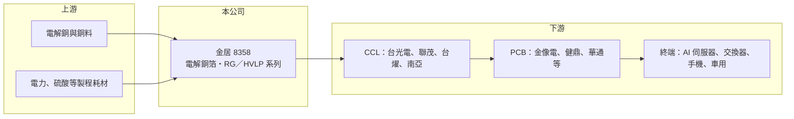

# 8358 金居

> 上櫃｜[[產業索引-電子零組件業|電子零組件業]]｜上市（櫃）日期 2010/09/27

# 第一章：企業模式與商業藍圖

> [!info] 撰寫說明
> 精簡版，由 Claude 依公開資料整理，架構比照 [[2330台積電]]，資料截至 2026-10-08。來源：證交所／櫃買中心開放資料快照（基本資料、2026 上半年損益與資產負債、股利）、Goodinfo 經營績效頁（2019 至 2025 年度）、口袋證券產業文章、優分析與財經媒體標題；產品型號與客戶認證整理自單一網頁，尚未比對公司年報。#待校對

金居開發（以下簡稱金居）是台灣少數專注於印刷電路板用電解[[銅箔]]的上市櫃公司，位在電子產業最上游的材料端。理解金居，關鍵在於它如何從一般規格銅箔轉向 AI 伺服器所需的低粗糙度高階銅箔。

- **核心業務：** 金居成立於 1998 年，2010 年在櫃買中心掛牌，總部位於台北內湖，生產基地在雲林。它把銅料電解成薄薄的銅箔，賣給[[銅箔基板]]（[[CCL]]）廠，再由 CCL 廠壓合成基板交給 [[PCB]] 廠。金居不直接賣給品牌或代工廠，因此它的訂單其實是終端電子需求經過兩層轉手之後的結果。
- **產品結構：** 早期主力是 HTE（高抗張強度銅箔）與 RTF（反轉處理銅箔）等標準品，近年策略集中在 RG 與 [[HVLP]] 系列，並逐步汰除低階品項。HVLP 是表面極平滑的銅箔，訊號在高頻下沿著銅箔表面傳遞，表面越平整，損耗越小，因此成為 [[AI 伺服器]]與高速交換器板材的必要材料。依網路整理，RG313（對應 HVLP3）於 2024 年第三季進入輝達 GB200 供應鏈，RG315 對應 HVLP4（待校對）。各產品營收比重未查得。
- **營運據點：** 生產集中在雲林，雲林三廠新產能於 2026 年起陸續開出，設計月產能約 900 至 950 噸，以 RG 與 HVLP 產品為主。2026 年 10 月公司宣布在馬來西亞檳城籌設新廠，以 HVLP4 為主，規劃年產能 3 萬噸，並對子公司 Co-Tech Development (Penang) 增資，媒體報導投資規模約百億元。這是金居第一次在台灣以外建立大型生產基地。
- **長期方向：** 金居的長期主軸是「把產品組合往高階移動」。一般銅箔的價格大致是銅價加上加工費，利潤取決於加工費，而高階銅箔因為技術門檻高、認證時間長，加工費遠高於標準品。只要 AI 伺服器與高速網通持續提高傳輸速率，對 HVLP 的需求就會沿著世代升級（HVLP2→HVLP3→HVLP4）持續往上走。

# 第二章：護城河深度與競爭優勢

金居的護城河不在規模，而在高階銅箔的製程技術與 CCL 客戶的認證關係。本章說明這些優勢的來源、與誰競爭，以及需要追蹤的指標。

- **競爭優勢：** 高階銅箔的表面處理需要長期累積的電解與後處理技術，產品要先通過 CCL 廠驗證，再隨著板材一起進入晶片廠與伺服器廠的認證清單，整個流程往往需要一年以上。一旦被設計進某一代伺服器平台，就會在該平台的生命週期內持續出貨，客戶不會輕易更換。金居是台灣較早量產 HVLP 系列的廠商之一，這是它與一般銅箔廠最大的差別。
- **主要對手：** 高階銅箔市場長期由日本廠主導，包括三井金屬、古河電工與福田金屬；盧森堡的 Circuit Foil、韓國與中國廠商（如德福科技）也積極擴產。台灣同業有長春集團（未上市）與 [[1303南亞]] 的銅箔事業。中國廠商在標準品具有價格優勢，因此標準品的加工費容易被壓縮，這也是金居必須持續往高階走的原因。
- **客戶結構：** 直接客戶以台灣 CCL 廠為主，公開資料點名 [[2383台光電]] 與 [[6213聯茂]]。台灣 CCL 廠在 AI 伺服器高速板材的全球市占率高，金居與它們地理鄰近、溝通成本低，是相對日本廠的優勢；但客戶集中在少數 CCL 廠，也代表議價空間受限。
- **觀察重點：** 第一，HVLP3 與 HVLP4 等高階品的營收占比能否持續提高，這直接決定毛利率能否維持在 2026 年上半年約 28% 的水準。第二，檳城新廠能否如期建成並通過客戶認證。第三，日本與中國對手的高階產能擴充速度，若高階銅箔轉為供過於求，加工費會回落。

# 第三章：財務體質與盈利規模

資料日期：2026-10-08，表格是撰寫當時的快照；最新月營收、毛利率、累計 EPS 由自動排程寫在本筆記的屬性欄位（月營收、毛利率、累計EPS 等）。#待校對

銅箔業是典型的景氣循環產業，財務數字隨電子需求與產品組合大幅波動。本章用七年的資料，檢視金居在一個完整循環中的獲利能力與資本報酬。

| 年度 | 營收（億元） | [[毛利率]] | [[營業利益率]] | EPS（元） | [[ROE]] |
|---|---|---|---|---|---|
| 2019 | 52.2 | 15.0% | 11.2% | 1.57 | 7.4% |
| 2020 | 60.4 | 16.0% | 12.2% | 2.14 | 10.5% |
| 2021 | 89.1 | 24.4% | 21.4% | 6.03 | 26.9% |
| 2022 | 74.1 | 18.3% | 15.6% | 3.83 | 15.8% |
| 2023 | 61.7 | 14.3% | 11.2% | 2.11 | 8.8% |
| 2024 | 68.2 | 19.8% | 16.8% | 3.65 | 14.7% |
| 2025 | 78.8 | 21.8% | 18.4% | 4.21 | 15.1% |
| 2026 上半年 | 53.4 | 28.0% | 25.0% | 4.22 | 未查得 |

資料來源：2019 至 2025 年為 Goodinfo 經營績效頁；2026 上半年依櫃買中心綜合損益開放資料計算。

- **營收規模：** 營收從 2019 年的 52.2 億元成長到 2025 年的 78.8 億元，六年年複合成長率約 7.1%（推算）。成長並不平順：2021 年受惠電子需求與銅價上漲衝到 89.1 億元，2023 年庫存調整時又跌回 61.7 億元，顯示營收同時受出貨量與銅價兩個因素影響。
- **獲利：** 毛利率在 14% 至 24% 之間循環，2026 年上半年升到 28.0%、營業利益率 25.0%，EPS 4.22 元已與 2025 年全年相當。值得注意的是，2024 年以後的獲利回升主要來自高階產品比重提高，而不是單純的景氣反彈，這是金居與過去循環不同的地方。營業費用占營收僅約 3%，費用結構精簡，毛利改善幾乎可以全數反映到營業利益。
- **財務特色：** 2026 年第二季末總資產 123.7 億元，負債 30.7 億元，其中非流動負債僅約 0.1 億元，負債比約 25%，財務結構保守。2021 至 2025 年平均 ROE 約 16.3%（推算）。2025 年度每股現金股利 2 元，以 EPS 4.21 元計，配息率約 48%（推算）。檳城新廠若以百億元規模投資，未來幾年資本支出與借款可能明顯增加，自由現金流會受到壓縮。

**[[ROIC]] 與 [[WACC]]：** 開放資料未拆分有息負債，以下用區間推算。2026 年第二季末股東權益 93.0 億元，負債總額 30.7 億元幾乎全為流動負債，有息負債應低於此數。投入資本取 93 億元（假設無有息負債）至 124 億元（假設負債全為有息）。2025 年營業利益約 14.5 億元（78.8 億 × 18.4%），稅後約 11.6 億元，ROIC 約 9% 至 12%（推算）；若以 2026 年上半年營業利益 13.3 億元年化，稅後約 21.3 億元，ROIC 約 17% 至 23%（推算）。WACC 以 CAPM 推估：無風險利率 1.75%、市場風險溢酬 6%、β 取電子材料同業常見值 1.2（未查得公司實際數字），權益成本約 9.0%；負債成本假設 2.5%、稅率 20%，稅後 2.0%，負債占資本約 0% 至 25%，WACC 約 7.3% 至 9.0%（推算）。金居在景氣高峰（2021 年、2026 年）ROIC 明顯高於 WACC，在低谷（2019、2023 年）則接近甚至低於 WACC。整體而言它長期能創造價值，但幅度高度依賴高階產品比重；高階化若能持續，利差有機會比過去循環更穩定。

# 第四章：總體風險與地緣政治

金居的風險主要來自銅價、電子產業週期與高階銅箔的競爭擴產，海外建廠則帶來新的執行風險。

- **產業週期：** 銅箔需求跟著 PCB 與 CCL 走，終端電子需求轉弱時，庫存調整會沿供應鏈逐層放大，上游材料廠的營收與毛利波動往往比下游更劇烈。2021 年到 2023 年 EPS 從 6.03 元降到 2.11 元就是例子。AI 伺服器雖然拉高了高階需求，但伺服器平台換代的節奏也會造成出貨的高低起伏。
- **營運風險：** 檳城新廠是金居第一次大規模海外投資，涉及當地人力、電力、環保與客戶認證，若進度延誤或良率不如預期，新增折舊會先侵蝕獲利。客戶集中在少數 CCL 廠，任何一家大客戶轉單或改用日本供應商，影響都會很明顯。
- **原物料與匯率：** 銅價是成本最大項，雖然報價多以銅價加加工費計算，可以轉嫁大部分波動，但銅價急漲急跌時，庫存評價與報價時間差仍會影響單季毛利。產品外銷比重高，新台幣升值也會壓縮毛利。
- **其他風險：** 電解銅箔耗電量大，台灣電價調漲與綠電要求會墊高成本；中國銅箔廠擴產若從標準品延伸到高階品，可能引發價格競爭。

# 專有名詞解析

## 應用

- **[[AI 伺服器]]**：搭載 GPU 或 ASIC 等加速晶片、專門執行 AI 訓練與推論的伺服器，對高速傳輸板材的規格要求最高。

## 產業

- **[[銅箔]]**：以電解方式把銅沉積成極薄的金屬箔，是銅箔基板的導電層材料，價格通常以銅價加加工費計算。
- **[[HVLP]]**：超低輪廓銅箔，表面粗糙度極低，可降低高頻訊號損耗，用於 AI 伺服器與高速交換器的板材。
- **[[銅箔基板]]**：由銅箔、玻纖布與樹脂壓合而成的板材，是印刷電路板的基礎材料。
- **[[CCL]]**：銅箔基板的英文縮寫（Copper Clad Laminate），台光電、聯茂、台燿是台灣主要廠商。
- **[[PCB]]**：印刷電路板，用來承載並連接電子元件的板子，幾乎所有電子產品都需要。

# 核心供應鏈

- 上游：電解銅與銅料（價格隨國際銅價波動）、電力與化學耗材。
- 下游／客戶：[[2383台光電]]、[[6213聯茂]] 等 CCL 廠為直接客戶；[[6274台燿]]、[[1303南亞]] 為台灣其他主要 CCL 廠（是否為金居客戶未查得）；再往下是 [[2368金像電]]、[[3044健鼎]] 等 PCB 廠，終端平台包括 [[NVDA輝達]] 的 AI 伺服器。
- 同業：三井金屬、古河電工、福田金屬、Circuit Foil、德福科技、長春集團；台灣上市櫃中 [[1303南亞]] 亦有銅箔事業。

## 最新新聞
<!-- news:start（自動產生，請勿手動編輯此範圍） -->
- 2026-10-22 📰 媒體 21:08｜4檔處置股因颱風順延10/27抓去關 PCB飆股金居處置到11/2止｜[鉅亨網](https://news.cnyes.com/news/id/6636083)

完整紀錄：[[8358金居 新聞]]
<!-- news:end -->

## 相關連結
- [公開資訊觀測站](https://mopsov.twse.com.tw/mops/web/t05st03?step=1&firstin=1&co_id=8358)
- [Goodinfo](https://goodinfo.tw/tw/StockDetail.asp?STOCK_ID=8358)
- [Yahoo 股市](https://tw.stock.yahoo.com/quote/8358)
- [鉅亨網新聞](https://www.cnyes.com/twstock/8358/news)
