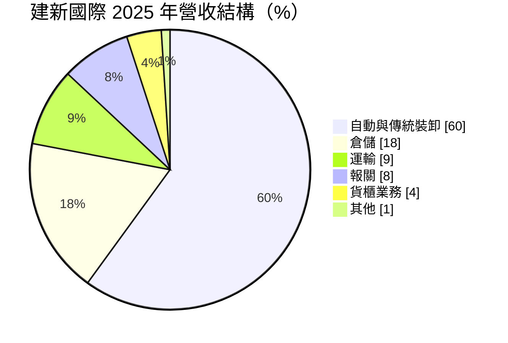
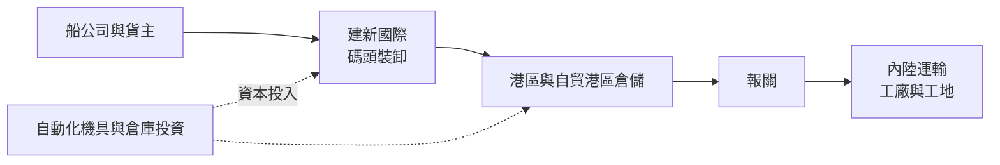
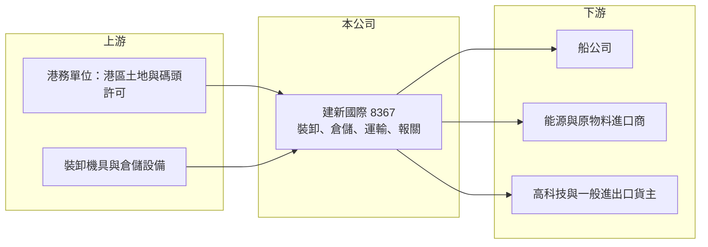

# 8367 建新國際

> 上市｜[[產業索引-航運業|航運業]]｜上市（櫃）日期 2018/09/12

# 第一章：企業模式與商業藍圖

> [!info] 撰寫說明
> 精簡版，由 Claude 依公開資料整理，架構比照 [[2330台積電]] 的四章研究，資料截至 2026-10-08。來源：Goodinfo 年度經營績效頁、理財周刊 2026 年 3 月報導、證交所開放資料（基本資料、2026 年第二季資產負債與綜合損益、營益分析、股利、每月營收）；資產負債的組成（有息負債、租賃負債）未查得明細，相關數字為推估。#待校對

建新國際是以港口裝卸為核心的綜合物流公司，本章說明它如何把港埠作業延伸到倉儲、運輸與報關，以及台北港物流園區對它長期定位的意義。

## 一、核心定位：港埠裝卸起家的一站式物流商

建新國際成立於 1989 年，2018 年上市，董事長為陳彥銘、總經理為柯勝鐘，實收資本額約 9.2 億元（證交所開放資料）。公司的本業是港區貨物裝卸，也就是在碼頭把貨物從船上卸下或裝上船，再延伸提供倉儲、內陸運輸、報關與貨櫃業務，讓貨主可以把進出口的港口作業一次外包。

2025 年營收結構如下（理財周刊）：

* **裝卸：** 占營收六成，包含自動化與傳統裝卸作業。港口裝卸需要碼頭作業許可、專用機具與熟練人力，業者數量有限，屬於地域性、長期合約型的業務。
* **倉儲、運輸與報關：** 合計約 35%，是建新從單純裝卸走向[[第三方物流]]的延伸，也提高單一客戶的服務深度。

## 二、營運據點

主要據點在高雄港、台中港與台北港。高雄港與台中港取得天然氣管線相關的長期裝卸倉儲標案，2025 年陸續認列；台北港的新科智慧物流園區第一期倉庫預計 2026 年第二季營運（理財周刊）。公司具備港區與[[自由貿易港區]]資格，可以承接保稅、轉口與高科技貨物的倉儲需求。

## 三、資本轉化邏輯：機具與倉庫換取長期合約

港埠物流是重資產的生意：裝卸機具、倉庫與園區開發都需要先投入大量資本，再透過長期合約與倉儲租金回收。2026 年第二季底總資產約 180.5 億元、總負債約 134.2 億元，資產規模遠大於年營收（證交所資產負債），反映台北港物流園區等長期投資的資本密集度。

## 四、企業長期藍圖

公司的長期方向有三個：持續投資自動化裝卸設備以提升效率；擴充倉儲量能，特別是台北港的智慧物流園區；以及擴大高科技物流與新能源儲運領域（理財周刊）。若台北港園區順利滿租，建新的收入結構將由裝卸主導，逐步轉為裝卸與倉儲並重，收入的穩定度也會提高。

# 第二章：護城河深度與競爭優勢

港口物流的競爭以地點、許可與設備為核心，本章分析建新國際的護城河與主要對手。

## 一、護城河的核心組成要素

* **港區作業許可與地點：** 碼頭裝卸與自由貿易港區倉儲需要主管機關許可，港區土地有限，既有業者不容易被取代。建新在高雄、台中、台北三港都有據點，對需要多港口服務的客戶較有吸引力。
* **長期標案與合約：** 能源相關的長期裝卸倉儲標案，合約期間長、收入可預期，也代表公司的作業能力獲得大型客戶認可。
* **一站式服務：** 裝卸、倉儲、報關與運輸整合，讓客戶減少協調成本，提高轉換成本。

## 二、主要競爭對手

| 對手 | 定位 | 與建新的比較 |
|---|---|---|
| [[5607遠雄港]] | 台北港貨櫃碼頭與自由貿易港區 | 在台北港直接競爭，碼頭資產規模較大 |
| [[2607榮運]] | 長榮集團的貨櫃場、碼頭與物流 | 集團貨源穩定，貨櫃業務規模大 |
| [[2613中櫃]]、[[5601台聯櫃]] | 貨櫃場與內陸運輸 | 在貨櫃與運輸業務重疊 |
| 各港區裝卸業者 | 未上市的地方性業者 | 在傳統裝卸以價格競爭 |

## 三、守得住與守不住

* **守得住：** 長期標案與港區倉儲的地點優勢。港區土地與許可具有稀缺性，合約到期前收入相對穩定。
* **守不住：** 傳統裝卸的價格。一般散雜貨裝卸的技術門檻不高，標案競爭時價格容易被壓低。
* **觀察重點：** 台北港物流園區的出租率與租金水準、能源儲運業務的擴展，以及新投資帶來的利息與折舊對獲利的影響。

# 第三章：財務體質與盈利規模

資料日期：2026-10-08，表格是撰寫當時的快照；最新月營收、毛利率、累計 EPS 由自動排程寫在本筆記的屬性欄位（月營收、毛利率、累計EPS 等）。#待校對

本章用多年度數據檢視建新國際的獲利穩定度，以及大規模投資對資本報酬的影響。

## 一、多年度三率與 ROE

| 年度 | 營收（新台幣） | [[毛利率]] | [[營業利益率]] | EPS（元） | [[ROE]] |
|---|---|---|---|---|---|
| 2020 | 19.0 億 | 30.2% | 15.9% | 2.73 | 10.4% |
| 2021 | 24.5 億 | 33.8% | 21.5% | 7.10 | 24.6% |
| 2022 | 23.4 億 | 32.0% | 19.6% | 2.98 | 6.69% |
| 2023 | 23.2 億 | 30.0% | 16.4% | 3.25 | 8.47% |
| 2024 | 29.0 億 | 32.4% | 21.9% | 3.59 | 9.97% |
| 2025 | 32.4 億 | 32.1% | 21.3% | 3.80 | 10.3% |
| 2026 上半年 | 16.2 億 | 27.85% | 16.56% | 0.98 | 未查得 |

註：2020 至 2025 年取自 Goodinfo；2026 上半年取自證交所營益分析與綜合損益。2021 年 EPS 與 ROE 明顯偏高，可能含一次性收益（推估）。

* **穩定的本業利潤率：** 毛利率長期維持在 30% 至 34%，營業利益率 16% 至 22%，在物流業中屬於較高水準，反映港區作業的地域性與長期合約特性。
* **營收成長：** 2020 至 2025 年營收年複合成長率約 11.3%（推算）。2026 年 1 至 8 月累計營收約 22.0 億元、年增約 3.2%（證交所每月營收）。
* **2026 年上半年的獲利落差：** 營業利益約 2.68 億元，但營業外淨損約 0.78 億元，且稅後淨利 1.52 億元中有約 0.62 億元歸屬非控制權益，歸屬母公司的 EPS 只有 0.98 元（證交所綜合損益）。新園區的利息與折舊、以及子公司持股結構，是解讀獲利時必須留意的地方（推估）。
* **ROE：** 2021 至 2025 年平均 ROE 約 12%（推算），扣除 2021 年後約 7% 至 10%。

## 二、股利與財務結構

2025 年度董事會決議現金股利 2.85 元，配發率約 75%（理財周刊、證交所股利資料）。2026 年第二季底權益總計約 46.3 億元（其中非控制權益約 13.6 億元）、總負債約 134.2 億元、非流動負債約 107 億元（證交所資產負債），負債比約 74%，在物流業中偏高。高配息搭配高負債與大規模投資，意味著自由現金流可能在投資期轉負（推估）。

## 三、[[ROIC]] 與 [[WACC]]

**ROIC 推算：** 2025 年營業利益約 32.4 億元 × 21.3% ≈ 6.9 億元，稅後約 5.5 億元。投入資本以權益 46.3 億元加上假設有息負債與[[租賃負債]]約 100 億元（推估，依非流動負債規模）計算，約 146 億元，ROIC 約 3.8%（推算）。

**WACC 推算：** 公債殖利率 1.75%、市場風險溢酬 6%、β 取港埠物流常見值 0.7，權益成本約 5.95%；負債成本 2.5%、稅後 2.0%，以權益約 32%、負債約 68% 加權，WACC 約 3.3%（推算）。

**結論：** ROIC 只略高於 WACC，代表目前大致處於「打平資金成本」的狀態。這有一部分是因為台北港園區等投資尚在建置或剛開始營運，資本已經投入但收入還沒完全反映。未來 ROIC 能否提升，取決於新倉儲的出租率；若園區營運不如預期，高負債將使股東承擔較大的風險。

# 第四章：總體風險與地緣政治

本章整理建新國際長期面對的產業、財務與外部風險。

## 一、產業週期

* **進出口貨量：** 裝卸與倉儲收入取決於港口吞吐量，全球景氣下滑、台灣進出口減少時，業務量會同步下降。
* **能源政策：** 天然氣相關的裝卸倉儲標案與政府能源轉型政策有關，政策方向調整可能影響後續標案。

## 二、營運與財務風險

* **高負債與利率：** 負債比約 74%，利率上升會直接增加利息支出，2026 年上半年營業外已出現約 0.78 億元淨損。
* **投資回收風險：** 台北港物流園區投入大量資本，若出租率或租金不如預期，折舊與利息將長期壓縮獲利。
* **標案續約：** 港區作業多以標案或長約取得，合約到期時若未能續約或須降價，收入會受影響。

## 三、其他風險

* **工安與人力：** 碼頭裝卸屬於高風險作業，工安事故可能導致停工與罰款；港區作業人力老化與缺工也是長期問題。
* **非控制權益：** 部分獲利歸屬子公司的其他股東，母公司股東實際分到的盈餘少於合併淨利。

# 專有名詞解析

## 金融

- **[[租賃負債]]**：企業以租賃方式取得資產（如飛機、店面）時，依會計準則認列的未來租金現值負債。
- **[[ROIC]]**：投入資本報酬率，衡量企業用股東與債權人投入的資本，每年能產生多少稅後營業利益。
- **[[WACC]]**：加權平均資金成本，股東要求報酬與負債利息依資本結構加權後的平均值，是判斷是否創造價值的門檻。

## 產業

- **[[第三方物流]]**：企業把倉儲、運輸、報關等物流作業外包給專業業者，由物流商提供整合服務。
- **[[自由貿易港區]]**：設在港口或機場的特定區域，貨物可在區內保稅儲存、加工與轉口，享有通關與稅務上的便利。

# 核心供應鏈

- 上游：港務單位（港區土地與碼頭作業許可）、裝卸機具與自動化設備供應商。
- 下游／客戶：船公司如 [[2603長榮]]、[[2609陽明]]、[[2615萬海]]（產業代表，非指名客戶）；能源相關長期標案業主；高科技與一般進出口貨主。
- 同業：[[5607遠雄港]]、[[2607榮運]]、[[2613中櫃]]、[[5601台聯櫃]]。

## 最新新聞
<!-- news:start -->
<!-- news:end -->

## 相關連結
- [公開資訊觀測站](https://mopsov.twse.com.tw/mops/web/t05st03?step=1&firstin=1&co_id=8367)
- [Goodinfo](https://goodinfo.tw/tw/StockDetail.asp?STOCK_ID=8367)
- [Yahoo 股市](https://tw.stock.yahoo.com/quote/8367)
- [鉅亨網新聞](https://www.cnyes.com/twstock/8367/news)
