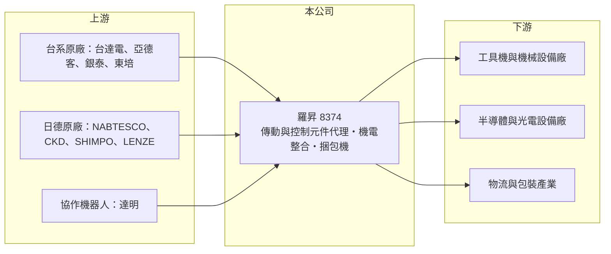

# 8374 羅昇

> 上市｜[[產業索引-電機機械|電機機械]]｜上市（櫃）日期 2008/12/25

# 第一章：企業模式與商業藍圖

> [!info] 撰寫說明
> 精簡版，由 Claude 依公開資料整理，架構比照 [[2330台積電]]，資料截至 2026-10-08。來源：證交所開放資料快照（基本資料、2026 年第二季資產負債與損益、股利）、Goodinfo 經營績效頁、優分析個股文章、nStock 公司簡介。公開資料有限。#待校對

羅昇是一家工業自動化零組件的代理與整合商，理解它的關鍵在於：它本身不製造多數產品，而是替台灣、日本、德國等原廠把傳動與控制元件賣給機械設備廠，並提供選型、維修與整合服務，因此營運跟著製造業的設備投資循環起伏。

- **核心業務：** 羅昇成立於 1984 年，2008 年在證交所上市，主要銷售工業傳動與自動化控制產品，例如滾珠螺桿、線性滑軌、[[減速機]]、PLC、伺服馬達與變頻器。依 nStock 的公司簡介，業務還包括半導體光電設備與耗材的買賣與維修、能源技術服務與能源管理產品，以及捆包設備的生產製造。公司的角色介於原廠與設備製造商之間，價值在於幫客戶找到合適的零件組合並提供在地技術支援。
- **營收結構：** 依優分析整理，公司部門包括台灣營運、大陸營運、半導體設備銷售及服務、節能／儲能，以及設備類部門；各部門的營收比重公開資料未查得。代理品牌涵蓋 [[2308台達電]]、[[1590亞德客-KY]]、銀泰科技、東培工業、達明協作機器人，以及德國 LENZE、日本 NABTESCO、CKD、SHIMPO、MIKI PULLEY 等。多品牌的[[代理權]]組合讓羅昇能提供一站式採購，但也代表核心資產掌握在原廠手中。
- **營運據點：** 總部位於新北市新莊，營運分為台灣與中國兩大區域。中國部門的客戶以工具機與機械設備廠為主，2023 年起受到中亞需求減少與日系工具機廠競爭的影響而轉弱，2024 年第二季仍虧損（優分析）。
- **長期方向：** 羅昇在 2024 年 6 月投資台灣捆包機業者怡進工業，切入自有設備的生產製造，這是從純代理走向「代理加製造」的結構性轉變。依優分析，怡進所屬的設備類部門在 2024 年第三季已成為主要獲利來源。公司同時布局半導體設備耗材與節能儲能，目的是降低對工具機景氣的依賴。

# 第二章：護城河深度與競爭優勢

羅昇的護城河主要來自多品牌代理組合與長年累積的客戶關係，屬於通路型的窄護城河。

- **競爭優勢：** 自動化元件的採購很重視技術支援：設備廠需要有人協助選型、計算負載、處理故障，羅昇數十年累積的應用工程師與庫存網絡，讓中小型機械廠願意長期往來。多品牌代理也讓它能把滑軌、馬達、減速機一起報價，降低客戶的採購與整合成本。不過代理權可以被原廠收回或分給其他通路，這是通路商共同的結構性弱點。
- **主要對手：** 同樣代理自動化與傳動元件的通路商、原廠的直營業務（例如 [[2049上銀]] 等元件廠自建通路），以及中國本土的自動化通路與元件廠。在機電整合與自動化系統方面，[[6215和椿]]、[[2464盟立]] 等也是競爭者。在中國市場，本土元件廠的價格優勢持續壓縮台系與日系產品的空間。
- **觀察重點：** 長期最該追蹤的是設備類部門（捆包機）與半導體相關業務占營收的比重能否持續提升，因為這兩塊的毛利率高於傳統代理。毛利率已由 2020 年的 17.4% 逐年升到 2025 年的 25.0%，顯示產品組合確實在改變；2026 年上半年營業利益率回升到 7.9%，是近年高點。中國部門能否穩定轉盈，是另一個關鍵。

# 第三章：財務體質與盈利規模

資料日期：2026-10-08，表格是撰寫當時的快照；最新月營收、毛利率、累計 EPS 由自動排程寫在本筆記的屬性欄位（月營收、毛利率、累計EPS 等）。#待校對

羅昇的財務呈現通路商的典型樣貌：營收規模數十億元、營業利益率只有個位數，獲利對景氣與費用控制相當敏感。

| 年度 | 營收（億元） | [[毛利率]] | [[營業利益率]] | EPS（元） | [[ROE]] |
|---|---|---|---|---|---|
| 2020 | 27.5 | 17.4% | 4.54% | 0.78 | 4.48% |
| 2021 | 36.6 | 18.0% | 5.19% | 1.32 | 7.40% |
| 2022 | 37.6 | 19.6% | 2.54% | 0.70 | 4.63% |
| 2023 | 30.5 | 20.4% | -0.44% | -0.19 | -0.81% |
| 2024 | 35.8 | 24.7% | 4.35% | 0.60 | 5.89% |
| 2025 | 44.4 | 25.0% | 2.60% | -0.55 | 未查得（為負） |

（來源：Goodinfo 經營績效頁；2025 年 ROE 頁面數字與虧損方向不一致，故不列。2026 年上半年依證交所資料：營收 30.1 億元、毛利率 24.0%、營業利益率 7.9%、EPS 0.89 元。）

- **營收規模：** 2020 至 2025 年營收由 27.5 億元增至 44.4 億元，年複合成長率約 10%（推算），其中 2025 年的跳升推估部分來自怡進工業的併入（#待校對）。2023 年營收下滑到 30.5 億元，反映工具機與機械設備景氣的循環性。
- **獲利：** 2021 至 2024 年平均 ROE 約 4.3%（推算），2025 年轉為虧損，長期資本報酬偏低。2025 年營業利益仍為正（約 1.2 億元），但歸屬母公司淨損約 0.62 億元，代表有業外損失或子公司虧損由母公司承擔，具體原因公開資料未查得。毛利率上升但費用也隨著併購與新事業增加，獲利改善要靠營收規模放大後的[[營業槓桿]]。
- **財務特色：** 依 2026 年第二季資料，總資產約 57.5 億元、股東權益約 29.3 億元（其中[[非控制權益]]約 8.5 億元）、負債約 28.3 億元。非控制權益比重高，反映怡進等子公司並非百分之百持有，子公司的獲利有一部分不屬於羅昇股東。2025 年雖虧損，仍以累積盈餘配發每股 0.2 元現金股利；Goodinfo 統計的歷年平均現金股利約 0.77 元，配息隨獲利起伏。自由現金流是否長期為正未查得。
- **[[ROIC]] 與 [[WACC]]：** 以 2025 年營業利益約 1.15 億元（44.4 億元 × 2.6%）、稅率 20% 計算，稅後營業利益約 0.92 億元。有息負債未查得，投入資本以股東權益 29.3 億元到「權益加全部負債」57.5 億元為區間，ROIC 約 1.6% 至 3.2%（推算）；若以 2026 年上半年營業利益 2.39 億元年化，約 6.6% 至 13%（推算）。WACC 以 [[CAPM]] 推估：無風險利率 1.75%、市場風險溢酬 6%、β 假設 1.0（自動化通路股常見值），權益成本約 7.75%；稅後負債成本假設 2%、負債占三成五，WACC 約 5.7%（推算）。2020 至 2025 年的 ROIC 大多低於 WACC，長期並未創造經濟價值；2026 年的改善若能延續，才有機會轉為正利差。

# 第四章：總體風險與地緣政治

羅昇的風險來自設備投資循環、代理權的不確定性與轉型的執行。

- **產業週期：** 自動化元件的需求取決於工具機、半導體與電子設備廠的資本支出，景氣好時設備廠搶料、景氣差時一起砍單，[[長鞭效應]]明顯。2023 年營收下滑與虧損，就是工具機需求轉弱與中國市場競爭的結果。這類週期通常 3 至 4 年一輪，投資時需要把整個循環的平均獲利納入考量。
- **營運風險：** 代理權是通路商最重要的資產，但原廠可以調整通路策略、改為直營或另找代理，一旦主要品牌流失，營收可能明顯下降。併購怡進等製造業務需要不同於通路的管理能力，整合不順就可能出現 2025 年那樣「本業有賺、股東虧損」的狀況。
- **其他風險：** 中國部門面臨本土元件廠的價格競爭與兩岸政治風險，人民幣匯率也會影響換算後的營收。代理日系產品以日圓計價，日圓升貶影響進貨成本。捆包機與儲能業務的市場規模與競爭格局仍待驗證。

# 專有名詞解析

## 金融

- **[[營業槓桿]]**：固定成本占比高的公司，營收增加時利潤增幅大於營收增幅，反之亦然。
- **[[非控制權益]]**：子公司中不屬於母公司的股權，其分得的淨利不計入母公司股東的 EPS。
- **[[長鞭效應]]**：終端需求的小幅變動，沿供應鏈往上游傳遞時被逐級放大，造成上游庫存與訂單劇烈波動。

## 產業

- **[[減速機]]**：降低馬達轉速、放大扭力的傳動元件，精密減速機是機器人關節的核心零件。
- **[[代理權]]**：原廠授權通路商在特定地區或客戶銷售其產品的權利，是通路商最核心的資產，但可被收回。

# 核心供應鏈

- 上游：[[2308台達電]]、[[1590亞德客-KY]]、銀泰科技、東培工業、達明機器人，以及日本 NABTESCO、CKD、SHIMPO、MIKI PULLEY，德國 LENZE、ATLANTA 等原廠。
- 下游／客戶：台灣與中國的工具機、自動化設備、半導體與光電設備製造商，以及使用捆包機的物流與製造業者。
- 同業：[[6215和椿]]、[[2464盟立]]（自動化整合），以及傳動元件原廠 [[2049上銀]]、[[4576大銀微系統]] 的直營通路。

## 最新新聞
<!-- news:start -->
<!-- news:end -->

## 相關連結
- [公開資訊觀測站](https://mopsov.twse.com.tw/mops/web/t05st03?step=1&firstin=1&co_id=8374)
- [Goodinfo](https://goodinfo.tw/tw/StockDetail.asp?STOCK_ID=8374)
- [Yahoo 股市](https://tw.stock.yahoo.com/quote/8374)
- [鉅亨網新聞](https://www.cnyes.com/twstock/8374/news)
