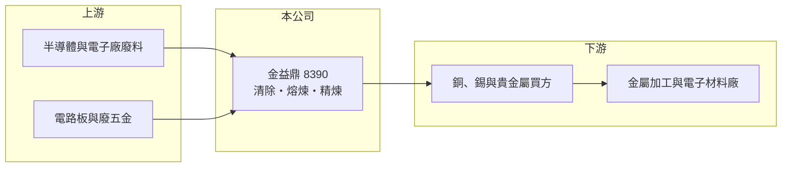

# 8390 金益鼎

> 上櫃｜[[產業索引-綠能環保|綠能環保]]｜上市（櫃）日期 2008/05/21

# 第一章：企業模式與商業藍圖

> [!info] 撰寫說明
> 精簡版，由 Claude 依公開資料整理，架構比照 [[2330台積電]]，資料截至 2026-10-08。來源：Goodinfo 台灣股市資訊網年度經營績效（2020 至 2025 年）；nStock 公司概況；櫃買中心開放資料快照（基本資料、2026 年上半年資產負債與損益、股利）。公開資料有限，這次未查得產品別比重、回收金屬種類與廠區分布，相關描述憑記憶整理，已標「待校對」。#待校對

金益鼎企業成立於 1997 年 4 月、2008 年 5 月上櫃，總部在新竹市香山區，董事長莊清旗、總經理莊瑞元，實收資本額 9.6 億元。公司從事金屬回收處理、廢五金買賣與[[電子廢棄物]]清除處理，是把科技業的廢料轉回金屬原料的「城市採礦」業者。

- **核心業務：** 金益鼎向電子、半導體與電路板等產業收取含金屬的廢料，經前處理、熔煉與精煉，回收銅、錫及金、銀、鈀等貴金屬（[[貴金屬回收]]），再以金屬原料出售（回收金屬種類待校對）。收入同時來自處理費與金屬銷售，因此毛利和國際金屬價格高度連動。
- **營收結構：** 產品別比重這次未查得。依櫃買中心資料，2026 年上半年營收 33.50 億元、毛利率約 27%，營業利益 7.43 億元，已超過 2025 年全年營業利益約 6.8 億元（推算），反映金屬價格上漲帶來的利差擴大（推估）。
- **營運據點：** 總部與主要處理廠位於新竹，財報為合併報表，含子公司（名單與海外據點未查得，待校對）。新竹科學園區周邊的半導體與電子廠是天然的廢料來源，地理位置本身就是優勢。
- **長期方向：** 全球對銅、錫與貴金屬的需求隨 AI、電動車與電網投資增加，供給端礦產開發緩慢，回收料的重要性長期提升。台灣電子業規模龐大，廢料來源穩定，金益鼎的成長取決於取得更多廢料與提高精煉純度。

# 第二章：護城河深度與競爭優勢

金益鼎的護城河來自處理許可、客戶關係與精煉技術，屬於環保與原物料的交叉型事業。

- **競爭優勢：** 電子廢棄物處理需要清除與處理許可，熔煉與精煉設施的環評門檻高，新進者不易取得。長期配合的科技廠客戶重視廢料流向的合規與保密，傾向固定合作，形成穩定的原料來源。
- **主要對手：** 國內貴金屬與金屬回收同業包括 [[1785光洋科]]、[[9955佳龍]]，以及 [[8438昶昕]]（蝕刻液回收銅）等；國際上有比利時 Umicore、日本 DOWA 等大型精煉集團。
- **觀察重點：** 2023 年營業利益率只有 7.66%，EPS 卻達 5.57 元，代表當年有較大的業外收益（來源未查得）。長期評估本業時應以營業利益為準，並觀察金屬價格回落時毛利能否守住。

# 第三章：財務體質與盈利規模

資料日期：2026-10-08，表格是撰寫當時的快照；最新月營收、毛利率、累計 EPS 由自動排程寫在本筆記的屬性欄位（月營收、毛利率、累計EPS 等）。#待校對

金益鼎營收在 5 年間由 28 億元成長到 46 億元，毛利率隨金屬價格在 13% 至 22% 間波動，ROE 長期在 11% 至 19%。

| 年度 | 營收（億元） | [[毛利率]] | [[營業利益率]] | EPS（元） | [[ROE]] |
|---|---|---|---|---|---|
| 2021 | 34.1 | 22.1% | 16.2% | 3.47 | 15.7% |
| 2022 | 36.3 | 13.9% | 8.51% | 2.82 | 11.7% |
| 2023 | 36.6 | 12.9% | 7.66% | 5.57 | 18.9% |
| 2024 | 49.4 | 16.8% | 11.9% | 4.84 | 14.9% |
| 2025 | 46.3 | 20.3% | 14.7% | 6.60 | 18.0% |

註：Goodinfo 合併報表；2020 年營收 28.2 億元、毛利率 17.1%、EPS 2.48 元、ROE 11.6%。2026 年上半年 EPS 5.16 元（櫃買中心資料）。

- **長期指標：** 2020 至 2025 年營收年複合成長率約 10.4%（推算），2021 至 2025 年平均 ROE 約 15.8%（推算）。現金股利 2024 年度 2.5 元、2025 年度 3.8 元，配息率約 52% 至 58%，配息隨獲利調整。
- **[[ROIC]] 與 [[WACC]]：** 2025 年營業利益約 6.8 億元（46.3 億元 × 14.7%），稅後約 5.4 億元；投入資本約 45 億元（2026 年第二季權益總計 40.03 億元，非流動負債僅 0.37 億元，另以流動負債 10.59 億元的一半約 5 億元推估短期借款），ROIC 約 12%（推算）。WACC 約 6.6%（推算：無風險利率 1.75%、市場風險溢酬 6%、β 取原物料回收業常見值 0.9，股東權益成本 7.15%；稅前負債成本 2.5%、稅率 20%，負債占資本約 11%）。ROIC 高於 WACC，近年創造價值，但利差會隨金屬價格明顯波動。
- **財務特色：** 2026 年第二季負債比率約 21%（負債 10.96 億元 ÷ 資產 51.00 億元），幾乎沒有長期負債，財務結構保守。存貨與應收主要是金屬料，金屬價格變動會直接影響營運資金需求。

# 第四章：總體風險與地緣政治

金益鼎的風險主要來自金屬價格與原料取得，屬於有週期性的環保業。

- **產業週期：** 銅、錫與貴金屬價格受全球景氣、美元與投機資金影響，價格回落時毛利會快速收縮，2022 至 2023 年毛利率降到 13% 左右即為例子。電子業景氣也影響廢料產生量。
- **營運風險：** 廢料來源若被同業或客戶自建回收系統取代，原料成本會上升；熔煉設施的空污與工安管理一旦出問題，可能被要求停工。
- **其他風險：** 環保法規趨嚴會提高處理成本；金屬以美元計價，新台幣匯率影響營收與存貨評價；國際精煉商與中國回收產能的競爭也會壓縮利差。

# 專有名詞解析

## 金融

- **[[ROIC]]**：投入資本報酬率，稅後營業利益除以股東權益加有息負債，衡量本業運用資本的效率。
- **[[WACC]]**：加權平均資金成本，股東與債權人要求報酬率的加權平均，是 ROIC 要超越的門檻。

## 產業

- **[[電子廢棄物]]**：廢棄的電子產品、電路板與製程廢料，含銅、錫與貴金屬，需由合格業者回收處理。
- **[[貴金屬回收]]**：從廢料、廢靶材或電子廢棄物中提煉金、銀、鉑、鈀等貴金屬，再精煉成可用材料。

# 核心供應鏈

- 上游（廢料來源）：半導體、電子與電路板廠的製程廢料與廢五金（客戶名單未查得）。
- 下游／客戶：金屬貿易商、金屬加工與電子材料廠（名單未查得）。
- 同業：[[1785光洋科]]、[[9955佳龍]]、[[8438昶昕]]；國際 Umicore、DOWA。

## 最新新聞
<!-- news:start（自動產生，請勿手動編輯此範圍） -->
- 2026-10-05 🏛️ 重訊 15:37｜公告本公司受邀參加中信證券舉辦之線上法人說明會｜[觀測站](https://mops.twse.com.tw/mops/#/web/t05st01)

完整紀錄：[[8390金益鼎 新聞]]
<!-- news:end -->

## 相關連結
- [公開資訊觀測站](https://mopsov.twse.com.tw/mops/web/t05st03?step=1&firstin=1&co_id=8390)
- [Goodinfo](https://goodinfo.tw/tw/StockDetail.asp?STOCK_ID=8390)
- [Yahoo 股市](https://tw.stock.yahoo.com/quote/8390)
- [鉅亨網新聞](https://www.cnyes.com/twstock/8390/news)
