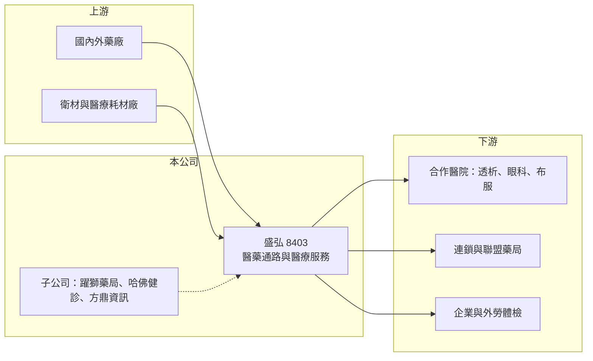

# 8403 盛弘

> 上櫃｜[[產業索引-生技醫療業|生技醫療業]]｜上市（櫃）日期 2011/03/01

# 第一章：企業模式與商業藍圖

> [!info] 撰寫說明
> 本文由 Claude 依公開資料整理，架構比照 [[2330台積電]] 的四章研究，資料截至 2026-10-08。財務數字來源：MoneyDJ 理財網年度財務比率、nStock 公司簡介、優分析 2025 年第三季法說會整理、櫃買中心開放資料（基本資料、2026 年第二季資產負債與綜合損益、本益比）；產業描述為整理性內容，尚未逐條比對原始文件。#待校對

本章拆解盛弘醫藥（股票代號：8403，以下簡稱盛弘）的商業模式。盛弘不是研發新藥的藥廠，而是一家以藥品與衛材通路為主、再延伸到醫療服務與連鎖藥局的「醫療服務整合商」，理解它要從低毛利、高周轉的通路生意開始。

- **核心業務：** 盛弘的營業項目包括藥品與衛材的批發零售、出租設備給醫療院所、承攬體檢與外勞檢驗、血液透析與眼科的醫療管理、醫院布服管理、不織布製造，以及連鎖藥局的管理諮詢。這些業務的共同點是「替醫院處理非核心但必要的工作」，讓醫院專心看診，盛弘則賺取採購規模與管理效率的差價。
- **營收結構：** 公開資料未查得各業務的營收比重。從約 16% 的[[毛利率]]判斷，藥品與衛材通路應占營收的大宗（推估），醫療管理與健診服務的毛利較高但規模較小。2025 年全年營收約 43.6 億元，是一家中型的醫藥通路商。
- **營運據點：** 公司總部位於桃園，子公司包括躍獅連鎖藥局、哈佛健診、竹科員診、方鼎資訊、醫電數位等。從法說會內容看，盛弘與桃園地區的敏盛醫療體系合作密切，例如在敏盛經國總院設立「健康台灣深耕計畫執行中心」，並於 2024 年出售大園敏盛相關投資認列業外收益。
- **長期方向：** 盛弘的策略是把通路、藥局、健診與資訊系統串成「智慧醫療全人照護」平台。藥局方面透過「好鄰居藥業聯盟」做聯合採購，2025 年前三季聯盟採購金額年增逾一成；醫療資訊方面與 [[6561是方]] 等夥伴建構 Smart on FHIR 數位醫療平台，目標在桃園連結 50 家以上的地區醫院、診所與長照機構，發展在宅醫療與遠距照護。

# 第二章：護城河深度與競爭優勢

本章分析盛弘在醫藥通路這個低毛利產業中的競爭優勢，以及它面對的主要對手。

- **競爭優勢：** 醫藥通路的核心競爭力是採購規模、配送效率與醫院關係。盛弘的優勢在於同時經營通路、醫療管理與健診，與合作醫院的關係比單純的藥品經銷商更深，客戶黏著度較高。藥局聯盟的聯合採購也讓它在面對藥廠議價時有一定的規模。
- **主要對手：** 連鎖藥局方面有 [[6469大樹]]、[[4175杏一]]；醫藥通路方面有裕利、大昌華嘉等大型外商物流商，以及眾多地區性藥品經銷商。醫療資訊方面則與醫院 HIS 系統廠商競爭。
- **護城河的限制：** 台灣藥價由健保決定，通路商只能在採購與管理效率上賺差價，議價空間有限；連鎖藥局市場又有大樹等快速展店的對手，規模差距不小。因此盛弘的護城河偏窄，主要靠在地醫院關係與服務整合。
- **觀察重點：** 子公司整頓後的虧損是否持續收斂、藥局聯盟能否擴大成有規模的平台，以及智慧醫療與在宅照護能否形成新的收費模式，是盛弘能否擺脫低毛利結構的關鍵。

# 第三章：財務體質與盈利規模

資料日期：2026-10-08，表格是撰寫當時的快照；最新月營收、毛利率、累計 EPS 由自動排程寫在本筆記的屬性欄位（月營收、毛利率、累計EPS 等）。#待校對

本章用多年度的三率、ROE 與資本報酬，檢視盛弘的獲利品質。

| 年度 | 營收（新台幣） | [[毛利率]] | [[營業利益率]] | EPS（元） | [[ROE]] |
|---|---|---|---|---|---|
| 2020 | 約 41.0 億（推算） | 28.79% | 12.50% | 2.29 | 11.50% |
| 2021 | 約 38.5 億（推算） | 21.66% | 6.71% | 2.04 | 5.18% |
| 2022 | 約 41.4 億（推算） | 23.78% | 8.20% | 2.45 | 6.12% |
| 2023 | 約 38.7 億（推算） | 18.75% | 3.07% | 0.99 | 1.37% |
| 2024 | 約 43.3 億（推算） | 16.51% | 4.13% | 1.53 | 3.08% |
| 2025 | 約 43.6 億 | 16.27% | 3.92% | 1.03 | 2.86% |
| 2026 上半年 | 22.63 億 | 15.8%（推算） | 4.0%（推算） | 0.58 | 未查得 |

註：2025 年營收取自 nStock，2020 至 2024 年依 MoneyDJ 營收成長率回推；2026 上半年取自櫃買中心開放資料。

- **毛利率長期下滑：** 毛利率從 2020 年的 28.8% 一路降到 2025 年的 16% 左右。2020 年疫情期間防疫物資與檢驗業務帶來高毛利，之後回到以藥品通路為主的結構；藥局通路併入後，低毛利的商品銷售比重提高，也拉低整體毛利率（推估）。
- **營業利益率偏低：** 營業利益率近三年只有 3% 至 4%，代表營收規模雖有成長，但費用吃掉大部分毛利。法說會指出 2025 年第三季營益率回升到 4.34%，子公司整頓開始見效。
- **長期指標：** 2021 至 2025 年平均 ROE 約 3.7%（推算），2020 至 2025 年營收年複合成長率約 1.2%（推算）。2026 年 10 月初股價淨值比約 0.78 倍（櫃買中心資料），反映市場對其資本報酬的保守評價。最新一年度現金股利每股 0.6 元（櫃買中心本益比資料）。

**[[ROIC]] 與 [[WACC]]：** 2025 年營業利益約 1.71 億元（43.57 億 × 3.92%），稅後約 1.37 億元。2026 年第二季底權益總計約 37.0 億元、總負債約 28.4 億元，假設其中約四成為有息負債（約 11.4 億元，推估，其餘多為應付帳款），投入資本約 48.4 億元，ROIC 約 2.8%（推算）。WACC 方面，假設 10 年期公債 1.75%、市場風險溢酬 6%、β 取醫藥通路同業常見值 0.7，股東權益成本約 5.95%；負債成本 2.5%、稅後 2.0%，以權益 76%、負債 24% 加權，WACC 約 5.0%（推算）。ROIC 低於 WACC 約 2 個百分點，代表盛弘近年的本業報酬不足以覆蓋資金成本，仍處於整頓期；未來需靠子公司轉虧與高毛利服務提升報酬率。

# 第四章：總體風險與地緣政治

本章分析盛弘長期面對的政策、產業與營運風險。

- **產業週期：** 醫藥通路需求穩定，受景氣影響小，但成長也慢。真正的變數是健保政策：每年的藥價調整會直接壓縮藥品價差，而通路商很難把成本轉嫁出去。
- **營運風險：** 盛弘業務線多、子公司多，管理複雜度高，過去幾年獲利受轉投資虧損拖累。醫療服務與合作醫院的關係高度相關，若合作醫院經營策略改變，相關收入可能受影響。
- **競爭風險：** 連鎖藥局市場由大型業者主導，展店與價格競爭激烈；智慧醫療平台屬於新業務，需要投入資訊系統與人力，回收期不確定。
- **其他風險：** 藥品與衛材多為進口，匯率與國際供應會影響成本；醫療法規與個資保護規範趨嚴，也會提高數位醫療業務的合規成本。

# 專有名詞解析

## 應用

- **[[在宅醫療]]**：醫護人員到病人家中提供診療與照護，搭配遠距系統，是高齡化社會的重要照護模式。

## 金融

- **[[ROIC]]**：投入資本報酬率，稅後營業利益除以股東權益與有息負債的合計，衡量本業對所有資金提供者的報酬。
- **[[WACC]]**：加權平均資金成本，依股東權益與負債的比重加權計算的資金成本，ROIC 高於它才代表創造價值。

## 產業

- **[[醫藥通路]]**：在藥廠與醫院、診所、藥局之間負責採購、倉儲與配送藥品的業者，以規模與效率賺取價差。
- **[[健保藥價調整]]**：健保署定期依市場實際交易價格調降給付藥價，壓縮藥廠與通路的利潤空間。

# 核心供應鏈

- 上游：國內外藥廠、衛材與醫療耗材供應商。
- 下游／客戶：桃園地區合作醫院（包括敏盛醫療體系）、聯盟藥局、企業與外勞體檢客戶；數位醫療合作夥伴 [[6561是方]]。
- 同業：[[6469大樹]]、[[4175杏一]]，以及裕利、大昌華嘉等醫藥物流商。

## 最新新聞
<!-- news:start -->
<!-- news:end -->

## 相關連結
- [公開資訊觀測站](https://mopsov.twse.com.tw/mops/web/t05st03?step=1&firstin=1&co_id=8403)
- [Goodinfo](https://goodinfo.tw/tw/StockDetail.asp?STOCK_ID=8403)
- [Yahoo 股市](https://tw.stock.yahoo.com/quote/8403)
- [鉅亨網新聞](https://www.cnyes.com/twstock/8403/news)
