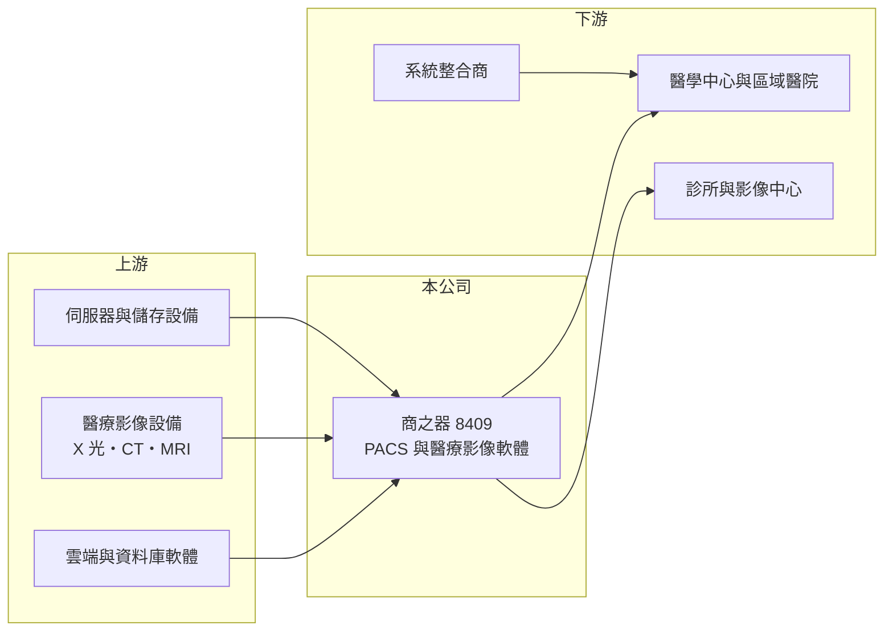

# 8409 商之器

> 上櫃｜[[產業索引-生技醫療業|生技醫療業]]｜上市（櫃）日期 2013/11/25

# 第一章：企業模式與商業藍圖

> [!info] 撰寫說明
> 精簡版，由 Claude 依公開資料整理，架構比照 [[2330台積電]]，資料截至 2026-10-08。來源：MoneyDJ 理財網財務比率年表（2021 至 2025 年）；櫃買中心開放資料快照（基本資料、2026 年上半年資產負債與損益、本益比殖利率）。公開資料有限，產品線、客戶與海外布局多為整理性描述，憑記憶部分已標「待校對」。#待校對

商之器科技成立於 1988 年 1 月、2013 年 11 月在櫃買中心掛牌，總部在台北內湖，董事長兼總經理為盤龍。它是台灣少數以醫療影像軟體為本業的公司，理解它的關鍵在於：這是一門靠醫院專案驗收認列營收、再靠長期維護合約累積經常性收入的軟體生意。

- **核心業務：** 商之器的主力產品是[[PACS]]（醫學影像儲傳系統），讓醫院把 X 光、電腦斷層、磁振造影等影像數位化儲存，並讓醫師在院內外調閱判讀；周邊另有放射科資訊系統、影像整合平台與遠距判讀等模組（產品細項待校對）。醫院一旦導入 PACS，影像資料、操作流程與院內其他資訊系統都會和它綁在一起，因此這類軟體具有很高的更換成本。
- **營收結構：** 營收由軟硬體建置專案與後續的維護服務組成，各部分比重這次未查得。2026 年上半年[[毛利率]]高達 77%，顯示營收以軟體授權與服務為主，硬體轉售比重不高（推估）。專案型營收的特性是金額大、認列時點取決於醫院驗收，所以年度營收常大起大落，2022 年營收成長約 97%、2023 年又衰退約 46% 就是例子。
- **營運據點：** 研發與營運集中在台北，客戶以台灣各級醫院為主，過去也曾到中國、美國與日本等市場推廣產品（海外營收比重未查得，待校對）。醫療軟體出口需要逐一取得各國法規許可並建立在地服務團隊，對一家年營收約 2 至 4 億元的公司來說，海外擴張的資源相當吃緊。
- **長期方向：** 醫療影像的長期趨勢是雲端化、跨院影像共享與 AI 輔助判讀，商之器的機會在於把既有的醫院客戶基礎延伸到這些新服務，並把一次性的建置收入轉為訂閱式或按量計費的經常性收入。這個轉型若成功，營收的波動度會下降，估值基礎也會更穩定。

# 第二章：護城河深度與競爭優勢

商之器的護城河來自醫院端的高轉換成本與長年累積的在地導入經驗，但規模小、與國際大廠的資源差距大，屬於利基型的窄護城河。

- **競爭優勢：** 醫院的影像系統一旦上線，要換供應商就得遷移多年的歷史影像、重新訓練醫事人員並重新串接院內系統，風險與成本都很高，這讓既有客戶的維護合約相對穩定。本土廠商在中文介面、健保申報流程與快速客製化服務上，比國際大廠更貼近台灣醫院的需求。
- **主要對手：** 國際上 PACS 市場由 GE HealthCare、Philips、Siemens Healthineers、Fujifilm 等醫療設備大廠主導，它們可以把影像設備與軟體綁在一起整包銷售。台灣本地則有其他醫療資訊與[[系統整合]]業者，以及大型醫院自建的資訊團隊，在標案中以價格競爭。
- **觀察重點：** 由於營收高度依賴標案，長期最值得觀察的是維護與訂閱等經常性收入占比能否提高，以及營業費用能否隨營收規模攤薄。過去 5 年[[營業利益率]]在 -18% 至 4% 之間擺盪，說明公司的費用結構仍大於穩定的營收規模，獲利尚未站穩。

# 第三章：財務體質與盈利規模

資料日期：2026-10-08，表格是撰寫當時的快照；最新月營收、毛利率、累計 EPS 由自動排程寫在本筆記的屬性欄位（月營收、毛利率、累計EPS 等）。#待校對

商之器的財務特徵是高毛利、高費用、營收波動大，過去 5 年只有 3 年小幅獲利，資本報酬長期偏低。

| 年度 | 營收（億元） | [[毛利率]] | [[營業利益率]] | EPS（元） | [[ROE]] |
|---|---|---|---|---|---|
| 2021 | 約 1.95（推算） | 67.35% | -18.16% | -0.73 | -7.49% |
| 2022 | 約 3.84（推算） | 48.04% | 1.45% | 0.13 | 1.27% |
| 2023 | 約 2.06（推算） | 75.16% | -6.83% | -0.44 | -4.47% |
| 2024 | 約 2.81（推算） | 63.37% | 1.17% | 0.07 | 0.69% |
| 2025 | 約 2.53（推算） | 68.89% | 3.89% | 0.24 | 2.47% |

註：營收以 MoneyDJ 每股營業額乘以 3,200 萬股推算，股本期間未見變動，與各年營收成長率相符。

- **長期指標：** 2021 至 2025 年營收年複合成長率約 6.7%（推算），但逐年波動極大；近 5 年平均 ROE 約 -1.5%（推算）。2025 年度未配發股利（櫃買中心資料每股股利 0 元），2026 年第二季保留盈餘為 -0.84 億元，帳上累積虧損使配息空間受限。每股現金流量 5 年中有 3 年為負，自由現金流並不穩定。
- **[[ROIC]] 與 [[WACC]]：** 2025 年稅後營業利益約 0.08 億元（營業利益率 3.89% × 營收約 2.53 億元 × 0.8），投入資本約 3.3 億元（2026 年第二季股東權益 3.00 億元，加上有息負債以約 0.3 億元推估），ROIC 約 2.4%（推算）；2026 年上半年營業損失 0.24 億元，換算 ROIC 轉為負值（推算）。WACC 約 7%（推算：無風險利率 1.75%、市場風險溢酬 6%、β 取軟體與醫療資訊同業常見值 0.9，股東權益成本約 7.15%；負債比重低，稅前負債成本 2.5%、稅率 20%）。ROIC 長期低於 WACC，代表目前的營運規模還沒有替股東創造超額報酬，關鍵在於營收能否穩定放大到足以覆蓋費用。
- **財務特色：** 2026 年上半年營收 0.87 億元，營業費用 0.92 億元，費用已超過營收；研發費用率這次未查得，但軟體公司的人力與研發支出屬固定成本，營收一下滑就直接轉為虧損。2026 年第二季負債比率約 29%（負債 1.22 億元 ÷ 資產 4.22 億元），流動負債多為專案相關的應付與預收款項（推估）。

# 第四章：總體風險與地緣政治

商之器的風險集中在專案營收的不穩定、規模不足以支撐研發，以及國際大廠與新技術帶來的競爭。

- **產業週期：** 醫院資訊系統的採購跟著醫院的預算年度、健保政策與公立醫院標案時程走，並非景氣循環主導，但時點難以預測。大型專案延後驗收，就可能讓單一年度由盈轉虧。
- **營運風險：** 公司規模小，少數大型標案的得失對營收影響很大；關鍵研發與導入人員流失，也會直接影響交付能力。AI 影像判讀與雲端平台需要持續投入，若營收無法同步成長，費用率會長期壓抑獲利。
- **其他風險：** 醫療軟體受各國醫材與資安法規規範，法規升級會提高合規成本；醫療影像資料涉及個資，資安事件會造成商譽與法律責任。國際大廠以設備綁軟體的方式整包銷售，以及雲端平台業者進入醫療影像市場，都可能壓縮本土業者的生存空間。

# 專有名詞解析

## 應用

- **[[PACS]]**：醫學影像儲傳系統，把醫院的 X 光、斷層等影像數位化儲存、傳輸與調閱，是醫院放射科的核心軟體。
- **[[系統整合]]**：把不同廠商的軟硬體依客戶需求組合、客製並導入上線，常附帶長期維護合約。

## 金融

- **[[ROIC]]**：投入資本報酬率，稅後營業利益除以股東權益加有息負債，衡量本業運用資本的效率。
- **[[WACC]]**：加權平均資金成本，股東與債權人要求報酬率的加權平均，是 ROIC 要超越的門檻。

# 核心供應鏈

- 上游：伺服器與儲存設備供應商、醫療影像設備廠（GE HealthCare、Philips、Siemens Healthineers 等），以及資料庫與雲端軟體。
- 下游／客戶：台灣各級醫院、診所與影像中心；部分專案透過系統整合商承攬（客戶名單未查得）。
- 同業：國際 PACS 廠商 GE HealthCare、Philips、Fujifilm；台灣醫療與政府資訊服務業者如 [[6214精誠]]、[[6841長佳智能]]（業務僅部分重疊）。

## 最新新聞
<!-- news:start -->
<!-- news:end -->

## 相關連結
- [公開資訊觀測站](https://mopsov.twse.com.tw/mops/web/t05st03?step=1&firstin=1&co_id=8409)
- [Goodinfo](https://goodinfo.tw/tw/StockDetail.asp?STOCK_ID=8409)
- [Yahoo 股市](https://tw.stock.yahoo.com/quote/8409)
- [鉅亨網新聞](https://www.cnyes.com/twstock/8409/news)
