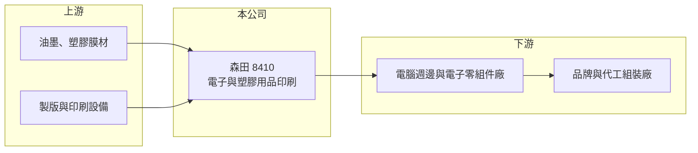

# 8410 森田

> 上櫃｜[[產業索引-電腦及週邊設備業|電腦及週邊設備業]]｜上市（櫃）日期 2011/02/23

# 第一章：企業模式與商業藍圖

> [!info] 撰寫說明
> 精簡版，由 Claude 依公開資料整理，架構比照 [[2330台積電]]，資料截至 2026-10-08。來源：櫃買中心開放資料快照（基本資料、2026 年第二季資產負債與損益）、Goodinfo 經營績效頁、nStock 公司概況頁。公開資料有限，產品細項、客戶與營收比重均未查得。#待校對

森田印刷廠（以下簡稱森田）是一家位於台南、被歸類在電腦及週邊設備業的印刷加工廠，理解它的關鍵在於：它不是出版或包裝印刷，而是在電子產品與塑膠零件上做功能性與外觀印刷，獲利高低取決於少數電子客戶的機種與訂單。

- **核心業務：** 森田成立於 1972 年，2011 年在櫃買中心掛牌，登記業務為「印刷、製版、電腦及其週邊設備及其他電子、電機及塑膠用品等印刷業務」，另有塑膠膜類買賣與進出口貿易。換句話說，公司把印刷技術用在電子產品的零件或膜材上，而不是紙本印刷。實際產品線與應用的細節，公開資料未查得，宜以公司年報校對。
- **營收結構：** 各產品與客戶的營收比重公開資料未查得。2020 至 2025 年營收維持在 10.5 億至 12.5 億元之間，規模穩定但沒有明顯成長，顯示公司服務的是成熟的電子週邊市場。毛利率在 18% 至 40% 之間大幅擺動，推估與產品組合及少數大客戶的機種輪替有關（推估）。
- **營運據點：** 公司登記地址在台南市安南區科技五路，屬台南科技工業區。其他生產據點與海外產能公開資料未查得。
- **長期方向：** 森田的長期課題是在電子週邊產品成熟、客戶持續要求降價的環境下，靠製程與品質維持高毛利。公司帳上現金與流動資產充裕，有能力投入新製程或新應用，但具體的轉型方向公開資料未查得。

# 第二章：護城河深度與競爭優勢

森田屬於利基型的小型加工廠，護城河主要來自製程經驗與客戶認證，規模不大但財務保守。

- **競爭優勢：** 電子產品的外觀與功能印刷要求精準套色、耐磨與良率，一旦通過品牌或代工客戶的認證，通常可以跟著機種長期供貨。森田在 2023 至 2024 年毛利率接近四成，說明它的製程在部分產品上有定價能力。這種優勢屬於「窄而深」，換機種時仍須重新爭取。
- **主要對手：** 同類型的電子印刷與表面加工廠在台灣、中國與東南亞都有，具體對手名單公開資料未查得。印刷加工技術門檻不算極高，因此價格競爭與客戶轉單是常態。
- **觀察重點：** 2026 年 1 至 9 月累計營收約 6.17 億元，年減約 28%，顯示訂單波動很大。長期要觀察的是營收能否回到 11 億元以上的水準、毛利率能否守在三成以上，以及公司是否找到新的應用或客戶來降低集中風險。

# 第三章：財務體質與盈利規模

資料日期：2026-10-08，表格是撰寫當時的快照；最新月營收、毛利率、累計 EPS 由自動排程寫在本筆記的屬性欄位（月營收、毛利率、累計EPS 等）。#待校對

森田的財務特徵是營收穩定、利潤率大幅擺動、資產負債表非常保守，股本小而每股淨值高。

| 年度 | 營收（億元） | [[毛利率]] | [[營業利益率]] | EPS（元） | [[ROE]] |
|---|---|---|---|---|---|
| 2020 | 12.5 | 39.3% | 19.8% | 4.55 | 11.2% |
| 2021 | 11.3 | 28.3% | 5.46% | 1.14 | 2.76% |
| 2022 | 10.5 | 18.3% | -6.77% | 0.61 | 1.50% |
| 2023 | 11.8 | 38.5% | 17.6% | 5.33 | 12.3% |
| 2024 | 11.7 | 39.7% | 18.8% | 7.54 | 15.7% |
| 2025 | 11.2 | 34.9% | 14.3% | 3.27 | 6.44% |

（來源：Goodinfo 經營績效頁；2026 年上半年營收 4.33 億元、毛利率約 32.0%、營業利益率約 4.1%、EPS 1.03 元，依櫃買中心開放資料計算。）

- **營收規模：** 2020 至 2025 年營收由 12.5 億元降到 11.2 億元，年複合成長率約 -2.2%（推算）。營收幾乎沒有成長，說明公司所處的電子週邊市場已成熟。2026 年上半年營收僅 4.33 億元，若延續，全年將明顯低於過去區間。
- **獲利：** 2021 至 2025 年平均 ROE 約 7.7%（推算），但年度之間差距極大，2022 年本業甚至虧損，2024 年 ROE 又回到 15.7%。這種擺動來自[[營業槓桿]]：營收變化不大，但毛利率一旦從四成掉到兩成，營業利益就由正轉負。2026 年上半年稅前利益約有六成來自業外收入，本業獲利偏弱。
- **財務特色：** 依 2026 年第二季資料，總資產約 23.0 億元、權益約 18.4 億元、負債僅約 4.5 億元，流動資產 14.8 億元遠高於流動負債 2.6 億元，財務非常保守。股本只有 3.66 億元，每股淨值約 50 元。現金股利 2024 年度為 3 元、2025 年度為 1.6 元，近五年平均約 1.66 元（nStock），配息跟著獲利調整。
- **[[ROIC]] 與 [[WACC]]：** 以 2025 年營業利益約 1.60 億元（11.2 億元 × 14.3%）、稅率 20% 計算，稅後營業利益約 1.28 億元。投入資本以權益 18.4 億元到總資產 23.0 億元為區間，ROIC 約 5.6% 至 7.0%（推算）；2024 年同法約 7% 至 9%（推算）。由於帳上現金多，若扣除現金，本業 ROIC 會更高。WACC 以 [[CAPM]] 推估：無風險利率 1.75%、市場風險溢酬 6%、β 假設 0.8（小型零組件股常見值），權益成本約 6.6%；幾乎沒有有息負債，WACC 約 6.3%（推算）。ROIC 在好年度略高於 WACC、壞年度低於 WACC，長期大致只賺回資金成本，大量閒置現金拉低了整體資本效率。

# 第四章：總體風險與地緣政治

森田的風險主要是客戶與產品集中、電子市場成熟，以及規模小帶來的議價力不足。

- **產業週期：** 電子週邊產品跟著筆電、消費電子的換機週期起伏，品牌客戶庫存調整時，上游加工廠的訂單會被放大縮減，這是[[長鞭效應]]的典型影響。2022 年本業虧損與 2026 年營收大幅下滑，都顯示公司對終端週期相當敏感。
- **營運風險：** 營收規模約 11 億元，推估集中在少數客戶與機種（推估），一旦主要機種結束或客戶轉單，營收與毛利率會同時受衝擊。公司資訊揭露有限，投資人難以事先判斷訂單變化。
- **其他風險：** 印刷油墨與塑膠膜材的價格會隨石化原料波動；客戶多為出口導向的電子業，匯率變動會影響報價與毛利；股本小、成交量低，市場流動性也是投資人需要考量的因素。

# 專有名詞解析

## 金融

- **[[營業槓桿]]**：固定成本占比高的公司，營收增加時利潤增幅大於營收增幅，反之亦然。
- **[[業外收入]]**：本業營運以外的收入，例如利息、投資收益、處分資產利益，持續性通常低於本業獲利。

## 產業

- **[[功能性印刷]]**：把導電、絕緣或裝飾用油墨印在電子零件、膜材或塑膠件上的加工技術，要求精準度與耐用性高於一般紙本印刷。

# 核心供應鏈

- 上游：油墨與塑膠膜材供應商，例如 [[1303南亞]] 等塑膠原料與膜材業者（是否為實際供應商未查得，#待校對）。
- 下游／客戶：電腦週邊與電子零組件廠，以及其後的品牌與代工組裝廠；具體客戶名單公開資料未查得。
- 同業：電子產品印刷與表面加工業者，公開資料未查得可對照的上市櫃同業。

## 最新新聞
<!-- news:start -->
<!-- news:end -->

## 相關連結
- [公開資訊觀測站](https://mopsov.twse.com.tw/mops/web/t05st03?step=1&firstin=1&co_id=8410)
- [Goodinfo](https://goodinfo.tw/tw/StockDetail.asp?STOCK_ID=8410)
- [Yahoo 股市](https://tw.stock.yahoo.com/quote/8410)
- [鉅亨網新聞](https://www.cnyes.com/twstock/8410/news)
