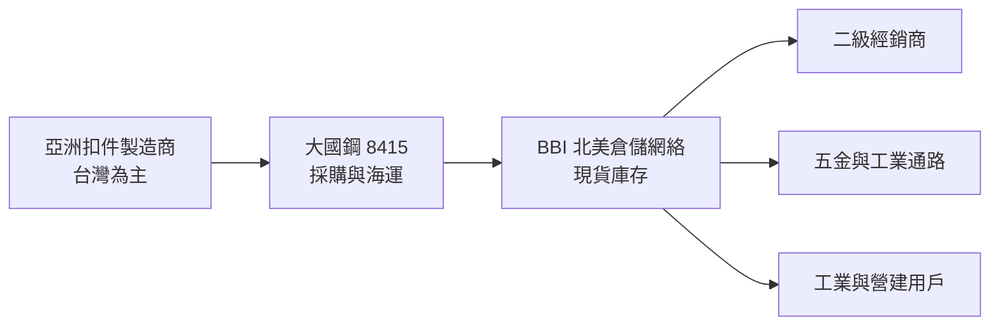
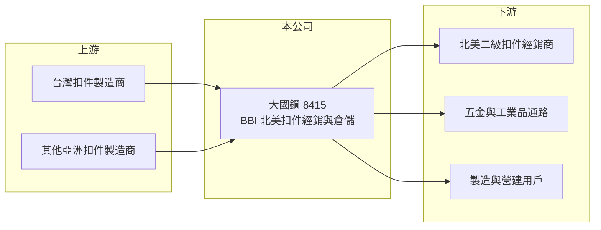

# 8415 大國鋼

> 上櫃｜[[產業索引-鋼鐵工業|鋼鐵工業]]｜上市（櫃）日期 2016/09/07

# 第一章：企業模式與商業藍圖

> [!info] 撰寫說明
> 本文由 Claude 依公開資料整理，架構比照 [[2330台積電]] 的四章研究，資料截至 2026-10-08。財務數字來源：MoneyDJ（富邦證券）年度財務比率表、Fastener World 2021 年 10 月報導（收購 Vertex Distribution）、櫃買中心開放資料（基本資料、資產負債、綜合損益、每月營收、本益比殖利率）。年營收以每股營業額乘發行股數推算；倉庫數量、地區比重與母公司持股比例未查得或憑記憶撰寫並已標註；產業描述為整理性內容。#待校對

在評估單一個股的長期投資價值時，首要步驟是拆解企業的底層獲利邏輯。本章說明大成國際鋼鐵（股票代號：8415，以下簡稱大國鋼）如何以北美扣件經銷通路，取得遠高於一般鋼鐵股的毛利率。

## 一、核心定位：北美最大的扣件經銷商

大國鋼成立於 2007 年 7 月，2016 年 9 月上櫃，2026 年實收資本額約 103.2 億元，董事長為謝麗雲，英文名稱 Brighton-Best。旗下美國子公司 Brighton-Best International（BBI）被產業媒體稱為「美洲最大的扣件經銷商」。大國鋼一般被視為 [[2027大成鋼]] 集團的成員（持股比例待校對）。#待校對

大國鋼的商業模式是[[扣件經銷]]：向亞洲（主要是台灣）的螺絲廠大量採購螺栓、螺帽、螺絲與鉚釘等標準扣件，存放在北美各地的倉庫，再以現貨方式賣給當地的二級經銷商、五金通路與工業用戶。它本身不是主要的製造商，賺的是「把貨從亞洲工廠搬到北美客戶手上、並隨時有貨」的服務價值。

## 二、為什麼通路的毛利率比工廠高

大國鋼的毛利率長年在 26% 至 38% 之間，遠高於多數扣件製造廠的 10% 至 20%。原因在於：

* **少量多樣、即時交貨：** 北美客戶需要的是數萬種規格、隨時可以出貨的現貨，單筆金額小、急迫性高，價格敏感度相對低。
* **庫存與倉儲網絡：** 維持龐大庫存與多點倉儲需要大量資金，這本身就是進入門檻。
* **採購規模：** 大量向亞洲工廠下單，取得較低的採購成本。

## 三、長期方向：併購擴張

北美扣件通路分散，大國鋼的成長方式之一是併購。2021 年 10 月，BBI 以 3,200 萬美元收購美國不鏽鋼扣件經銷商 Vertex Distribution 的全部資產，目的在擴大經濟規模、降低營運成本。長期而言，大國鋼的成長來自三個方向：持續併購區域型經銷商、擴充產品線（例如不鏽鋼與特殊扣件），以及受惠北美製造業與基礎建設投資。

# 第二章：護城河深度與競爭優勢

在長期價值投資中，「護城河」指企業抵禦競爭、維持超額利潤的保護機制。本章分析大國鋼的護城河，以及它與製造型扣件廠的本質差異。

## 一、護城河組成

* **規模與庫存廣度：** 作為美洲最大的扣件經銷商，大國鋼能提供的規格與現貨量是小型經銷商無法比擬的，形成「一次買齊」的優勢。
* **倉儲網絡：** 北美多點倉庫可以快速交貨，縮短客戶的等待時間。建立這種網絡需要多年時間與大量資金。
* **供應鏈關係：** 長期與台灣扣件廠合作，取得穩定的品質與價格，在供應短缺時（例如 2021 至 2022 年）更顯價值。

## 二、競爭對手格局

| 對手 | 定位 | 對大國鋼的影響 |
|---|---|---|
| Fastenal | 美國大型工業用品與扣件經銷商，直接服務終端 | 終端工業客戶的競爭者 |
| Würth、Bossard | 國際扣件與供應鏈管理集團 | 工業客戶的競爭者 |
| 北美區域型扣件經銷商 | 數量多、規模小 | 價格競爭，也是潛在併購對象 |
| [[5538東明-KY]] | 中國扣件製造與通路 | 通路模式相近，但市場在中國 |

## 三、守得住與守不住的地方

* **守得住：** 二級經銷商對大型主經銷商的依賴，以及規模帶來的採購優勢。2025 年毛利率 36.9%，接近 2021 至 2022 年的高峰。
* **守不住：** 景氣循環下的銷量。2020 年疫情期間營業利益率只有 10%，2024 年也降到 12.8%，代表需求下滑時費用比例上升。
* **觀察重點：** 美國關稅對進口扣件價格的影響、庫存水位，以及新的併購案。

# 第三章：財務體質與盈利規模

資料日期：2026-10-08，表格是撰寫當時的快照；最新月營收、毛利率、累計 EPS 由自動排程寫在本筆記的屬性欄位（月營收、毛利率、累計EPS 等）。#待校對

財務報表是檢驗護城河是否真實存在的最終標準。本章用多年度三率、ROE 與資本報酬，檢視大國鋼的獲利品質。

## 一、多年度獲利

| 年度 | 營收（新台幣，推算） | [[毛利率]] | [[營業利益率]] | EPS（元） | [[ROE]] |
|---|---|---|---|---|---|
| 2019 | 約 194 億 | 25.79% | 8.00% | 0.81 | 4.56% |
| 2020 | 約 153 億 | 29.69% | 10.09% | 0.92 | 5.65% |
| 2021 | 約 215 億 | 38.00% | 21.23% | 3.50 | 20.08% |
| 2022 | 約 264 億 | 37.60% | 19.58% | 4.39 | 20.09% |
| 2023 | 約 249 億 | 33.37% | 15.39% | 3.04 | 11.65% |
| 2024 | 約 231 億 | 33.14% | 12.82% | 2.22 | 8.20% |
| 2025 | 約 238 億 | 36.88% | 16.79% | 3.05 | 10.96% |
| 2026 上半年 | 140.7 億 | 39.5%（推算） | 21.9%（推算） | 2.17 | 未查得 |

註：營收以 MoneyDJ 每股營業額乘發行股數 10.315 億股推算，假設股本期間未變動；2025 年推算值與 2026 年 1 至 8 月營收年增約 23% 的基期大致相符。#待校對

* **2021 年後獲利結構改變：** 2019 至 2020 年營業利益率只有 8% 至 10%，2021 年後提升到 13% 至 21%。疫情後供應短缺讓扣件價格上漲，加上 2021 年的併購擴大規模，使獲利率跳升。
* **2026 年創新高：** 上半年毛利率約 39.5%、營業利益率約 21.9%，EPS 2.17 元，1 至 8 月營收年增約 23%，可能與美國關稅推升進口扣件價格有關（推估）。
* **其他綜合損益大：** 2026 年上半年其他綜合損益 13.3 億元，主要應為美元資產換算差額（推估），會影響每股淨值但不影響 EPS。

## 二、長期指標

* **平均 ROE：** 2021 至 2025 年平均約 14.2%（推算）。
* **營收年複合成長率：** 2019 至 2025 年約 3.5%（推算）。
* **股利：** 最近一次現金股利 1.5 元，配息率約 49%（推算）；保留盈餘約 129.5 億元。
* **財務結構：** 負債比從 2022 年的 46.5% 逐年降到 2025 年的 33.8%；2026 年第二季流動資產 236.1 億元、流動負債 121.3 億元，流動比率約 1.9 倍（推算），財務穩健。

## 三、[[ROIC]] 與 [[WACC]]：價值創造利差

**ROIC 推算：** 2025 年營業利益約 40.0 億元（約 238 億元 × 16.79%），稅後約 32.0 億元（稅率 20%）。投入資本以 2026 年第二季權益 313.4 億元加負債 171.7 億元計（以負債總額代替有息負債會高估投入資本），ROIC 約 6.6%（推算）；只以權益計算約 10.2%（推算）。美國聯邦與州稅合計實際稅率可能高於 20%（2026 年上半年有效稅率約 27.6%），以此計算 ROIC 會再低約 1 個百分點。

**WACC 推算：** 以 [[CAPM]] 推估，台灣 10 年期公債 1.75%、市場風險溢酬 6%、β 取 0.9（通路與鋼鐵業常見值，非來源數字），權益成本約 7.15%；負債成本假設 4%（美元借款利率較高），稅後約 3.2%。依帳面權益約 65%、負債約 35% 計算，WACC 約 5.8%；若有息負債較少，接近 6.5% 至 7%（推算）。

**結論：** 大國鋼在 2021 至 2022 年與 2025 年後 ROIC 高於 WACC，2019 至 2020 年則低於。它的通路模式具有真實的定價能力，但大量庫存與龐大權益使資本報酬率不會特別高；ROIC 能否長期維持在 WACC 之上，取決於毛利率能否守住 33% 以上。

# 第四章：總體風險與地緣政治

任何企業都無法脫離宏觀環境獨立存在。本章分析大國鋼必須面對的貿易、產業週期與營運風險。

## 一、貿易與地緣政治風險

* **美國關稅：** 大國鋼的商品主要從亞洲進口到美國，[[232 條款]]鋼鐵衍生品關稅與[[對等關稅]]會直接提高進貨成本。短期內若能轉嫁售價，甚至可能帶來[[庫存利益]]；但長期若關稅過高，可能壓抑需求或促使客戶轉向北美在地製造。
* **反傾銷：** 美國若對特定國家的扣件發動[[反傾銷]]調查，供應來源需要調整。

## 二、產業週期

* **北美製造與營建景氣：** 扣件需求跟著北美工業生產、設備投資與營建活動循環，2020 年疫情衝擊使營業利益率降到約 10%。
* **庫存循環：** 通路商在景氣好時大量備貨、景氣轉弱時去化，庫存水位錯判會造成跌價損失。

## 三、營運與其他風險

* **匯率：** 營收與資產主要以美元計價，新台幣升值會降低換算後的營收、獲利與淨值。
* **併購整合：** 以併購擴張的模式需要良好的整合能力，否則可能產生商譽減損。
* **集團關係：** 與大成鋼集團的關係若變化（例如持股調整），可能影響公司策略與資本配置（持股關係待校對）。

# 專有名詞解析

## 金融

- **[[庫存利益]]**：原料或產品價格上漲時，先前以低價買進的庫存被以較高售價賣出所產生的額外利潤。

## 產業

- **[[扣件經銷]]**：向製造廠大量採購螺絲螺帽等標準扣件，存放在各地倉庫並以現貨供應下游經銷商與工業用戶的通路業務。
- **[[232 條款]]**：美國以國家安全為由對進口鋼鋁等產品加徵關稅的法律依據。
- **[[對等關稅]]**：美國依各國對美貿易條件課徵的對應關稅，2025 年起實施，影響出口美國的產品價格。
- **[[反傾銷]]**：進口國對低於正常價格銷售的進口商品加徵關稅，以保護本國產業的貿易救濟措施。

# 核心供應鏈

## 1. 上游：扣件製造商
- 台灣螺絲廠：[[2012春雨]]、[[2062橋椿]]、[[2069運錩]]、[[5015華祺]]、[[5011久陽]] 等（實際供應商未查得）

## 2. 本公司與集團
- 集團相關：[[2027大成鋼]]（持股關係待校對）
- 通路同業：Fastenal、Würth、Bossard

## 3. 下游：客戶
- 北美二級扣件經銷商、五金與工業品通路
- 製造業、設備業與營建業用戶

## 最新新聞
<!-- news:start（自動產生，請勿手動編輯此範圍） -->
- 2026-10-08 📰 媒體 17:24｜營收速報 - 大國鋼(8415)9月營收27.70億元年增率高達43.67％｜[鉅亨網](https://news.cnyes.com/news/id/6625050)

完整紀錄：[[8415大國鋼 新聞]]
<!-- news:end -->

## 相關連結
- [公開資訊觀測站](https://mopsov.twse.com.tw/mops/web/t05st03?step=1&firstin=1&co_id=8415)
- [Goodinfo](https://goodinfo.tw/tw/StockDetail.asp?STOCK_ID=8415)
- [Yahoo 股市](https://tw.stock.yahoo.com/quote/8415)
- [鉅亨網新聞](https://www.cnyes.com/twstock/8415/news)
