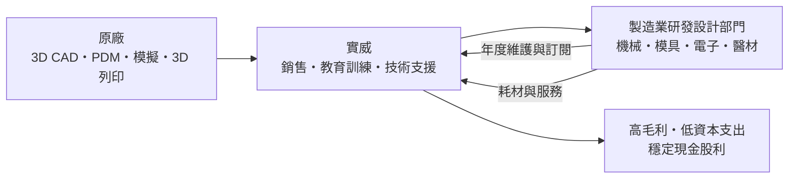
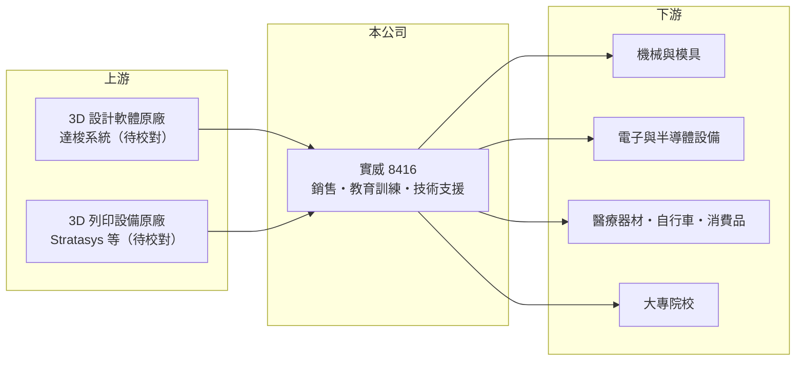

# 8416 實威

> 上櫃｜[[產業索引-資訊服務業|資訊服務業]]｜上市（櫃）日期 2012/09/19

# 第一章：企業模式與商業藍圖

> [!info] 撰寫說明
> 本文由 Claude 依公開資料整理，架構比照 [[2330台積電]] 的四章研究，資料截至 2026-10-08。財務數字來源：Goodinfo 年度經營績效頁、nStock 公司簡介、櫃買中心開放資料（基本資料、2026 年第二季資產負債與綜合損益、本益比殖利率）；代理品牌與營收比重主要憑記憶整理，未查得官方比重。公開資料有限。#待校對

實威國際（股票代號：8416，以下簡稱實威）是台灣 3D 設計軟體代理商中獲利能力最突出的一家，毛利率超過五成、營業利益率超過兩成。本章說明一家代理商如何做到接近自有軟體公司的利潤率。

## 一、核心定位：3D 設計軟體與 3D 列印的解決方案商

實威成立於 2005 年，2012 年 9 月在櫃買中心掛牌，實收資本額約 2.82 億元。依記憶，實威是法國達梭系統（Dassault Systèmes）旗下 3D 設計軟體 SOLIDWORKS 在台灣的主要經銷商，並延伸到產品資料管理、模擬分析、3DEXPERIENCE 雲端平台，以及 Stratasys 等品牌的 [[3D 列印]]設備（待校對）。

實威的客戶是機械、模具、電子、醫療器材、自行車與各類製造業的研發設計部門。工程師用 3D [[CAD]] 軟體畫出零件與組裝圖，再用模擬軟體驗證強度，最後用 3D 列印做出原型。實威把這一整段「從設計到原型」的工具與服務打包提供。

## 二、營收結構

公開資料未查得實威的營收比重。依業務性質，收入可分為三類（推估）：

* **軟體授權銷售：** 新客戶或新增授權的一次性收入。
* **年度維護與訂閱：** 既有授權的年度維護合約與訂閱續約，屬於[[經常性收入]]，是毛利率最高、最穩定的部分。台灣製造業長期使用 SOLIDWORKS 的裝機量龐大，維護續約構成獲利的基本盤。
* **3D 列印設備與耗材、教育訓練與顧問：** 設備毛利較低，但耗材與服務會持續產生收入。

## 三、資本轉化邏輯

實威的[[毛利率]]約 50% 至 55%，遠高於一般硬體代理商，原因是軟體授權與維護的毛利本來就高，而且實威在台灣的市占與規模讓它在原廠的通路體系中享有較好的條件（推估）。由於不需要工廠，資本支出極低，獲利大部分可以發放為股利。

## 四、長期方向

實威的長期成長來自三個方向：一是製造業數位化，從 3D 設計延伸到產品生命週期管理與雲端協作；二是[[積層製造]]從原型走向小量生產，帶動 3D 列印設備與耗材需求；三是新應用與新市場的延伸。2025 年營收 17.0 億元，創歷史新高，2018 至 2025 年營收每年成長，顯示需求穩定擴大。

# 第二章：護城河深度與競爭優勢

實威的護城河建立在使用者習慣、裝機量與原廠通路地位上。本章分析它的競爭位置。

## 一、護城河的組成

* **使用者習慣與人才供給：** 台灣許多大專院校與職訓體系以 SOLIDWORKS 教學，畢業生進入職場後習慣使用，企業也因為容易招到會用的工程師而持續採用。這種「教育端到職場端」的循環，是 3D CAD 市場最強的鎖定效應（待校對）。
* **檔案與流程轉換成本：** 企業累積的數萬個 3D 圖檔、零件庫與設計流程都綁在同一個軟體上，更換軟體需要大量轉檔與重新訓練。
* **在地服務規模：** 實威在台灣擁有大量應用工程師與教育訓練資源，原廠在一個地區通常只保留少數主要經銷商，實威的規模本身就是通路門檻。

## 二、主要競爭對手

| 對手 | 定位 | 與實威的比較 |
|---|---|---|
| Autodesk（Inventor、Fusion）代理商 | 3D 設計軟體 | 在中小型製造業直接競爭 |
| 西門子（NX、Solid Edge）、PTC（Creo）代理商 | 中高階 3D CAD | 在大型製造業與汽車產業競爭 |
| [[6791虎門科技]] | 模擬軟體代理 | 在模擬分析模組有重疊 |
| 其他 SOLIDWORKS 經銷商 | 同品牌經銷 | 以服務與價格競爭 |

## 三、守得住與守不住

* **守得住：** 既有裝機量的維護與訂閱續約，以及台灣製造業研發部門的長期關係。
* **守不住：** 原廠的通路政策。原廠若推動雲端直銷或調整經銷利潤，實威的利潤率可能受壓。
* **觀察重點：** 毛利率能否維持 50% 以上、訂閱制轉換的進度，以及 3D 列印與新事業的收入貢獻。

# 第三章：財務體質與盈利規模

資料日期：2026-10-08，表格是撰寫當時的快照；最新月營收、毛利率、累計 EPS 由自動排程寫在本筆記的屬性欄位（月營收、毛利率、累計EPS 等）。#待校對

實威的財報是「穩定」的代名詞：毛利率八年來維持在五成上下，營業利益率約四分之一，ROE 長期超過兩成。

## 一、多年度財務表

| 年度 | 營收（新台幣） | [[毛利率]] | [[營業利益率]] | EPS（元） | [[ROE]] |
|---|---|---|---|---|---|
| 2021 | 13.8 億 | 53.1% | 27.9% | 11.35 | 26.4% |
| 2022 | 13.9 億 | 53.6% | 26.5% | 10.85 | 23.2% |
| 2023 | 14.5 億 | 52.3% | 23.5% | 10.23 | 20.7% |
| 2024 | 15.4 億 | 49.7% | 22.4% | 11.01 | 21.1% |
| 2025 | 17.0 億 | 52.0% | 25.8% | 13.46 | 23.9% |
| 2026 上半年 | 8.44 億 | 54.2% | 27.4% | 6.58 | 未查得 |

資料來源：Goodinfo；2026 上半年為櫃買中心開放資料。

* **穩定而溫和的成長：** 2020 至 2025 年營收年複合成長率約 5.7%（推算），2018 年以來每年成長。
* **利潤率極穩定：** 毛利率在 49.7% 至 54.5% 之間，營業利益率在 22% 至 28% 之間，代表定價與費用結構多年未變，是軟體代理商中少見的穩定。
* **高配息：** 2025 年度配發現金股利 8.5 元，以 EPS 13.46 元計算配息率約 63%（推算）；nStock 資料顯示近五年平均現金股利約 8.1 元。

## 二、ROE 與長期指標

2021 至 2025 年平均 ROE 約 23.1%（推算）。2026 年第二季底權益約 16.2 億元，其中保留盈餘約 11.9 億元，負債約 6.0 億元且幾乎都是流動負債（推估以合約負債與應付原廠款為主）。實威沒有財務槓桿，高 ROE 完全來自本業的高利潤率。自由現金流推估長期為正。

## 三、[[ROIC]] 與 [[WACC]]

**ROIC 推算：** 2025 年營業利益 4.37 億元，扣除 20% 稅率後約 3.50 億元。權益約 16.22 億元，有息負債推估接近零，投入資本約 16.2 億元，ROIC 約 21.6%（推算）。權益中有相當比例是累積現金，若扣除超額現金，營運資本報酬率會更高。

**WACC 推算：** 台灣 10 年期公債殖利率假設 1.75%、市場風險溢酬 6%、β 取資訊服務業常見值 0.8（同業估計值），股東權益成本約 6.55%。公司無有息負債，WACC 約 6.5%（推算）。

**結論：** 實威的 ROIC 是 WACC 的三倍以上，屬於長期顯著創造價值的公司。這個利差的來源是使用者鎖定與在地服務規模，最大的威脅則是原廠通路政策的改變。

# 第四章：總體風險與地緣政治

實威的風險集中在原廠依賴與製造業景氣。本章整理長期風險。

## 一、產業週期

* **製造業研發預算：** 新授權採購隨製造業景氣起伏，景氣下滑時新購延後；但維護續約收入穩定，能大幅緩衝衝擊，2018 年以來營收從未衰退即是證明。
* **訂閱制轉換：** 原廠推動從永久授權轉向訂閱制，短期可能讓一次性收入減少，長期則提高經常性收入比重。

## 二、營運風險

* **原廠集中：** 營收高度依賴單一原廠產品線（待校對），原廠調整經銷制度、改走直銷或雲端訂閱直售，會直接影響實威。
* **人才：** 應用工程師與講師是服務品質的核心，人才流失會削弱競爭力。
* **新事業執行：** 延伸到 3D 列印與其他新領域，需要不同的技術與客戶，成效有不確定性。

## 三、其他風險

* **匯率：** 授權成本以外幣計價，新台幣貶值會提高成本。
* **產業外移：** 台灣製造業研發若持續外移，在地的設計軟體需求可能成長放緩。
* **AI 設計工具：** 生成式 AI 設計工具可能改變 3D CAD 的使用方式與競爭格局，原廠能否跟上，連帶影響實威。

# 專有名詞解析

## 應用

- **[[CAD]]**：電腦輔助設計，用電腦繪製 2D 或 3D 工程圖與零件模型的軟體，是製造業研發的基本工具。
- **[[3D 列印]]**：依 3D 模型逐層堆疊材料製作實體的技術，常用於原型、治具與小量生產。
- **[[積層製造]]**：3D 列印的正式名稱，強調以逐層堆疊方式製造零件，從原型走向工業量產。

## 金融

- **[[毛利率]]**：營業毛利占營收的比例，反映產品定價能力與生產成本控制。
- **[[營業利益率]]**：扣除營業費用後的營業利益占營收的比例，衡量本業整體獲利能力。
- **[[ROE]]**：股東權益報酬率，稅後淨利除以股東權益，衡量公司運用股東資金的效率。
- **[[ROIC]]**：投入資本報酬率，稅後營業利益除以股東權益與有息負債的合計，衡量本業對所有資金提供者的報酬。
- **[[WACC]]**：加權平均資金成本，依股東權益與負債的比重加權計算的資金成本，ROIC 高於它才代表創造價值。

## 產業

- **[[經常性收入]]**：每年按合約重複收取的收入，例如軟體維護費、訂閱費，可預測性高於一次性銷售。
- **[[軟體代理商]]**：取得原廠授權，在特定地區銷售軟體並提供導入、教育訓練與技術支援的公司。

# 核心供應鏈

## 1. 上游：軟體與設備原廠
- 3D 設計、PDM 與模擬軟體：達梭系統 SOLIDWORKS、3DEXPERIENCE（待校對）
- 3D 列印設備：Stratasys 等（待校對）

## 2. 中游：實威與同業
- 模擬軟體代理：[[6791虎門科技]]
- 其他 3D CAD 代理商：Autodesk、西門子、PTC 的台灣經銷商

## 3. 下游：客戶
- 機械、模具、電子、半導體設備、醫療器材、自行車與消費品製造商的研發部門
- 大專院校與職業訓練機構

## 最新新聞
<!-- news:start -->
<!-- news:end -->

## 相關連結
- [公開資訊觀測站](https://mopsov.twse.com.tw/mops/web/t05st03?step=1&firstin=1&co_id=8416)
- [Goodinfo](https://goodinfo.tw/tw/StockDetail.asp?STOCK_ID=8416)
- [Yahoo 股市](https://tw.stock.yahoo.com/quote/8416)
- [鉅亨網新聞](https://www.cnyes.com/twstock/8416/news)
