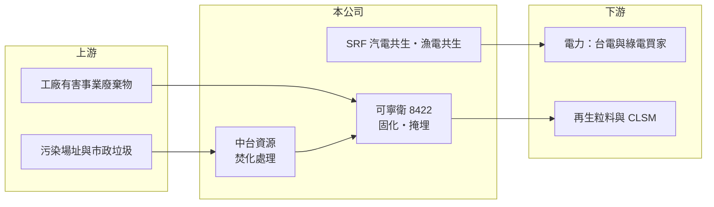

# 8422 可寧衛

> 上市｜[[產業索引-綠能環保|綠能環保]]｜上市（櫃）日期 2011/10/05

# 第一章：企業模式與商業藍圖

> [!info] 撰寫說明
> 精簡版，由 Claude 依公開資料整理，架構比照 [[2330台積電]]，資料截至 2026-10-08。來源：Goodinfo 台灣股市資訊網年度經營績效（2020 至 2025 年）；富果研究 2025 年 3 月法說會摘要；證交所開放資料快照（基本資料、2026 年上半年資產負債與損益、2025 年度股利）。業務別營收比重未查得。#待校對

可寧衛成立於 1999 年 5 月、2011 年 10 月上市，總部在高雄岡山，董事長楊慶祥、總經理楊永發。公司是台灣有害[[事業廢棄物]]最終處置的龍頭，核心資產是少數取得許可的[[掩埋場]]，並透過子公司延伸到焚化、資源再利用與綠能。可寧衛股票面額為每股 1 元，與一般 10 元面額不同，比較每股數字時要特別注意。

- **核心業務：** 可寧衛提供有害事業廢棄物從開挖清運、固化到掩埋的一站式服務，也承接污染場址整治、廢照明與電子廢棄物處理。依法說會資料，公司是台灣唯一同時具備焚化發電、化學處理與固化處理的綜合處理業者。掩埋是廢棄物處理鏈的最後一關，無法被其他工法完全取代，因此具有剛性需求。
- **營收結構：** 2024 年合併營收約 51.7 億元，各業務比重這次未查得。子公司中台資源是大型廢棄物焚化處理廠，每月焚化量能約 3,780 公噸，並規劃二期擴建，是掩埋以外的主要收入來源。
- **營運據點：** 主要設施位於南台灣，目前兩座掩埋場的剩餘年限仍在 10 年以上；高雄馬頭山新掩埋場仍在溝通，取得難度高。子公司包括中台資源、可寧衛能源、大創綠能與大創電力，另與威立雅（Veolia）合資成立可威環境。
- **長期方向：** 公司從終端掩埋延伸到[[循環經濟]]與再生能源：[[SRF]] 汽電共生廠規劃日處理 350 公噸、目標 2025 年商轉；再生粒料與 CLSM 廠 2024 年起商轉；[[漁電共生]]第一期 69MW 於 2024 年 4 月併聯，第二期約 70MW 開發中。這些投資讓收入來源從單一掩埋轉向多元。

# 第二章：護城河深度與競爭優勢

可寧衛的護城河是掩埋場許可本身，這是台灣環保業最難複製的資產。

- **競爭優勢：** 有害廢棄物掩埋場需經嚴格環評，選址幾乎必遭地方反對，新場址動輒十年以上仍難落地，馬頭山案即為例子。供給稀缺讓既有業者擁有很強的定價能力，2020 至 2021 年毛利率高達 63% 至 70%。中台資源的焚化產能也具類似的許可門檻。
- **主要對手：** 有害廢棄物處理同業包括 [[8341日友]]，大型焚化與環境服務有 [[6803崑鼎]]，水泥窯協同處理則有 [[1101台泥]] 等。各業者處理的廢棄物種類與區域不同，直接競爭有限。
- **觀察重點：** 掩埋場容量是會被用完的資源，長期價值取決於新場址能否取得，以及 SRF、焚化、漁電共生等新事業能否接棒。2022 年營收大增但毛利率由 63.5% 降到 42.1%，反映營收組合轉向毛利較低的焚化與處理業務。

# 第三章：財務體質與盈利規模

資料日期：2026-10-08，表格是撰寫當時的快照；最新月營收、毛利率、累計 EPS 由自動排程寫在本筆記的屬性欄位（月營收、毛利率、累計EPS 等）。#待校對

可寧衛營收由 2020 年的 26.8 億元成長到近 50 億元，營業利益率長期維持在 28% 以上，ROE 穩定在 15% 至 21%。

| 年度 | 營收（億元） | [[毛利率]] | [[營業利益率]] | EPS（元） | [[ROE]] |
|---|---|---|---|---|---|
| 2021 | 30.2 | 63.5% | 47.8% | 10.59 | 19.5% |
| 2022 | 52.4 | 42.1% | 31.8% | 12.33 | 21.1% |
| 2023 | 42.7 | 42.4% | 29.6% | 9.12 | 14.6% |
| 2024 | 51.7 | 39.2% | 27.8% | 10.70 | 16.6% |
| 2025 | 47.8 | 53.1% | 40.6% | 1.29 | 16.9% |

註：Goodinfo 合併報表。2025 年 EPS 以面額 1 元計，與前幾年 10 元面額不可直接比較；以 2025 年淨利 14.6 億元與約 13.6 億股換算約 1.07 元，與 1.29 元不一致，待校對。2020 年營收 26.8 億元、毛利率 70.2%，EPS 與 ROE 未查得。2026 年上半年營收 33.82 億元、毛利率 37.16%、EPS 0.55 元（證交所資料）。

- **長期指標：** 2020 至 2025 年營收年複合成長率約 12.3%（推算），2021 至 2025 年平均 ROE 約 17.7%（推算）。2025 年度每股配發盈餘現金 1 元加資本公積 0.2 元（面額 1 元），現金股利總額約 16.3 億元，高於當年淨利 14.6 億元，屬高配發政策。
- **[[ROIC]] 與 [[WACC]]：** 2025 年營業利益約 19.4 億元（47.8 億元 × 40.6%），稅後約 15.5 億元；投入資本約 191 億元（2026 年第二季權益總計 117.37 億元，加上以非流動負債 73.94 億元推估的有息負債，其中可能含掩埋場封閉復育準備等非有息項目），ROIC 約 8.1%（推算，可能偏低）。WACC 約 4.4%（推算：無風險利率 1.75%、市場風險溢酬 6%、β 取環境服務業常見值 0.7，股東權益成本 5.95%；稅前負債成本 2.5%、稅率 20%，負債占資本約 39%）。ROIC 高於 WACC，長期創造價值；但綠能與新廠投資擴大資本基礎，利差比早年縮小。
- **財務特色：** 2026 年第二季總資產 265 億元、負債比率約 56%，比早年明顯提高，反映漁電共生、SRF 廠等資本支出與借款增加。法說會提到曾發行可轉換公司債償還借款，未來有股本稀釋。

# 第四章：總體風險與地緣政治

可寧衛的長期風險是掩埋容量遞減與新事業的執行，而不是需求不足。

- **產業週期：** 有害事業廢棄物量與製造業景氣相關，但處理需求具法規強制性，週期波動小於一般工業。污染整治等專案型收入則有年度差異。
- **營運風險：** 掩埋場容量用完而新場址未取得時，核心業務會萎縮；SRF 汽電共生與漁電共生等新事業規模大，若延誤或發電效益不如預期，會拉低資本報酬。非控制權益在 2026 年上半年為虧損，顯示部分子公司仍在投資期。
- **其他風險：** 環保法規、處理費率與地方政治影響很大；掩埋場長期監測與封閉後的責任是隱性負債。漁電共生受躉購費率與綠電市場價格影響。

# 專有名詞解析

## 金融

- **[[ROIC]]**：投入資本報酬率，稅後營業利益除以股東權益加有息負債，衡量本業運用資本的效率。

## 產業

- **[[事業廢棄物]]**：工廠、醫院等事業機構產生的廢棄物，依法須委託合格業者清除處理，分為一般與有害兩類。
- **[[掩埋場]]**：最終處置廢棄物的場所，有害廢棄物需固化後進入有防滲與監測設施的封閉型掩埋場。
- **[[循環經濟]]**：把廢棄物重新回收成原料投入生產，減少資源消耗與廢棄物的經濟模式。
- **[[SRF]]**：固體再生燃料，把可燃廢棄物破碎、篩選、乾燥後製成的燃料，可供鍋爐或汽電共生使用。
- **[[漁電共生]]**：在魚塭上方或周邊設置太陽能板，同時養殖與發電，是台灣增加太陽光電土地的政策方向。

# 核心供應鏈

- 上游（廢棄物來源）：半導體、石化、鋼鐵等產業的有害事業廢棄物，以及污染場址整治與市政垃圾。
- 下游／客戶：漁電共生與 SRF 發電的電力買方；再生粒料與 CLSM 的營建客戶。
- 同業：[[8341日友]]、[[6803崑鼎]]、[[1101台泥]]。合資夥伴：威立雅（Veolia）。

## 最新新聞
<!-- news:start（自動產生，請勿手動編輯此範圍） -->
- 2026-10-06 🏛️ 重訊 16:23｜公告可寧衛*股份有限公司國內第一次無擔保轉換公司債(簡稱：可寧衛一，代碼：84221)發行公司行使債券贖回權暨訂於115年11月27日終止櫃檯買賣等相關事宜。｜[觀測站](https://mops.twse.com.tw/mops/#/web/t05st01)
- 2026-10-06 🏛️ 重訊 16:23｜公告可寧衛*股份有限公司國內第二次無擔保轉換公司債(簡稱：可寧衛二，代碼：84222)發行公司行使債券贖回權暨訂於115年11月27日終止櫃檯買賣等相關事宜。｜[觀測站](https://mops.twse.com.tw/mops/#/web/t05st01)

完整紀錄：[[8422可寧衛 新聞]]
<!-- news:end -->

## 相關連結
- [公開資訊觀測站](https://mopsov.twse.com.tw/mops/web/t05st03?step=1&firstin=1&co_id=8422)
- [Goodinfo](https://goodinfo.tw/tw/StockDetail.asp?STOCK_ID=8422)
- [Yahoo 股市](https://tw.stock.yahoo.com/quote/8422)
- [鉅亨網新聞](https://www.cnyes.com/twstock/8422/news)
