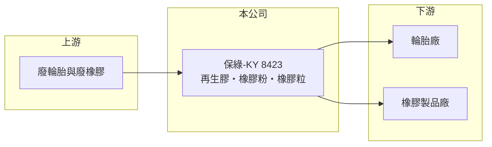

# 8423 保綠-KY

> 上櫃｜[[產業索引-綠能環保|綠能環保]]｜上市（櫃）日期 2012/03/14

# 第一章：企業模式與商業藍圖

> [!info] 撰寫說明
> 精簡版，由 Claude 依公開資料整理，架構比照 [[2330台積電]]，資料截至 2026-10-08。來源：Goodinfo 台灣股市資訊網年度經營績效（2020 至 2025 年）；nStock 公司概況；櫃買中心開放資料快照（基本資料、2026 年上半年資產負債與損益、股利）。公開資料有限，營收比重、客戶與廠區細節未查得，營運地點與原料來源憑記憶整理，已標「待校對」。#待校對

保綠資源（保綠-KY）2009 年 11 月在開曼群島設立、2012 年 3 月上櫃，董事長陳東興、總經理李雲山，實收資本額 4.2 億元。公司是開曼控股的海外企業，聯絡電話為馬來西亞區碼，實際營運據點在馬來西亞（待校對），主要製造與銷售[[再生橡膠]]、橡膠粉與橡膠粒。

- **核心業務：** 保綠把廢輪胎等廢橡膠（原料來源待校對）經破碎、研磨與脫硫處理，製成再生膠、橡膠粉與橡膠粒，再賣給輪胎與橡膠製品廠作為部分原料。再生橡膠價格低於天然膠與合成膠，能幫客戶降低成本，也符合品牌商使用回收材料的永續要求。
- **營收結構：** 產品別與地區別比重這次未查得。2025 年營收 3.77 億元，2026 年 1 至 9 月營收 3.19 億元、年增約 13%（nStock）。產品以外銷為主（推估）。
- **營運據點：** 開曼控股公司，營運子公司與工廠在馬來西亞（待校對）。馬來西亞是全球天然橡膠與橡膠製品的重要產地，手套、輪胎與工業橡膠廠群聚，有利於原料取得與就近銷售。
- **長期方向：** 全球輪胎與汽車品牌提高回收材料使用比例，加上各國對廢輪胎處理的規範趨嚴，讓再生橡膠從「便宜替代品」逐漸變成[[循環經濟]]的必要材料。保綠的長期成長取決於擴充產能與打入大型輪胎廠供應鏈。

# 第二章：護城河深度與競爭優勢

保綠的競爭力在於低成本產地與長年的再生膠製程經驗，但產品同質性高，護城河有限。

- **競爭優勢：** 在馬來西亞生產可以取得較低的人力與原料成本，貼近東南亞橡膠產業聚落。毛利率長期維持在 26% 至 29%，在橡膠加工業中屬於穩定水準，顯示公司在原料取得與製程上有一定效率。
- **主要對手：** 再生橡膠同業以中國、印度與東南亞的中小型廠商為主（名單未查得），中國再生膠產能龐大，是價格的主要決定者。
- **觀察重點：** 營收 6 年間只由 2.83 億元增加到 3.77 億元，規模成長慢；2024 年配發股票股利後股本擴大，EPS 由 1 元左右降到 0.6 至 0.7 元。長期要看品牌商的回收材料需求能否帶動量價提升。

# 第三章：財務體質與盈利規模

資料日期：2026-10-08，表格是撰寫當時的快照；最新月營收、毛利率、累計 EPS 由自動排程寫在本筆記的屬性欄位（月營收、毛利率、累計EPS 等）。#待校對

保綠營收小而穩定，毛利率長期在 26% 至 29%，但 ROE 只有 5% 至 8%，資本效率偏低。

| 年度 | 營收（億元） | [[毛利率]] | [[營業利益率]] | EPS（元） | [[ROE]] |
|---|---|---|---|---|---|
| 2021 | 2.69 | 26.4% | 8.61% | 0.75 | 5.29% |
| 2022 | 3.21 | 28.5% | 9.24% | 1.18 | 8.29% |
| 2023 | 3.25 | 25.7% | 8.33% | 0.95 | 6.67% |
| 2024 | 3.70 | 26.6% | 9.91% | 0.62 | 4.77% |
| 2025 | 3.77 | 27.6% | 12.1% | 0.73 | 4.98% |

註：Goodinfo 合併報表；2020 年營收 2.83 億元、EPS 0.92 元、ROE 6.21%。2026 年上半年營收 2.13 億元、毛利率約 29.6%、EPS 0.61 元（櫃買中心資料）。

- **長期指標：** 2020 至 2025 年營收年複合成長率約 5.9%（推算），2021 至 2025 年平均 ROE 約 6.0%（推算）。2025 年度現金股利 0.7 元，配息率約 96%（0.7 ÷ 0.73）；2024 年度配發現金 0.6 元加股票 0.3 元（nStock），近 5 年平均現金股利約 0.5 元。
- **[[ROIC]] 與 [[WACC]]：** 2025 年營業利益約 0.46 億元（3.77 億元 × 12.1%），稅後約 0.37 億元；投入資本約 8.4 億元（2026 年第二季股東權益 6.18 億元，加上以非流動負債 2.18 億元推估的有息負債），ROIC 約 4.4%（推算）。WACC 約 5.4%（推算：無風險利率 1.75%、市場風險溢酬 6%、β 取橡膠製品業常見值 0.8，股東權益成本 6.55%；稅前負債成本 2.5%、稅率 20%，負債占資本約 26%）；若改用馬來西亞較高的無風險利率（約 3.5% 至 4%），WACC 會再高 1 至 2 個百分點。ROIC 略低於 WACC，長期尚未明確創造價值，2026 年上半年獲利改善後利差有望縮小。
- **財務特色：** 2026 年第二季負債比率約 36%（負債 3.47 億元 ÷ 資產 9.65 億元），以非流動負債為主。高配息加上低 ROE，代表公司缺乏高報酬的再投資機會。

# 第四章：總體風險與地緣政治

保綠的風險來自原物料價格、匯率與海外營運。

- **產業週期：** 再生橡膠的售價與天然膠、合成膠價格連動，橡膠價格下跌時再生膠的價格優勢縮小；輪胎與汽車產業景氣也影響需求。
- **營運風險：** 公司規模小，單一產線停工或大客戶流失對營收影響大；廢輪胎處理涉及粉塵、異味與廢水，環保要求提高會增加成本。
- **其他風險：** 營運在馬來西亞、財報以新台幣表達，令吉與美元匯率變動影響獲利；KY 公司的資訊揭露與公司治理需要投資人額外留意；中國再生膠產能的價格競爭。

# 專有名詞解析

## 金融

- **[[ROIC]]**：投入資本報酬率，稅後營業利益除以股東權益加有息負債，衡量本業運用資本的效率。
- **[[WACC]]**：加權平均資金成本，股東與債權人要求報酬率的加權平均，是 ROIC 要超越的門檻。

## 產業

- **[[再生橡膠]]**：把廢輪胎等廢橡膠經粉碎與脫硫處理後重新製成的橡膠原料，成本低於天然膠與合成膠。
- **[[循環經濟]]**：把廢棄物重新回收成原料投入生產，減少資源消耗與廢棄物的經濟模式。

# 核心供應鏈

- 上游：廢輪胎與廢橡膠回收商（來源待校對）。
- 下游／客戶：輪胎廠與橡膠製品廠（名單未查得；台灣輪胎廠如 [[2105正新]]、[[2106建大]] 是否為客戶未查證）。
- 同業：中國、印度與東南亞再生橡膠廠（名單未查得）；台灣橡膠原料業者 [[2103台橡]]。

## 最新新聞
<!-- news:start -->
<!-- news:end -->

## 相關連結
- [公開資訊觀測站](https://mopsov.twse.com.tw/mops/web/t05st03?step=1&firstin=1&co_id=8423)
- [Goodinfo](https://goodinfo.tw/tw/StockDetail.asp?STOCK_ID=8423)
- [Yahoo 股市](https://tw.stock.yahoo.com/quote/8423)
- [鉅亨網新聞](https://www.cnyes.com/twstock/8423/news)
