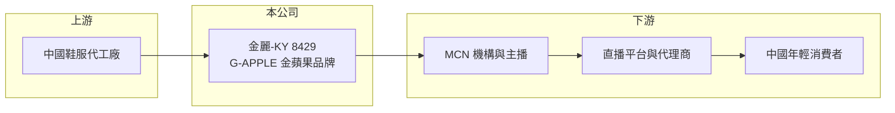

# 8429 金麗-KY

> 上市｜[[產業索引-貿易百貨業|貿易百貨業]]｜上市（櫃）日期 2012/12/20

# 第一章：企業模式與商業藍圖

> [!info] 撰寫說明
> 精簡版，由 Claude 依公開資料整理，架構比照 [[2330台積電]] 的四章研究，資料截至 2026-10-08。財務數字來源：MoneyDJ 年度財務比率頁、富果研究 2025 年 12 月法說會整理、證交所開放資料（基本資料、2026 年第二季資產負債與綜合損益、營益分析、股利、本益比、每月營收）。歷年營收為依淨利率與成長率回推。#待校對

金麗-KY（股票代號：8429）是在台上市的中國休閒鞋服品牌公司。它最特別的地方是「營收很小、帳上資產很大」：年營收只有一億多元，權益卻超過 66 億元，股價淨值比僅約 0.16 倍，是理解 KY 股折價問題的典型案例。

## 一、核心定位：G-APPLE 金蘋果品牌

- **公司基本面：** 金麗-KY 註冊於開曼群島，2010 年成立、2012 年在台上市，實收資本額約 18.6 億元，董事長為庄春龍。作為 [[KY股]]，營運都在中國。
- **品牌與產品：** 核心品牌為 G-APPLE（金蘋果），主打時尚休閒鞋與牛仔服飾，目標客群為 18 至 35 歲年輕族群，零售價約人民幣 150 至 500 元，產品系列包括蒼龍、紅龍、白龍、PINGGUO 與 Jin Ping Guo。
- **從代工轉向品牌：** 2023 年代工（[[OEM]]）占營收約 68%，到 2025 年前三季自有品牌占比已達 100%。台灣子公司領先國際生物科技（美妝）則因市場因素暫時退出營運。

## 二、輕資產與直播電商

- **生產全面外包：** 公司不再經營自有工廠，生產全部委外代工，資源集中在設計研發與品牌管理。這讓固定成本大幅下降，但也代表公司的價值要靠品牌與通路經營來支撐。
- **以[[直播電商]]為主要通路：** 銷售鏈為「品牌商（金麗）→ MCN 機構與主播 → 直播平台 → 快遞送到消費者」，取代傳統專賣店與專櫃。直播電商的好處是不用負擔門市成本，缺點是要分潤給主播與平台，毛利率只有約 17%。
- **規模變化：** 依 MoneyDJ 成長率回推，2018 年營收約 40 億元、2019 年約 20.8 億元，2020 年驟降到約 3.8 億元，2025 年約 1.48 億元（推算）。公司已從一家中型鞋服製造商，縮小為以品牌授權與電商為主的小型公司。

## 三、長期方向

公司的策略包括優化 G-APPLE 的設計與包裝、尋找有經驗的設計研發團隊、探索其他具潛力的消費性產品，並在維持 17% 毛利率的前提下擴大營收。但以目前一億多元的營收規模，與帳上數十億元資產相比，本業的貢獻微乎其微；股東更關心的是帳上資產如何運用或回饋。

# 第二章：護城河深度與競爭優勢

金麗的品牌在中國休閒鞋服市場屬於小眾，護城河很窄。

## 一、競爭條件

- **品牌歷史：** G-APPLE 經營多年，在部分年輕客群中有一定的辨識度（待校對）。
- **輕資產彈性：** 生產外包與直播通路讓公司可以低成本試錯，快速調整產品。
- **財務實力：** 帳上流動資產約 65 億元、負債比約 10%（證交所開放資料），財務風險低，但這筆資產並未轉化為營運優勢。

## 二、主要競爭對手

| 對手 | 定位 | 對金麗的威脅 |
|---|---|---|
| 安踏、李寧、特步等中國運動休閒品牌 | 全國性品牌 | 品牌力與通路規模遠大於金麗 |
| 直播電商白牌鞋服 | 低價商品 | 以低價搶奪相同的直播流量 |
| 國際快時尚與休閒品牌 | 平價服飾 | 品牌與設計優勢明顯 |

## 三、守得住與守不住

- **守得住：** 既有的直播合作關係與小眾品牌客群。
- **守不住：** 直播流量與價格，主播與平台的分潤條件掌握在對方手上。
- **觀察重點：** 營收能否明顯擴大、毛利率能否維持 17%，以及公司是否運用帳上資產回饋股東或投入新事業。

# 第三章：財務體質與盈利規模

資料日期：2026-10-08，表格是撰寫當時的快照；最新月營收、毛利率、累計 EPS 由自動排程寫在本筆記的屬性欄位（月營收、毛利率、累計EPS 等）。#待校對

金麗的財務數字顯示，本業規模很小且多數年度虧損，獲利主要靠帳上資產產生的業外收益。

## 一、多年度財務表

| 年度 | 營收（新台幣） | [[毛利率]] | [[營業利益率]] | EPS（元） | [[ROE]] |
|---|---|---|---|---|---|
| 2019 | 約 20.8 億（推算） | 18.22% | -4.28% | -0.29 | -0.76% |
| 2020 | 約 3.8 億（推算） | -29.36% | -161.79% | -2.70 | -7.59% |
| 2021 | 約 4.3 億（推算） | 8.17% | -3.54% | 0.12 | 0.35% |
| 2022 | 約 2.1 億（推算） | -23.69% | -113.22% | -1.08 | -3.18% |
| 2023 | 約 2.1 億（推算） | 4.01% | -20.07% | -0.08 | -0.23% |
| 2024 | 約 1.3 億（推算） | 16.96% | -21.39% | -0.02 | -0.05% |
| 2025 | 約 1.48 億（推算） | 16.97% | -8.11% | 0.12 | 0.34% |
| 2026 上半年 | 0.66 億 | 14.58% | -22.92% | 0.03 | 未查得 |

註：2019 至 2025 年比率取自 MoneyDJ；營收以 2025 年稅後淨利約 0.216 億元（證交所股利資料）除以淨利率 14.55% 得到約 1.48 億元，再依各年營收成長率回推，皆為推算。2026 上半年取自證交所開放資料。富果研究的法說會摘要稱 2025 年前三季營業淨利為正，與 MoneyDJ 全年營業利益率 -8.11% 不一致，以年報為準。

- **營收趨勢：** 2019 至 2025 年營收年複合成長率約 -36%（推算）。
- **業外撐起獲利：** 2026 年上半年營業損失約 0.15 億元，業外收入約 0.21 億元，稅後仍小幅獲利。業外收入推估主要來自帳上資金的利息收入（未逐項查證）。
- **毛利率曾為負：** 2020 與 2022 年毛利率為負，推估與存貨跌價及代工業務收縮有關。

## 二、ROE 與帳上資產

2021 至 2025 年平均 ROE 約 -0.6%（推算），幾乎沒有報酬。2026 年第二季底總資產約 74.0 億元，其中流動資產約 65.3 億元，負債僅約 7.1 億元，權益約 66.9 億元，每股淨值約 36 元，股價淨值比約 0.16 倍（證交所開放資料）。帳上可分配盈餘約 29.1 億元，但 2025 年度未配發股利。龐大的資產幾乎沒有產生營業報酬，ROE 被這筆閒置資金大幅稀釋，這也是股價深度折價的主因：市場不確定這些資產能否真正回到股東手上。

## 三、[[ROIC]] 與 [[WACC]]

**ROIC 推算：** 2025 年營業損失約 0.12 億元（1.48 億元 × -8.11%，推算），虧損年度不計稅盾。投入資本以權益約 66.9 億元為主，有息負債推估很少，ROIC 約 -0.2%（推算）。若扣除帳上流動資產只計營運資產，本業 ROIC 的負值會大得多。

**WACC 推算：** 公債殖利率 1.75%、市場風險溢酬 6%、β 取中國消費類 KY 股常見值 1.0，再加計約 3% 的公司治理風險溢酬，股東權益成本約 10.75%；幾乎沒有負債，WACC 約 10.7%（推算）。

**結論：** 金麗的 ROIC 長期為零或負值，與資金成本差距很大，代表帳上資本長期沒有創造價值。對股東而言，最大的價值來源不是本業，而是公司是否以配息、減資或買回股票的方式釋出帳上資產。

# 第四章：總體風險與地緣政治

金麗的風險不在財務槓桿，而在本業萎縮與 KY 公司治理。

## 一、產業結構

- **中國鞋服市場競爭：** 中國休閒鞋服市場品牌眾多，大型運動休閒品牌與直播白牌夾擊，小品牌生存空間有限。
- **中國消費景氣：** 消費信心疲弱時，年輕客群偏好低價商品，品牌溢價難以維持。2026 年公司說明代理商提貨策略轉趨保守，累計營收較去年同期減少（證交所每月營收備註）。

## 二、營運風險

- **直播通路依賴：** 銷售高度依賴主播與平台，分潤條件、平台規則或主播合作關係變動，都會直接影響營收。
- **本業規模過小：** 營收一億多元，難以支撐品牌投資與設計團隊擴張。
- **資產閒置：** 大量資金未投入營運也未發還股東，資本效率極低。

## 三、其他風險

- **KY 公司治理：** 帳上資產位於海外，台灣投資人對資產真實性與動用情況的查核能力有限，這是股價淨值比僅約 0.16 倍的核心原因。
- **資金匯出與法規：** 中國的外匯管制與盈餘匯出規定，會影響公司把資金匯回並發放股利的能力。
- **匯率：** 資產與營收以人民幣計價，人民幣兌新台幣的匯率變動會影響帳面淨值。

# 專有名詞解析

## 金融

- **[[KY股]]**：在開曼群島等地註冊、在台灣上市櫃的外國公司股票，主要營運多在海外。
- **[[ROIC]]**：投入資本報酬率，稅後營業利益除以股東權益與有息負債的合計，衡量本業對所有資金提供者的報酬。
- **[[WACC]]**：加權平均資金成本，依股東權益與負債的比重加權計算的資金成本，ROIC 高於它才代表創造價值。

## 產業

- **[[OEM]]**：代工生產，依客戶的設計與規格製造產品，以客戶品牌出貨。
- **[[直播電商]]**：透過網路直播即時展示並銷售商品的電商模式，在中國已成為主要銷售通路之一。

# 核心供應鏈

## 1. 上游：生產外包
- 中國鞋服代工廠（全面委外生產）

## 2. 本公司
- 金麗-KY：G-APPLE 品牌設計、研發與品牌管理

## 3. 下游與同業
- MCN 機構、主播、直播平台與代理商，終端為中國 18 至 35 歲年輕消費者
- 同業：安踏、李寧、特步、[[2929淘帝-KY]]

## 最新新聞
<!-- news:start -->
<!-- news:end -->

## 相關連結
- [公開資訊觀測站](https://mopsov.twse.com.tw/mops/web/t05st03?step=1&firstin=1&co_id=8429)
- [Goodinfo](https://goodinfo.tw/tw/StockDetail.asp?STOCK_ID=8429)
- [Yahoo 股市](https://tw.stock.yahoo.com/quote/8429)
- [鉅亨網新聞](https://www.cnyes.com/twstock/8429/news)
