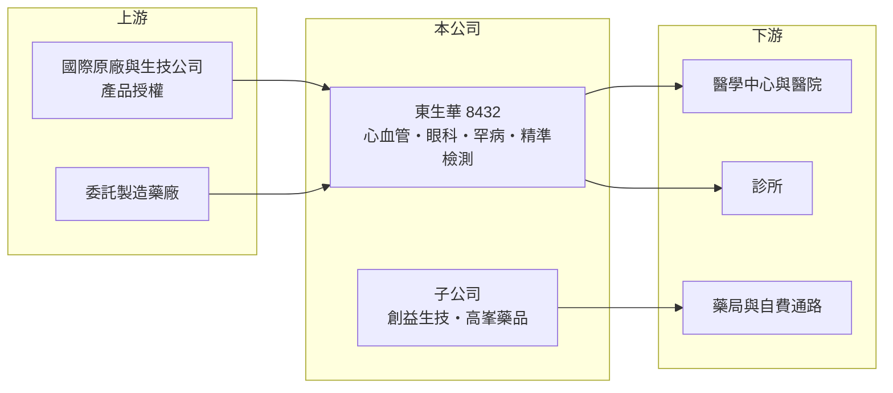

# 8432 東生華

> 上櫃｜[[產業索引-生技醫療業|生技醫療業]]｜上市（櫃）日期 2012/04/30

# 第一章：企業模式與商業藍圖

> [!info] 撰寫說明
> 精簡版，由 Claude 依公開資料整理，架構比照 [[2330台積電]]，資料截至 2026-10-08。來源：MoneyDJ 理財網財務比率年表（2021 至 2025 年）；富果研究 2026 年第一季法說會摘要；櫃買中心開放資料快照（基本資料、2026 年上半年資產負債與損益、本益比殖利率）。產品線營收比重未查得，與東洋的關係憑記憶撰寫，已標「待校對」。#待校對

東生華製藥成立於 2010 年 9 月、2012 年 4 月在櫃買中心掛牌，董事長為林全。它不靠自己從頭研發新藥，而是向國際藥廠與生技公司取得產品授權，在台灣與亞洲負責註冊、上市與行銷，是一家以「產品組合管理」為核心能力的藥品公司。

- **核心業務：** 東生華的業務分為三大領域：心血管三高與眼科等[[關鍵與生活品質用藥]]、罕見疾病用藥，以及協助醫師選藥的精準檢測。公司以[[授權引進]]（Licensing-in）為主要擴充產品線的方式，取得已在國外完成開發或上市的產品，再負責台灣的法規送審與醫院推廣，因此研發風險遠低於自行開發新藥的公司。
- **營收結構：** 依富果整理的法說內容，降血脂等心血管產品是近年主要成長動能，各產品線比重這次未查得。子公司創益生技經營自費醫療市場，產品包括流感疫苗、戒菸貼片與「醫敏家」[[保健食品]]；子公司高峯藥品則聚焦高齡保健食品。自費與保健產品不受[[健保藥價]]調降直接影響，可以平衡健保用藥的價格壓力。
- **營運據點：** 營運以台灣醫院、診所與藥局通路為主，公司透過子公司整合這三種通路。東生華與 [[4105東洋]] 同屬一個集團體系，在通路與產品上有合作關係（持股與合作細節待校對）。海外營收比重未查得，公司參加 BIO International Convention 與 BIO-Europe 等國際會議，尋找可引進亞洲的產品。
- **長期方向：** 公司的長期目標是成為國際創新生技公司在亞洲開發與行銷的合作夥伴。依 2026 年第一季法說內容，乾眼症鼻噴劑已於 2024 年上市，罕病產品 E20 預計 2026 年上市、G25 目標 2028 年，老花眼用藥目標 2027 年取得許可，另規劃未來數年陸續推出約 15 項新產品。持續有新產品接棒，是授權引進模式能長期成長的前提。

# 第二章：護城河深度與競爭優勢

東生華的護城河在於醫院通路的長期經營、法規送審能力與挑選產品的眼光，這些能力讓國外原廠願意把產品交給它在台灣代為推廣。

- **競爭優勢：** 國外中小型生技公司通常沒有能力在台灣自建業務團隊，需要熟悉健保核價、醫院進藥委員會與醫師教育的在地夥伴。東生華長期深耕心血管與眼科醫師社群，授權方一旦合作順利，後續產品也較可能交給同一家公司，形成正向循環。
- **主要對手：** 同樣以授權引進或代理國際藥品為主的 [[4120友華]]、[[4114健喬]]，以及具自有產品與國際授權能力的 [[1795美時]]，都在爭取同一批國際授權來源；國際原廠在台分公司也會直接銷售自家藥品。授權合約有期限，原廠收回自營或改授權給他人，是這類公司共同的競爭壓力。
- **觀察重點：** 2021 至 2025 年[[營業利益率]]由約 8% 提升到 16%，ROE 由 4% 上升到 11%，顯示產品組合擴大後規模經濟開始發揮。長期要觀察新產品能否依時程上市、罕病與精準檢測能否成為新的利潤來源，以及主要授權合約的續約情形。

# 第三章：財務體質與盈利規模

資料日期：2026-10-08，表格是撰寫當時的快照；最新月營收、毛利率、累計 EPS 由自動排程寫在本筆記的屬性欄位（月營收、毛利率、累計EPS 等）。#待校對

東生華過去 5 年營收約成長 3 倍，獲利能力同步改善，加上幾乎沒有負債，是財務體質相當健康的藥品行銷公司。

| 年度 | 營收（億元） | [[毛利率]] | [[營業利益率]] | EPS（元） | [[ROE]] |
|---|---|---|---|---|---|
| 2021 | 約 4.1（推算） | 59.82% | 13.45% | 1.23 | 4.26% |
| 2022 | 約 7.4（推算） | 52.61% | 8.91% | 1.61 | 5.76% |
| 2023 | 約 8.1（推算） | 49.31% | 7.85% | 1.61 | 5.24% |
| 2024 | 約 11.2（推算） | 52.23% | 15.22% | 2.95 | 9.29% |
| 2025 | 約 13.4（推算） | 50.93% | 16.34% | 3.63 | 11.24% |

註：營收以 MoneyDJ 每股營業額乘以約 3,840 萬股推算，與各年營收成長率相符。2021 至 2022 年為個別財報，2023 年起為合併財報，2022 年營收大增部分來自報表基礎改變與子公司納入（推估）。

- **長期指標：** 2023 至 2025 年合併營收年複合成長率約 28%（推算）；近 5 年平均 ROE 約 7.2%（推算），且逐年走高。2025 年度每股現金股利 2.61 元（櫃買中心資料），約為當年 EPS 3.63 元的 72%，配息政策穩定。每股現金流量 2021 至 2025 年皆為正值，自由現金流長期為正。
- **研發與產品線：** 授權引進模式的研發支出主要是臨床試驗銜接、法規送審與授權金，研發費用率這次未查得。2026 年上半年營業費用 2.14 億元、占營收約 35%，以業務推廣與行銷費用為主（推估），這是藥品行銷公司的主要成本結構。
- **[[ROIC]] 與 [[WACC]]：** 2025 年稅後營業利益約 1.75 億元（營業利益率 16.34% × 營收約 13.4 億元 × 0.8），投入資本約 16.8 億元（2026 年第二季權益總計 16.77 億元，有息負債趨近於零），ROIC 約 10.4%（推算）；若扣除帳上大量現金，本業實際運用資本的報酬更高。WACC 約 6%（推算：無風險利率 1.75%、市場風險溢酬 6%、β 取製藥同業常見值 0.7，股東權益成本約 5.95%；幾乎無負債）。ROIC 高於 WACC 約 4 個百分點，代表公司正在替股東創造價值，且利差在 2024 年後明顯擴大。
- **財務特色：** 2026 年第二季負債比率約 17%（負債 3.49 億元 ÷ 資產 20.26 億元），流動資產 14.88 億元占總資產七成以上，資產輕、現金多。權益中有 2.62 億元屬非控制權益，代表部分子公司並非全資持有，合併營收中有一部分利潤歸屬其他股東。

# 第四章：總體風險與地緣政治

東生華的風險主要來自健保政策、授權合約的穩定性，以及新產品上市時程。

- **產業週期：** 藥品需求受景氣影響小，心血管慢性病用藥隨人口高齡化長期成長，這是東生華的結構性順風。但健保總額控管與定期藥價調查，會讓已上市產品的價格逐年下降，公司必須靠新產品與自費市場補上缺口。
- **營運風險：** 營收集中在少數主力產品時，任一產品授權到期、原廠收回或出現[[學名藥]]競爭，都會明顯影響營收與毛利。罕病與新藥的上市時程取決於主管機關審查，延後上市會推遲成長。
- **其他風險：** 授權產品多以外幣計價採購，匯率變動影響成本；保健食品市場進入門檻低、廣告法規嚴格，品牌競爭激烈。藥品品質或供貨中斷（原廠生產問題）也可能造成缺貨與商譽損失。

# 專有名詞解析

## 金融

- **[[ROIC]]**：投入資本報酬率，稅後營業利益除以股東權益加有息負債，衡量本業運用資本的效率。

## 產業

- **[[授權引進]]**：向國外藥廠或生技公司取得產品在特定地區的開發與銷售權利，以較低研發風險擴充產品線。
- **[[關鍵與生活品質用藥]]**：東生華對其心血管三高、眼科等慢性病與生活品質相關藥品的業務分類。
- **[[保健食品]]**：以補充營養或維持健康為訴求的食品，不屬藥品，進入門檻低、品牌競爭激烈。
- **[[健保藥價]]**：全民健保給付藥品的價格，由主管機關核定並定期調整，直接影響國內藥廠的營收與毛利。
- **[[學名藥]]**：原廠藥專利到期後，其他藥廠依相同成分與劑型生產的藥品，價格通常較低。

# 核心供應鏈

- 上游：國際原廠與生技公司（授權來源，名單未查得）；集團關係企業 [[4105東洋]]（合作細節待校對）。
- 下游／客戶：醫學中心、區域醫院、診所，以及子公司經營的藥局與自費醫療通路。
- 同業：[[4120友華]]、[[4114健喬]]、[[1795美時]]；國際原廠在台分公司。

## 最新新聞
<!-- news:start -->
<!-- news:end -->

## 相關連結
- [公開資訊觀測站](https://mopsov.twse.com.tw/mops/web/t05st03?step=1&firstin=1&co_id=8432)
- [Goodinfo](https://goodinfo.tw/tw/StockDetail.asp?STOCK_ID=8432)
- [Yahoo 股市](https://tw.stock.yahoo.com/quote/8432)
- [鉅亨網新聞](https://www.cnyes.com/twstock/8432/news)
