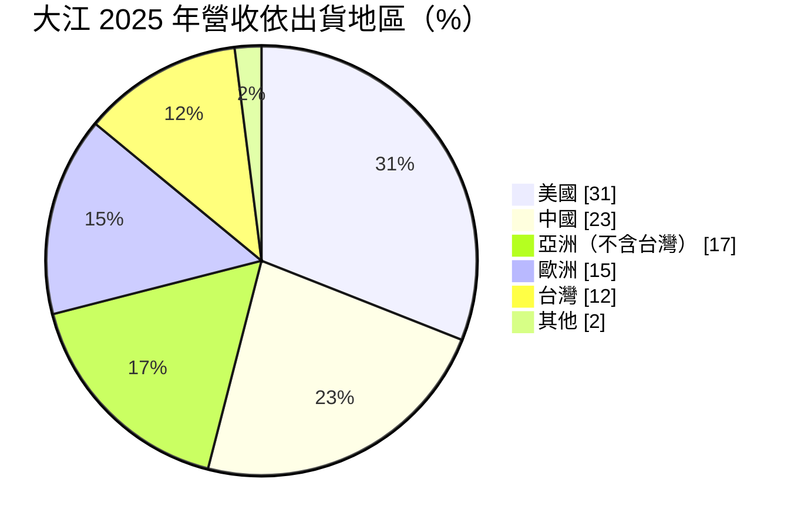
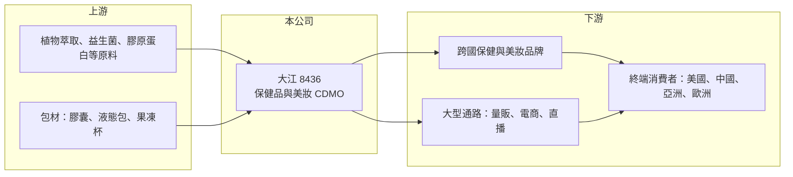

# 8436 大江

> 上櫃｜[[產業索引-生技醫療業|生技醫療業]]｜上市（櫃）日期 2013/09/12

# 第一章：企業模式與商業藍圖

> [!info] 撰寫說明
> 本文由 Claude 依公開資料整理，架構比照 [[2330台積電]] 的四章研究，資料截至 2026-10-08。財務數字來源：MoneyDJ 理財網年度財務比率、富果研究 2026 年 3 月法說會整理、櫃買中心開放資料（基本資料、2026 年第二季資產負債與綜合損益、本益比）；產業描述為整理性內容，尚未逐條比對原始文件。#待校對

本章拆解大江生醫（股票代號：8436，以下簡稱大江）的商業模式，說明一家替品牌商研發與代工保健品的公司，如何靠研發速度與配方資料庫賺取高於一般代工廠的毛利。

- **核心業務：** 大江是保健食品與美妝品的 [[CDMO]]（委託開發暨製造服務）廠商，客戶是全球的品牌商與通路商，大江負責從原料研究、配方設計、法規文件到量產的整套流程。和單純接單生產的 [[OEM]] 不同，大江賣的是「把一個健康趨勢變成可上架商品」的能力，因此長期[[毛利率]]維持在 40% 以上，遠高於一般食品代工。
- **營收結構：** 依富果整理的 2025 年法說會，營收依出貨地區為美國 31%、中國 23%、亞洲（不含台灣）17%、歐洲 15%、台灣 12%、其他 2%，產品銷往 68 個國家。美國比重從 2024 年的 26% 提高到 31%，顯示公司正把重心從過去倚重的中國市場移往歐美。
- **營運據點：** 公司 2025 年 12 月在美國猶他州購入廠房，並評估西班牙巴塞隆納設廠（最快 2027 年），目的是縮短對歐美客戶的交期 4 至 8 週。液態包等產能也規劃在台灣、中國、美國擴充。這代表大江從「台灣生產、全球出口」走向「靠近客戶就地生產」，以因應關稅與通路商分散供貨的要求。
- **長期方向：** 公司鎖定 PDRN 口服化、GLP-1 減重藥物的伴隨保健品、長壽經濟、功能性果凍劑型等趨勢，並以新品每年占營收 20% 為目標。保健品的流行週期短，新品比重高代表大江必須持續推出新配方，研發能力是它的生命線。

# 第二章：護城河深度與競爭優勢

本章說明大江的競爭優勢從何而來，以及在保健品代工這個進入門檻不算高的產業中，哪些優勢守得住。

- **競爭優勢：** 大江的護城河主要來自研發速度與配方、臨床資料的累積。品牌商要推一款新品時，最在意的是能否快速拿到有實驗數據支持的配方，並通過各國法規，大江多年累積的原料與功效資料庫能縮短這段時間。其次是規模與多國產能，大型跨國通路要求分散式供貨，有多地工廠的代工廠比較容易拿到長期訂單。
- **主要對手：** 台灣同業包括 [[3205佰研]]、[[1707葡萄王]]（兼做自有品牌與代工）、1295生合等；國際上則有美國、日本與中國的大型保健品代工廠。大江的定位是研發導向的高毛利代工，與以價格取勝的中小型代工廠區隔。
- **轉換成本有限：** 保健品配方並不像藥品有嚴格的專利與審批保護，品牌商若要換代工廠，技術上可行。因此大江的優勢需要靠持續推出新品與服務品質維持，而不是一次性鎖定。
- **觀察重點：** 美國比重持續提高、歐美設廠能否如期運作、新品營收能否穩定維持兩成，是判斷護城河是否加深的三個指標。中國直播電商通路受法規影響，訂單能見度低，也是需要追蹤的變數。

# 第三章：財務體質與盈利規模

資料日期：2026-10-08，表格是撰寫當時的快照；最新月營收、毛利率、累計 EPS 由自動排程寫在本筆記的屬性欄位（月營收、毛利率、累計EPS 等）。#待校對

財務報表是檢驗護城河的最終標準。本章用多年度的三率、ROE 與資本報酬，檢視大江在保健品景氣循環中的獲利品質。

| 年度 | 營收（新台幣） | [[毛利率]] | [[營業利益率]] | EPS（元） | [[ROE]] |
|---|---|---|---|---|---|
| 2020 | 約 82.2 億（推算） | 43.65% | 24.54% | 15.69 | 25.04% |
| 2021 | 約 85.8 億（推算） | 43.41% | 20.16% | 13.17 | 18.78% |
| 2022 | 約 74.3 億（推算） | 42.19% | 13.81% | 6.06 | 8.33% |
| 2023 | 約 80.2 億（推算） | 40.13% | 13.16% | 7.73 | 9.94% |
| 2024 | 約 72.4 億（推算） | 43.89% | 14.19% | 7.60 | 10.06% |
| 2025 | 69.89 億 | 44.09% | 16.55% | 8.68 | 11.89% |
| 2026 上半年 | 33.54 億 | 46.4%（推算） | 18.1%（推算） | 4.13 | 未查得 |

註：2025 年營收取自法說會整理，2020 至 2024 年營收依 MoneyDJ 營收成長率回推；2026 上半年取自櫃買中心開放資料。

- **毛利率穩定、營益率波動：** 毛利率六年都在 40% 至 46% 之間，說明大江的定價能力相當穩定；但營業利益率從 2020 年的 24.5% 掉到 2022 至 2023 年的 13% 左右，主因是營收下滑而研發與管銷費用相對固定，形成[[營業槓桿]]的反向作用。2025 年起營益率回升，代表營收結構調整後費用效率改善。
- **長期指標：** 2021 至 2025 年平均 ROE 約 11.8%（推算），2020 至 2025 年營收年複合成長率約 -3.2%（推算），反映 2020 至 2021 年疫情帶動保健需求的高基期，以及之後中國市場轉弱。公司 2025 年底現金約 54.7 億元、負債比低於 40%，財務結構保守。
- **股利：** 富果整理稱 2025 年度發放 10 元現金股利，櫃買中心本益比資料顯示每股股利約 6.01 元，兩者差異原因未查得，待校對。

**[[ROIC]] 與 [[WACC]]：** 2025 年營業利益約 11.57 億元（69.89 億 × 16.55%），扣除 20% 稅率後約 9.25 億元。2026 年第二季底權益總計約 89.8 億元、總負債約 52.1 億元，假設其中約三成為有息負債（約 15.6 億元，推估），投入資本約 105.4 億元，ROIC 約 8.8%（推算）。若扣除帳上約 54.7 億元現金，實際營運資本的報酬率可達 18% 左右（推算）。WACC 方面，假設台灣 10 年期公債 1.75%、市場風險溢酬 6%、β 取保健品同業常見值 0.8，股東權益成本約 6.55%；負債成本 2.5%、稅後 2.0%，以權益 85%、負債 15% 加權，WACC 約 5.9%（推算）。ROIC 高於 WACC 約 3 個百分點，扣除閒置現金後差距更大，代表大江的本業長期仍在創造價值，只是疫情高峰後的利差明顯縮小。

# 第四章：總體風險與地緣政治

本章分析大江長期必須面對的產業、營運與法規風險。

- **產業週期：** 保健品需求受消費景氣與健康話題驅動，疫情期間需求暴增後，2022 年起出現庫存調整。新趨勢（例如 GLP-1 伴隨保健品）可能帶來一波成長，但流行退燒時營收也會快速下滑，這種「話題週期」是大江營收波動的主因。
- **客戶與市場集中：** 中國市場曾是重要成長來源，但直播電商的法規與通路變化讓訂單能見度下降；美國比重提高後，則要面對美國關稅與當地監管（如 FDA 對膳食補充劑的規範）。海外設廠可以降低關稅風險，但也帶來管理成本與初期虧損的可能。
- **法規與信譽風險：** 保健食品的功效宣稱在各國都受到嚴格限制，一旦客戶產品出現品質或宣稱爭議，代工廠的商譽也會受影響。原料溯源與食品安全事件是這個產業最難預測的尾端風險。
- **其他風險：** 外銷比重高，新台幣升值會壓縮毛利；原料（如膠原蛋白、益生菌、植物萃取）價格與供應也會影響成本。

# 專有名詞解析

## 金融

- **[[營業槓桿]]**：固定費用占比高時，營收小幅變動會造成營業利益大幅變動的現象。
- **[[ROIC]]**：投入資本報酬率，稅後營業利益除以股東權益與有息負債的合計，衡量本業對所有資金提供者的報酬。
- **[[WACC]]**：加權平均資金成本，依股東權益與負債的比重加權計算的資金成本，ROIC 高於它才代表創造價值。

## 產業

- **[[CDMO]]**：委託開發暨製造服務，代工廠除了生產，也替客戶開發配方、處理法規與試驗，附加價值高於單純代工。
- **[[OEM]]**：原廠委託製造，代工廠依客戶提供的規格與配方生產，不負責產品設計。
- **[[GLP-1]]**：一種腸道荷爾蒙，相關藥物可抑制食慾與控制血糖，被廣泛用於減重，帶動周邊營養補充品需求。

# 核心供應鏈

- 上游：植物萃取、益生菌、膠原蛋白等原料供應商，以及膠囊、液態包等包材廠。
- 下游／客戶：跨國保健與美妝品牌、大型量販與電商通路（法說會提及 Costco 等通路要求分散式供貨）。
- 同業：[[3205佰研]]、[[1707葡萄王]]、1295生合。

## 最新新聞
<!-- news:start -->
<!-- news:end -->

## 相關連結
- [公開資訊觀測站](https://mopsov.twse.com.tw/mops/web/t05st03?step=1&firstin=1&co_id=8436)
- [Goodinfo](https://goodinfo.tw/tw/StockDetail.asp?STOCK_ID=8436)
- [Yahoo 股市](https://tw.stock.yahoo.com/quote/8436)
- [鉅亨網新聞](https://www.cnyes.com/twstock/8436/news)
