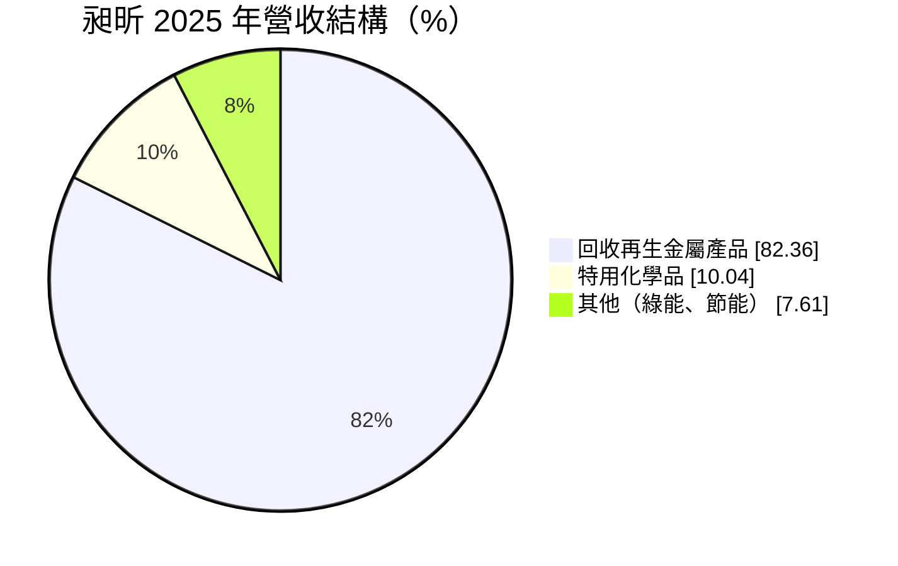
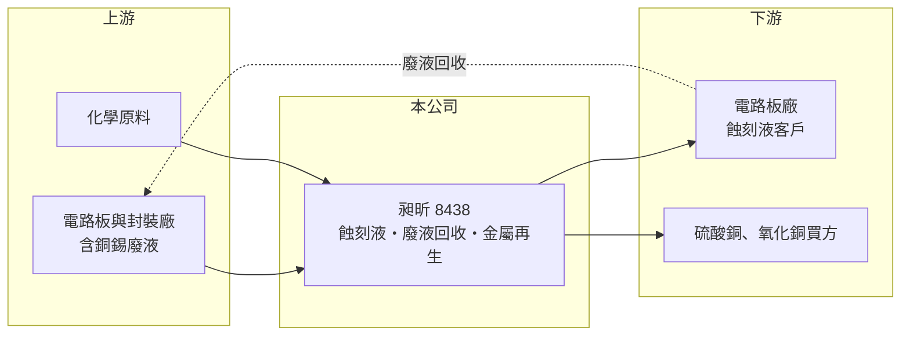

# 8438 昶昕

> 上市｜[[產業索引-綠能環保|綠能環保]]｜上市（櫃）日期 2022/03/11

# 第一章：企業模式與商業藍圖

> [!info] 撰寫說明
> 精簡版，由 Claude 依公開資料整理，架構比照 [[2330台積電]]，資料截至 2026-10-08。來源：Goodinfo 台灣股市資訊網年度經營績效（2020 至 2025 年）；富果研究 2026 年 5 月法說會摘要；證交所開放資料快照（基本資料、2026 年上半年資產負債、損益與營益分析、2025 年度股利）。個別客戶名稱未查得。#待校對

昶昕實業成立於 1989 年 10 月、2022 年 3 月上市，總部與廠區在桃園大園，董事長陳國金、總經理陳彥亨，實收資本額 7.0 億元。昶昕的商業模式是一個封閉的[[循環經濟]]迴圈：把[[蝕刻液]]賣給電路板廠，再把用過的含銅、錫廢液收回，提煉成硫酸銅、氧化銅等金屬化合物出售。

- **核心業務：** [[PCB]]、封裝與半導體廠在製作線路時，需要用蝕刻液把多餘的銅溶掉，產生大量含銅廢液。昶昕供應蝕刻液並回收廢液，利用自有技術提煉金屬製成硫酸銅、氧化銅與錫化合物等工業原料，非金屬部分也再製成化學品。客戶端同時是原料來源與產品買方，綁定程度高。
- **營收結構：** 2025 年回收再生金屬產品占 82.36%、特用化學品占 10.04%、其他（綠能、節能等）占 7.61%；2026 年第一季金屬再生占比升到 85.45%，主因銅價與匯率推升金額。
- **營運據點：** 集團包含特用化學品廠、再利用廠、處理廠、貿易公司、倉儲物流與甲級廢棄物清除機構，台灣市占率高。越南新廠已進入試機，短期貢獻小，並評估在當地設物流倉，跟隨電路板供應鏈移往東南亞。
- **長期方向：** 公司計畫由「製造導向」轉為「製造與服務平台」，資本支出重點放在物流倉儲。AI 伺服器帶動高階多層板需求，研發方向包括玻璃基板蝕刻與超細線路蝕刻，另規劃太陽能與儲能設施降低碳排。

# 第二章：護城河深度與競爭優勢

昶昕的護城河是「供應加回收」的雙向綁定與廢棄物處理許可，讓客戶很難只換掉其中一段。

- **競爭優勢：** 電路板廠若改用其他蝕刻液供應商，廢液回收也要重新安排，切換成本高。廢液清除與再利用需要甲級清除機構與再利用許可，新進者不易取得。廢液回收量隨電路板產量增加，等於把客戶成長直接轉為原料來源。
- **主要對手：** 國內含銅廢液回收與蝕刻液業者有多家中小型同業（名單未查得）；廣義金屬回收同業包括 [[8390金益鼎]]、[[9955佳龍]]。
- **觀察重點：** 毛利率長期在 10% 至 14%，營業利益率 3% 至 6%，屬於量大利薄的模式，獲利對銅價很敏感。2026 年上半年營業利益率升到 8.09%，要觀察是銅價帶來的短期利差，還是高階板材帶動的結構改善。

# 第三章：財務體質與盈利規模

資料日期：2026-10-08，表格是撰寫當時的快照；最新月營收、毛利率、累計 EPS 由自動排程寫在本筆記的屬性欄位（月營收、毛利率、累計EPS 等）。#待校對

昶昕營收在 30 至 42 億元之間隨銅價起伏，2021 年與 2026 年上半年是獲利高點，其餘年份 ROE 在 5% 至 9%。

| 年度 | 營收（億元） | [[毛利率]] | [[營業利益率]] | EPS（元） | [[ROE]] |
|---|---|---|---|---|---|
| 2021 | 42.0 | 13.2% | 5.92% | 3.56 | 17.2% |
| 2022 | 37.2 | 9.71% | 2.59% | 1.46 | 6.50% |
| 2023 | 30.6 | 12.6% | 3.92% | 1.28 | 5.23% |
| 2024 | 34.1 | 14.0% | 5.80% | 2.21 | 8.73% |
| 2025 | 38.4 | 12.9% | 6.02% | 2.10 | 7.83% |

註：Goodinfo 合併報表；2020 年營收 28.7 億元、EPS 1.12 元、ROE 5.95%。2026 年上半年營收 24.92 億元、毛利率 14.32%、營業利益率 8.09%、EPS 2.16 元，已超過 2025 年全年（證交所資料）。

- **長期指標：** 2020 至 2025 年營收年複合成長率約 6.0%（推算），2021 至 2025 年平均 ROE 約 9.1%（推算）。2025 年度現金股利 1.3 元，配息率約 62%（1.3 ÷ 2.10）。
- **[[ROIC]] 與 [[WACC]]：** 2025 年營業利益約 2.3 億元（38.4 億元 × 6.02%），稅後約 1.85 億元；投入資本約 25 億元（2026 年第二季股東權益 19.99 億元，非流動負債 1.97 億元，另以流動負債 11.31 億元中約 3 億元推估短期借款），ROIC 約 7.4%（推算）；以 2026 年上半年營業利益年化計算約 13%（推算）。WACC 約 6.1%（推算：無風險利率 1.75%、市場風險溢酬 6%、β 取化學與回收業常見值 0.9，股東權益成本 7.15%；稅前負債成本 2.5%、稅率 20%，負債占資本約 20%）。2025 年 ROIC 只略高於 WACC，2026 年銅價上漲時利差擴大，長期價值創造力取決於銅價與高階產品比重。
- **財務特色：** 2026 年第二季負債比率約 40%（負債 13.28 億元 ÷ 資產 33.27 億元），以流動負債為主，與金屬料存貨和應收帳款的周轉有關。

# 第四章：總體風險與地緣政治

昶昕的風險集中在銅價與電路板景氣，兩者都具明顯週期性。

- **產業週期：** 回收金屬產品占八成以上，營收與毛利隨國際銅價波動；電路板產量決定廢液回收量，消費電子景氣下滑時原料來源同步減少，2022 至 2023 年營收與獲利下滑即為例子。
- **營運風險：** 電路板產能移往東南亞，若越南廠進度不如預期，可能流失部分客戶的廢液來源。廢液處理涉及有害物質，工安或污染事件會影響許可。
- **其他風險：** 銅價以美元計價，新台幣匯率影響營收；環保法規變動會改變處理成本與再利用產品的認定。

# 專有名詞解析

## 金融

- **[[ROIC]]**：投入資本報酬率，稅後營業利益除以股東權益加有息負債，衡量本業運用資本的效率。
- **[[WACC]]**：加權平均資金成本，股東與債權人要求報酬率的加權平均，是 ROIC 要超越的門檻。

## 產業

- **[[蝕刻液]]**：電路板製程中用來溶除多餘銅箔、形成線路的化學溶液，使用後成為含銅廢液。
- **[[循環經濟]]**：把廢棄物重新回收成原料投入生產，減少資源消耗與廢棄物的經濟模式。
- **[[PCB]]**：印刷電路板，承載並連接電子零件的基板，是所有電子產品的基礎零組件。

# 核心供應鏈

- 上游（廢液來源）：電路板、封裝與半導體廠，可能包括 [[3037欣興]]、[[8046南電]]、[[2368金像電]]、[[4958臻鼎-KY]] 等台灣主要板廠（實際客戶未查得，待校對）。
- 下游／客戶：電路板廠（蝕刻液）、電鍍與化工業者（硫酸銅、氧化銅）。
- 同業：[[8390金益鼎]]、[[9955佳龍]]。

## 最新新聞
<!-- news:start -->
<!-- news:end -->

## 相關連結
- [公開資訊觀測站](https://mopsov.twse.com.tw/mops/web/t05st03?step=1&firstin=1&co_id=8438)
- [Goodinfo](https://goodinfo.tw/tw/StockDetail.asp?STOCK_ID=8438)
- [Yahoo 股市](https://tw.stock.yahoo.com/quote/8438)
- [鉅亨網新聞](https://www.cnyes.com/twstock/8438/news)
