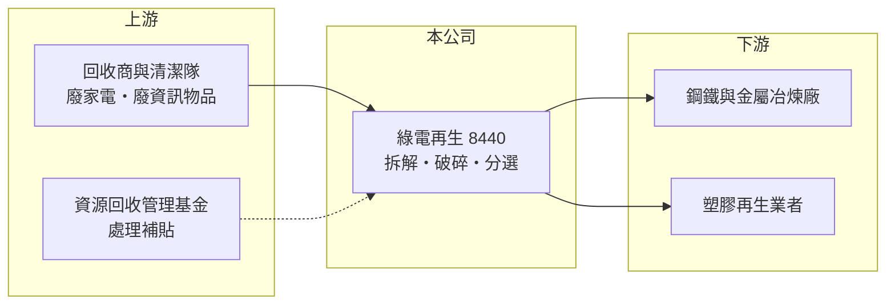

# 8440 綠電

> 上櫃｜[[產業索引-綠能環保|綠能環保]]｜上市（櫃）日期 2018/03/28

# 第一章：企業模式與商業藍圖

> [!info] 撰寫說明
> 精簡版，由 Claude 依公開資料整理，架構比照 [[2330台積電]]，資料截至 2026-10-08。來源：Goodinfo 台灣股市資訊網年度經營績效（2020 至 2025 年）；nStock 公司概況；櫃買中心開放資料快照（基本資料、2026 年上半年資產負債與損益、股利）。公開資料有限，營收比重、處理量與電廠布局未查得，回收品項與收入模式憑記憶整理，已標「待校對」。#待校對

綠電再生成立於 1998 年 8 月、2018 年 3 月上櫃，廠區在桃園楊梅，董事長陳正林、總經理陳建潤，實收資本額 5.0 億元。公司經營[[公告應回收物]]的回收處理與廢棄物清除，主要處理廢家電與廢資訊物品，是台灣大型的廢電子電器回收廠之一。

- **核心業務：** 綠電再生把回收的廢電視、冰箱、洗衣機、冷暖氣機與電腦等（品項待校對）拆解、破碎與分選，分出鐵、銅、鋁、塑膠等再生料出售。收入一般來自兩部分：處理後依規定向[[資源回收管理基金]]申請的處理補貼，以及再生料銷售收入（收入結構待校對）。
- **營收結構：** 營收比重這次未查得。年營收約 9 億元，2020 年以來在 7 億至 10 億元之間，規模穩定；獲利則隨金屬與塑膠再生料價格變化。
- **營運據點：** 廠區位於桃園楊梅，地近北部人口與家電汰換量最大的區域，有利於回收物取得（其他廠區未查得）。
- **長期方向：** 家電與資訊產品的汰換量長期穩定，加上電器中的銅、鋁與稀有金屬價值上升，回收處理的需求不會消失。公司長期價值取決於提高金屬回收純度、擴大處理量，以及補貼費率的變化。

# 第二章：護城河深度與競爭優勢

綠電再生的競爭力來自處理許可與規模，但收入高度受政策費率影響，護城河有限。

- **競爭優勢：** 廢電子電器處理廠需取得環保主管機關認證與處理許可，設廠與環評門檻高，市場由少數業者分食。北部區位與既有回收通路，讓公司能穩定取得處理量。
- **主要對手：** 國內廢家電與資訊物品回收處理廠有多家（名單未查得），廣義的金屬回收同業有 [[9955佳龍]]、[[8390金益鼎]] 等。
- **觀察重點：** 毛利率由 2022 年的 13.8% 降到 2024 年的 7.26%，2025 年回升到 8.59%，營業利益率只有 2% 至 3%，顯示成本上升或補貼與再生料價格未同步調整。長期要看獲利率能否回到 2021 至 2023 年的水準。

# 第三章：財務體質與盈利規模

資料日期：2026-10-08，表格是撰寫當時的快照；最新月營收、毛利率、累計 EPS 由自動排程寫在本筆記的屬性欄位（月營收、毛利率、累計EPS 等）。#待校對

綠電再生營收穩定在 9 億元上下，但利潤率在 2024 至 2025 年明顯下滑，ROE 只剩 2% 至 4%。

| 年度 | 營收（億元） | [[毛利率]] | [[營業利益率]] | EPS（元） | [[ROE]] |
|---|---|---|---|---|---|
| 2021 | 8.68 | 12.6% | 6.26% | 1.37 | 9.47% |
| 2022 | 8.77 | 13.8% | 8.66% | 0.90 | 5.92% |
| 2023 | 9.10 | 11.2% | 5.10% | 1.32 | 8.34% |
| 2024 | 9.72 | 7.26% | 2.00% | 0.54 | 3.74% |
| 2025 | 9.13 | 8.59% | 2.65% | 0.31 | 2.42% |

註：Goodinfo 合併報表；2020 年營收 7.05 億元、EPS 0.60 元、ROE 4.35%。2026 年上半年營收 4.46 億元、毛利率約 19.2%、營業利益率約 10.6%、EPS 0.67 元（櫃買中心資料），獲利明顯回升。

- **長期指標：** 2020 至 2025 年營收年複合成長率約 5.3%（推算），2021 至 2025 年平均 ROE 約 6.0%（推算）。2025 年度現金股利 0.2 元，配息率約 65%（0.2 ÷ 0.31）；2026 年第二季另配發 0.35 元（nStock）。
- **[[ROIC]] 與 [[WACC]]：** 2025 年營業利益約 0.24 億元（9.13 億元 × 2.65%），稅後約 0.19 億元；投入資本約 7.3 億元（2026 年第二季股東權益 6.66 億元，加上以非流動負債 0.59 億元推估的有息負債），ROIC 約 2.7%（推算）。以 2026 年上半年營業利益 0.47 億元年化，ROIC 約 10%（推算）。WACC 約 5.6%（推算：無風險利率 1.75%、市場風險溢酬 6%、β 取環境服務業常見值 0.7，股東權益成本 5.95%；稅前負債成本 2.5%、稅率 20%，負債占資本約 8%）。2024 至 2025 年 ROIC 低於 WACC，2026 年上半年回到 WACC 之上，長期是否創造價值要看獲利回升能否延續。
- **財務特色：** 2026 年第二季負債比率約 25%（負債 2.26 億元 ÷ 資產 8.92 億元），幾乎沒有長期負債，財務結構保守。

# 第四章：總體風險與地緣政治

綠電再生的風險集中在政策費率與再生料價格。

- **產業週期：** 鐵、銅、鋁與塑膠再生料價格隨國際原物料行情波動，直接影響毛利；家電汰換量相對穩定，週期性較小。
- **營運風險：** 處理補貼費率由主管機關定期檢討，下修時會壓縮利潤；人力與電費上升也會侵蝕薄利。拆解過程涉及冷媒、含汞零件等有害物質，管理不善會面臨裁罰。
- **其他風險：** 回收法規與處理認證標準變動；同業競爭導致回收物取得成本上升；金屬價格以美元計價，匯率影響再生料售價。

# 專有名詞解析

## 金融

- **[[ROIC]]**：投入資本報酬率，稅後營業利益除以股東權益加有息負債，衡量本業運用資本的效率。
- **[[WACC]]**：加權平均資金成本，股東與債權人要求報酬率的加權平均，是 ROIC 要超越的門檻。

## 產業

- **[[公告應回收物]]**：環境部公告由製造或輸入業者繳納回收清除處理費的物品，例如家電、資訊物品、電池與容器。
- **[[資源回收管理基金]]**：由製造與輸入業者繳納的回收清除處理費成立的基金，用來補貼合格回收處理業者。

# 核心供應鏈

- 上游（回收物來源）：回收商、清潔隊與家電通路回收的廢家電與廢資訊物品；資源回收管理基金的處理補貼。
- 下游／客戶：鋼鐵廠、銅鋁冶煉廠與塑膠再生業者（名單未查得）。
- 同業：[[9955佳龍]]、[[8390金益鼎]]；其他廢電子電器處理廠（名單未查得）。

## 最新新聞
<!-- news:start -->
<!-- news:end -->

## 相關連結
- [公開資訊觀測站](https://mopsov.twse.com.tw/mops/web/t05st03?step=1&firstin=1&co_id=8440)
- [Goodinfo](https://goodinfo.tw/tw/StockDetail.asp?STOCK_ID=8440)
- [Yahoo 股市](https://tw.stock.yahoo.com/quote/8440)
- [鉅亨網新聞](https://www.cnyes.com/twstock/8440/news)
