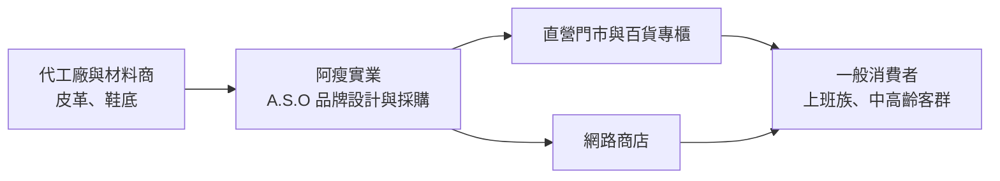
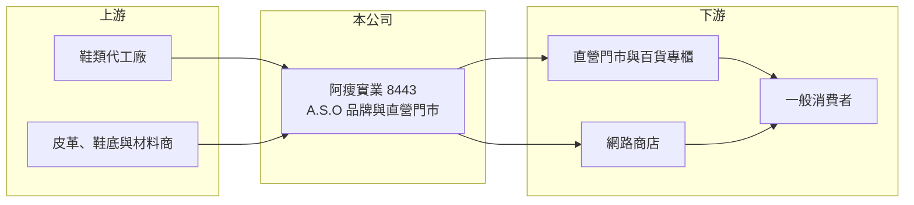

# 8443 阿瘦

> 上市｜[[產業索引-貿易百貨業|貿易百貨業]]｜上市（櫃）日期 2014/09/15

# 第一章：企業模式與商業藍圖

> [!info] 撰寫說明
> 精簡版，由 Claude 依公開資料整理，架構比照 [[2330台積電]] 的四章研究，資料截至 2026-10-08。來源：Goodinfo 年度經營績效頁與基本資料頁、證交所開放資料（基本資料、2026 年第二季資產負債與綜合損益、每月營收、股利）。創辦歷史、品牌定位與通路描述依記憶整理，門市數與營收結構未查得，公開資料有限。#待校對

阿瘦實業是台灣本土老字號皮鞋品牌 A.S.O 阿瘦皮鞋的經營公司，本章說明它「自有品牌加直營門市」的垂直整合模式，以及這個模式在消費習慣改變後面臨的挑戰。

## 一、核心定位：自有品牌、自有通路的皮鞋零售商

- **核心業務：** 阿瘦實業的登記業務為鞋類商品的批發與零售（Goodinfo 基本資料），實際上以 A.S.O 品牌的皮鞋、休閒鞋與機能鞋為主，並搭配皮件與鞋類保養品銷售。公司本身於 2003 年設立、2014 年上市，實收資本額 6.68 億元（證交所開放資料）；阿瘦皮鞋品牌的歷史則可追溯到 1950 年代創辦人在台北以擦鞋、修鞋起家（依記憶整理，待校對）。這段歷史讓品牌在中高齡客群中有很高的知名度，也是它長期主打「舒適、耐穿」形象的來源。
- **營收結構：** 公開資料未查得產品別或通路別的營收比重。以經營型態推估，營收絕大部分來自台灣的[[直營門市]]，再加上百貨專櫃與網路商店，屬於典型的品牌零售模式（推估）。2025 年全年營收約 11.2 億元（Goodinfo），在國內鞋類通路中屬於中型規模。
- **營運據點：** 門市主要分布在台灣各縣市的街邊店與百貨商場，確切門市數未查得。直營模式的好處是能直接掌握售價、陳列與服務品質，缺點是租金與人事等固定成本由公司自行負擔，營收下滑時虧損會迅速放大。
- **長期方向：** 阿瘦近年的經營方向是把品牌從「傳統皮鞋」轉向「健康舒適鞋」，強調腳型量測與機能鞋墊，並經營年輕化與線上通路（依媒體報導標題與記憶整理，待校對）。這條路能否成功，決定公司能否擺脫 2020 年以來多數年度虧損的局面。

## 二、資本轉化邏輯：毛利高、費用更高

品牌直營零售的特點是[[毛利率]]高，阿瘦 2025 年毛利率約 56.5%、2026 年上半年約 54.2%（Goodinfo、證交所營益分析）。但門市租金、店員薪資、行銷與百貨抽成等營業費用占營收比重更高，2026 年上半年營業費用約 3.65 億元，超過 2.82 億元的營業毛利，因此[[營業利益率]]為 -15.95%。這說明阿瘦的問題不是產品賺不到錢，而是營收規模不足以支撐既有的通路成本。

# 第二章：護城河深度與競爭優勢

本章分析阿瘦的品牌資產能形成多少護城河，以及它在國內鞋類市場面對的競爭。

## 一、競爭優勢

- **品牌知名度：** A.S.O 阿瘦皮鞋在台灣經營數十年，是少數能被一般消費者直接叫出名字的本土鞋類品牌。品牌信任讓它能維持五成以上的毛利率，也讓年長客群在需要正式皮鞋或舒適鞋時會優先想到它。
- **直營通路與售後服務：** 直營門市能提供試穿、腳型諮詢與修鞋保養等服務，這是純網路品牌難以複製的體驗。若能把服務轉化為會員黏著度與回購率，門市就會從成本中心變成護城河。
- **限制：** 不過鞋類市場的轉換成本很低，消費者隨時可以改買運動品牌或平價快時尚，品牌力只能換來定價空間，不能保證來客數。阿瘦 2021 至 2025 年有四年營業虧損（Goodinfo），顯示目前的品牌優勢還不足以構成穩固的護城河。

## 二、主要對手

| 對手 | 定位 | 與阿瘦的比較 |
|---|---|---|
| La New（老牌鞋類品牌，未上市） | 台灣舒適鞋與氣墊鞋品牌，同樣以直營門市為主 | 定位與客群最接近，長期是正面對手 |
| 國際運動品牌（Nike、Adidas、New Balance 等） | 運動與休閒鞋 | 休閒化穿著趨勢下，搶走大量原本買皮鞋的客群 |
| 平價鞋類與快時尚通路 | 低價、款式更新快 | 以價格與流行度吸引年輕消費者 |
| 電商與網路品牌 | 低營運成本 | 不負擔門市租金，價格彈性大 |

## 三、觀察重點

- **門市效率：** 營收規模若無法回到 2020 年的 13.7 億元以上，公司需要的是關閉低效門市、降低租金負擔，而不是單靠促銷拉營收。門市數與坪效的變化是判斷轉型成效的第一指標。
- **客群年輕化：** 品牌形象與中高齡客群高度綁定，若能把健康機能鞋推向更年輕的上班族，才有機會擴大市場。
- **業外收益的品質：** 2026 年上半年業外收入約 0.42 億元，抵銷了部分本業虧損（證交所綜合損益），評估時應以營業利益為準。

# 第三章：財務體質與盈利規模

資料日期：2026-10-08，表格是撰寫當時的快照；最新月營收、毛利率、累計 EPS 由自動排程寫在本筆記的屬性欄位（月營收、毛利率、累計EPS 等）。#待校對

本章用多年度數據檢視阿瘦在疫情前後的獲利變化，以及長期虧損對資本結構的影響。

## 一、多年度三率與 ROE

| 年度 | 營收（新台幣） | [[毛利率]] | [[營業利益率]] | EPS（元） | [[ROE]] |
|---|---|---|---|---|---|
| 2020 | 13.7 億 | 45.9% | -17.1% | -2.81 | -13.5% |
| 2021 | 10.8 億 | 45.4% | -23.2% | -3.90 | -22.6% |
| 2022 | 12.4 億 | 46.6% | -10.5% | -3.15 | -23.0% |
| 2023 | 11.8 億 | 58.6% | 0.32% | 0.25 | 2.07% |
| 2024 | 11.4 億 | 54.7% | -6.29% | -0.73 | -6.02% |
| 2025 | 11.2 億 | 56.5% | -9.8% | -1.46 | -13.5% |
| 2026 上半年 | 5.20 億 | 54.22% | -15.95% | -0.61 | 未查得 |

註：2020 至 2025 年取自 Goodinfo；2026 上半年取自證交所綜合損益與營益分析。

- **營收規模：** 2020 至 2025 年營收年複合成長率約 -3.9%（推算），2026 年 1 至 8 月累計營收約 6.80 億元、年減約 8.8%（證交所每月營收）。營收長期緩步下滑，是虧損無法扭轉的根本原因。
- **毛利率與費用：** 2023 年起毛利率由四成多升到五成五以上，代表公司減少折扣、調整產品組合，但營業利益率只有 2023 年短暫轉正。毛利率改善被固定費用吃掉，顯示通路成本結構仍需調整。
- **ROE：** 2021 至 2025 年平均 ROE 約 -12.6%（推算），六年中只有一年獲利。

## 二、股利與財務結構

2026 年第二季底保留盈餘為 -1.38 億元，待彌補虧損使公司近幾季無法配發股利（證交所股利資料）。同期權益約 6.26 億元、每股淨值 9.38 元，已低於面額 10 元；總負債約 8.91 億元，其中非流動負債約 2.99 億元，推估多為門市租約認列的[[租賃負債]]（推估）。連年虧損持續侵蝕淨值，是長期投資最需要留意的財務特色。

## 三、[[ROIC]] 與 [[WACC]]

**ROIC 推算：** 2025 年營業利益約 11.2 億元 × (-9.8%) ≈ -1.10 億元，虧損年度不計所得稅，稅後營業利益仍約 -1.10 億元。投入資本以 2026 年第二季權益 6.26 億元加上非流動負債 2.99 億元（視為租賃負債，推估）計算，約 9.25 億元，ROIC 約 -11.9%（推算）。

**WACC 推算：** 台灣 10 年期公債殖利率取 1.75%、市場風險溢酬 6%、β 取零售股常見值 0.8，權益成本約 6.55%；負債成本假設 3%、稅後 2.4%，以權益約 68%、負債約 32% 加權，WACC 約 5.2%（推算）。

**結論：** ROIC 為負、遠低於 WACC，代表阿瘦目前每投入一元資本都在減損股東價值。要讓利差轉正，關鍵不在毛利率，而在於讓營收回到能攤提門市固定成本的規模，或縮減門市與費用。

# 第四章：總體風險與地緣政治

本章整理阿瘦長期面對的消費趨勢、成本與財務風險。

## 一、產業週期與需求

- **穿著休閒化：** 遠距與彈性上班普及，正式皮鞋需求長期萎縮，消費者改買運動鞋與休閒鞋。這是結構性變化，不會隨景氣回升而恢復。
- **少子化與客群老化：** 品牌核心客群偏向中高齡，若年輕客群沒有接上，營收會隨人口結構自然下滑。
- **消費景氣：** 鞋類屬於可延後的消費，景氣轉弱時消費者會延長換鞋週期。

## 二、營運風險

- **固定成本壓力：** 直營門市的租金與人事屬於固定成本，基本工資連年調漲，若營收持續下滑，虧損會放大。
- **轉型執行：** 機能鞋與線上通路的轉型需要投入行銷與系統，在虧損狀態下資源有限，轉型可能因資金不足而放慢。
- **財務韌性：** 每股淨值已低於面額，若虧損持續，未來可能需要減資彌補虧損或增資補充資本（推估）。

## 三、其他風險

- **原物料與匯率：** 皮革等材料與海外代工成本受國際價格與新台幣匯率影響，會擠壓毛利率。
- **電商價格競爭：** 網路通路比價容易，品牌若頻繁促銷，會稀釋長期建立的品牌價值。

# 專有名詞解析

## 金融

- **[[租賃負債]]**：企業以租賃方式取得資產（如飛機、店面）時，依會計準則認列的未來租金現值負債。
- **[[ROIC]]**：投入資本報酬率，衡量企業用股東與債權人投入的資本，每年能產生多少稅後營業利益。
- **[[WACC]]**：加權平均資金成本，股東要求報酬與負債利息依資本結構加權後的平均值，是判斷是否創造價值的門檻。

## 產業

- **[[直營門市]]**：品牌商自己開設並經營的門市，能掌握價格與服務，但租金與人事成本由公司自行負擔。

# 核心供應鏈

- 上游：鞋類代工廠與皮革、鞋底材料供應商；台灣大型鞋廠如 [[9904寶成]]、[[9910豐泰]] 以國際運動品牌代工為主，列為產業代表，非指名合作對象。
- 下游／客戶：直營門市、百貨專櫃與網路商店的一般消費者；百貨通路如 [[2903遠百]]（產業代表，非指名合作對象）。
- 同業：La New（未上市）、國際運動品牌與平價鞋類通路。

## 最新新聞
<!-- news:start -->
<!-- news:end -->

## 相關連結
- [公開資訊觀測站](https://mopsov.twse.com.tw/mops/web/t05st03?step=1&firstin=1&co_id=8443)
- [Goodinfo](https://goodinfo.tw/tw/StockDetail.asp?STOCK_ID=8443)
- [Yahoo 股市](https://tw.stock.yahoo.com/quote/8443)
- [鉅亨網新聞](https://www.cnyes.com/twstock/8443/news)
