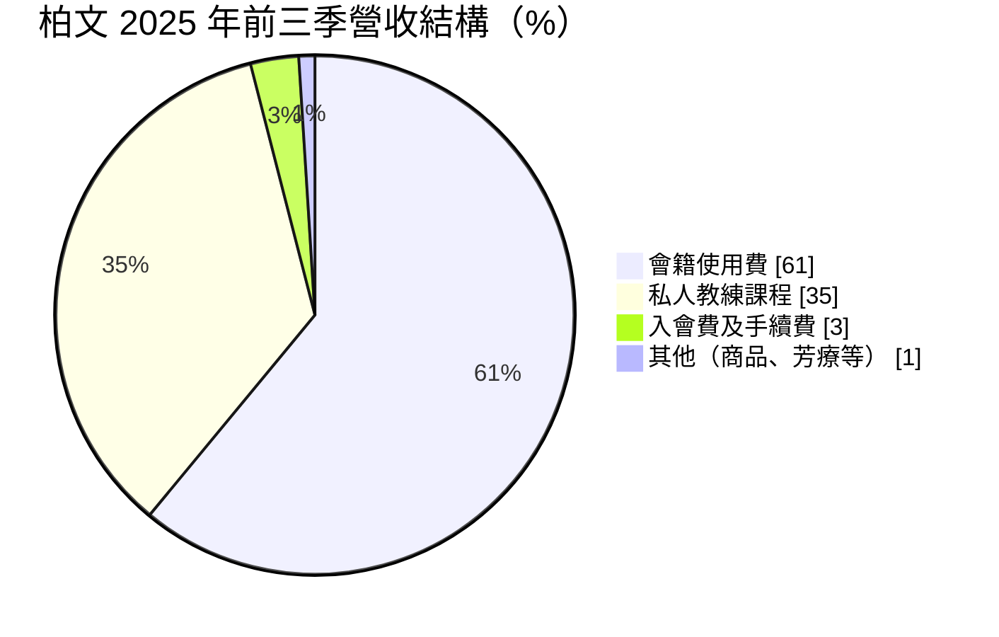
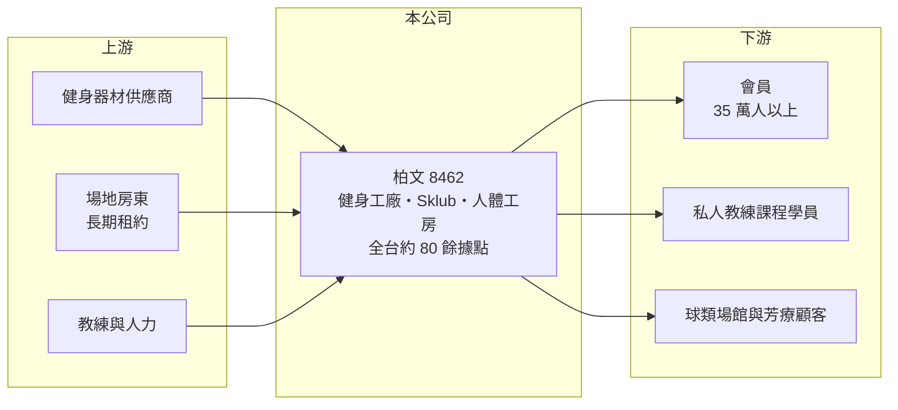

# 8462 柏文

> 上市｜[[產業索引-運動休閒|運動休閒]]｜上市（櫃）日期 2019/03/15

# 第一章：企業模式與商業藍圖

> [!info] 撰寫說明
> 精簡版，由 Claude 依公開資料整理，架構比照 [[2330台積電]]，資料截至 2026-10-08。來源：MoneyDJ 理財網財務比率年表（2018 至 2025 年）；富果研究 2025 年 11 月法說會備忘錄（品牌、據點、會員、營收結構、展店目標、市占）；證交所開放資料快照（基本資料、2026 年上半年資產負債與損益、2025 年度股利）。營收金額以每股營業額乘以約 8,038 萬股推算；2025 年底據點與會員數為法說會當時的預估值。#待校對

柏文健康事業成立於 2005 年 10 月、2019 年 3 月上市，總部在高雄左營，董事長陳尚義、總經理林洵賢，實收資本額約 8.04 億元。柏文以「健身工廠」品牌經營連鎖健身房，從南台灣起家逐步北上，與 [[2762世界健身-KY]] 並列台灣兩大連鎖健身房，商業模式是「長租大型場地、以會籍月費與教練課回收」。

- **核心業務：** 柏文的主力品牌健身工廠提供重訓、有氧器材與團體課程，另經營以羽球、籃球等球類運動為主的 Sklub 運動俱樂部、SPA 芳療品牌人體工房，以及運動按摩的 Buddy Body Workshop。收入來自會員按月繳交的會籍費與按堂計費的私人教練課程，屬於典型的[[會員經濟]]。
- **營收結構：** 依富果整理的 2025 年 11 月法說會，2025 年前三季會籍使用費占 61%、私人教練課程 35%、入會費及手續費約 3%、其他約 1%。會籍收入穩定、可預測，教練課則是提升單一會員貢獻的關鍵，兩者合計超過九成五。
- **營運據點：** 2025 年底預估達 83 處、遍布台灣西部各縣市，2026 年底目標 92 家、2027 年 100 家、2035 年 150 家，每年自有展店約 7 至 9 家、不靠併購。會員數在 2025 年 9 月底突破 35 萬人，續約率突破 70%；依法說會資料，截至 2025 年 6 月柏文以銷售額計市占約 28%、以會員數計約 33%。
- **長期方向：** 管理層認為台灣健身人口滲透率約 4.81%（2024 年），長期可達 6.5% 以上，柏文的成長來自「穩定展店＋既有店會員成長＋教練課滲透」，並以 Sklub 球類場館開拓第二條成長曲線。董事與創始股東持股超過 64%，加計員工約 67%，經營層與股東利益高度一致，配息率也偏高。

# 第二章：護城河深度與競爭優勢

柏文的護城河是區域密度與規模：據點越密，會員跨店使用越方便，品牌與教練招募也越有優勢。

- **競爭優勢：** 健身房是地方性生意，同一城市的據點密度決定會員的便利性，柏文從高雄起家，在南台灣的據點密度高，再一路北上複製。規模帶來器材採購、行銷與教練培訓的成本優勢，好地段的大型場地以長期租約先卡位，也提高新進者的門檻。淨增會員中約六成來自既有場館，顯示老店仍有成長空間。
- **主要對手：** 最直接的對手是 [[2762世界健身-KY]]，兩者在中大型綜合健身房市場互為主要競爭者；其他還有 Anytime Fitness 等 24 小時小型健身房、各地運動中心與獨立健身房。小型健身房以低月費、近住家搶客，是大型場館需要面對的替代競爭。
- **觀察重點：** 2021 年疫情停業時柏文營業利益率為 -7.4%，之後隨會員回流與規模擴大，2025 年回升到 14.9%，展現明顯的營運槓桿。長期要看[[同店銷售]]成長能否持續（2025 年前三季約 13%）、續約率是否維持七成以上，以及 Sklub 新業態能否複製成功。

# 第三章：財務體質與盈利規模

資料日期：2026-10-08，表格是撰寫當時的快照；最新月營收、毛利率、累計 EPS 由自動排程寫在本筆記的屬性欄位（月營收、毛利率、累計EPS 等）。#待校對

柏文營收從 2021 年約 27 億元成長到 2025 年約 61 億元，營業利益率由負轉為約 15%，ROE 在 2025 年達到三成。

| 年度 | 營收（億元） | [[毛利率]] | [[營業利益率]] | EPS（元） | [[ROE]] |
|---|---|---|---|---|---|
| 2021 | 約 27.0（推算） | 12.61% | -7.41% | -1.91 | -7.53% |
| 2022 | 約 36.5（推算） | 23.00% | 3.99% | 0.95 | 4.29% |
| 2023 | 約 43.5（推算） | 24.03% | 5.09% | 1.50 | 6.51% |
| 2024 | 約 51.9（推算） | 28.22% | 10.06% | 4.77 | 19.62% |
| 2025 | 約 61.5（推算） | 31.93% | 14.85% | 8.49 | 30.42% |

- **長期指標：** 2021 至 2025 年營收年複合成長率約 23%（推算），近 5 年平均 ROE 約 10.7%（推算），但趨勢逐年上升。每股現金流量 2018 至 2025 年皆為正且遠高於 EPS（2025 年 28.3 元對 EPS 8.49 元），因為會費預收與大量折舊攤提讓現金流大於帳上獲利。2025 年度現金股利約 7.38 元、配發率約 87%（證交所資料）。
- **[[ROIC]] 與 [[WACC]]：** 2025 年營業利益約 9.1 億元（營收約 61.5 億元 × 14.85%），稅後約 7.3 億元（稅率 20%）。2026 年第二季權益總計 24.2 億元、負債總計 104.7 億元，其中非流動負債 68.3 億元推估多為[[租賃負債]]。若把租賃負債與借款視為有息負債（推估約 85 億元），ROIC 約 6.7%（推算）；若只計股東權益加少量借款，ROIC 約 25% 至 30%（推算）。WACC 約 4.7% 至 6.5%（推算：無風險利率 1.75%、市場風險溢酬 6%、β 取服務業常見值 0.8，股東權益成本 6.55%；租賃負債隱含利率約 2.5%、稅率 20%，權重依是否計入租賃負債而定）。即使計入租約，ROIC 仍略高於 WACC，代表規模擴大後柏文已開始創造價值，2021 至 2023 年則低於資金成本。
- **財務特色：** 2026 年第二季總資產 128.9 億元、負債 104.7 億元，負債比率約 81%，主要是長期租約與預收會費，每股淨值 29.94 元、股價淨值比約 5.2 倍。2026 年上半年營收 34.0 億元、毛利率 34.5%、營業利益率 17.6%、EPS 5.68 元，利潤率持續提升。

# 第四章：總體風險與地緣政治

柏文的風險在於長期租約的固定成本、展店執行，以及健身市場的競爭與消費景氣。

- **產業週期：** 健身房屬可選消費，景氣差時新會員招募放緩、教練課購買減少，但月費制會籍的黏著度較高，波動通常小於零售業。真正的大風險是疫情這類強制停業事件，2021 年柏文就因停業轉為虧損。
- **營運風險：** 長期租約讓成本高度固定，新店前一兩年多半處於虧損爬坡期，展店太快或選址失誤會拖累整體獲利。私人教練課占營收約三成五，教練流動率、薪酬制度與勞動法規變化都影響成本與服務品質。
- **其他風險：** 預收會費與教練課程受消費者保護法規範，預收款履約保證是監理重點。租約到期時的續約租金上漲會壓縮老店利潤；健身器材多為進口，匯率影響資本支出。股價淨值比偏高，反映市場對成長的高期待，成長放緩時評價修正的幅度可能較大。

# 專有名詞解析

## 金融

- **[[租賃負債]]**：企業承租店面或設備時，依會計準則把未來租金折現認列的負債，零售與餐飲業金額通常很大。
- **[[ROIC]]**：投入資本報酬率，稅後營業利益除以股東權益加有息負債，衡量本業運用資本的效率。
- **[[WACC]]**：加權平均資金成本，股東與債權人要求報酬率的加權平均，是 ROIC 要超越的門檻。

## 產業

- **[[會員經濟]]**：以月費或年費綁定顧客、持續收取經常性收入的商業模式，重點在續約率與單一會員貢獻。
- **[[同店銷售]]**：只比較營運滿一定期間的既有門市營收變化，排除新店貢獻，用來判斷本業成長是否健康。

# 核心供應鏈

- 上游：健身器材供應商（國際品牌與台灣廠商如 [[1736喬山]]、[[1598岱宇]] 屬此類型，實際採購對象未查得）；商場與大樓房東；教練人力。
- 下游／客戶：一般消費者會員、私人教練課程學員、Sklub 球類場館與人體工房芳療顧客。
- 同業：[[2762世界健身-KY]]；Anytime Fitness 等 24 小時小型健身房；各地運動中心。

## 最新新聞
<!-- news:start（自動產生，請勿手動編輯此範圍） -->
- 2026-10-12 📰 媒體 10:12｜〈健身商機正夯〉柏文9月營收創單月次高 樂觀估獲利增幅可望更大｜[鉅亨網](https://news.cnyes.com/news/id/6627871)

完整紀錄：[[8462柏文 新聞]]
<!-- news:end -->

## 相關連結
- [公開資訊觀測站](https://mopsov.twse.com.tw/mops/web/t05st03?step=1&firstin=1&co_id=8462)
- [Goodinfo](https://goodinfo.tw/tw/StockDetail.asp?STOCK_ID=8462)
- [Yahoo 股市](https://tw.stock.yahoo.com/quote/8462)
- [鉅亨網新聞](https://www.cnyes.com/twstock/8462/news)
