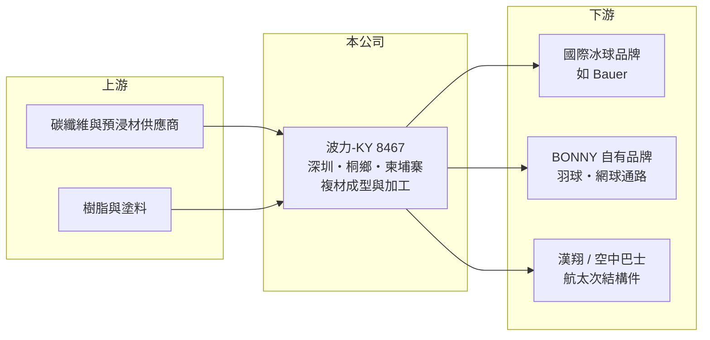

# 8467 波力-KY

> 上市｜[[產業索引-運動休閒|運動休閒]]｜上市（櫃）日期 2015/12/15

# 第一章：企業模式與商業藍圖

> [!info] 撰寫說明
> 精簡版，由 Claude 依公開資料整理，架構比照 [[2330台積電]] 的四章研究，資料截至 2026-10-08。財務數字來源：Goodinfo 年度經營績效頁、聯合新聞網 2026 年 3 月人物報導、證交所開放資料（基本資料、2026 年第二季資產負債與綜合損益、營益分析、股利、本益比）。公開資料有限，產品營收比重未查得。#待校對

本章說明波力環球（股票代號：8467，以下簡稱波力）如何從一家球拍工廠，發展成以[[碳纖維複合材料]]加工為核心、橫跨運動器材與航太零件的製造商。

- **核心業務：** 波力的經營團隊 1982 年創業，1992 年到廣東深圳設廠，2007 年在浙江嘉興桐鄉設立生產基地，2013 年以開曼控股公司架構成立，2015 年 12 月回台上市，屬於[[KY股]]。總經理為洪進山，董事長為洪文誕。公司的共同核心是碳纖維預浸材的疊層、成型與塗裝技術，同一套能力可用在冰上曲棍球桿、羽球拍與飛機結構件。
- **產品結構：** 目前最重要的產品是高階碳纖維冰上曲棍球桿，主要以 [[OEM]]／[[ODM]] 方式替國際冰球品牌生產，報導指出 2023 年起與 Bauer 合作開發輕量化球桿。另有[[自有品牌]] BONNY 的羽球拍，以及網球拍、壁球拍與配件。各產品營收比重公開資料未查得。
- **營運據點：** 生產集中在中國深圳與桐鄉，2026 年初柬埔寨新廠試營運，定位為生產高階冰球桿並出口美國的主要據點。這個布局的目的是降低美國對中國商品關稅的影響，也讓客戶在中國以外有第二個供貨來源。
- **長期方向：** 2025 年起與 [[2634漢翔]] 合作，生產空中巴士的複材[[航太次結構件]]（例如整流罩），已開始出貨；另研發碳纖維經濟艙座椅腳並取得台灣專利。航太件認證週期長、訂單期間也長，如果放量，可以降低波力對單一運動品項的依賴。

# 第二章：護城河深度與競爭優勢

本章分析波力的競爭優勢，重點在碳纖維加工的工藝累積與客戶綁定。

- **競爭優勢：** 高階冰球桿講究重量、剛性與耐衝擊，碳纖維疊層角度與成型參數需要長期試驗，品牌客戶從開發到量產往往要經過多個賽季驗證。一旦成為主力供應商，客戶不易更換，這是波力 2022 年後毛利率從約 30% 提升到 40% 以上的主要原因。
- **跨產業延伸：** 同樣的複材技術可以延伸到航太。航太件要通過嚴格的品質系統與客戶認證，進入門檻比運動器材更高，一旦合格，訂單通常以多年期計算。這讓波力的護城河從「運動器材代工」往「精密複材製造」延伸。
- **主要對手：** 碳纖維運動器材代工可對照 [[4536拓凱]]（自行車、球拍與醫療複材），冰球桿代工另有中國與北美的同業；航太複材則面對國際一線結構件供應商。
- **觀察重點：** 第一，柬埔寨廠的良率與產能爬坡；第二，航太件出貨能否形成穩定營收；第三，冰球桿主要客戶的訂單集中度。2026 年前 8 月營收年減約 10%，顯示單一運動品項的週期仍會影響整體營收。

# 第三章：財務體質與盈利規模

資料日期：2026-10-08，表格是撰寫當時的快照；最新月營收、毛利率、累計 EPS 由自動排程寫在本筆記的屬性欄位（月營收、毛利率、累計EPS 等）。#待校對

本章用多年度三率、ROE 與資本報酬，檢視波力轉型高階冰球桿後的獲利品質。

| 年度 | 營收（新台幣） | [[毛利率]] | [[營業利益率]] | EPS（元） | [[ROE]] |
|---|---|---|---|---|---|
| 2019 | 14.4 億 | 29.2% | 5.86% | 2.67 | 9.39% |
| 2020 | 10.4 億 | 31.2% | 2.63% | 0.48 | 1.73% |
| 2021 | 14.1 億 | 33.1% | 9.59% | 1.98 | 6.96% |
| 2022 | 19.6 億 | 37.7% | 20.1% | 8.21 | 26.5% |
| 2023 | 19.9 億 | 39.2% | 20.8% | 7.69 | 21.1% |
| 2024 | 24.7 億 | 40.9% | 23.9% | 11.5 | 24.1% |
| 2025 | 24.3 億 | 42.0% | 25.2% | 10.03 | 17.8% |
| 2026 上半年 | 11.3 億 | 35.7% | 17.1% | 2.53 | 未查得 |

註：2019 至 2025 年取自 Goodinfo，2026 上半年取自證交所營益分析與綜合損益表。

- **成長軌跡：** 2020 至 2025 年營收從 10.4 億元增至 24.3 億元，年複合成長率約 18.5%（推算）。成長主要發生在 2022 年，當年毛利率與營業利益率同時大幅跳升，代表產品組合轉向高單價冰球桿，而不只是量的增加。
- **獲利結構：** 營業利益率由個位數升到 25% 左右，說明固定費用被放大的營收攤薄，具明顯的[[營運槓桿]]。反過來說，2026 年上半年營收下滑時，營業利益率也同步降到 17%，EPS 只有 2.53 元，獲利對營收變化相當敏感。
- **長期指標：** 2021 至 2025 年平均 ROE 約 19.3%（推算）。公司採季配息，2025 年第四季配 3 元、2026 年第一季配 2 元、第二季不配，股利隨獲利調整，並非固定金額。
- **財務特色：** 2026 年第二季底總資產約 48.7 億元，負債約 22.8 億元，其中 21.7 億元為流動負債；權益約 25.9 億元，每股淨值 53.53 元，股本約 4.84 億元，股本小、每股獲利彈性大。

**[[ROIC]] 與 [[WACC]]：** 2025 年營業利益約 6.12 億元（24.3 億 × 25.2%），扣 20% 稅後約 4.90 億元。投入資本以權益 25.9 億元加上有息負債（未查得明細，假設占總負債五成，約 11.4 億元）合計約 37.3 億元，ROIC 約 13%（推算）。WACC 以 CAPM 推估：無風險利率 1.75%、市場風險溢酬 6%、β 取中小型製造股常見值 1.0，權益成本約 7.75%；負債成本 3%、稅後 2.4%；權益約占 69%，WACC 約 6.1%（推算）。ROIC 約為 WACC 的兩倍，代表 2022 年後的產品升級確實在創造價值；但 2026 年上半年獲利明顯下滑，若全年營業利益率停在 17% 左右，ROIC 會降到 8% 上下（推算），利差將大幅縮小。

# 第四章：總體風險與地緣政治

本章分析波力長期面對的風險。

- **產業週期：** 冰球桿屬於高單價運動用品，需求受北美消費景氣與品牌庫存影響。品牌客戶在景氣轉弱時會先去化庫存，訂單減少的幅度往往大於終端銷售的衰退，形成[[長鞭效應]]。
- **客戶集中：** 高階冰球桿的主要客戶數量有限，單一品牌的策略改變（例如轉單或自建產能）會直接影響營收與毛利率，這是代工模式的結構性風險。
- **營運風險：** 柬埔寨新廠初期良率與效率需要時間爬坡，新廠折舊與人員費用會先於營收發生；航太件若出貨不如預期，投入的認證與設備成本回收期會拉長。
- **其他風險：** 主要產能在中國，面臨美國關稅與地緣政治風險；碳纖維原料價格、人民幣與美元匯率變動，也會影響成本與以新台幣計算的獲利。

# 專有名詞解析

## 金融

- **[[KY股]]**：在開曼群島等海外地區註冊、回台灣掛牌的公司，營運主體多在台灣以外。
- **[[ROIC]]**：投入資本報酬率，稅後營業利益除以股東權益與有息負債的合計，衡量本業對所有資金提供者的報酬。
- **[[WACC]]**：加權平均資金成本，依股東權益與負債的比重加權計算的資金成本，ROIC 高於它才代表創造價值。

## 產業

- **[[碳纖維複合材料]]**：以碳纖維搭配樹脂成型的材料，重量輕、強度高，用於球拍、球桿、自行車與飛機結構件。
- **[[OEM]]**：代工生產，依客戶的設計與規格製造產品，以客戶品牌出貨。
- **[[ODM]]**：原廠委託設計製造，代工廠負責產品設計與生產，再以客戶品牌出貨。
- **[[航太次結構件]]**：飛機上非主要承力的結構零件，例如整流罩、艙門與內裝件，需通過航太品質認證才能供貨。

# 核心供應鏈

- 上游：碳纖維、預浸材與樹脂供應商（日本、台灣與中國廠商），原料品質直接決定球桿與結構件性能。
- 下游／客戶：國際冰上曲棍球品牌（報導提及 Bauer）、BONNY 品牌的羽球與網球通路，以及透過 [[2634漢翔]] 供應的空中巴士。
- 同業：碳纖維運動器材與複材代工可對照 [[4536拓凱]]。

## 最新新聞
<!-- news:start（自動產生，請勿手動編輯此範圍） -->
- 2026-10-06 🏛️ 重訊 13:55｜公告本公司115年第1季現金股利除息基準日｜[觀測站](https://mops.twse.com.tw/mops/#/web/t05st01)

完整紀錄：[[8467波力-KY 新聞]]
<!-- news:end -->

## 相關連結
- [公開資訊觀測站](https://mopsov.twse.com.tw/mops/web/t05st03?step=1&firstin=1&co_id=8467)
- [Goodinfo](https://goodinfo.tw/tw/StockDetail.asp?STOCK_ID=8467)
- [Yahoo 股市](https://tw.stock.yahoo.com/quote/8467)
- [鉅亨網新聞](https://www.cnyes.com/twstock/8467/news)
