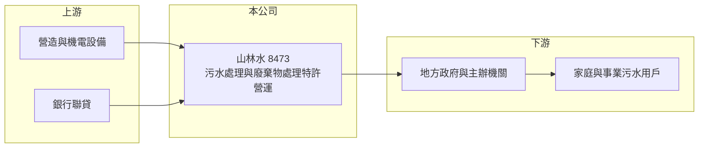

# 8473 山林水

> 上市｜[[產業索引-綠能環保|綠能環保]]｜上市（櫃）日期 2016/09/08

# 第一章：企業模式與商業藍圖

> [!info] 撰寫說明
> 精簡版，由 Claude 依公開資料整理，架構比照 [[2330台積電]] 的四章研究，資料截至 2026-10-08。財務數字來源：Goodinfo 年度經營績效頁、nStock 公司簡介、證交所開放資料（基本資料、2026 年第二季資產負債與綜合損益、營益分析、股利、本益比）；個別特許案名稱與年限未查得，業務細節部分憑既有知識撰寫，已標「待校對」。公開資料有限。#待校對

在評估單一個股的長期價值時，首要步驟是拆解企業的獲利來源。本章說明山林水環境工程（股票代號：8473，以下簡稱山林水）如何以「先蓋、後營運」的特許模式，在污水處理與廢棄物處理領域建立長期收入。

- **核心業務：** 山林水成立於 2004 年，2016 年上市，董事長為郭又綺，實收資本額約 18.2 億元（2026 年第二季資產負債表股本已增至約 20.2 億元，反映 2025 年度的盈餘轉增資）。依公司登記與 nStock 的描述，主要營業項目為環境保護工程營造、污水處理、廢棄物處理與資源回收，以及堆肥與廚餘回收去化。
- **商業模式：** 山林水的核心是參與政府的污水下水道 [[BOT]] 等民間參與公共建設案。公司先承攬並出資興建污水處理廠與管線，完工後在特許期間內營運，向主辦機關收取污水處理費，特許期通常長達二、三十年（推估，個別案件年限未查得）。#待校對 這種模式前期資本支出大、負債高，但完工後的營運收入穩定，類似收費的公用事業。
- **營收組成：** 公開資料未提供分項比重。可以理解為兩種收入：一是工程期依進度認列的建造收入，金額大但隨工程完工而起伏；二是營運期的處理費收入，金額較小但可預期。2025 年營收由前一年的 33.9 億元跳升到 51.2 億元，推估與新工程案進入高峰有關。
- **長期方向：** 台灣的污水下水道接管率仍有提升空間，加上水資源回收再利用、廚餘與有機廢棄物處理的需求增加，政府未來仍會釋出新的民間參與案。山林水的長期成長取決於能否持續得標新案，並把工程期轉為穩定的營運期現金流。

# 第二章：護城河深度與競爭優勢

本章分析山林水的競爭優勢與限制。特許型環保事業的護城河，來自合約期間的獨占地位與過往的實績門檻。

- **競爭優勢：** 污水處理廠一旦取得特許，在合約期間內是該區域唯一的處理者，收入不受市場價格戰影響，這是特許模式最重要的保護。另外，政府評選民間參與案時重視過往的興建與營運實績，累積多件案例的業者在下一次投標時較有優勢，新進者不容易一開始就拿到大型案件。
- **限制與弱點：** 特許案的報酬率在簽約時大致就已決定，公司無法自行漲價，長期 [[ROE]] 偏低。2021 至 2025 年平均 ROE 僅約 3.1%（推算），2022 年還出現虧損，顯示工程成本超支或個案問題會直接侵蝕獲利。
- **主要對手：** [[8422可寧衛]]、[[6803崑鼎]]、[[8341日友]]、[[9933中鼎]] 旗下環保事業，以及大型營造廠組成的投標團隊。
- **觀察重點：** 第一，新得標案件的規模與特許年限；第二，工程收入高峰過後，營運收入能否撐住營收；第三，負債比與利息負擔是否隨新案增加而上升。

# 第三章：財務體質與盈利規模

資料日期：2026-10-08，表格是撰寫當時的快照；最新月營收、毛利率、累計 EPS 由自動排程寫在本筆記的屬性欄位（月營收、毛利率、累計EPS 等）。#待校對

本章用多年度三率、ROE 與資本報酬，檢視山林水特許模式的獲利品質。

| 年度 | 營收（新台幣） | [[毛利率]] | [[營業利益率]] | EPS（元） | [[ROE]] |
|---|---|---|---|---|---|
| 2020 | 44.9 億 | 17.1% | 12.5% | 1.15 | 3.69% |
| 2021 | 39.6 億 | 22.6% | 17.3% | 1.36 | 4.63% |
| 2022 | 39.2 億 | 6.8% | 1.0% | -1.89 | -2.36% |
| 2023 | 36.8 億 | 16.8% | 11.1% | 0.27 | 2.26% |
| 2024 | 33.9 億 | 22.2% | 15.0% | 0.97 | 4.06% |
| 2025 | 51.2 億 | 23.7% | 17.9% | 2.55 | 7.11% |
| 2026 上半年 | 23.7 億 | 32.75% | 26.41% | 2.43 | 未查得 |

註：2020 至 2025 年取自 Goodinfo（EPS 與 ROE 之間有不一致之處，待校對），2026 上半年取自證交所營益分析與綜合損益表。

- **營收規模：** 2020 至 2025 年營收年複合成長率約 2.7%（推算），中間有三年下滑，2025 年才大幅回升。營收起伏主要來自工程進度，不代表營運規模同步變化。
- **獲利結構：** 營業利益率在正常年度約 11% 至 18%，2026 年上半年升到 26.41%。不過 2026 年上半年營業外淨損約 0.56 億元，顯示利息費用是固定負擔。
- **財務特色：** 2026 年第二季底總資產約 167.2 億元，負債約 92.4 億元，權益約 74.8 億元，負債比約 55%（證交所開放資料）。保留盈餘僅約 4.9 億元，2025 年度配發現金股利約 0.80 元與股票股利約 1.08 元，以配股保留現金支應新案。

**[[ROIC]] 與 [[WACC]]：** 以 2025 年營業利益約 9.16 億元（51.2 億 × 17.9%）計，稅後約 7.33 億元；投入資本以權益 74.8 億元加上假設占總負債七成的有息負債約 64.7 億元，合計約 139.5 億元，ROIC 約 5.3%（推算）。WACC 以 CAPM 推估：無風險利率 1.75%、市場風險溢酬 6%、β 取公用事業型環保股常見值 0.6，股東權益成本約 5.35%；負債成本 2.5%、稅後 2.0%；權益約占 54%，WACC 約 3.8%（推算）。2025 年 ROIC 高於 WACC 約 1.5 個百分點，屬小幅創造價值；但若回到 2021 至 2024 年的平均水準，ROIC 多數年度與資金成本接近，特許模式的價值主要在穩定，而非高報酬。

# 第四章：總體風險與地緣政治

本章分析山林水長期面對的風險。

- **產業週期：** 環保特許事業的需求來自政府政策與預算，而非景氣循環。風險在於政府釋出新案的節奏不穩，若數年沒有新案，工程收入斷層會造成營收大幅下滑，2022 至 2024 年即是例子。
- **營運風險：** 興建期的工程成本超支、工期延誤或與主辦機關的履約爭議，會直接造成虧損，2022 年營業利益率僅 1.0% 即反映這類風險（原因未查得）。營運期則要承擔設備老化、放流水標準加嚴帶來的改善支出。
- **其他風險：** 高負債的特許模式對利率敏感，利率上升會提高新案融資成本；部分特許案的處理費調整需經政府同意，通膨期間可能出現成本上升但收入不變的情況。

# 專有名詞解析

## 金融

- **[[ROIC]]**：投入資本報酬率，稅後營業利益除以股東權益與有息負債的合計，衡量本業對所有資金提供者的報酬。
- **[[WACC]]**：加權平均資金成本，依股東權益與負債的比重加權計算的資金成本，ROIC 高於它才代表創造價值。

## 產業

- **[[BOT]]**：興建、營運、移轉，民間出資興建公共建設並在特許期間營運收費，期滿後移轉給政府的合作模式。
- **[[污水下水道]]**：收集家庭與事業污水並送到處理廠的管線系統，接管率是衡量一國都市衛生水準的指標。

# 核心供應鏈

- 上游：土木營造與機電設備廠商、水處理設備與藥劑、提供專案融資的銀行。
- 下游／客戶：地方政府與中央主辦機關（支付處理費），最終服務對象為家庭與事業污水用戶。
- 同業：[[8422可寧衛]]、[[6803崑鼎]]、[[8341日友]]、[[8476台境]]、[[9933中鼎]]。

## 最新新聞
<!-- news:start -->
<!-- news:end -->

## 相關連結
- [公開資訊觀測站](https://mopsov.twse.com.tw/mops/web/t05st03?step=1&firstin=1&co_id=8473)
- [Goodinfo](https://goodinfo.tw/tw/StockDetail.asp?STOCK_ID=8473)
- [Yahoo 股市](https://tw.stock.yahoo.com/quote/8473)
- [鉅亨網新聞](https://www.cnyes.com/twstock/8473/news)
