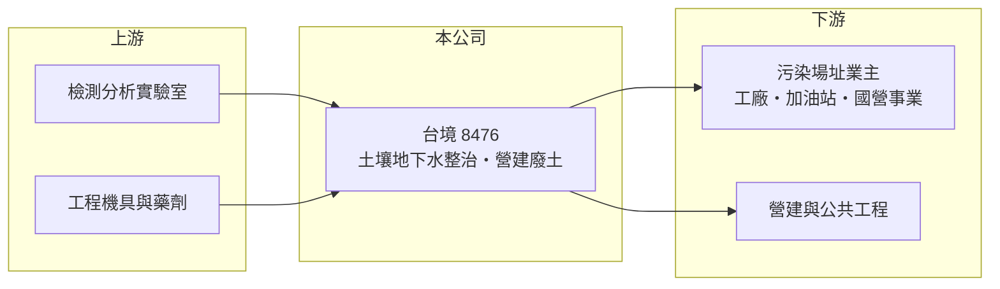

# 8476 台境

> 上市｜[[產業索引-綠能環保|綠能環保]]｜上市（櫃）日期 2023/10/31

# 第一章：企業模式與商業藍圖

> [!info] 撰寫說明
> 精簡版，由 Claude 依公開資料整理，架構比照 [[2330台積電]] 的四章研究，資料截至 2026-10-08。財務數字來源：Goodinfo 年度經營績效頁、nStock 公司簡介、證交所開放資料（基本資料、2026 年第二季資產負債與綜合損益、營益分析、股利、本益比）；分項營收比重與主要客戶未查得。公開資料有限。#待校對

在評估單一個股的長期價值時，首要步驟是拆解企業的獲利來源。本章說明台境企業（股票代號：8476，以下簡稱台境）作為土壤與地下水整治工程業者的定位，以及專案型收入如何決定它的營收與獲利起伏。

- **核心業務：** 台境成立於 2003 年，總部位於高雄，2023 年上市，董事長為郭人豪，實收資本額約 8.3 億元。依 nStock 的描述，公司及子公司主要經營環境保護工程、[[土壤及地下水整治]]的調查與工程，以及[[營建廢土]]處理。2024 年股東會通過將每股面額由 10 元改為 5 元。
- **商業模式：** 土壤與地下水整治屬於專案型工程。污染場址的所有者（工廠、加油站、國營事業或政府機關）依法完成調查與整治後才能解除列管或轉作其他用途，台境負責調查、設計整治方法並施工。每個案件金額差異很大，大案一進來就會讓單年營收倍增。
- **營收特性：** 2022 年營收 27.9 億元，是 2021 年的三倍以上，2023 至 2025 年再逐年回落到 12.1 億元，正是典型的大型專案進出造成的波動（大案內容未查得）。營建廢土處理則與房地產與公共工程開挖量有關，屬於較穩定但毛利較低的收入。
- **長期方向：** 台灣早期的工業區、煉油廠、加油站與軍事用地留下不少污染場址，隨著都市更新與土地活化，整治需求會長期存在。台境的成長取決於能否持續取得大型整治案，並透過廢土處理等業務平滑專案空窗期。

# 第二章：護城河深度與競爭優勢

本章分析台境的競爭優勢與限制。整治工程的門檻在於技術實績與主管機關的信任，而不是規模。

- **競爭優勢：** 污染整治的結果需要經環保主管機關審查才能解除列管，業主通常偏好有成功案例、熟悉法規流程的業者，這讓有實績的公司在投標時較有優勢。台境以高雄為基地，南部重工業與石化聚落密集，在地緣上接近主要的潛在污染場址（推估）。#待校對
- **限制與弱點：** 專案型業務缺乏經常性收入，營收與獲利隨大案進出大幅波動，2020 與 2021 年仍是虧損，2022 年 ROE 則高達 43.5%。這種極端起伏代表長期平均獲利能力很難用單一年度判斷。
- **主要對手：** 國內環保工程公司、大型工程顧問公司，以及 [[8473山林水]]、[[9933中鼎]] 等具環保工程能力的業者。
- **觀察重點：** 第一，新取得整治案的規模與數量；第二，營建廢土處理能否成為穩定的基本收入；第三，毛利率能否回到 20% 以上。

# 第三章：財務體質與盈利規模

資料日期：2026-10-08，表格是撰寫當時的快照；最新月營收、毛利率、累計 EPS 由自動排程寫在本筆記的屬性欄位（月營收、毛利率、累計EPS 等）。#待校對

本章用多年度三率、ROE 與資本報酬，檢視台境專案型模式的獲利品質。

| 年度 | 營收（新台幣） | [[毛利率]] | [[營業利益率]] | EPS（元） | [[ROE]] |
|---|---|---|---|---|---|
| 2020 | 5.25 億 | 5.6% | -6.76% | -1.06 | -12.7% |
| 2021 | 7.95 億 | 13.6% | 2.8% | -0.49 | -4.12% |
| 2022 | 27.9 億 | 27.8% | 21.3% | 7.19 | 43.5% |
| 2023 | 15.4 億 | 36.5% | 27.9% | 4.49 | 21.8% |
| 2024 | 15.2 億 | 24.2% | 15.5% | 1.62 | 13.7% |
| 2025 | 12.1 億 | 18.5% | 9.07% | 0.52 | 4.54% |
| 2026 上半年 | 6.64 億 | 15.24% | 5.87% | 0.12 | 未查得 |

註：2020 至 2025 年取自 Goodinfo，EPS 為當年面額基礎，2024 年改面額 5 元後與前期不完全可比；2026 上半年取自證交所營益分析與綜合損益表。

- **營收規模：** 2020 至 2025 年營收年複合成長率約 18.2%（推算），但這主要是 2020 年基期偏低，2022 年高峰後已連續三年衰退。
- **獲利結構：** 營業利益率從 2023 年的 27.9% 一路降到 2026 年上半年的 5.87%，大案結束後毛利率與營業利益率同步下滑，說明固定成本在營收縮小時會明顯壓縮獲利。
- **長期指標：** 2021 至 2025 年平均 ROE 約 15.9%（推算），但幾乎全部來自 2022 至 2023 年。2025 年度配發現金股利 0.20 元（證交所資料），配息隨獲利大幅變動。
- **財務特色：** 2026 年第二季底總資產約 43.0 億元，負債約 24.6 億元（其中流動負債 19.1 億元），權益約 18.4 億元，負債比約 57%（證交所開放資料）。

**[[ROIC]] 與 [[WACC]]：** 以 2025 年營業利益約 1.10 億元（12.1 億 × 9.07%）計，稅後約 0.88 億元；投入資本以權益 18.4 億元加上假設占總負債四成的有息負債約 9.8 億元，合計約 28.2 億元，ROIC 約 3.1%（推算）。WACC 以 CAPM 推估：無風險利率 1.75%、市場風險溢酬 6%、β 取中小型工程股常見值 0.8，股東權益成本約 6.55%；負債成本 2.5%、稅後 2.0%；權益約占 65%，WACC 約 5.0%（推算）。2025 年 ROIC 低於 WACC，代表大案空窗期並未創造價值；但 2022 至 2023 年 ROIC 遠高於資金成本，長期是否創造價值要看大案能否每隔幾年出現一次。

# 第四章：總體風險與地緣政治

本章分析台境長期面對的風險。

- **產業週期：** 整治需求取決於法規執行力度、土地開發與業主預算，與一般景氣循環關聯較低，但大案的出現時點難以預測。營建廢土業務則跟著營建景氣起伏。
- **營運風險：** 整治工程常遇到污染範圍比調查時更大、整治未達標需重做等情況，可能造成成本超支；專案集中也代表單一案件延誤就會影響全年獲利。
- **其他風險：** 土壤與地下水污染整治標準、營建廢土的去化與處理規範若有變動，會影響成本與需求；業主多為大型企業或公部門，收款時程較長，需要注意應收帳款與流動負債管理。

# 專有名詞解析

## 金融

- **[[ROIC]]**：投入資本報酬率，稅後營業利益除以股東權益與有息負債的合計，衡量本業對所有資金提供者的報酬。
- **[[WACC]]**：加權平均資金成本，依股東權益與負債的比重加權計算的資金成本，ROIC 高於它才代表創造價值。

## 產業

- **[[土壤及地下水整治]]**：對受污染的土地與地下水進行調查、清除或處理，使污染物濃度降到法規標準以下，才能解除列管。
- **[[營建廢土]]**：營建工程開挖產生的剩餘土石方，需送到合法場所處理、回填或再利用。

# 核心供應鏈

- 上游：環境檢測實驗室、工程機具租賃、整治藥劑與材料供應商。
- 下游／客戶：污染場址的所有者（工廠、加油站、國營事業、政府機關），以及產生營建廢土的營造與公共工程。
- 同業：[[8473山林水]]、[[8422可寧衛]]、[[6803崑鼎]]、[[9933中鼎]]。

## 最新新聞
<!-- news:start（自動產生，請勿手動編輯此範圍） -->
- 2026-10-08 🏛️ 重訊 18:06｜本公司得標國防部「救火、堵漏暨核生化防護訓場設施財物 採購及安裝」案｜[觀測站](https://mops.twse.com.tw/mops/#/web/t05st01)

完整紀錄：[[8476台境 新聞]]
<!-- news:end -->

## 相關連結
- [公開資訊觀測站](https://mopsov.twse.com.tw/mops/web/t05st03?step=1&firstin=1&co_id=8476)
- [Goodinfo](https://goodinfo.tw/tw/StockDetail.asp?STOCK_ID=8476)
- [Yahoo 股市](https://tw.stock.yahoo.com/quote/8476)
- [鉅亨網新聞](https://www.cnyes.com/twstock/8476/news)
