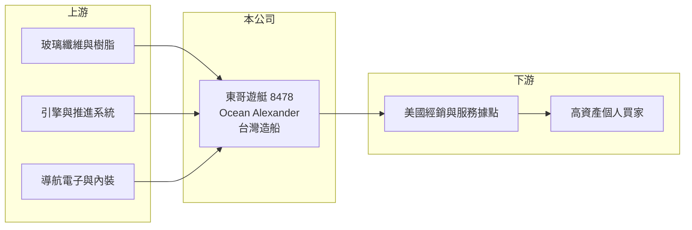

# 8478 東哥遊艇

> 上市｜[[產業索引-運動休閒|運動休閒]]｜上市（櫃）日期 2017/12/11

# 第一章：企業模式與商業藍圖

> [!info] 撰寫說明
> 精簡版，由 Claude 依公開資料整理，架構比照 [[2330台積電]] 的四章研究，資料截至 2026-10-08。財務數字來源：Goodinfo 年度經營績效頁、科技新報 2016 年東哥遊艇專題報導、證交所開放資料（基本資料、2026 年第二季資產負債與綜合損益、營益分析、股利、本益比）。部分經營描述引自 2016 年報導，現況可能已改變。#待校對

本章說明東哥企業（股票代號：8478，以下簡稱東哥遊艇）如何以台灣製造、美國銷售的[[自有品牌]]模式，在全球大型豪華遊艇市場取得一席之地。

- **核心業務：** 東哥遊艇 1978 年創立，名稱取自創辦人闕詒流的小名，從一開始就以自有品牌 Ocean Alexander 銷售，而不是替外國品牌代工，這在以代工起家的台灣遊艇業相當少見。第二代闕慶承長駐美國負責銷售與代理，目前擔任董事長，曾雄威擔任總經理，負責台灣製造。公司 2017 年 12 月上市。
- **產品結構：** 主力是 78 英尺以上的大型機動遊艇，單艘售價可達數百萬至近千萬美元。2016 年報導指出，產品線已從二十多種尺寸精簡到 9 種，並把需求較大的 70 英尺中型艇委託美國船廠代工。精簡船型的目的是讓模具、零件與工法可以重複使用，提高生產效率。
- **營運據點：** 製造在台灣（高雄，待校對），銷售以美國為主要市場，2016 年時在全美有超過 52 個銷售與服務據點。2016 年報導指出，東哥在美國大型豪華遊艇市場的市占率曾排名第一，在 78 英尺以上遊艇製造商排名中名列全球第四。
- **長期方向：** 東哥遊艇的策略是「[[模組化造船]]量產＋自有品牌」，造船時間約 1.5 年，比完全客製化的約 2 年短。長期成長取決於能否持續推出更大尺寸的新船型、擴充台灣產能，以及在美國以外的市場（例如歐洲與亞洲）建立通路。

# 第二章：護城河深度與競爭優勢

本章分析東哥遊艇的護城河：品牌、通路與造船工藝。

- **品牌與通路：** 大型遊艇的買家是高資產人士，購買決策看重品牌口碑、轉售價值與售後服務。Ocean Alexander 經營美國市場超過四十年，經銷與服務網絡完整，新進品牌很難在短時間內建立同等的信任，這是東哥最主要的護城河。
- **製造效率：** 東哥以模組化設計、預先組裝的家具與電腦排程管理工廠，在維持豪華規格的同時縮短工期。工期短代表資金占用時間短、交船快，對買家與公司都有利。
- **主要對手：** 美國 Viking Yachts、英國 Princess Yachts、義大利 Azimut-Benetti 與 Ferretti 等國際品牌，以及台灣的嘉鴻遊艇與其他遊艇廠。2016 年報導也提到中國遊艇廠的競爭壓力。
- **觀察重點：** 第一，美國利率與高資產族群財富變化對新船訂單的影響；第二，新船型與更大尺寸產品的推出節奏；第三，毛利率能否維持在 2024 年以來的 39% 左右。

# 第三章：財務體質與盈利規模

資料日期：2026-10-08，表格是撰寫當時的快照；最新月營收、毛利率、累計 EPS 由自動排程寫在本筆記的屬性欄位（月營收、毛利率、累計EPS 等）。#待校對

本章用多年度三率、ROE 與資本報酬，檢視東哥遊艇在遊艇景氣循環中的獲利表現。

| 年度 | 營收（新台幣） | [[毛利率]] | [[營業利益率]] | EPS（元） | [[ROE]] |
|---|---|---|---|---|---|
| 2019 | 36.9 億 | 26.4% | 3.47% | 0.50 | 1.71% |
| 2020 | 42.2 億 | 23.7% | 5.38% | 1.04 | 3.71% |
| 2021 | 45.5 億 | 35.1% | 20.9% | 9.55 | 31.0% |
| 2022 | 55.6 億 | 45.4% | 33.5% | 19.93 | 45.5% |
| 2023 | 63.3 億 | 48.2% | 34.7% | 23.66 | 39.5% |
| 2024 | 49.4 億 | 39.2% | 19.2% | 10.37 | 13.0% |
| 2025 | 52.3 億 | 39.0% | 22.4% | 13.25 | 14.1% |
| 2026 上半年 | 25.8 億 | 39.9% | 24.3% | 6.35 | 未查得 |

註：2019 至 2025 年取自 Goodinfo，2026 上半年取自證交所營益分析與綜合損益表。

- **景氣循環：** 2021 至 2023 年疫情帶動的高資產族群休閒需求，讓營收與毛利率同時創高，2023 年 EPS 達 23.66 元。2024 年需求回落後營收減少約 22%，營業利益率從 34.7% 降到 19.2%，說明遊艇是高單價、需求波動大的產業，獲利隨景氣大起大落。
- **獲利品質：** 即使在 2024 至 2025 年的回落期，毛利率仍維持在 39% 左右，遠高於 2019 至 2020 年的 24% 至 26%。這代表疫情期間的漲價與產品組合調整有一部分被保留下來，是較正面的結構性變化。
- **長期指標：** 2019 至 2025 年營收年複合成長率約 6%（推算）；2021 至 2025 年平均 ROE 約 28.6%（推算），但受 2022 至 2023 年高峰拉高。2025 年度配發現金股利 6.5 元，[[配息率]]約 49%（推算，6.5 ÷ 13.25）。
- **財務特色：** 2026 年第二季底總資產約 156.5 億元，其中流動資產約 117 億元（以在製遊艇存貨與現金為主，推估）；負債約 64.9 億元，權益約 91.5 億元，每股淨值 97.41 元。

**[[ROIC]] 與 [[WACC]]：** 2025 年營業利益約 11.7 億元（52.3 億 × 22.4%），扣 20% 稅後約 9.4 億元。投入資本以權益 91.5 億元加上有息負債（明細未查得，假設約等於非流動負債 31.1 億元）合計約 122.6 億元，ROIC 約 7.6%（推算）。WACC 以 CAPM 推估：無風險利率 1.75%、市場風險溢酬 6%、β 取景氣循環消費股常見值 1.0，權益成本約 7.75%；負債成本 2.5%、稅後 2.0%；權益約占 75%，WACC 約 6.3%（推算）。ROIC 在景氣高峰的 2022 至 2023 年遠高於 WACC，回落期則僅小幅高於 WACC，代表東哥長期能創造價值，但幅度高度依賴遊艇景氣。

# 第四章：總體風險與地緣政治

本章分析東哥遊艇長期面對的風險。

- **產業週期：** 大型遊艇屬於奢侈性消費，需求與美國股市、利率與高資產族群的財富感受高度相關。景氣反轉時新訂單會先減少，再經過 1 至 2 年的造船期反映到營收。
- **市場集中：** 主要市場集中在美國，美國的奢侈稅、關稅或進口規定變化都可能直接影響銷售。1990 年代初東哥就曾因美國奢侈稅與新台幣升值陷入困境。
- **營運風險：** 單艘遊艇金額高，交船時點的變動會讓各月與各季營收大幅波動；大型船型開發投入高，若新船型銷售不佳，模具與研發成本難以回收。
- **其他風險：** 營收以美元計價，新台幣升值會壓縮獲利；引擎、電子設備等關鍵零組件多向國外採購，供應延遲會影響交期。

# 專有名詞解析

## 金融

- **[[配息率]]**：現金股利占每股盈餘的比例，反映公司把多少獲利分配給股東。
- **[[ROIC]]**：投入資本報酬率，稅後營業利益除以股東權益與有息負債的合計，衡量本業對所有資金提供者的報酬。
- **[[WACC]]**：加權平均資金成本，依股東權益與負債的比重加權計算的資金成本，ROIC 高於它才代表創造價值。

## 產業

- **[[自有品牌]]**：公司以自己的品牌直接銷售產品，承擔行銷與通路成本，但能保留較高的品牌溢價。
- **[[模組化造船]]**：把船體、內裝與設備拆成標準模組分別製作再組裝，縮短工期並降低客製化成本。

# 核心供應鏈

- 上游：船體用的玻璃纖維、樹脂與木材，國際引擎與推進系統大廠，以及導航電子、空調與內裝家具供應商。
- 下游／客戶：美國的經銷與服務網絡，最終客戶是購買大型遊艇的高資產個人。
- 同業：國際品牌 Viking Yachts、Princess Yachts、Azimut-Benetti、Ferretti，台灣的嘉鴻遊艇等遊艇廠。

## 最新新聞
<!-- news:start -->
<!-- news:end -->

## 相關連結
- [公開資訊觀測站](https://mopsov.twse.com.tw/mops/web/t05st03?step=1&firstin=1&co_id=8478)
- [Goodinfo](https://goodinfo.tw/tw/StockDetail.asp?STOCK_ID=8478)
- [Yahoo 股市](https://tw.stock.yahoo.com/quote/8478)
- [鉅亨網新聞](https://www.cnyes.com/twstock/8478/news)
