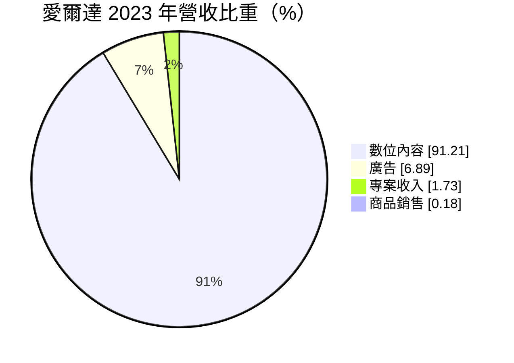
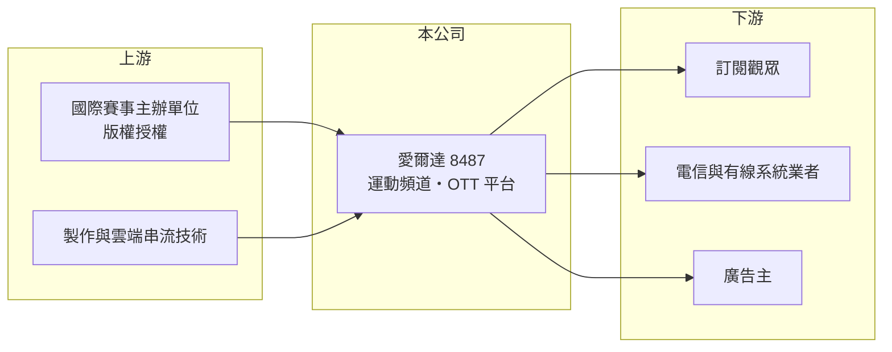

# 8487 愛爾達-創

> 創新板｜[[產業索引-數位雲端|數位雲端]]｜上市（櫃）日期 2024/03/26

# 第一章：企業模式與商業藍圖

> [!info] 撰寫說明
> 精簡版，由 Claude 依公開資料整理，架構比照 [[2330台積電]]，資料截至 2026-10-08。創新板／新掛牌，公開資料有限。來源：證交所開放資料快照（基本資料、2026 年第二季綜合損益與資產負債、每月營收、股利）、Goodinfo 年度經營績效、MoneyDJ 基本資料（2023 年營收比重）、科技新報 2023 年 1 月世足報導、優分析與數位時代 2026 年轉播大年報導標題。賽事版權年份部分憑記憶整理，標示待校對。#待校對

愛爾達科技（以下簡稱愛爾達）是台灣以體育賽事轉播聞名的影音平台，2024 年 3 月登上[[創新板]]。本章說明它如何以運動版權為核心經營內容生意。

- **核心業務：** 愛爾達取得國際大型運動賽事與各類節目的台灣播映權，透過自有的電視頻道與 [[OTT]] 串流平台播出，向觀眾收取訂閱費，並向系統業者與電信業者收取頻道授權費，同時銷售廣告。代表性的賽事包括世界盃足球賽、奧運、世界棒球經典賽（WBC）與亞運（各屆版權歸屬待校對）。
- **營收結構：** 依 MoneyDJ 資料，2023 年數位內容占營收 91.21%、廣告 6.89%、專案收入 1.73%、商品銷售 0.18%。數位內容包括訂閱與授權收入，是公司的核心，廣告則隨大型賽事的收視熱度增加。

- **營運據點：** 總部位於台北市中正區，營運以台灣市場為主。
- **長期方向：** 觀眾收看習慣從有線電視轉向串流，愛爾達的長期策略是以獨家運動版權吸引訂閱，再把一次性的賽事觀眾轉成長期[[訂閱制]]用戶。依 2026 年報導，公司把 2026 年視為「轉播大年」，同時有 WBC、世界盃足球賽與亞運，挑戰內容變現的新拐點。

# 第二章：護城河深度與競爭優勢

版權生意的護城河來自長期的賽事合作關係與平台承載能力。本章分析愛爾達的競爭位置。

- **競爭優勢：** 國際賽事主辦單位挑選轉播商時，看重過往的播出品質、收視規模與合作紀錄，愛爾達長期經營運動頻道，累積了與國際賽事組織的關係。依 2023 年報導，2018 年世足時曾因瞬間流量過大而被迫開放免費收看，2022 年卡達世足則改善平台承載並帶動訂閱與收視成長，顯示技術與營運能力是逐步累積的。
- **主要對手：** 台灣影音與運動轉播的競爭者包括 [[2412中華電]] 旗下 MOD 與 Hami Video、[[3045台灣大]]、[[4904遠傳]] 的影音平台，以及 Netflix、DAZN、緯來體育、ELEVEN SPORTS 等；台股媒體同業可參考 [[9928中視]]、[[8450霹靂]]。電信業者同時是愛爾達的通路夥伴與潛在競爭者。
- **觀察重點：** 一是重大賽事版權能否持續取得，以及版權成本的漲幅；二是賽事結束後的訂閱留存率；三是[[毛利率]]，因為版權成本占比高，毛利率可直接反映版權投資的報酬。

# 第三章：財務體質與盈利規模

資料日期：2026-10-08，表格是撰寫當時的快照；最新月營收、毛利率、累計 EPS 由自動排程寫在本筆記的屬性欄位（月營收、毛利率、累計EPS 等）。#待校對

愛爾達的營收與獲利跟著大型賽事的年份起伏，偶數年通常是旺年。

| 年度 | 營收（億元） | [[毛利率]] | [[營業利益率]] | EPS（元） | [[ROE]] |
|---|---|---|---|---|---|
| 2019 | 5.99 | 14.9% | 2.4% | 0.56 | 4.4% |
| 2020 | 3.97 | 12.8% | -6.3% | -0.37 | -3.0% |
| 2021 | 9.34 | 15.6% | 4.9% | 2.15 | 16.7% |
| 2022 | 9.81 | 19.4% | 7.8% | 2.81 | 20.4% |
| 2023 | 9.68 | 35.4% | 17.6% | 5.98 | 31.9% |
| 2024 | 14.9 | 26.2% | 14.9% | 6.85 | 29.0% |
| 2025 | 10.2 | 27.2% | 12.4% | 4.03 | 15.6% |
| 2026 上半年 | 8.56 | 21.9% | 12.4% | 3.30 | 未查得 |

- **營收規模：** 營收從 2019 年 5.99 億元成長到 2025 年 10.2 億元，六年年複合成長率約 9%（推算）。2020 年疫情導致賽事停辦，營收跌到 3.97 億元，說明公司對大型賽事的依賴。2026 年 1 至 8 月累計營收 12.2 億元，較前一年同期成長約 71%，反映 2026 年多項大型賽事集中。
- **獲利：** 2026 年上半年營業利益 1.07 億元、稅後淨利 0.87 億元，EPS 3.30 元。近五年（2021 至 2025）平均 ROE 約 23%（推算），在內容產業中屬於高水準，代表版權投資的回收效率不錯。
- **財務特色：** 2026 年第二季底股東權益 6.30 億元、流動負債 5.66 億元，非流動負債 0.73 億元；流動負債應包含版權應付款與訂閱預收款（推估）。公司配息積極，2025 年度配發現金股利 4.806 元，現金股利總額約 1.28 億元，高於當年度稅後淨利約 1.07 億元，配息率超過百分之百（推算），部分應來自以前年度保留盈餘；公司資本支出需求低，但這樣的配息水準不一定能長期維持。
- **[[ROIC]] 與 [[WACC]]：** 官方快照未拆分有息負債，以非流動負債 0.73 億元作為有息負債近似值。2026 年上半年營業利益年化約 2.13 億元，扣除 20% 稅後約 1.70 億元，除以股東權益加非流動負債 7.03 億元，ROIC 約 24%（推算）。WACC 以 CAPM 推估：無風險利率 1.75%、市場風險溢酬 6%、β 假設 1.0（媒體業推估值），權益成本約 7.8%；負債成本假設 2.5%、稅後 2.0%，負債占比約 10%，WACC 約 7.2%（推算）。ROIC 高出 WACC 約 17 個百分點，但這是賽事旺年的數字，跨賽事週期的平均報酬仍高於 WACC，代表公司長期在創造價值。

# 第四章：總體風險與地緣政治

運動版權生意的風險集中在版權成本與賽事週期。本章整理愛爾達的長期風險。

- **產業週期：** 世界盃、奧運等大型賽事每兩到四年一次，營收在賽事年與非賽事年之間明顯波動；疫情這類突發事件可能讓賽事停辦，營收大幅下滑。
- **營運風險：** 版權價格逐屆上漲，若取得成本過高而訂閱與廣告收入不如預期，就會出現虧損；重大賽事版權若被國際串流平台或電信業者搶走，營收會直接缺口。平台在熱門賽事時的流量承載也是營運挑戰。
- **其他風險：** 版權以美元或歐元計價時，匯率波動影響成本；盜版與非法串流侵蝕訂閱收入；政府對媒體與 OTT 的法規（例如 OTT 專法）可能改變營運規範。

# 專有名詞解析

## 金融

- **[[創新板]]**：臺灣證券交易所為新創與成長型企業設立的上市板塊，掛牌條件較寬，但初期限制一般投資人交易資格。

## 產業

- **[[OTT]]**：透過網際網路直接提供影音內容給觀眾的服務，不經過有線電視系統。
- **[[訂閱制]]**：客戶按月或按年付費使用產品或服務，營收可預測性高。
- **[[轉播權]]**：在特定地區播出賽事或節目的授權，通常向主辦單位競標取得，是運動媒體最主要的成本。

# 核心供應鏈

- 上游：國際足總、國際奧會、WBC 主辦單位等賽事組織的[[轉播權]]授權，以及轉播製作、雲端與內容傳遞網路服務。
- 下游／客戶：直接訂閱的觀眾、上架頻道的電信與有線系統業者（例如 [[2412中華電]] MOD），以及廣告主。
- 同業：[[2412中華電]]、[[3045台灣大]]、[[4904遠傳]] 的影音平台；媒體同業 [[9928中視]]、[[8450霹靂]]。

## 最新新聞
<!-- news:start -->
<!-- news:end -->

## 相關連結
- [公開資訊觀測站](https://mopsov.twse.com.tw/mops/web/t05st03?step=1&firstin=1&co_id=8487)
- [Goodinfo](https://goodinfo.tw/tw/StockDetail.asp?STOCK_ID=8487)
- [Yahoo 股市](https://tw.stock.yahoo.com/quote/8487)
- [鉅亨網新聞](https://www.cnyes.com/twstock/8487/news)
