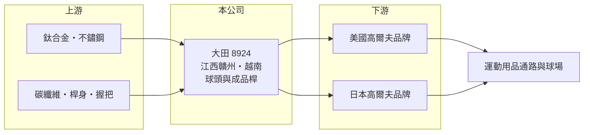

# 8924 大田

> 上櫃｜[[產業索引-運動休閒|運動休閒]]｜上市（櫃）日期 2000/02/09

# 第一章：企業模式與商業藍圖

> [!info] 撰寫說明
> 精簡版，由 Claude 依公開資料整理，架構比照 [[2330台積電]] 的四章研究，資料截至 2026-10-08。財務數字來源：Goodinfo 年度經營績效頁、優分析 2025 年越南新廠報導、證交所與櫃買中心開放資料（基本資料、2026 年第二季資產負債與綜合損益、股利、本益比）。公開資料有限，產品營收比重與客戶名單未查得，客戶描述為整理性內容。#待校對

本章說明大田精密（股票代號：8924，以下簡稱大田）作為台灣四大高爾夫球具代工廠之一，如何在品牌客戶的訂單週期中經營，以及近年為何把產能往越南移動。

- **核心業務：** 大田成立於 1988 年，2000 年上櫃，主要以 [[OEM]]／[[ODM]] 方式替國際高爾夫品牌生產球頭與成品球桿，產品包括木桿、鐵桿與推桿等。台灣的高爾夫球頭代工由 [[6670復盛應用]]、[[8938明安]]、大田與 [[8928鉅明]] 四家主導，合計占全球球頭供應的大部分。
- **客戶結構：** 客戶為美國與日本的高爾夫品牌，2025 年報導提到日系客戶表示將與大田更密切合作。各客戶營收比重未公開，但球具代工業普遍有前幾大客戶占比偏高的特性（推估）。
- **營運據點：** 主要生產基地在中國江西贛州，報導形容其人員穩定、生產效率佳。2025 年起在越南承租廠房並開始出貨，以木桿為主；越南自建廠房 2025 年 11 月底封頂，2026 年 3 月起設備進駐並導入自動化產線，規劃新增月產 30 萬支球具產能。
- **長期方向：** 越南布局的主要目的，是因應美國對中國商品加徵關稅、滿足品牌客戶「中國以外產能」的要求，同時爭取新客戶。這屬於改變公司長期生產結構的投資，未來中越兩地的產能配置會影響成本與接單能力。

# 第二章：護城河深度與競爭優勢

本章分析大田的護城河：製程能力、客戶關係與多地產能。

- **競爭優勢：** 高爾夫球頭涉及鍛造、鑄造、精密加工、碳纖維冠部與表面處理，新款球桿每年推出，代工廠必須配合品牌在短時間內完成開發與量產。長期合作累積的模具、工法與良率經驗，是新進者難以複製的門檻。
- **限制與弱點：** 代工廠議價能力有限，品牌客戶掌握設計、行銷與定價權。當品牌去化庫存時，代工廠的稼動率與毛利率會同時下滑，2023 年毛利率從 28.8% 降到 16.6% 就是例子。
- **主要對手：** [[6670復盛應用]] 規模最大，[[8938明安]] 兼有球具與複合材料，[[8928鉅明]] 規模較小；中國當地也有球頭代工廠。
- **觀察重點：** 第一，越南自建廠的量產進度與良率；第二，新客戶與日系客戶的訂單能否放大；第三，毛利率能否回到 2019 至 2020 年 23% 至 26% 的水準。

# 第三章：財務體質與盈利規模

資料日期：2026-10-08，表格是撰寫當時的快照；最新月營收、毛利率、累計 EPS 由自動排程寫在本筆記的屬性欄位（月營收、毛利率、累計EPS 等）。#待校對

本章用多年度三率、ROE 與資本報酬，檢視大田在高爾夫景氣循環中的獲利變化。

| 年度 | 營收（新台幣） | [[毛利率]] | [[營業利益率]] | EPS（元） | [[ROE]] |
|---|---|---|---|---|---|
| 2019 | 35.6 億 | 23.2% | 13.7% | 5.81 | 21.1% |
| 2020 | 39.3 億 | 26.0% | 17.3% | 6.50 | 19.1% |
| 2021 | 78.8 億 | 31.6% | 25.4% | 20.15 | 53.9% |
| 2022 | 77.0 億 | 28.8% | 23.1% | 21.40 | 43.6% |
| 2023 | 43.7 億 | 16.6% | 8.75% | 4.85 | 9.74% |
| 2024 | 46.4 億 | 15.9% | 8.65% | 5.66 | 11.8% |
| 2025 | 46.3 億 | 18.5% | 9.9% | 5.63 | 11.3% |
| 2026 上半年 | 20.2 億 | 8.6% | -0.4% | -0.58 | 未查得 |

註：2019 至 2025 年取自 Goodinfo，2026 上半年由櫃買中心綜合損益表計算。

- **景氣循環：** 2021 至 2022 年疫情帶動戶外運動，高爾夫球具需求爆發，大田營收翻倍到近 79 億元，ROE 超過 40%。2023 年品牌客戶去化庫存，營收減少約 43%，毛利率腰斬，說明球具代工是典型的景氣循環產業。
- **近期轉弱：** 2026 年上半年營收約 20.2 億元，毛利率只有約 8.6%，本業小幅虧損，EPS 為 -0.58 元。推估與越南新廠初期成本、客戶訂單調整及匯率有關（推估），需觀察新廠量產後毛利率能否回升。
- **長期指標：** 2019 至 2025 年營收年複合成長率約 4.5%（推算）；2021 至 2025 年平均 ROE 約 26.1%（推算），但高度集中在 2021 至 2022 年。2025 年度現金股利 4.3 元，[[配息率]]約 76%（推算，4.3 ÷ 5.63），公司長期維持高配息。
- **財務特色：** 2026 年第二季底總資產約 54.1 億元，負債約 15.1 億元，權益約 39.0 億元，負債比約 28%，每股淨值 46.57 元，財務結構保守。

**[[ROIC]] 與 [[WACC]]：** 2025 年營業利益約 4.58 億元（46.3 億 × 9.9%），扣 20% 稅後約 3.67 億元。投入資本以權益 39.0 億元加上有息負債（明細未查得，假設占總負債三成，約 4.5 億元）合計約 43.5 億元，ROIC 約 8.4%（推算）。WACC 以 CAPM 推估：無風險利率 1.75%、市場風險溢酬 6%、β 取中小型製造股常見值 1.0，權益成本約 7.75%；負債成本 2.5%、稅後 2.0%；權益約占 90%，WACC 約 7.2%（推算）。2025 年 ROIC 僅小幅高於 WACC，2026 年上半年本業虧損則使 ROIC 轉為負值。大田只有在景氣高峰時明顯創造價值，平時大致在打平邊緣，越南新廠能否改善成本是長期關鍵。

# 第四章：總體風險與地緣政治

本章分析大田長期面對的風險。

- **產業週期：** 高爾夫球具需求受消費景氣、參與人口與品牌庫存影響。品牌在需求旺時大量下單、轉弱時急速去化，訂單變化幅度大於終端銷售，形成明顯的[[長鞭效應]]。
- **客戶集中：** 營收依賴少數國際品牌，單一客戶轉單、改變供應商比重或自身銷售不佳，都會直接衝擊大田的稼動率與毛利率。
- **營運風險：** 越南新廠初期的學習曲線、人員訓練與折舊會先壓縮獲利；中國廠與越南廠的產能配置若失衡，可能出現一邊閒置、一邊吃緊的情況。
- **其他風險：** 美國關稅政策變動會影響客戶的採購地選擇；鈦合金、不鏽鋼與碳纖維等原料價格、人民幣與美元匯率，也會影響成本與以新台幣計算的獲利。

# 專有名詞解析

## 金融

- **[[配息率]]**：現金股利占每股盈餘的比例，反映公司把多少獲利分配給股東。
- **[[長鞭效應]]**：終端需求的小幅變動，沿供應鏈往上游傳遞時被逐級放大，造成上游庫存與訂單劇烈波動。
- **[[ROIC]]**：投入資本報酬率，稅後營業利益除以股東權益與有息負債的合計，衡量本業對所有資金提供者的報酬。
- **[[WACC]]**：加權平均資金成本，依股東權益與負債的比重加權計算的資金成本，ROIC 高於它才代表創造價值。

## 產業

- **[[OEM]]**：代工生產，依客戶的設計與規格製造產品，以客戶品牌出貨。
- **[[ODM]]**：原廠委託設計製造，代工廠負責產品設計與生產，再以客戶品牌出貨。

# 核心供應鏈

- 上游：鈦合金、不鏽鋼等金屬材料，碳纖維冠部材料，以及桿身與握把供應商。
- 下游／客戶：美國與日本的國際高爾夫品牌，再經由運動用品通路與球場專賣店銷售給球友。
- 同業：[[6670復盛應用]]、[[8938明安]]、[[8928鉅明]]。

## 最新新聞
<!-- news:start -->
<!-- news:end -->

## 相關連結
- [公開資訊觀測站](https://mopsov.twse.com.tw/mops/web/t05st03?step=1&firstin=1&co_id=8924)
- [Goodinfo](https://goodinfo.tw/tw/StockDetail.asp?STOCK_ID=8924)
- [Yahoo 股市](https://tw.stock.yahoo.com/quote/8924)
- [鉅亨網新聞](https://www.cnyes.com/twstock/8924/news)
