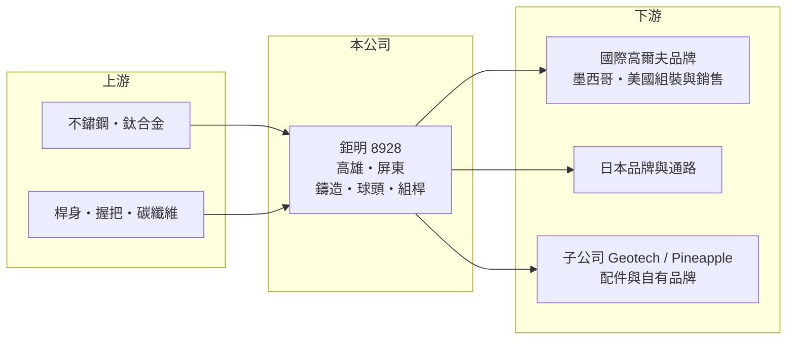

# 8928 鉅明

> 上櫃｜[[產業索引-運動休閒|運動休閒]]｜上市（櫃）日期 2001/02/02

# 第一章：企業模式與商業藍圖

> [!info] 撰寫說明
> 精簡版，由 Claude 依公開資料整理，架構比照 [[2330台積電]] 的四章研究，資料截至 2026-10-08。財務數字來源：Goodinfo 年度經營績效頁、CMoney 2022 年個股研究筆記、櫃買中心開放資料（基本資料、2026 年第二季資產負債與綜合損益、本益比）。營收比重為 2022 年第一季資料，主要客戶名單未查得。公開資料有限。#待校對

本章說明鉅明（股票代號：8928）這家高雄老牌鑄造廠，如何從不鏽鋼精密鑄造起家，成為台灣四大高爾夫球具代工廠之一。

- **核心業務：** 鉅明成立於 1973 年，2001 年上櫃，擁有四十多年不鏽鋼精密鑄造、二十多年鈦合金真空鑄造經驗，近年延伸到複合材料。主要以 [[OEM]]／[[ODM]] 方式替國際品牌製造高爾夫球頭與組裝完成的球桿，也生產五金鑄件與複合材料製品。
- **營收結構：** 依 2022 年第一季資料，組裝球桿約占 47.4%、球頭約 47%、其他約 5%。地區別以墨西哥 37% 最大（推估為品牌客戶在墨西哥的組裝廠），其次是日本 20%、美國 12%、英國 6.5%。組桿比重高，代表鉅明不只賣球頭，也承接後段組裝，營收規模較大但附加價值率較低。
- **營運據點：** 與多數同業把產能移到中國或越南不同，鉅明的工廠集中在高屏地區，包括高雄新厝（模具與總部）、大發（鑄造前段）、裕民（美工後段）與屏東（熱處理）。2022 年起在高雄和發產業園區興建新廠，整合新厝與裕民廠製程，2023 年起陸續投產（推估）。
- **長期方向：** 透過日本子公司 Geotech Golf 與德國子公司 Pineapple Golf 經營配件通路與[[自有品牌]]球具，目的是在代工之外建立直接面對消費者的管道；另把原廠區轉向五金與複合材料應用，分散對高爾夫單一產業的依賴。

# 第二章：護城河深度與競爭優勢

本章分析鉅明的競爭優勢與限制。

- **競爭優勢：** 精密鑄造需要長期累積的模具設計、真空鑄造與熱處理技術，鉅明從 1973 年起經營鑄造本業，製程從模具、鑄造、熱處理到美工一條龍完成。對品牌客戶而言，台灣製造也提供了「非中國產能」的選項。
- **限制與弱點：** 台灣的人工與土地成本高於中國與越南，鉅明的毛利率長期低於同業，2019 至 2022 年約 15% 至 18%，2023 年後更降到 8% 至 12%。新廠的折舊也會在需求不振時壓縮獲利。
- **主要對手：** [[6670復盛應用]]、[[8938明安]]、[[8924大田]] 規模都較鉅明大，另有中國當地的球頭代工廠。
- **觀察重點：** 第一，和發新廠的自動化能否抵銷台灣人力成本；第二，美國關稅政策下「台灣製造」能否爭取到更多訂單；第三，毛利率能否回到 15% 以上。

# 第三章：財務體質與盈利規模

資料日期：2026-10-08，表格是撰寫當時的快照；最新月營收、毛利率、累計 EPS 由自動排程寫在本筆記的屬性欄位（月營收、毛利率、累計EPS 等）。#待校對

本章用多年度三率、ROE 與資本報酬，檢視鉅明的獲利能力。

| 年度 | 營收（新台幣） | [[毛利率]] | [[營業利益率]] | EPS（元） | [[ROE]] |
|---|---|---|---|---|---|
| 2019 | 24.2 億 | 17.3% | 7.95% | 3.30 | 21.6% |
| 2020 | 22.3 億 | 16.2% | 6.6% | 2.50 | 15.2% |
| 2021 | 30.9 億 | 17.9% | 10.1% | 4.70 | 25.9% |
| 2022 | 33.9 億 | 15.3% | 7.64% | 5.63 | 26.7% |
| 2023 | 26.0 億 | 7.86% | -1.88% | -0.71 | -3.4% |
| 2024 | 31.7 億 | 11.9% | 3.33% | 2.75 | 13.4% |
| 2025 | 34.2 億 | 11.9% | 2.49% | 1.42 | 6.55% |
| 2026 上半年 | 13.7 億 | 12.7% | 1.0% | 0.82 | 未查得 |

註：2019 至 2025 年取自 Goodinfo，2026 上半年由櫃買中心綜合損益表計算。

- **獲利結構：** 鉅明的營業利益率長期在個位數，2023 年景氣低谷甚至虧損。2025 年營收 34.2 億元已接近 2022 年高點，但營業利益率只有 2.49%，代表營收回升沒有帶動同等獲利，推估與新廠折舊、人力成本與組桿比重高有關（推估）。
- **業外比重：** 2026 年上半年營業利益約 0.14 億元，但業外收入約 0.38 億元，稅後淨利約 0.42 億元，獲利有相當比例來自業外，本業獲利能力偏弱。
- **長期指標：** 2019 至 2025 年營收年複合成長率約 5.9%（推算）；2021 至 2025 年平均 ROE 約 13.8%（推算），但波動很大。2025 年度現金股利 0.8 元，[[配息率]]約 56%（推算，0.8 ÷ 1.42）。
- **財務特色：** 2026 年第二季底總資產約 30.0 億元，負債約 19.1 億元（其中非流動負債約 7.3 億元，推估含新廠長期借款），權益約 10.9 億元，負債比約 64%，在同業中財務槓桿最高，每股淨值 21.49 元。

**[[ROIC]] 與 [[WACC]]：** 2025 年營業利益約 0.85 億元（34.2 億 × 2.49%），扣 20% 稅後約 0.68 億元。投入資本以權益 10.9 億元加上有息負債（明細未查得，假設約 11 億元，即總負債的六成左右）合計約 21.9 億元，ROIC 約 3.1%（推算）。WACC 以 CAPM 推估：無風險利率 1.75%、市場風險溢酬 6%、β 取中小型製造股常見值 1.0，權益成本約 7.75%；負債成本 2.5%、稅後 2.0%；權益約占 50%，WACC 約 4.9%（推算）。ROIC 低於 WACC，代表鉅明近年的本業報酬不足以支付資金成本；新廠投資要能創造價值，營業利益率至少需回到 5% 以上（推算）。

# 第四章：總體風險與地緣政治

本章分析鉅明長期面對的風險。

- **產業週期：** 高爾夫球具需求隨消費景氣與品牌庫存起伏，品牌去化庫存時代工廠訂單會急速縮減，2023 年鉅明就因此出現虧損，屬典型的[[長鞭效應]]。
- **成本結構：** 生產集中在台灣，人工、土地與環保成本較高，在價格競爭時處於不利位置；新廠折舊與利息負擔，讓獲利對產能利用率更加敏感。
- **財務風險：** 負債比約 64%，在景氣低迷時償債與資本支出的壓力會比財務保守的同業更大。
- **其他風險：** 客戶集中在少數國際品牌；美國關稅與墨西哥組裝廠相關的貿易規則變動，會影響訂單流向；鈦合金與不鏽鋼價格、美元與日圓匯率也會影響毛利。

# 專有名詞解析

## 金融

- **[[配息率]]**：現金股利占每股盈餘的比例，反映公司把多少獲利分配給股東。
- **[[ROIC]]**：投入資本報酬率，稅後營業利益除以股東權益與有息負債的合計，衡量本業對所有資金提供者的報酬。
- **[[WACC]]**：加權平均資金成本，依股東權益與負債的比重加權計算的資金成本，ROIC 高於它才代表創造價值。

## 產業

- **[[OEM]]**：代工生產，依客戶的設計與規格製造產品，以客戶品牌出貨。
- **[[ODM]]**：原廠委託設計製造，代工廠負責產品設計與生產，再以客戶品牌出貨。
- **[[自有品牌]]**：公司以自己的品牌直接銷售產品，承擔行銷與通路成本，但能保留較高的品牌溢價。

# 核心供應鏈

- 上游：不鏽鋼、鈦合金等鑄造原料，碳纖維材料，以及桿身與握把供應商。
- 下游／客戶：國際高爾夫品牌（出貨地以墨西哥、日本、美國為主），以及日本 Geotech Golf、德國 Pineapple Golf 等子公司通路。
- 同業：[[6670復盛應用]]、[[8938明安]]、[[8924大田]]。

## 最新新聞
<!-- news:start -->
<!-- news:end -->

## 相關連結
- [公開資訊觀測站](https://mopsov.twse.com.tw/mops/web/t05st03?step=1&firstin=1&co_id=8928)
- [Goodinfo](https://goodinfo.tw/tw/StockDetail.asp?STOCK_ID=8928)
- [Yahoo 股市](https://tw.stock.yahoo.com/quote/8928)
- [鉅亨網新聞](https://www.cnyes.com/twstock/8928/news)
