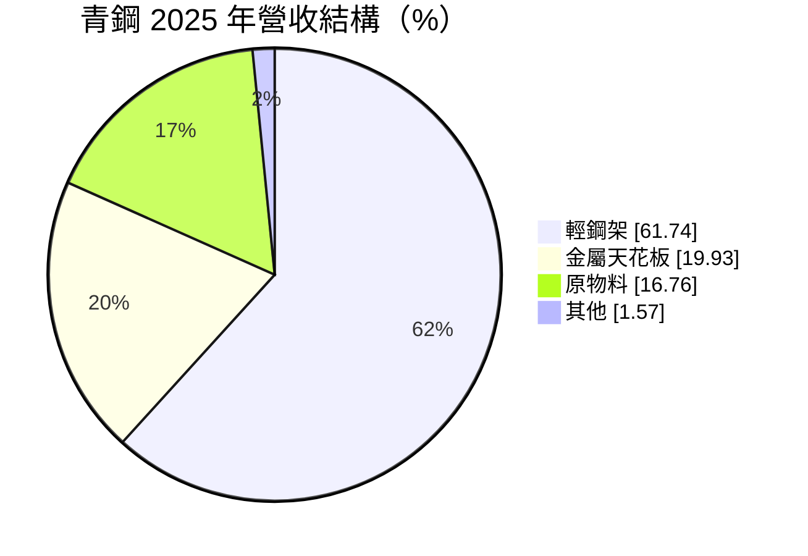
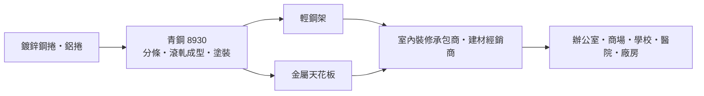
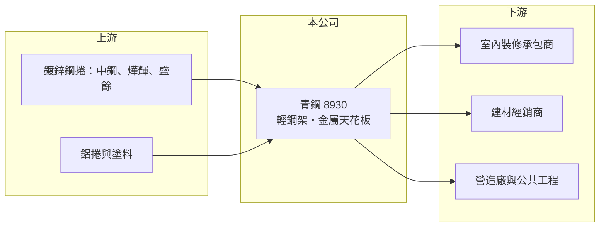

# 8930 青鋼

> 上櫃｜[[產業索引-鋼鐵工業|鋼鐵工業]]｜上市（櫃）日期 2000/12/06

# 第一章：企業模式與商業藍圖

> [!info] 撰寫說明
> 本文由 Claude 依公開資料整理，架構比照 [[2330台積電]] 的四章研究，資料截至 2026-10-08。財務數字來源：MoneyDJ（富邦證券）年度財務比率表與公司基本資料（2025 年營收比重）、櫃買中心開放資料（基本資料、資產負債、綜合損益、每月營收、本益比殖利率）。年營收以每股營業額乘發行股數推算；公開資料有限，客戶結構、產能與通路未查得；產業描述為整理性內容。#待校對

在評估單一個股的長期投資價值時，首要步驟是拆解企業的底層獲利邏輯。本章說明青鋼應用材料（股票代號：8930，以下簡稱青鋼）如何在鋼鐵類股中，以室內裝修建材取得較高且穩定的毛利率。

## 一、核心定位：天花板用輕鋼架與金屬天花板

青鋼成立於 1982 年 8 月，2000 年 12 月上櫃，2026 年實收資本額約 8.2 億元，董事長兼總經理為陳元籐。雖然被歸在鋼鐵工業，青鋼的產品其實是室內裝修建材：

* **[[輕鋼架]]：** 辦公室、商場、學校、醫院等建築常見的「明架天花板」骨架，以鍍鋅鋼板滾軋成型，再搭配礦纖板、石膏板等天花板材。占營收約六成，是青鋼的核心產品。
* **金屬天花板：** 以鋼板或鋁板製成的天花板面材，耐潮、耐用，常用於公共空間與交通設施。
* **原物料：** 轉售鋼捲等原物料，毛利率較低，主要用於調節庫存與服務客戶。

## 二、商業模式：鋼板加工成建材

輕鋼架的主要原料是[[鍍鋅鋼捲]]，青鋼把鋼捲分條、滾軋成型、塗裝後，賣給室內裝修承包商與建材經銷商。這門生意的特性是：

* **跟著裝修與營建週期：** 新建辦公大樓、商場、廠房與舊建物翻修都需要天花板，需求與商用不動產和公共工程相關。
* **加工附加價值高於鋼品：** 輕鋼架是規格化的系統產品，需要與天花板板材、燈具、空調出風口搭配，品牌與通路關係比單純鋼品重要，因此毛利率可以維持在 20% 至 30%。

## 三、長期方向

公開資料未查得青鋼的擴產或新事業計畫。長期來看，台灣在 2018 年花蓮地震等事件後提高對非結構構件（包括天花板）耐震性能的重視，[[耐震天花板]]系統是輕鋼架業者提升附加價值的方向之一（產業趨勢，非公司揭露）。#待校對 另外，舊建物都市更新、科技廠房與公共建設的推進，是長期需求的支撐。

# 第二章：護城河深度與競爭優勢

在長期價值投資中，「護城河」指企業抵禦競爭、維持超額利潤的保護機制。本章評估青鋼在輕鋼架市場的競爭位置。

## 一、競爭優勢

* **品牌與通路：** 輕鋼架需要與裝修承包商長期配合，供貨穩定、規格齊全的品牌較容易被指定採用。青鋼深耕四十多年，在國內通路應有一定的知名度（推估）。
* **系統化產品：** 輕鋼架與金屬天花板搭配販售，可提供較完整的天花板解決方案。
* **獲利穩定：** 2019 年以來每年都有獲利，2023 至 2025 年營業利益率維持在 16% 至 20%，顯示具備一定的定價能力。

## 二、競爭對手格局

| 對手 | 定位 | 對青鋼的影響 |
|---|---|---|
| 國內輕鋼架與天花板業者 | 多為未上市中小企業 | 價格與地區通路競爭 |
| 進口天花板系統 | 國際建材品牌 | 高階與特殊規格市場競爭 |
| 天花板板材廠（礦纖板、石膏板） | 搭配產品供應商 | 可能延伸至骨架系統 |

## 三、守得住與守不住的地方

* **守得住：** 國內裝修通路與系統化產品的價格。
* **守不住：** 營建景氣下滑時的銷量，以及鋼價上漲時無法即時轉嫁的成本。2026 年 1 至 8 月營收年減約 4%，反映營建與裝修需求降溫。
* **觀察重點：** 毛利率能否維持在 25% 以上、營收是否隨營建景氣回落，以及耐震相關產品的發展。

# 第三章：財務體質與盈利規模

資料日期：2026-10-08，表格是撰寫當時的快照；最新月營收、毛利率、累計 EPS 由自動排程寫在本筆記的屬性欄位（月營收、毛利率、累計EPS 等）。#待校對

財務報表是檢驗護城河是否真實存在的最終標準。本章用多年度三率、ROE 與資本報酬，檢視青鋼的獲利品質。

## 一、多年度獲利

| 年度 | 營收（新台幣，推算） | [[毛利率]] | [[營業利益率]] | EPS（元） | [[ROE]] |
|---|---|---|---|---|---|
| 2019 | 約 11.1 億 | 19.17% | 8.69% | 0.84 | 5.71% |
| 2020 | 約 10.0 億 | 19.80% | 8.98% | 0.32 | 2.18% |
| 2021 | 約 12.5 億 | 20.04% | 10.32% | 1.00 | 6.86% |
| 2022 | 約 13.1 億 | 23.87% | 13.14% | 2.13 | 13.74% |
| 2023 | 約 15.3 億 | 29.47% | 19.67% | 3.12 | 18.09% |
| 2024 | 約 15.4 億 | 26.38% | 16.41% | 3.01 | 16.20% |
| 2025 | 約 14.5 億 | 26.91% | 16.34% | 2.40 | 13.04% |
| 2026 上半年 | 7.09 億 | 26.3%（推算） | 14.8%（推算） | 1.19 | 未查得 |

註：營收以 MoneyDJ 每股營業額乘發行股數 8,181 萬股推算，假設股本期間未變動。2019 至 2021 年為合併報表、2022 年起為個體報表數字。#待校對

* **2022 年後獲利跳升：** 毛利率從約 20% 升到 26% 至 29%，營業利益率從約 9% 升到 16% 至 20%，EPS 從 1 元以下升到 2.4 至 3.1 元。可能與產品組合改善、營建需求與售價調整有關（推估）。
* **2020 年異常：** 營業利益率約 9%，EPS 卻只有 0.32 元，代表當年有較大的業外損失（原因未查得）。
* **2026 年小幅放緩：** 上半年 EPS 1.19 元，1 至 8 月營收年減約 4%。

## 二、長期指標

* **平均 ROE：** 2021 至 2025 年平均約 13.6%（推算）。
* **營收年複合成長率：** 2019 至 2025 年約 4.5%（推算）。
* **股利：** 2025 年度現金股利 2.2 元，配息率約 92%（推算），屬於高配息公司。
* **財務結構：** 2026 年第二季流動資產 10.8 億元、流動負債 2.4 億元，流動比率約 4.4 倍（推算），負債比約 34%，並持有約 152 萬股庫藏股，財務非常穩健。

## 三、[[ROIC]] 與 [[WACC]]：價值創造利差

**ROIC 推算：** 2025 年營業利益約 2.4 億元（約 14.5 億元 × 16.34%），稅後約 1.9 億元。投入資本以 2026 年第二季權益 13.8 億元加負債 7.2 億元計（以負債總額代替有息負債會高估投入資本），ROIC 約 9%（推算）；只以權益計算約 13.7%（推算）。2023 年同法估算約 11% 至 17%（推算）。

**WACC 推算：** 以 [[CAPM]] 推估，台灣 10 年期公債 1.75%、市場風險溢酬 6%、β 取 0.8（建材業常見值，非來源數字），權益成本約 6.55%；負債成本假設 2.5%，稅後 2%。依帳面權益約 66%、負債約 34% 計算，WACC 約 5%；若有息負債很少，接近 6% 至 6.5%（推算）。

**結論：** 青鋼在 2022 至 2025 年的 ROIC 明顯高於 WACC，屬於持續創造價值的小型建材公司；2019 至 2021 年則大致與資金成本打平。高配息與低負債也代表它把大部分獲利回饋給股東，而非用於擴張。

# 第四章：總體風險與地緣政治

任何企業都無法脫離宏觀環境獨立存在。本章分析青鋼必須面對的產業、營運與外部風險。

## 一、產業週期

* **營建與裝修景氣：** 輕鋼架需求來自新建工程與室內裝修，跟著商用不動產、公共工程與廠房投資循環。央行房市管制與利率上升會延後建案進度。
* **鋼價：** 鍍鋅鋼捲是主要原料，鋼價大漲時若無法即時調整售價，毛利率會被壓縮；鋼價大跌時則可能有存貨跌價。

## 二、營運風險

* **市場集中於國內：** 產品主要服務台灣營建市場（推估），成長空間受國內營建規模限制。
* **規模小：** 年營收約 15 億元，面對進口產品與同業削價時，議價與研發資源有限。
* **原物料轉售業務：** 約 17% 營收來自原物料轉售，毛利率低，會稀釋整體獲利率。

## 三、其他風險

* **建築法規：** 耐震與防火法規的變化，可能提高產品規格要求，對有研發能力的業者是機會，對產品落後的業者是風險。
* **碳成本：** 台灣碳費與鋼廠的減碳成本可能轉嫁到鍍鋅鋼捲價格。
* **缺工：** 營建與裝修缺工會延後工程進度，間接影響出貨。

# 專有名詞解析

## 產業

- **[[輕鋼架]]**：以鍍鋅鋼板滾軋成型的天花板骨架系統，搭配礦纖板或石膏板，廣泛用於辦公室、商場與公共建築。
- **[[鍍鋅鋼捲]]**：表面鍍上鋅層以防鏽的鋼捲，用於建材、家電與輕鋼架等產品。
- **[[耐震天花板]]**：以補強吊筋、斜撐與連接件提高天花板在地震時穩定性的系統，可減少天花板掉落造成的傷害。

# 核心供應鏈

## 1. 上游：原料
- 鍍鋅鋼捲：[[2002中鋼]]、[[2023燁輝]]、[[2029盛餘]]（實際供應商未查得）

## 2. 本公司與同業
- 國內輕鋼架與天花板業者多為未上市公司（具名同業未查得）

## 3. 下游：客戶
- 室內裝修承包商與建材經銷商
- 營造廠：[[2597潤弘]] 等（是否為青鋼客戶未查得）
- 辦公室、商場、學校、醫院與廠房業主

## 最新新聞
<!-- news:start -->
<!-- news:end -->

## 相關連結
- [公開資訊觀測站](https://mopsov.twse.com.tw/mops/web/t05st03?step=1&firstin=1&co_id=8930)
- [Goodinfo](https://goodinfo.tw/tw/StockDetail.asp?STOCK_ID=8930)
- [Yahoo 股市](https://tw.stock.yahoo.com/quote/8930)
- [鉅亨網新聞](https://www.cnyes.com/twstock/8930/news)
