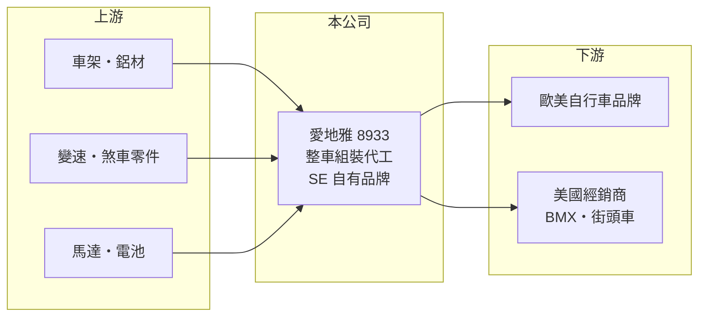

# 8933 愛地雅

> 上櫃｜[[產業索引-運動休閒|運動休閒]]｜上市（櫃）日期 2001/03/28

# 第一章：企業模式與商業藍圖

> [!info] 撰寫說明
> 精簡版，由 Claude 依公開資料整理，架構比照 [[2330台積電]] 的四章研究，資料截至 2026-10-08。財務數字來源：Goodinfo 年度經營績效頁、優分析 2026 年 3 月報導、櫃買中心開放資料（基本資料、2026 年第二季資產負債與綜合損益、每月營收、本益比）。公開資料有限，產品與客戶營收比重未查得，部分沿革憑記憶整理。#待校對

本章說明愛地雅工業（股票代號：8933，以下簡稱愛地雅）這家老牌自行車整車廠，如何在連年虧損後嘗試從純代工轉向「製造＋品牌」的雙軌模式。

- **核心業務：** 愛地雅成立於 1980 年，2001 年上櫃，總部與主要工廠在台中大甲（待校對），以 [[OEM]]／[[ODM]] 方式替國際自行車品牌組裝整車，產品涵蓋一般自行車與[[電動輔助自行車]]。整車組裝的毛利率天生偏低，公司 2019 至 2025 年毛利率大多在 15% 以下，是理解愛地雅獲利困境的起點。
- **營收結構：** 營收以代工為主，主要出貨歐美市場（推估）。2023 年起全球自行車產業進入庫存調整期，營收從 2022 年的 55.9 億元一路降到 2025 年的 21.9 億元，三年內縮小超過六成。產品與地區營收比重公開資料未查得。
- **轉型方向：** 依 2026 年 3 月報導，公司自 2026 年起由 OEM 代工逐步發展「製造＋品牌銷售」雙軌經營，優先布局美國市場，以[[自有品牌]] SE 鎖定美國街頭文化與 BMX 市場，2026 年 1 月開始銷售，並已在美國建立數百家經銷據點。公司表示自有品牌毛利優於代工業務。
- **資本結構變化：** 依櫃買中心資料，愛地雅實收資本額約 32.7 億元，其中含 1.08 億股私募股；截至 2026 年第二季，累積虧損約 18.3 億元，每股淨值只有 4.70 元。這代表公司過去以增資與私募引進資金支撐營運，長期股東的權益已被大幅侵蝕。

# 第二章：護城河深度與競爭優勢

本章分析愛地雅的競爭地位。坦白說，它的護城河很淺，轉型能否成功仍是未知數。

- **既有優勢：** 台灣自行車產業聚落完整，零件供應商集中在中部，愛地雅擁有四十多年整車組裝經驗與台灣生產基地，可提供「非中國產能」給受美國關稅影響的品牌客戶。
- **限制與弱點：** 整車代工主要比的是組裝效率與成本，技術差異化有限，議價能力掌握在品牌客戶手中。相較於擁有全球品牌的 [[9921巨大]] 與 [[9914美利達]]，愛地雅規模小、品牌力弱，在景氣低迷時最先被削減訂單。
- **主要對手：** 台灣整車廠 [[9921巨大]]、[[9914美利達]]，以及中國與東南亞的自行車代工廠；在美國 BMX 與街頭車市場，則要面對眾多既有的專業品牌。
- **觀察重點：** 第一，SE 品牌在美國的銷售與通路擴張；第二，代工訂單能否回升，2026 年 8 月營收年增約九成，公司說明是客戶訂單增加；第三，毛利率能否回到正常的 10% 左右。

# 第三章：財務體質與盈利規模

資料日期：2026-10-08，表格是撰寫當時的快照；最新月營收、毛利率、累計 EPS 由自動排程寫在本筆記的屬性欄位（月營收、毛利率、累計EPS 等）。#待校對

本章用多年度三率、ROE 與資本報酬，檢視愛地雅的財務體質。

| 年度 | 營收（新台幣） | [[毛利率]] | [[營業利益率]] | EPS（元） | [[ROE]] |
|---|---|---|---|---|---|
| 2019 | 40.6 億 | 8.17% | -6.97% | -1.55 | -20.4% |
| 2020 | 40.2 億 | 9.37% | -0.21% | 0.05 | 0.86% |
| 2021 | 46.1 億 | 11.8% | 2.77% | 0.29 | 4.91% |
| 2022 | 55.9 億 | 14.8% | 6.4% | 1.11 | 15.2% |
| 2023 | 36.5 億 | 7.74% | -8.67% | -0.97 | -12.8% |
| 2024 | 26.5 億 | 4.56% | -10.7% | -0.74 | -10.8% |
| 2025 | 21.9 億 | -3.02% | -19.7% | -1.39 | -23.3% |
| 2026 上半年 | 11.7 億 | 2.0% | -15.3% | -0.55 | 未查得 |

註：2019 至 2025 年取自 Goodinfo，2026 上半年由櫃買中心綜合損益表計算。

- **獲利結構：** 七年中只有 2021 與 2022 年疫情帶動自行車熱潮時本業獲利，其餘年度營業利益率多為負值。2025 年毛利率甚至轉為負數，代表售價不足以涵蓋生產成本，推估與產能利用率過低、存貨跌價與固定成本無法攤提有關（推估）。
- **長期指標：** 2019 至 2025 年營收年複合成長率約 -9.8%（推算）；2021 至 2025 年平均 ROE 約 -5.4%（推算）。公司累積虧損未彌補，近年未配發現金股利。
- **財務特色：** 2026 年第二季底總資產約 39.3 億元，負債約 23.9 億元（流動負債約 19.4 億元），權益約 15.3 億元，負債比約 61%。股本 32.7 億元遠大於權益，股價淨值比約 0.97 倍，市場對公司資產價值的評價接近帳面。

**[[ROIC]] 與 [[WACC]]：** 2025 年營業損失約 4.31 億元（21.9 億 × -19.7%），本業虧損沒有所得稅可扣抵，稅後營業利益以 -4.31 億元計。投入資本以權益 15.3 億元加上有息負債（明細未查得，假設占總負債五成，約 12 億元）合計約 27.3 億元，ROIC 約 -15.8%（推算）。WACC 以 CAPM 推估：無風險利率 1.75%、市場風險溢酬 6%、β 取虧損轉型股較高的 1.1，權益成本約 8.35%；負債成本 3%、稅後 2.4%；權益約占 56%，WACC 約 5.7%（推算）。ROIC 為大幅負值，代表本業持續消耗股東資本。愛地雅要創造價值，必須先讓毛利率回到 10% 以上、營業利益轉正，而這取決於代工訂單回流與自有品牌放量能否同時發生。

# 第四章：總體風險與地緣政治

本章分析愛地雅長期面對的風險。

- **產業週期：** 自行車是景氣與庫存驅動的產業，2021 至 2022 年疫情帶動的超額需求，在 2023 年後轉為全產業庫存過剩。品牌庫存去化期間代工訂單會大幅減少，形成[[長鞭效應]]，規模小的代工廠受傷最重。
- **轉型風險：** 經營自有品牌需要投入行銷、通路與庫存，回收期長。若 SE 品牌在美國的銷售不如預期，新增的費用與存貨反而會擴大虧損。
- **財務風險：** 連年虧損讓權益縮水、負債比升高，未來若需要再增資或私募，會稀釋既有股東；累積虧損也使公司短期內難以配發股利。
- **其他風險：** 美國關稅政策反覆、歐洲電動輔助自行車市場的價格競爭，以及鋁材、鋰電池與零組件成本，都會影響接單與毛利。

# 專有名詞解析

## 金融

- **[[長鞭效應]]**：終端需求的小幅變動，沿供應鏈往上游傳遞時被逐級放大，造成上游庫存與訂單劇烈波動。
- **[[ROIC]]**：投入資本報酬率，稅後營業利益除以股東權益與有息負債的合計，衡量本業對所有資金提供者的報酬。
- **[[WACC]]**：加權平均資金成本，依股東權益與負債的比重加權計算的資金成本，ROIC 高於它才代表創造價值。

## 產業

- **[[OEM]]**：代工生產，依客戶的設計與規格製造產品，以客戶品牌出貨。
- **[[ODM]]**：原廠委託設計製造，代工廠負責產品設計與生產，再以客戶品牌出貨。
- **[[自有品牌]]**：公司以自己的品牌直接銷售產品，承擔行銷與通路成本，但能保留較高的品牌溢價。
- **[[電動輔助自行車]]**：騎乘者踩踏時由馬達提供輔助動力的自行車，歐洲稱 e-bike，單價與附加價值高於一般自行車。

# 核心供應鏈

- 上游：車架與鋁材、變速與煞車系統（如 Shimano）、鏈條（如 [[5306桂盟]]）、電動輔助自行車用馬達與電池。
- 下游／客戶：歐美自行車品牌的代工訂單，以及自有品牌 SE 在美國的經銷通路。
- 同業：[[9921巨大]]、[[9914美利達]]，以及中國與東南亞的自行車代工廠。

## 最新新聞
<!-- news:start -->
<!-- news:end -->

## 相關連結
- [公開資訊觀測站](https://mopsov.twse.com.tw/mops/web/t05st03?step=1&firstin=1&co_id=8933)
- [Goodinfo](https://goodinfo.tw/tw/StockDetail.asp?STOCK_ID=8933)
- [Yahoo 股市](https://tw.stock.yahoo.com/quote/8933)
- [鉅亨網新聞](https://www.cnyes.com/twstock/8933/news)
