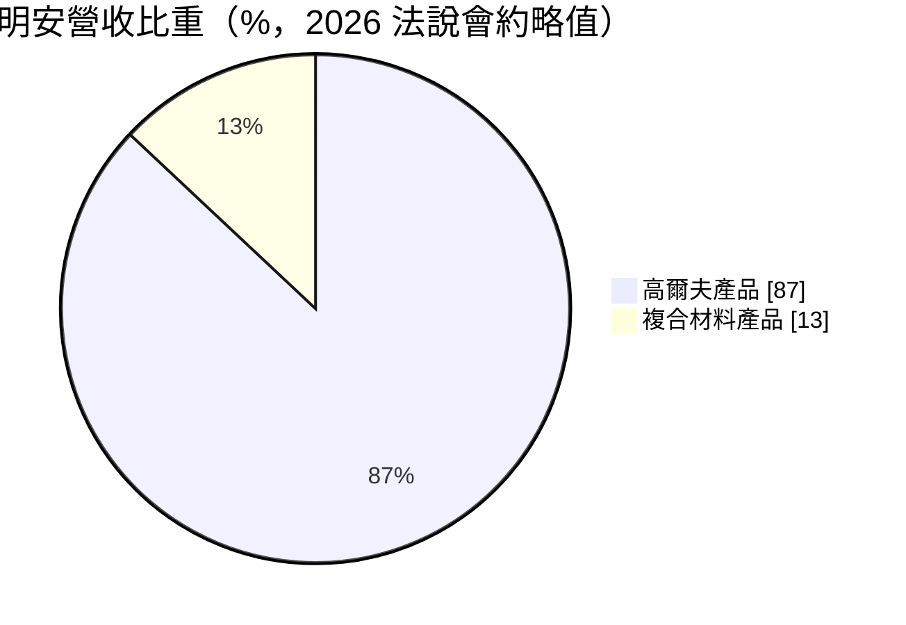
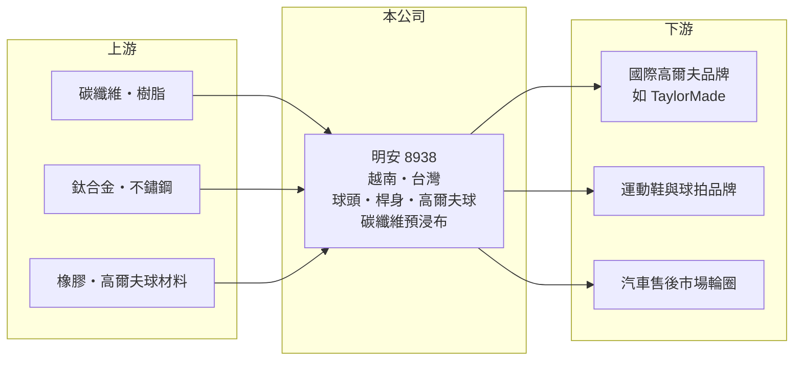

# 8938 明安

> 上櫃｜[[產業索引-運動休閒|運動休閒]]｜上市（櫃）日期 2002/12/02

# 第一章：企業模式與商業藍圖

> [!info] 撰寫說明
> 精簡版，由 Claude 依公開資料整理，架構比照 [[2330台積電]] 的四章研究，資料截至 2026-10-08。財務數字來源：Goodinfo 年度經營績效頁、富果研究整理的 2026 年 5 月法說會摘要、櫃買中心開放資料（基本資料、2026 年第二季資產負債與綜合損益、本益比）。2023 年明揚廠區事故的描述憑記憶整理。#待校對

本章說明明安國際（股票代號：8938，以下簡稱明安）如何從高爾夫球頭代工，發展成同時能做球頭、桿身與高爾夫球的一站式供應商，並把碳纖維技術延伸到其他產業。

- **核心業務：** 明安成立於 1987 年，2002 年上櫃，以 [[OEM]]／[[ODM]] 方式替國際高爾夫品牌生產球頭、組裝球桿、桿身與高爾夫球。依 2026 年法說會，明安是唯一能同時生產球頭、桿身與高爾夫球的代工廠，客戶可以把整支球桿到消耗性的球都交給同一家供應商。
- **營收結構：** 高爾夫產品約占營收 85% 至 90%，[[碳纖維複合材料]]產品約占 10% 至 15%；若把高爾夫產品中使用的碳纖維也算進去，碳纖維相關產值約占總產值 20% 至 30%。主要客戶包括 TaylorMade，前三大客戶每年都推出新品。
- **營運據點：** 越南一、二、三廠已全數建置完成，是集團最大、產品線最完整的生產基地，員工約占集團六成；台灣屏東的子公司明揚負責高爾夫球的產能與技術，高雄和發廠生產碳纖維預浸布。公司正逐步把生產移出中國，降低單一地區風險。
- **長期方向：** 高爾夫事業的成長重心放在高爾夫球等消耗品，因為球每年都要更換，需求比球桿穩定。複合材料則集中在碳纖維運動鞋底、匹克球拍與碳纖維汽車輪圈（2026 年起出貨售後市場），公司預估 2030 年輪圈業務可貢獻約 15 億元營收（公司說法）。

# 第二章：護城河深度與競爭優勢

本章分析明安的護城河：產品線完整度、多地產能與碳纖維材料自製。

- **一站式供應：** 球頭、桿身與高爾夫球分屬不同製程與材料，多數代工廠只專精其中一項。明安三者都能做，讓品牌客戶可以簡化供應鏈管理，也讓明安在每次新品開發時參與得更深，提高客戶的[[轉換成本]]。
- **材料自製：** 和發廠自產碳纖維預浸布，除了自用也外售到亞洲與歐洲。掌握上游材料，可以縮短新產品開發時間、穩定品質，並把碳纖維技術延伸到鞋底、球拍與輪圈等新應用。
- **主要對手：** 高爾夫球頭代工的 [[6670復盛應用]]、[[8924大田]]、[[8928鉅明]]；高爾夫球則面對其他專業製球廠；碳纖維複合材料可對照 [[4536拓凱]]。
- **觀察重點：** 第一，TaylorMade 等客戶把產品週期從一年一改調整為兩年一改，對新品開發訂單的影響；第二，高爾夫球業務的成長；第三，碳纖維輪圈能否如期放量。

# 第三章：財務體質與盈利規模

資料日期：2026-10-08，表格是撰寫當時的快照；最新月營收、毛利率、累計 EPS 由自動排程寫在本筆記的屬性欄位（月營收、毛利率、累計EPS 等）。#待校對

本章用多年度三率、ROE 與資本報酬，檢視明安的獲利品質。

| 年度 | 營收（新台幣） | [[毛利率]] | [[營業利益率]] | EPS（元） | [[ROE]] |
|---|---|---|---|---|---|
| 2019 | 118 億 | 16.9% | 8.1% | 4.55 | 15.4% |
| 2020 | 121 億 | 18.0% | 9.43% | 5.03 | 15.2% |
| 2021 | 169 億 | 19.0% | 11.5% | 10.01 | 27.6% |
| 2022 | 214 億 | 20.3% | 13.2% | 16.92 | 37.3% |
| 2023 | 143 億 | 16.2% | 7.88% | 0.50 | -5.13% |
| 2024 | 142 億 | 15.7% | 5.34% | 7.51 | 16.3% |
| 2025 | 154 億 | 15.6% | 6.41% | 6.18 | 12.2% |
| 2026 上半年 | 72.9 億 | 12.9% | 3.0% | 1.34 | 未查得 |

註：2019 至 2025 年取自 Goodinfo，2026 上半年由櫃買中心綜合損益表計算。Goodinfo 2023 年 EPS 為正、ROE 為負，推估與非控制權益（當時明揚為上市子公司）分攤事故損失有關，以年報為準。

- **景氣循環：** 2021 至 2022 年高爾夫熱潮讓營收衝上 214 億元，2023 年品牌去化庫存，營收減少約 33%。同年子公司明揚屏東廠區發生重大事故（待校對），損失使當年獲利大減；2025 年第一季認列約 3.8 億元保險理賠。
- **獲利結構：** 毛利率長期在 15% 至 20%，營業利益率 5% 至 13%，高於鉅明、低於復盛應用。2026 年上半年營業利益率降到約 3%，推估與客戶產品週期拉長、匯率及新產品初期成本有關（推估）。
- **長期指標：** 2019 至 2025 年營收年複合成長率約 4.5%（推算）；2021 至 2025 年平均 ROE 約 17.7%（推算）。公司自上櫃以來連續 24 年配發股利，2025 年度現金股利 4 元，[[配息率]]約 65%。
- **財務特色：** 2026 年第二季底總資產約 128.7 億元，負債約 52.0 億元，權益約 76.7 億元，負債比約 40%，每股淨值 49.72 元，另持有庫藏股約 263 萬股。

**[[ROIC]] 與 [[WACC]]：** 2025 年營業利益約 9.87 億元（154 億 × 6.41%），扣 20% 稅後約 7.90 億元。投入資本以權益 76.7 億元加上有息負債（明細未查得，假設占總負債六成，約 31 億元）合計約 107.7 億元，ROIC 約 7.3%（推算）。WACC 以 CAPM 推估：無風險利率 1.75%、市場風險溢酬 6%、β 取同業常見值 0.9，權益成本約 7.15%；負債成本 2.5%、稅後 2.0%；權益約占 71%，WACC 約 5.7%（推算）。ROIC 高於 WACC 約 1.6 個百分點，代表明安在正常年度能小幅創造價值，高峰年度利差更大；但 2026 年上半年獲利轉弱，若全年營業利益率停在 3%，ROIC 會跌到 WACC 以下（推算）。

# 第四章：總體風險與地緣政治

本章分析明安長期面對的風險。

- **產業週期：** 高爾夫球具需求受消費景氣與品牌庫存影響，品牌去化庫存時代工訂單會大幅減少，形成[[長鞭效應]]。品牌把新品週期拉長，也會降低代工廠的開發與換線訂單。
- **客戶集中：** 營收高度依賴少數國際品牌，單一客戶的銷售表現或供應商策略改變，會直接衝擊稼動率。
- **營運風險：** 越南廠員工占集團六成，當地工資上漲、勞動法規與供電穩定度都會影響成本；2023 年的廠區事故也顯示化工與製造流程的工安風險。新事業（碳纖維輪圈、鞋底）需要通過車廠與品牌驗證，放量時程有不確定性。
- **其他風險：** 美國關稅政策會影響越南與中國產能的配置；碳纖維、樹脂與金屬原料價格，以及美元、越南盾匯率，也會影響獲利。

# 專有名詞解析

## 金融

- **[[配息率]]**：現金股利占每股盈餘的比例，反映公司把多少獲利分配給股東。
- **[[ROIC]]**：投入資本報酬率，稅後營業利益除以股東權益與有息負債的合計，衡量本業對所有資金提供者的報酬。
- **[[WACC]]**：加權平均資金成本，依股東權益與負債的比重加權計算的資金成本，ROIC 高於它才代表創造價值。

## 產業

- **[[OEM]]**：代工生產，依客戶的設計與規格製造產品，以客戶品牌出貨。
- **[[ODM]]**：原廠委託設計製造，代工廠負責產品設計與生產，再以客戶品牌出貨。
- **[[碳纖維複合材料]]**：以碳纖維搭配樹脂成型的材料，重量輕、強度高，用於球拍、球桿、自行車與飛機結構件。
- **[[轉換成本]]**：客戶更換供應商時需要付出的時間、驗證與風險成本，越高代表客戶越不容易轉單。

# 核心供應鏈

- 上游：碳纖維原絲與樹脂、鈦合金與不鏽鋼、高爾夫球用橡膠與聚合物材料。
- 下游／客戶：國際高爾夫品牌（含 TaylorMade）、美國匹克球拍品牌、運動鞋品牌，以及碳纖維輪圈的汽車售後市場。
- 同業：[[6670復盛應用]]、[[8924大田]]、[[8928鉅明]]，複合材料可對照 [[4536拓凱]]。

## 最新新聞
<!-- news:start -->
<!-- news:end -->

## 相關連結
- [公開資訊觀測站](https://mopsov.twse.com.tw/mops/web/t05st03?step=1&firstin=1&co_id=8938)
- [Goodinfo](https://goodinfo.tw/tw/StockDetail.asp?STOCK_ID=8938)
- [Yahoo 股市](https://tw.stock.yahoo.com/quote/8938)
- [鉅亨網新聞](https://www.cnyes.com/twstock/8938/news)
