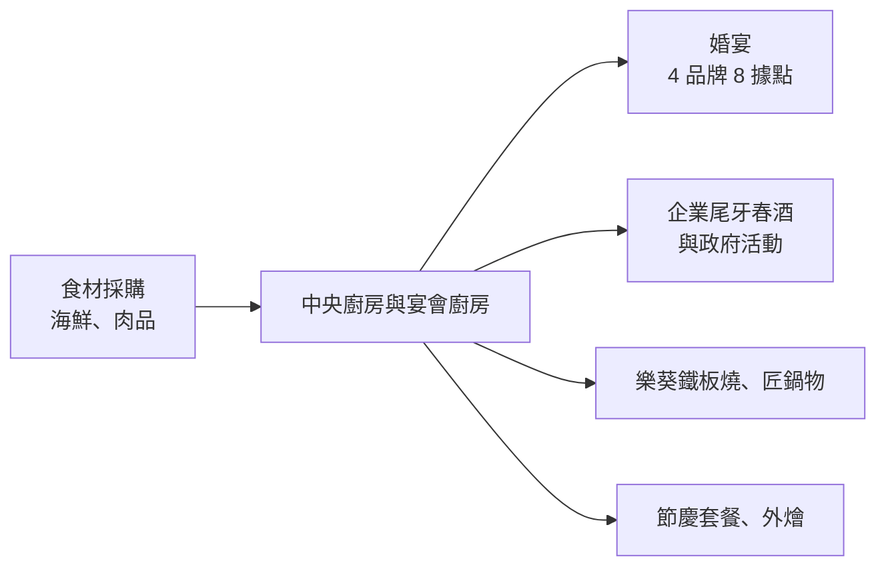
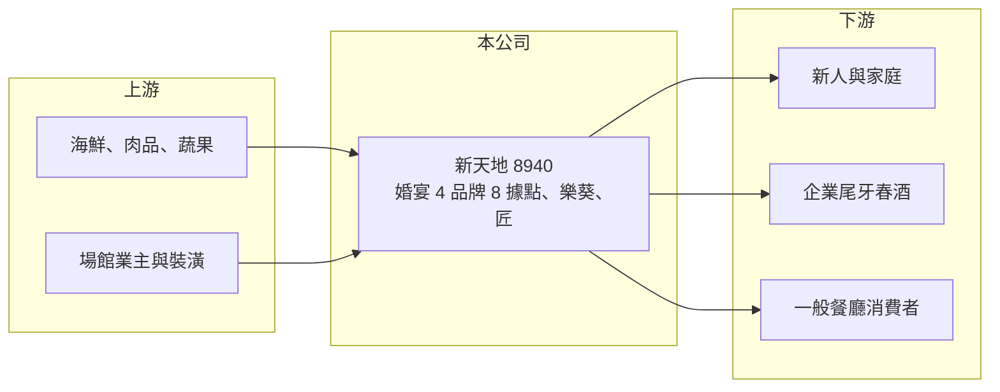

# 8940 新天地

> 上市｜[[產業索引-觀光餐旅|觀光餐旅]]｜上市（櫃）日期 2009/05/15

# 第一章：企業模式與商業藍圖

> [!info] 撰寫說明
> 精簡版，由 Claude 依公開資料整理，架構比照 [[2330台積電]] 的四章研究，資料截至 2026-10-08。來源：Goodinfo 年度經營績效頁、工商時報 2026 年 5 月報導、證交所開放資料（基本資料、2026 年第二季資產負債與綜合損益、營益分析、股利、每月營收）。婚宴品牌名稱與起源地部分憑記憶整理，已標示待校對；婚宴與一般餐飲的營收比重未查得。#待校對

新天地是以台中為基地的婚宴與宴會餐飲集團，被市場視為台灣婚宴龍頭之一。本章說明它的業務組成與營運特性。

## 一、核心定位：大型婚宴場館與多品牌餐廳

新天地成立於 1993 年，2009 年上市，董事長為歐宗憲、總經理為歐政宏，實收資本額約 6.75 億元（證交所開放資料）。依工商時報 2026 年 5 月報導，公司經營 4 個婚宴品牌、全台 8 個大型宴會據點，總容量可達 1,386 桌；另經營 6 家「樂葵」法式鐵板燒與 1 家「匠」頂級鍋物餐廳。婚宴品牌以「新天地」與「心之芳庭」較為人知（品牌名稱待校對）。

* **[[婚宴會館]]的特性：** 一個場館可以同時辦多場宴席，週末與吉日的訂桌率決定獲利。婚宴需要提前數月訂位、收取訂金，營收能見度比一般餐廳高。
* **一般餐廳的角色：** 鐵板燒與鍋物餐廳可以使用平日閒置的人力與[[中央廚房]]產能，平衡婚宴淡旺季。

## 二、商業模式：宴席、尾牙春酒與節慶餐

婚宴與宴會的收入來自桌數乘以每桌單價，旺季集中在農曆年前後的尾牙春酒、母親節與秋冬婚期。工商時報報導指出，公司的成長動能來自節慶宴席、穩定的外燴與企業活動需求，以及多品牌展店。毛利率長期約 45% 至 53%（Goodinfo），但大型場館的租金、折舊與人力固定成本高，營業利益率對桌數非常敏感。

## 三、長期方向

公司的長期方向是在婚宴本業之外，擴大鐵板燒、鍋物等一般餐飲品牌，降低對婚宴季節與結婚對數的依賴。台灣結婚對數長期下降，婚宴市場的總量成長有限，龍頭業者的策略重點因此轉向提高市占、提高每桌單價，以及開發企業宴會與一般餐飲。

# 第二章：護城河深度與競爭優勢

婚宴市場的進入門檻在於場地與口碑。本章分析新天地的護城河與限制。

## 一、護城河的核心組成要素

* **大型場地的稀缺性：** 可同時容納上百桌的宴會場館需要大面積土地與建物，在都會區新開設的難度高。新天地 8 個據點、近 1,400 桌的容量，是新進業者難以快速複製的規模。
* **口碑與品牌：** 婚宴是一生一次的消費，新人高度依賴口碑與親友推薦，經營數十年的品牌在中部地區具有信任度。
* **宴席經驗與中央廚房：** 同時出餐上百桌需要成熟的廚房動線與人力調度，這是一般餐廳難以承接的能力。

## 二、主要競爭對手

| 對手 | 定位 | 對新天地的威脅 |
|---|---|---|
| [[1268漢來美食]] | 飯店宴席與多品牌餐飲 | 搶高價位婚宴與企業宴會 |
| [[2707晶華]]、[[2704國賓]] 等國際飯店 | 飯店婚宴 | 在高價婚宴市場競爭 |
| 彭園、典華等婚宴會館 | 獨立婚宴會館 | 定位最接近，在北部與中部直接競爭 |
| [[2727王品]] | 多品牌餐飲 | 與樂葵鐵板燒等一般餐飲品牌競爭 |

## 三、守得住與守不住

* **守得住：** 中部地區大型婚宴與企業尾牙的市占，以及大型場館帶來的進入障礙。
* **守不住：** 市場總量。結婚對數長期減少、婚禮規模縮小，婚宴桌數的長期趨勢向下。
* **觀察重點：** 一般餐飲品牌的展店成效、每桌單價的調漲能力，以及營業利益率能否回到 2023 年約 10% 的水準。

# 第三章：財務體質與盈利規模

資料日期：2026-10-08，表格是撰寫當時的快照；最新月營收、毛利率、累計 EPS 由自動排程寫在本筆記的屬性欄位（月營收、毛利率、累計EPS 等）。#待校對

本章用多年度數據檢視新天地在疫情前後的獲利與資本報酬。

## 一、多年度三率與 ROE

| 年度 | 營收（新台幣） | [[毛利率]] | [[營業利益率]] | EPS（元） | [[ROE]] |
|---|---|---|---|---|---|
| 2019 | 15.3 億 | 49.6% | 0.14% | -0.04 | -0.09% |
| 2020 | 10.2 億 | 45.4% | -9.26% | -0.86 | -6.75% |
| 2021 | 6.69 億 | 41.9% | -21.2% | -1.74 | -16.8% |
| 2022 | 9.78 億 | 49.8% | 3.65% | 0.35 | 3.52% |
| 2023 | 15.4 億 | 52.7% | 10.7% | 1.58 | 15.8% |
| 2024 | 17.0 億 | 51.0% | 8.73% | 1.44 | 12.0% |
| 2025 | 15.9 億 | 49.1% | 4.27% | 0.55 | 5.32% |
| 2026 上半年 | 9.26 億 | 49.15% | 9.96% | 0.95 | 未查得 |

註：2019 至 2025 年取自 Goodinfo；2026 上半年取自證交所營益分析與綜合損益。

* **營收規模停滯：** 2019 至 2025 年營收年複合成長率不到 1%（推算），營收規模停留在 15 億至 17 億元。2026 年 1 至 8 月累計營收約 10.7 億元、年增約 2.3%（證交所每月營收）。
* **獲利高度季節性：** 2026 年上半年 EPS 0.95 元已高於 2025 年全年的 0.55 元，因為上半年包含尾牙春酒與母親節等旺季，下半年通常較淡。
* **ROE 平均偏低：** 2021 至 2025 年平均 ROE 約 4%（推算），只有 2023、2024 年超過 10%。

## 二、股利與財務結構

2025 年度未配發現金股利（證交所股利資料）。2026 年第二季底總資產約 21.1 億元、總負債約 11.8 億元（其中非流動負債約 7.9 億元）、權益約 9.2 億元，保留盈餘只有約 0.24 億元（證交所資產負債），顯示疫情期間的虧損仍在消化。非流動負債可能包含場館的長期借款與[[租賃負債]]，各自金額未查得。

## 三、[[ROIC]] 與 [[WACC]]

**ROIC 推算：** 2025 年營業利益約 15.9 億 × 4.27% ≈ 0.68 億元，以 20% 稅率計算稅後約 0.54 億元。以權益約 9.2 億元加上推估的有息與租賃負債約 8 億元、合計約 17 億元作為投入資本，ROIC 約 3%（推算）。2023 年營業利益約 1.65 億元，同樣算法 ROIC 約 8%（推算）。

**WACC 推算：** 台灣 10 年期公債 1.75%、市場風險溢酬 6%、β 取餐飲同業常見值 0.7，權益成本約 6%；負債稅後成本約 2%，以權益 55%、負債 45% 加權，WACC 約 4.2%（推算）。

**結論：** 新天地只有在 2023、2024 年這種婚宴旺年 ROIC 才明顯高於 WACC，2025 年則略低於資金成本。長期來看，大型場館的固定成本讓公司的資本報酬接近資金成本，能否穩定創造價值，取決於一般餐飲品牌能否提高平日的場地與人力使用率。

# 第四章：總體風險與地緣政治

本章整理新天地長期面對的人口、成本與營運風險。

## 一、人口與產業結構

* **結婚對數下降：** 台灣少子化與晚婚使結婚對數長期減少，婚宴需求總量下滑，是最根本的長期風險。
* **婚禮型態改變：** 小型婚禮、戶外婚禮與只登記不宴客的趨勢，會降低大型宴會廳的桌數需求。

## 二、營運風險

* **季節性與吉日集中：** 營收集中在特定月份與週末，淡季的固定成本難以降低，獲利波動大。
* **人力與食材：** 宴席需要大量臨時人力，服務業缺工與基本工資上漲，加上海鮮與肉品價格波動，會壓縮利潤。

## 三、其他風險

* **疫情與群聚管制：** 2020 至 2021 年營收大減的經驗顯示，任何限制群聚的政策都會直接衝擊宴會業。
* **場館租約與老化：** 大型場館的租約續約、建物老化與翻修，需要持續投入資本。

# 專有名詞解析

## 金融

- **[[租賃負債]]**：依 IFRS 16，企業把長期租約未來應付的租金折現後認列在資產負債表上的負債，連鎖餐飲與零售業金額通常很大。
- **[[ROIC]]**：投入資本報酬率，衡量企業用股東與債權人投入的資本，每年能產生多少稅後營業利益。
- **[[WACC]]**：加權平均資金成本，股東要求報酬與負債利息依資本結構加權後的平均值，是判斷是否創造價值的門檻。

## 產業

- **[[婚宴會館]]**：專門承辦婚宴與大型宴會的場館，收入取決於桌數與每桌單價，旺季集中在吉日與週末。
- **[[中央廚房]]**：連鎖餐飲集中採購、清洗、切配與預先調理食材的工廠，再配送到各門市，以統一品質並降低成本。

# 核心供應鏈

- 上游：海鮮、肉品與蔬果供應商，場館業主與裝潢工程。
- 下游／客戶：新人與家庭、企業尾牙春酒與活動、鐵板燒與鍋物餐廳消費者。
- 同業：[[1268漢來美食]]、[[2707晶華]]、[[2704國賓]]、[[2727王品]]、彭園、典華。

## 最新新聞
<!-- news:start -->
<!-- news:end -->

## 相關連結
- [公開資訊觀測站](https://mopsov.twse.com.tw/mops/web/t05st03?step=1&firstin=1&co_id=8940)
- [Goodinfo](https://goodinfo.tw/tw/StockDetail.asp?STOCK_ID=8940)
- [Yahoo 股市](https://tw.stock.yahoo.com/quote/8940)
- [鉅亨網新聞](https://www.cnyes.com/twstock/8940/news)
