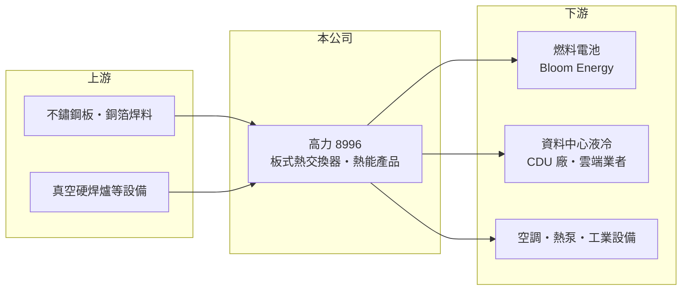

# 8996 高力

> 上市｜[[產業索引-電機機械|電機機械]]｜上市（櫃）日期 2014/02/14

# 第一章：企業模式與商業藍圖

> [!info] 撰寫說明
> 精簡版，由 Claude 依公開資料整理，架構比照 [[2330台積電]] 的四章研究，資料截至 2026-10-08。來源：證交所開放資料（基本資料、2026 年第二季資產負債與綜合損益、股利、每月營收備註）、Goodinfo 經營績效頁（2020 至 2025 年度數字）、優分析 2026 年研究文章、財訊與工商時報標題。生產據點與部分客戶細節憑記憶整理，已標註待校對。#待校對

高力是一家有五十多年歷史的[[熱交換器]]廠，近年從傳統工業熱能設備，轉型為燃料電池與 AI 資料中心液冷的關鍵零組件供應商。理解高力，要先理解「熱交換」這個看似傳統、卻是能源與散熱系統核心的技術。

- **核心業務：** 高力成立於 1970 年，總部在桃園中壢，2014 年在證交所上市。核心技術是[[板式熱交換器]]與真空硬焊（銅焊）製程：把多片壓出紋路的金屬板疊合後在真空爐中焊成一體，讓冷熱兩種流體在極小空間內交換熱量。這項製程同時應用在空調、[[熱泵]]、工業設備，以及燃料電池與伺服器液冷系統。
- **營收結構：** 公司把營收分為「板式熱交換器」與「熱能產品」兩大類。熱能產品包括供應美國燃料電池廠 Bloom Energy 的 Hot Box 等熱管理元件，2026 年 1 至 8 月熱能產品營收年增 158%、板式熱交換器年增 19%（證交所每月營收備註），可見成長主力已轉向燃料電池相關業務。依 2026 年研究文章，資料中心液冷用的板式熱交換器約占 2026 年營收 4%，法人預估 2027 至 2028 年占比可升至 16% 至 18%（預估值）。產品別確切比重未查得。
- **營運據點：** 主要生產基地在台灣中壢，另有中國生產據點（待校對）。為了對應 Bloom Energy 與資料中心客戶的需求，公司已啟動擴產規劃，並在 2026 年連續發行第五次、第六次無擔保[[可轉換公司債]]籌措資金，顯示正處於積極擴充產能的階段。
- **長期方向：** 高力的長期成長來自兩條主線。第一是[[固態氧化物燃料電池]]：AI 資料中心電力吃緊，現場發電的燃料電池需求上升，高力是 Bloom Energy 熱管理元件的重要供應商。第二是[[液冷]]：AI 伺服器功耗提高，雲端業者導入液對液的 [[CDU]]（冷卻液分配單元），而板式熱交換器是 CDU 內部的核心零件。

# 第二章：護城河深度與競爭優勢

熱交換器看起來是成熟產品，但在高溫、高壓、長壽命的應用中，焊接品質與可靠度需要長期累積。本章分析高力的護城河與競爭格局。

- **競爭優勢：** 高力的優勢在真空硬焊製程與材料工藝的長年累積。燃料電池的工作溫度很高，熱管理元件必須在高溫下長期不洩漏；資料中心液冷則要求零洩漏與長壽命。這類關鍵零件一旦通過客戶驗證、進入量產，客戶很少輕易更換供應商，形成轉換成本。高力與 Bloom Energy 的長期合作關係，也讓它跟著客戶的擴產一起成長。
- **主要對手：** 板式熱交換器的國際大廠包括瑞典 Alfa Laval、丹麥 Danfoss 與 SWEP 等，品牌與規模都大於高力。在資料中心液冷領域，CDU 系統由 [[2308台達電]]、Vertiv 等廠商整合，散熱模組廠如 [[3017奇鋐]]、[[3324雙鴻]] 也在擴大液冷布局；高力的定位偏向供應 CDU 內部的熱交換器，與系統廠是合作也是潛在競爭關係。
- **護城河的限制：** 高力的燃料電池業務高度集中在單一客戶 Bloom Energy，議價能力與成長性都受這家客戶左右。熱交換器本身也不是獨家技術，國際大廠若積極爭取資料中心市場，價格競爭會加劇。這使高力的護城河屬於「窄而深」：在特定客戶與特定應用上很深，但範圍不寬。
- **觀察重點：** 長期應觀察 Bloom Energy 營收占比是否下降、液冷熱交換器能否打進更多雲端業者與 CDU 廠，以及擴產後新產能的利用率與毛利率能否維持。

# 第三章：財務體質與盈利規模

資料日期：2026-10-08，表格是撰寫當時的快照；最新月營收、毛利率、累計 EPS 由自動排程寫在本筆記的屬性欄位（月營收、毛利率、累計EPS 等）。#待校對

高力的財務數字清楚記錄了它的轉型：營收在五年內成長三倍以上，獲利能力同步提升。本章用多年度資料檢視成長的品質與資本報酬。

| 年度 | 營收（億元） | [[毛利率]] | [[營業利益率]] | EPS（元） | [[ROE]] |
|---|---|---|---|---|---|
| 2020 | 20.8 | 25.4% | 8.2% | 1.26 | 6.0% |
| 2021 | 22.3 | 26.6% | 10.3% | 1.67 | 7.8% |
| 2022 | 28.4 | 27.6% | 12.2% | 3.37 | 15.3% |
| 2023 | 43.3 | 28.3% | 16.4% | 6.45 | 24.2% |
| 2024 | 40.0 | 29.8% | 16.2% | 6.56 | 19.3% |
| 2025 | 65.8 | 27.3% | 15.6% | 9.07 | 21.8% |
| 2026 上半年 | 57.3 | 27.8% | 17.6% | 8.69 | 未查得 |

- **營收規模與成長：** 2020 至 2025 年營收從 20.8 億元成長到 65.8 億元，年複合成長率約 26%（推算），2026 年上半年營收 57.3 億元已接近 2025 年全年。成長主要來自燃料電池熱管理元件的放量，而非傳統空調與工業熱交換器。
- **獲利：** 毛利率長期穩定在 25% 至 30%，代表高力屬於製造型零組件廠，而非高毛利的技術授權型公司；獲利成長主要靠規模放大帶來的營業槓桿，[[營業利益率]]從 2020 年的 8.2% 提升到 2026 年上半年的 17.6%。2026 年上半年稅後淨利 8.07 億元，已接近 2025 年全年 8.30 億元。
- **財務特色：** 2026 年第二季底總資產 102.6 億元、股東權益 51.3 億元，負債比約 50%，較傳統製造業偏高，主要是營運擴張帶來的應付款項與可轉債。2021 至 2025 年平均 ROE 約 17.7%（推算）。2025 年度每股配發現金股利 4.6 元，約為當年 EPS 的五成，公司章程規定盈餘分配比例為 10% 至 100%，保留約一半盈餘支應擴產，符合成長期公司的資本配置習慣。
- **[[ROIC]] 與 [[WACC]]：** 以 2025 年營業利益約 10.3 億元（65.8 億 × 15.6%）、稅率 20% 計，稅後營業利益約 8.2 億元；投入資本以 2026 年第二季股東權益 51.3 億元加非流動負債 11.6 億元（有息負債明細未查得，以此近似）約 62.9 億元計，2025 年 ROIC 約 13%（推算）。2026 年上半年營業利益 10.1 億元，年化後 ROIC 約 25%（推算）。WACC 以 CAPM 推估：無風險利率 1.75%、市場風險溢酬 6%、β 假設 1.3（成長型電機與散熱股常見值，非來源數字），股權成本約 9.6%；負債成本假設 2.5%、稅後 2%，股權與負債約 8 比 2，WACC 約 8%（推算）。結論是高力自 2022 年起 ROIC 持續高於 WACC，轉型後確實在創造價值；未來的關鍵是擴產新增的資本能否維持同樣的報酬水準。

# 第四章：總體風險與地緣政治

高力的成長來自少數新興應用，這讓它的上行空間與下行風險都比傳統製造業大。本章整理它的長期風險。

- **產業週期：** 燃料電池與資料中心液冷都受 AI 基礎建設投資驅動。只要雲端業者放緩資料中心建置，或電力短缺的問題被電網擴建、其他發電方式解決，燃料電池的需求成長就會放慢。傳統業務則受全球空調、熱泵與工業投資景氣影響。
- **客戶集中風險：** 燃料電池業務高度依賴 Bloom Energy，若該客戶訂單變化、改採多元供應商或自製，對高力營收與獲利的影響會很大。液冷業務也集中在少數雲端業者與 CDU 廠。
- **營運與財務風險：** 快速擴產需要大量資本支出與營運資金，2026 年連續發行可轉債代表資金需求上升；可轉債轉換後會稀釋股本，擴產若遇到需求放緩，新產能的折舊會壓低利潤率。
- **其他風險：** 主要客戶在美國，美國關稅與在地製造要求可能迫使高力赴美設廠或調整供應鏈。不鏽鋼與銅等金屬原料價格上漲會壓縮毛利；營收以美元計價比重高，新台幣升值會影響以台幣計算的獲利。

# 專有名詞解析

## 應用

- **[[液冷]]**：以液體帶走晶片熱量的散熱方式，散熱能力遠高於風扇氣冷，是高功耗 AI 伺服器的主流方向。
- **[[CDU]]**：冷卻液分配單元，負責在液冷系統中循環冷卻液並透過熱交換器把熱排出機櫃。

## 金融

- **[[可轉換公司債]]**：持有人可在約定期間依轉換價格把債券轉為公司股票的債券，票面利率通常很低。

## 產業

- **[[熱交換器]]**：讓兩種不同溫度的流體在不直接混合的情況下交換熱量的設備，用於空調、工業與散熱系統。
- **[[板式熱交換器]]**：以多片壓紋金屬板疊合焊接而成的熱交換器，體積小、效率高，常見於熱泵與液冷系統。
- **[[熱泵]]**：利用少量電力把熱從低溫處搬到高溫處的設備，用於暖氣、熱水與工業加熱，比直接燃燒更省能。
- **[[固態氧化物燃料電池]]**：以陶瓷電解質在高溫下讓燃料與氧反應發電的燃料電池，發電效率高，可作為資料中心現場電源。

# 核心供應鏈

- 上游：不鏽鋼板、銅焊料等金屬原料，國內鋼材供應商如 [[2002中鋼]]（是否為高力供應商未查得）；真空硬焊爐等製程設備。
- 下游／客戶：燃料電池廠 Bloom Energy 是最重要的客戶；資料中心液冷的 CDU 系統廠與雲端業者，台灣 CDU 與電源系統廠如 [[2308台達電]]（是否為高力客戶未查得）；另有空調、熱泵與工業設備客戶。
- 同業：國際板式熱交換器廠 Alfa Laval、Danfoss、SWEP；台灣液冷散熱相關廠商 [[3017奇鋐]]、[[3324雙鴻]]（產品層級不同，屬廣義同業）。

## 最新新聞
<!-- news:start（自動產生，請勿手動編輯此範圍） -->
- 2026-10-07 🏛️ 重訊 14:13｜公告本公司國內第五次無擔保轉換公司債收足債款｜[觀測站](https://mops.twse.com.tw/mops/#/web/t05st01)
- 2026-10-05 📰 媒體 18:50｜營收速報 - 高力(8996)9月營收16.16億元年增率高達153.78％｜[鉅亨網](https://news.cnyes.com/news/id/6621917)

完整紀錄：[[8996高力 新聞]]
<!-- news:end -->

## 相關連結
- [公開資訊觀測站](https://mopsov.twse.com.tw/mops/web/t05st03?step=1&firstin=1&co_id=8996)
- [Goodinfo](https://goodinfo.tw/tw/StockDetail.asp?STOCK_ID=8996)
- [Yahoo 股市](https://tw.stock.yahoo.com/quote/8996)
- [鉅亨網新聞](https://www.cnyes.com/twstock/8996/news)
