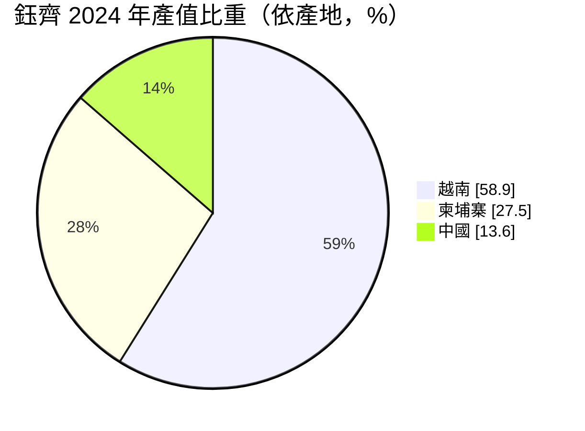
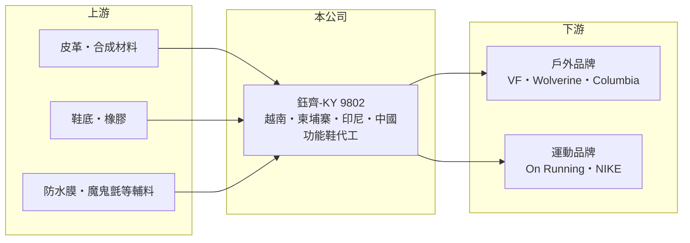

# 9802 鈺齊-KY

> 上市｜[[產業索引-運動休閒|運動休閒]]｜上市（櫃）日期 2012/10/18

# 第一章：企業模式與商業藍圖

> [!info] 撰寫說明
> 精簡版，由 Claude 依公開資料整理，架構比照 [[2330台積電]] 的四章研究，資料截至 2026-10-08。財務數字來源：Goodinfo 年度經營績效頁、優分析 2025 年 4 月個股報導、證交所開放資料（基本資料、2026 年第二季資產負債與綜合損益、營益分析、股利、本益比）。#待校對

本章說明鈺齊國際（股票代號：9802，以下簡稱鈺齊）如何以「多品牌、多產地」的策略，在戶外功能鞋代工領域建立自己的位置。

- **核心業務：** 鈺齊集團 1995 年創立，2009 年成立開曼控股公司，2012 年在台上市，屬於[[KY股]]。公司專注[[功能鞋]]的 [[OEM]]／[[ODM]] 代工，依 2025 年報導，戶外功能鞋約占營收 88% 至 92%，運動鞋約占 8% 至 12%，產品包括登山鞋、雪靴、打獵鞋、溯溪鞋與越野跑鞋。
- **客戶結構：** 量產客戶超過 50 家，包括 VF 集團、Wolverine 集團、Columbia、NIKE、Meindl，以及 2024 年躍升為第二大客戶的 On Running（營收占比約 10% 至 15%）。前三大客戶合計近五成、前十大超過八成，集中度仍高，但比單一大客戶模式分散。
- **營運據點：** 生產基地分布在越南、柬埔寨、印尼與中國。2024 年產值比重越南約 58.9%、柬埔寨約 27.5%、中國約 13.6%，近年新增產能集中在越南鈺騰廠與印尼齊樺廠。銷售地區 2024 年歐洲約 44.3%、美洲約 39.1%、亞洲約 15%。
- **長期方向：** 每年穩定新增 3 至 5 個客戶，並持續把產能放在中國以外，以因應品牌客戶的供應鏈分散需求。切入 On Running 這類高成長運動品牌，是鈺齊從戶外鞋延伸到跑鞋的重要一步。

# 第二章：護城河深度與競爭優勢

本章分析鈺齊的護城河：功能鞋的製程門檻與客戶分散。

- **競爭優勢：** 戶外功能鞋要求防水、止滑、耐磨與支撐，材料多、工序複雜，生產門檻高於一般休閒鞋。鈺齊長期專注這個利基，累積開發與量產經驗，讓品牌客戶願意把高單價、少量多樣的鞋款交給它。
- **客戶分散：** 相較於大型鞋廠集中服務少數超大品牌，鈺齊同時服務 50 多個品牌，任何一家品牌轉弱的衝擊較小，也讓公司能快速搭上新興品牌（如 On Running）的成長。
- **主要對手：** 大型製鞋集團 [[9904寶成]]、[[9910豐泰]] 規模遠大，主要服務運動品牌；戶外鞋代工另有 [[6768志強-KY]] 與越南、中國的鞋廠。
- **觀察重點：** 第一，On Running 等新客戶的訂單成長；第二，印尼新廠的產能爬坡與良率；第三，毛利率能否回到 2022 年 23% 的高點，或停留在 15% 至 19% 區間。

# 第三章：財務體質與盈利規模

資料日期：2026-10-08，表格是撰寫當時的快照；最新月營收、毛利率、累計 EPS 由自動排程寫在本筆記的屬性欄位（月營收、毛利率、累計EPS 等）。#待校對

本章用多年度三率、ROE 與資本報酬，檢視鈺齊的獲利品質。

| 年度 | 營收（新台幣） | [[毛利率]] | [[營業利益率]] | EPS（元） | [[ROE]] |
|---|---|---|---|---|---|
| 2019 | 128 億 | 19.7% | 11.3% | 7.81 | 17.2% |
| 2020 | 113 億 | 21.0% | 11.2% | 5.06 | 10.7% |
| 2021 | 155 億 | 18.0% | 9.46% | 6.39 | 13.5% |
| 2022 | 242 億 | 23.1% | 15.9% | 18.10 | 37.5% |
| 2023 | 169 億 | 18.9% | 10.7% | 7.87 | 14.0% |
| 2024 | 146 億 | 19.1% | 8.7% | 7.23 | 10.4% |
| 2025 | 173 億 | 18.3% | 9.2% | 6.05 | 8.69% |
| 2026 上半年 | 89.3 億 | 14.7% | 5.0% | 1.78 | 未查得 |

註：2019 至 2025 年取自 Goodinfo，2026 上半年取自證交所營益分析與綜合損益表。

- **景氣循環：** 2022 年戶外熱潮讓營收衝上 242 億元、EPS 18.1 元，2023 至 2024 年品牌去化庫存，營收回落到 146 億元。2025 年營收回升到 173 億元，但 EPS 只有 6.05 元，低於營收規模相近的 2023 年。
- **股本稀釋：** EPS 與 ROE 沒有跟著營收回升，原因之一是股本與權益擴大。2026 年第二季資本公積約 66 億元，推估來自歷年現金增資與可轉換公司債轉換（推估），用來支應新廠建設。擴產讓營收規模變大，但每股獲利被稀釋。
- **長期指標：** 2019 至 2025 年營收年複合成長率約 5.2%（推算）；2021 至 2025 年平均 ROE 約 16.8%（推算），但最近三年都在 15% 以下。公司採半年配息，2025 年下半年配 3.1 元、2026 年上半年配 2.0 元。
- **財務特色：** 2026 年第二季底總資產約 225.4 億元，負債約 89.1 億元（流動負債約 74.9 億元），權益約 136.3 億元，負債比約 40%，每股淨值 67.72 元，股價淨值比約 0.95 倍。

**[[ROIC]] 與 [[WACC]]：** 2025 年營業利益約 15.9 億元（173 億 × 9.2%），扣 20% 稅後約 12.7 億元。投入資本以權益 136.3 億元加上有息負債（明細未查得，假設占總負債四成，約 35.6 億元）合計約 171.9 億元，ROIC 約 7.4%（推算）。WACC 以 CAPM 推估：無風險利率 1.75%、市場風險溢酬 6%、β 取製鞋同業常見值 0.9，權益成本約 7.15%；負債成本 2.5%、稅後 2.0%；權益約占 79%，WACC 約 6.1%（推算）。ROIC 只比 WACC 高約 1.3 個百分點，代表擴產後的資本報酬已從 2022 年的高峰大幅收斂；2026 年上半年營業利益率降到 5%，若持續，ROIC 將接近或低於 WACC（推算）。新廠能否提高產能利用率，是價值創造能否恢復的關鍵。

# 第四章：總體風險與地緣政治

本章分析鈺齊長期面對的風險。

- **產業週期：** 戶外與運動鞋需求受歐美消費景氣與品牌庫存影響。品牌在景氣轉弱時削減訂單的幅度大於終端銷售衰退，形成[[長鞭效應]]，2023 至 2024 年的營收回落就是例子。
- **客戶集中：** 雖然客戶數多，但前三大仍占近五成；On Running 這類成長型客戶若改變供應商配置，影響會很明顯。
- **營運風險：** 越南、柬埔寨、印尼的工資上漲、勞動法規與罷工風險，以及新廠初期的效率損失與折舊，都會壓縮毛利率。擴產若快於訂單成長，資本報酬會持續下降。
- **其他風險：** 美國對東南亞的關稅政策、歐洲的環保與供應鏈盡職調查法規，以及皮革、橡膠與合成材料價格、美元匯率變動，都會影響接單與獲利。

# 專有名詞解析

## 金融

- **[[KY股]]**：在開曼群島等海外地區註冊、回台灣掛牌的公司，營運主體多在台灣以外。
- **[[ROIC]]**：投入資本報酬率，稅後營業利益除以股東權益與有息負債的合計，衡量本業對所有資金提供者的報酬。
- **[[WACC]]**：加權平均資金成本，依股東權益與負債的比重加權計算的資金成本，ROIC 高於它才代表創造價值。

## 產業

- **[[功能鞋]]**：強調防水、透氣、止滑或支撐等特定功能的鞋款，例如登山鞋、雪靴與越野跑鞋，製程比休閒鞋複雜。
- **[[OEM]]**：代工生產，依客戶的設計與規格製造產品，以客戶品牌出貨。
- **[[ODM]]**：原廠委託設計製造，代工廠負責產品設計與生產，再以客戶品牌出貨。

# 核心供應鏈

- 上游：皮革與合成材料、鞋底與橡膠、防水透氣膜，以及魔鬼氈等輔料（如 [[9938百和]]）。
- 下游／客戶：VF 集團、Wolverine 集團、Columbia、Meindl 等戶外品牌，以及 On Running、NIKE 等運動品牌。
- 同業：[[9904寶成]]、[[9910豐泰]]、[[6768志強-KY]]。

## 最新新聞
<!-- news:start -->
<!-- news:end -->

## 相關連結
- [公開資訊觀測站](https://mopsov.twse.com.tw/mops/web/t05st03?step=1&firstin=1&co_id=9802)
- [Goodinfo](https://goodinfo.tw/tw/StockDetail.asp?STOCK_ID=9802)
- [Yahoo 股市](https://tw.stock.yahoo.com/quote/9802)
- [鉅亨網新聞](https://www.cnyes.com/twstock/9802/news)
