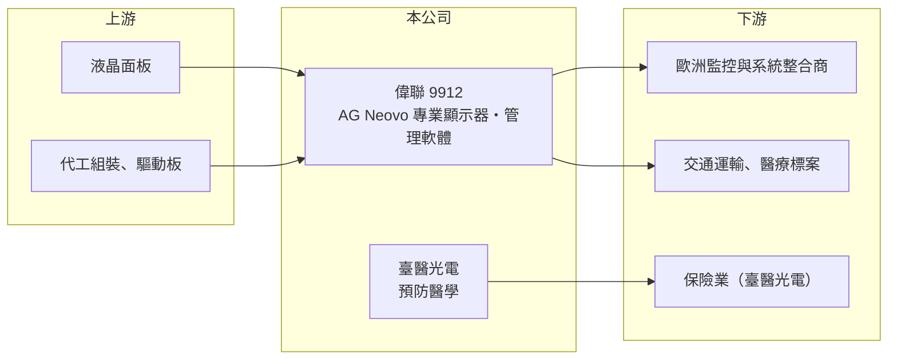

# 9912 偉聯

> 上市｜[[產業索引-電腦及週邊設備業|電腦及週邊設備業]]｜上市（櫃）日期 1992/08/08

# 第一章：企業模式與商業藍圖

> [!info] 撰寫說明
> 精簡版，由 Claude 依公開資料整理，架構比照 [[2330台積電]]，資料截至 2026-10-08。來源：證交所開放資料快照（基本資料、2026 年第二季資產負債與損益、股利）、Goodinfo 經營績效頁、富果 2026 年 6 月法說會備忘錄。公開資料有限。#待校對

偉聯科技（以下簡稱偉聯）是以自有品牌 AG Neovo 經營專業顯示器的公司，理解它的關鍵在於：它賣的不是一般消費型螢幕，而是要 24 小時不停機的監控、交通與醫療用顯示器，並試著從賣硬體轉向賣「可管理的顯示系統」。

- **核心業務：** 偉聯成立於 1978 年，1992 年上市，核心業務是 AG Neovo 品牌的 B2B [[專業顯示器]]，主要應用在安全監控、交通運輸與醫療照護。這些場域要求螢幕長時間運轉、低故障率與長期供貨，與消費型螢幕拚價格、拚規格的邏輯不同。公司另開發 Neovo Controller 與 Neovo Manager 軟體，讓客戶可以現場或跨場域遠端管理大量螢幕。
- **營收結構：** 依 2026 年法說會資料，營收約 80% 來自歐洲市場，產品或應用別比重未公開。公司近年主動減少低毛利產品，集中在交通運輸等高附加價值應用，毛利率因此由 2020 年的 33.8% 升到 2025 年的 41.5%。高度依賴歐洲，代表歐洲景氣與俄烏戰爭的影響會直接反映在營收。
- **營運據點：** 公司總部在台灣，以品牌與通路經營歐洲市場為主，自有生產據點公開資料未查得，推估以委外製造為主（推估，待校對）。子公司臺醫光電（TBPC）經營穿戴式裝置與 AI 健康模型的預防醫學業務，目標客群是保險業，目前仍處投入期。
- **長期方向：** 偉聯的長期策略是從硬體規格競爭轉向以軟體整合與管理能力為核心的解決方案，並在台灣交通運輸市場從顯示器供應商擴展成小型[[系統整合]]商。這個方向若成功，客戶黏著度與毛利都會提高；但轉型需要時間，在營收規模只有約 5 億元的情況下，費用負擔是最大挑戰。

# 第二章：護城河深度與競爭優勢

偉聯的護城河在於品牌與利基應用的認證，但規模小，尚未把毛利優勢轉成獲利。

- **競爭優勢：** 監控與交通用顯示器需要通過長時間運轉與可靠度驗證，一旦被系統整合商或標案採用，通常會在專案生命週期內持續補貨。AG Neovo 在歐洲監控市場經營多年，加上軟體管理工具，使它比單純賣面板模組的廠商更貼近終端需求。2025 年 41.5% 的毛利率，證明這個利基市場有定價空間。
- **主要對手：** 專業顯示器市場的競爭者包括國際大廠的商用顯示器部門，以及台灣、中國的工業顯示器業者，例如 [[2352佳世達]] 旗下的醫療與商用顯示業務；具體市占資料未查得。大廠擁有面板資源與規模，小品牌只能靠專注應用與服務取勝。
- **觀察重點：** 長期要看三件事：營收能否止跌回升到 6 億元以上，讓費用率降下來；台灣交通標案與新客戶能否成為歐洲以外的第二市場；以及臺醫光電的虧損何時收斂。只要營收規模不擴大，再高的毛利率也撐不起營業利益。

# 第三章：財務體質與盈利規模

資料日期：2026-10-08，表格是撰寫當時的快照；最新月營收、毛利率、累計 EPS 由自動排程寫在本筆記的屬性欄位（月營收、毛利率、累計EPS 等）。#待校對

偉聯的財務呈現「毛利率高、營業利益率為負」的組合，顯示問題不在產品定價，而在營收規模撐不起品牌與研發費用。

| 年度 | 營收（億元） | [[毛利率]] | [[營業利益率]] | EPS（元） | [[ROE]] |
|---|---|---|---|---|---|
| 2020 | 5.39 | 33.8% | -2.72% | -0.77 | -8.83% |
| 2021 | 6.32 | 34.1% | 2.20% | 0.37 | 4.34% |
| 2022 | 5.94 | 31.8% | -6.12% | -0.27 | -7.26% |
| 2023 | 5.11 | 39.1% | -7.86% | -0.41 | -10.4% |
| 2024 | 5.05 | 39.2% | -12.4% | -0.98 | -13.8% |
| 2025 | 5.06 | 41.5% | -12.0% | -1.12 | -16.5% |

（來源：Goodinfo 經營績效頁；2026 年上半年營收 2.36 億元、毛利率約 44.2%、營業利益率約 -10.5%、EPS -0.43 元，依證交所開放資料計算。）

- **營收規模：** 2020 至 2025 年營收由 5.39 億元降到 5.06 億元，年複合成長率約 -1.3%（推算），2021 年後逐年下滑，與歐洲市場受俄烏戰爭影響有關。營收停滯使公司進入「毛利改善、但費用攤不掉」的困境。
- **獲利：** 2021 至 2025 年平均 ROE 約 -8.7%（推算），六年中只有 2021 年獲利。營業費用相對固定，營收每少一些，虧損就放大，這是小型品牌公司的[[營業槓桿]]反向作用。2026 年第一季營業費用年減 19%，營業淨損收斂，但稅後仍受轉投資臺醫光電的損失拖累。
- **財務特色：** 依 2026 年第二季資料，總資產約 8.1 億元、權益約 3.6 億元，保留盈餘為 -1.28 億元，屬[[累積虧損]]狀態，每股淨值約 6.56 元，已低於面額 10 元。2025 年度未配發股利。負債約 4.5 億元，大部分為流動負債，財務彈性有限。
- **[[ROIC]] 與 [[WACC]]：** 2025 年營業損失約 0.61 億元（5.06 億元 × -12.0%），虧損年度不計稅盾，以權益 3.6 億元到總資產 8.1 億元為投入資本區間，ROIC 約 -7.5% 至 -16.8%（推算），為負值。WACC 以 [[CAPM]] 推估：無風險利率 1.75%、市場風險溢酬 6%、β 假設 0.9（中小型電子品牌股常見值），權益成本約 7.2%；負債多為營運負債，WACC 約 6.8%（推算）。ROIC 長期低於 WACC，代表近年持續在消耗股東資本，轉型成果要先反映在營業利益轉正，才談得上創造價值。

# 第四章：總體風險與地緣政治

偉聯的風險集中在單一市場、規模不足與轉型執行。

- **產業週期：** 監控與交通顯示器屬於專案型需求，跟著政府標案與企業安防預算起伏；歐洲景氣轉弱或公共支出縮減時，訂單會延後。面板價格週期也會影響產品成本與競爭對手的報價。
- **營運風險：** 營收約八成集中在歐洲，地區集中度很高；營收規模小，品牌、研發與通路費用難以攤提，連續虧損已侵蝕淨值。轉投資臺醫光電屬新創型業務，需要持續投入，短期內可能繼續拖累獲利。
- **其他風險：** 歐元與新台幣匯率變動會影響以台幣計算的營收與毛利；面板主要來自亞洲供應商，供應鏈與運費波動會影響交期；若淨值持續下降，也可能影響籌資條件。

# 專有名詞解析

## 金融

- **[[營業槓桿]]**：固定成本占比高的公司，營收增加時利潤增幅大於營收增幅，反之亦然。
- **[[累積虧損]]**：歷年虧損累積後尚未彌補的金額，依公司法須先彌補完畢才能分配盈餘。

## 產業

- **[[專業顯示器]]**：為監控、醫療、交通、工控等場域設計的顯示器，強調長時間運轉、可靠度與長期供貨，與消費型螢幕不同。
- **[[系統整合]]**：把硬體、軟體與網路設備整合成可直接運作的完整系統，並負責安裝與維護的服務。

# 核心供應鏈

- 上游：液晶面板廠，例如 [[2409友達]]、[[3481群創]]（是否為實際供應商未查得，#待校對），以及顯示器代工與驅動板廠。
- 下游／客戶：歐洲安全監控系統整合商與通路、台灣交通運輸標案、醫療照護場域；臺醫光電的目標客戶為保險業。
- 同業：國際商用與工業顯示器品牌，以及台灣的 [[2352佳世達]] 等。

## 最新新聞
<!-- news:start -->
<!-- news:end -->

## 相關連結
- [公開資訊觀測站](https://mopsov.twse.com.tw/mops/web/t05st03?step=1&firstin=1&co_id=9912)
- [Goodinfo](https://goodinfo.tw/tw/StockDetail.asp?STOCK_ID=9912)
- [Yahoo 股市](https://tw.stock.yahoo.com/quote/9912)
- [鉅亨網新聞](https://www.cnyes.com/twstock/9912/news)
