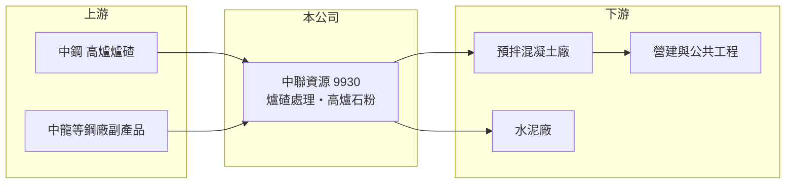

# 9930 中聯資源

> 上市｜[[產業索引-綠能環保|綠能環保]]｜上市（櫃）日期 1999/11/22

# 第一章：企業模式與商業藍圖

> [!info] 撰寫說明
> 精簡版，由 Claude 依公開資料整理，架構比照 [[2330台積電]] 的四章研究，資料截至 2026-10-08。財務數字來源：Goodinfo 年度經營績效頁、證交所開放資料（基本資料、2026 年第二季資產負債與綜合損益、營益分析、股利、本益比）、nStock 新聞標題（2026 年 9 月研磨廠擴建）；業務內容與營收結構主要憑既有知識撰寫，已標「待校對」。公開資料有限。#待校對

在評估單一個股的長期價值時，首要步驟是拆解企業的獲利來源。本章說明中聯資源（股票代號：9930，以下簡稱中聯資）如何把鋼鐵廠的副產品轉成建材原料，在[[循環經濟]]中建立穩定的獲利模式。

- **核心業務：** 中聯資成立於 1991 年，總部位於高雄，1999 年上市，董事長為周文賢，實收資本額約 24.9 億元。公司屬於中鋼集團，主要業務是處理與再利用煉鋼過程產生的爐碴，最主要的產品是[[高爐石粉]]，作為混凝土中部分取代水泥的材料。#待校對
- **商業模式：** 高爐煉鐵會產生大量熔融爐碴，經水淬、乾燥與研磨後成為高爐石粉，賣給預拌混凝土廠與水泥廠。對鋼廠來說，這是把廢棄物變成資源；對中聯資來說，原料來源穩定且成本低，產品又能替代價格較高、碳排較高的水泥，因此能維持穩定利潤。#待校對 公司另有轉爐石處理與環保相關業務（細項比重未查得）。
- **營收規模：** 依 Goodinfo，營收從 2020 年的 99.7 億元穩定成長到 2025 年的 140 億元，五年間每年都成長，與一般建材公司的大幅循環不同，反映原料來源與客戶需求都相對穩定。
- **長期方向：** 水泥業面臨[[碳費]]與減碳壓力，以高爐石粉取代部分水泥是混凝土業降低碳排最直接的方法之一，這是中聯資長期需求的支撐。依 2026 年 9 月的報導標題，公司中南部研磨廠擴建正在推進，代表產能仍在擴充（細節未查得）。

# 第二章：護城河深度與競爭優勢

本章分析中聯資的競爭優勢與限制。它的護城河來自與上游鋼廠的綁定關係。

- **競爭優勢：** 高爐石粉的原料只能來自高爐煉鋼廠，而台灣的一貫作業高爐主要集中在中鋼與中龍。中聯資身為中鋼集團成員，長期取得穩定的爐碴來源，新進者很難取得同樣的原料，這是一種由上游資源決定的進入障礙。#待校對
- **獲利穩定度：** 2020 至 2025 年營業利益率維持在 8% 至 11% 之間，[[ROE]] 維持在 12% 至 19% 之間，在建材相關產業中屬於波動小、報酬穩定的類型。
- **限制與弱點：** 原料量受中鋼的產量決定，若中鋼減產或未來轉向電爐等低碳製程，爐碴供給可能減少；產品售價也與水泥價格和營建景氣相關，議價空間有限。
- **主要對手：** 進口爐石粉、其他鋼廠副產品處理業者，以及作為替代品的水泥與飛灰；水泥業者包括 [[1101台泥]]、[[1102亞泥]]。
- **觀察重點：** 中鋼高爐的長期產量與低碳轉型路線、新研磨產能投產後的銷量，以及高爐石粉在綠建材與低碳混凝土規範中的使用比例。

# 第三章：財務體質與盈利規模

資料日期：2026-10-08，表格是撰寫當時的快照；最新月營收、毛利率、累計 EPS 由自動排程寫在本筆記的屬性欄位（月營收、毛利率、累計EPS 等）。#待校對

本章用多年度三率、ROE 與資本報酬，檢視中聯資的獲利品質。

| 年度 | 營收（新台幣） | [[毛利率]] | [[營業利益率]] | EPS（元） | [[ROE]] |
|---|---|---|---|---|---|
| 2020 | 99.7 億 | 14.2% | 9.7% | 3.07 | 14.2% |
| 2021 | 108 億 | 12.6% | 8.29% | 2.86 | 12.5% |
| 2022 | 114 億 | 12.0% | 7.97% | 3.04 | 12.5% |
| 2023 | 124 億 | 12.6% | 8.67% | 3.38 | 13.8% |
| 2024 | 133 億 | 15.0% | 11.1% | 4.66 | 18.3% |
| 2025 | 140 億 | 15.1% | 11.2% | 4.96 | 18.6% |
| 2026 上半年 | 66.7 億 | 14.23% | 9.79% | 2.16 | 未查得 |

註：2020 至 2025 年取自 Goodinfo，2026 上半年取自證交所營益分析與綜合損益表。

- **營收規模：** 2020 至 2025 年營收年複合成長率約 7.0%（推算），每年都正成長。2026 年 1 至 8 月累計營收約 90.2 億元，年減約 3%（證交所每月營收），成長暫時放緩。
- **獲利結構：** 毛利率在 12% 至 15% 之間，屬於薄利多銷的加工型態，獲利主要靠穩定的量與費用控制；2024 年起營業利益率站上 11%。
- **長期指標：** 2021 至 2025 年平均 ROE 約 15.1%（推算）。2025 年度配發現金股利 4.00 元，以 2025 年 EPS 4.96 元計，配息率約 81%（推算），股利發放積極且穩定。
- **財務特色：** 2026 年第二季底總資產約 112.9 億元，負債約 48.8 億元，權益約 64.1 億元，負債比約 43%；保留盈餘約 36.5 億元，高於股本（證交所開放資料）。

**[[ROIC]] 與 [[WACC]]：** 以 2025 年營業利益約 15.7 億元（140 億 × 11.2%）計，稅後約 12.5 億元；投入資本以權益 64.1 億元加上假設占總負債四成的有息負債約 19.5 億元，合計約 83.6 億元，ROIC 約 15.0%（推算）。WACC 以 CAPM 推估：無風險利率 1.75%、市場風險溢酬 6%、β 取低波動建材與環保股常見值 0.6，股東權益成本約 5.35%；負債成本 2.0%、稅後 1.6%；權益約占 77%，WACC 約 4.5%（推算）。ROIC 高出 WACC 約 10 個百分點，是本批公司中少數明確長期創造價值的例子，原因在於原料成本低、資本需求不大，且大部分獲利以現金股利回饋股東。

# 第四章：總體風險與地緣政治

本章分析中聯資長期面對的風險。

- **產業週期：** 高爐石粉的需求跟著預拌混凝土與營建景氣，房市與公共工程降溫時銷量與價格會受影響；但因為它有取代水泥的成本與減碳優勢，需求波動通常比水泥小。
- **營運風險：** 最大的結構風險是對中鋼的依賴。若中鋼長期減少高爐產量，或像國際鋼廠一樣逐步改用電爐與氫能煉鋼，高爐爐碴的供給將下降，中聯資需要尋找新的原料或業務。
- **其他風險：** 爐碴再利用的法規與管理標準若加嚴，會增加處理成本；過去台灣曾發生爐碴不當回填的社會爭議，相關事件會影響產業形象與監管強度（個別事件年份未查得）。

# 專有名詞解析

## 金融

- **[[ROIC]]**：投入資本報酬率，稅後營業利益除以股東權益與有息負債的合計，衡量本業對所有資金提供者的報酬。
- **[[WACC]]**：加權平均資金成本，依股東權益與負債的比重加權計算的資金成本，ROIC 高於它才代表創造價值。

## 產業

- **[[循環經濟]]**：把廢棄物或副產品重新變成原料或產品，減少資源消耗與廢棄物的經濟模式。
- **[[高爐石粉]]**：高爐煉鐵的爐碴經水淬、研磨後的粉末，可取代部分水泥用於混凝土，降低成本與碳排。
- **[[碳費]]**：政府對溫室氣體排放大戶依排放量收取的費用，台灣自 2025 年起開徵，水泥、鋼鐵等產業首當其衝。

# 核心供應鏈

- 上游：[[2002中鋼]] 等一貫作業鋼廠的高爐與轉爐爐碴。
- 下游／客戶：預拌混凝土廠、水泥廠（如 [[1101台泥]]、[[1102亞泥]]），最終用於營建與公共工程。
- 同業：其他爐碴處理業者與進口爐石粉；環保類股可對照 [[8422可寧衛]]、[[6803崑鼎]]。

## 最新新聞
<!-- news:start（自動產生，請勿手動編輯此範圍） -->
- 2026-10-19 🏛️ 重訊 15:51｜本公司法人董事之代表人變動｜[觀測站](https://mops.twse.com.tw/mops/#/web/t05st01)
- 2026-10-12 🏛️ 重訊 11:11｜澄清媒體報導｜[觀測站](https://mops.twse.com.tw/mops/#/web/t05st01)

完整紀錄：[[9930中聯資源 新聞]]
<!-- news:end -->

## 相關連結
- [公開資訊觀測站](https://mopsov.twse.com.tw/mops/web/t05st03?step=1&firstin=1&co_id=9930)
- [Goodinfo](https://goodinfo.tw/tw/StockDetail.asp?STOCK_ID=9930)
- [Yahoo 股市](https://tw.stock.yahoo.com/quote/9930)
- [鉅亨網新聞](https://www.cnyes.com/twstock/9930/news)
