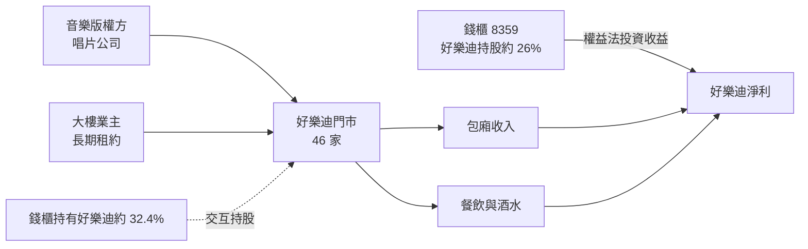
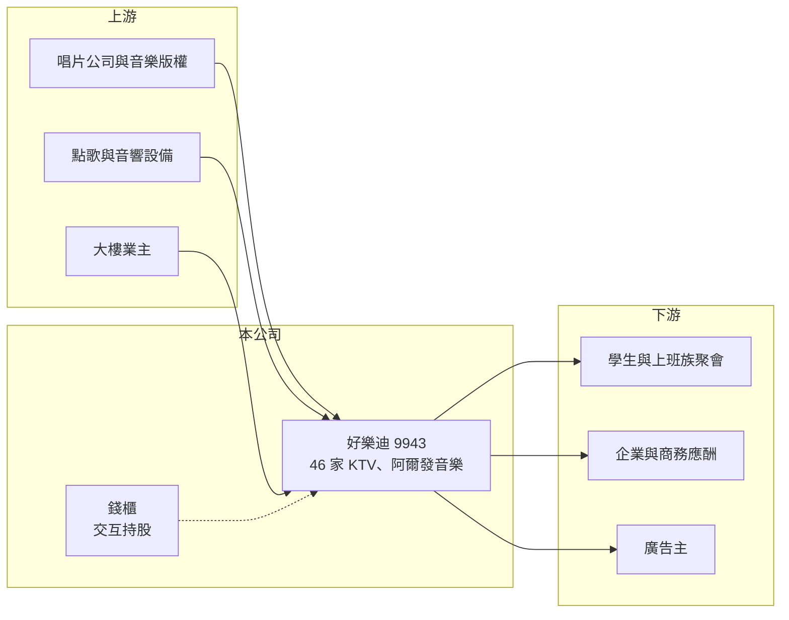

# 9943 好樂迪

> 上市｜[[產業索引-觀光餐旅|觀光餐旅]]｜上市（櫃）日期 2002/08/26

# 第一章：企業模式與商業藍圖

> [!info] 撰寫說明
> 精簡版，由 Claude 依公開資料整理，架構比照 [[2330台積電]] 的四章研究，資料截至 2026-10-08。來源：Goodinfo 年度經營績效頁、富果研究 2025 年 3 月法說會整理、證交所開放資料（基本資料、2026 年第二季資產負債與綜合損益、營益分析、股利、每月營收）。門市數為 2024 年底資料，最新數字未查得。#待校對

好樂迪是台灣兩大連鎖 KTV 之一，與錢櫃並列產業龍頭，兩家公司之間還有[[交互持股]]。本章說明它的門市布局、收入來源與這層特殊的股權關係。

## 一、核心定位：以大台北為主的連鎖 KTV

好樂迪成立於 1993 年，2002 年上市，董事長為林佳霖、總經理為李天行，實收資本額約 12.5 億元（證交所開放資料）。依富果研究整理的 2025 年 3 月法說會，2024 年底共有 46 家門市，其中大北區（含桃竹苗）約 30 多家、貢獻超過六成營收。公司另有阿爾發音樂，主要收取版權與廣告收入。

* **收入來源：** 包廂收入（計時或計人頭）、餐飲收入、酒類等公賣品，以及廣告收入。KTV 的核心是包廂的使用率與單價，餐飲與酒水則是提高客單價的重要來源。
* **會員基礎：** 約 30 萬名威力卡會員，提供熟客優惠並累積消費數據（富果研究）。

## 二、商業模式與錢櫃的交互持股

好樂迪持有錢櫃約 26% 股權，以[[權益法]]認列投資收益；錢櫃則持有好樂迪約 32.4%，兩家形成交互持股（富果研究）。因此好樂迪的淨利中有一部分來自錢櫃的獲利，2026 年上半年營業外收入約 0.88 億元，占稅前淨利約三分之一（證交所綜合損益）。中國大陸轉投資 Holiday Global 已於 2024 年 3 月清算完結。

## 三、門市與展店節奏

公司持續關閉績效不佳的門市，2024 年收掉木柵、草屯、豐原、逢甲 4 家，同時在新興商圈開店；六都新店傾向使用較新潮的「V-Mix」品牌，例如台中向陽店、西屯店（富果研究）。長期策略是「汰弱換新」，維持門市數穩定、提升單店品質，而不是大量擴張。

# 第二章：護城河深度與競爭優勢

KTV 是一個成熟、集中的產業，護城河來自規模與市場結構。本章分析好樂迪的優勢與限制。

## 一、護城河的核心組成要素

* **雙寡占的市場結構：** 台灣連鎖 KTV 主要由好樂迪與錢櫃兩大品牌主導，再加上兩者交互持股，彼此激烈價格戰的誘因較低（推估）。新進業者要在都會區取得大面積店面並投入音響與裝潢，門檻很高。
* **音樂版權與點歌系統：** 大型連鎖業者與唱片公司有長期的版權授權安排，曲庫完整度是消費者選擇 KTV 的重要因素。
* **地段與門市密度：** 大北區門市密集，學生、上班族聚會與商務應酬的需求穩定，品牌熟悉度高。

## 二、主要競爭對手

| 對手 | 定位 | 對好樂迪的威脅 |
|---|---|---|
| 錢櫃（代號 8359） | 連鎖 KTV 龍頭之一 | 市場最大對手，同時也是交互持股夥伴 |
| 星聚點 | 連鎖 KTV | 在部分商圈競爭年輕客群 |
| 區域型 KTV 與小型包廂歌唱店 | 地方型業者 | 以低價爭取在地客群 |
| 串流影音、手遊等其他娛樂 | 居家與線上娛樂 | 長期分食年輕人的休閒時間 |

## 三、守得住與守不住

* **守得住：** 都會區聚會與應酬的 KTV 需求，以及兩大品牌的寡占地位。
* **守不住：** 整體市場成長。營收從 2019 年的 29.9 億元降到 2025 年的 24.1 億元（Goodinfo），反映門市收縮與休閒娛樂選擇變多。
* **觀察重點：** V-Mix 新店能否提升坪效、餐飲與酒水占比能否提高，以及錢櫃投資收益的穩定度。

# 第三章：財務體質與盈利規模

資料日期：2026-10-08，表格是撰寫當時的快照；最新月營收、毛利率、累計 EPS 由自動排程寫在本筆記的屬性欄位（月營收、毛利率、累計EPS 等）。#待校對

本章用多年度數據檢視好樂迪的獲利能力、股利與資本報酬，並說明交互持股對 EPS 與 ROE 的影響。

## 一、多年度三率與 ROE

| 年度 | 營收（新台幣） | [[毛利率]] | [[營業利益率]] | EPS（元） | [[ROE]] |
|---|---|---|---|---|---|
| 2019 | 29.9 億 | 55.6% | 21.4% | 5.48 | 19.4% |
| 2020 | 27.5 億 | 53.3% | 20.0% | 4.41 | 15.8% |
| 2021 | 16.8 億 | 46.2% | -1.11% | 0.43 | 1.63% |
| 2022 | 23.8 億 | 50.8% | 13.3% | 3.42 | 13.0% |
| 2023 | 27.7 億 | 54.3% | 23.5% | 8.81 | 19.1% |
| 2024 | 26.0 億 | 51.8% | 17.6% | 7.74 | 16.2% |
| 2025 | 24.1 億 | 50.4% | 16.8% | 5.40 | 11.5% |
| 2026 上半年 | 11.7 億 | 50.89% | 14.79% | 2.59 | 未查得 |

註：2019 至 2025 年取自 Goodinfo；2026 上半年取自證交所營益分析與綜合損益。

* **高利潤率、緩步縮小：** 營業利益率在正常年度約 15% 至 23%，是休閒服務業中很高的水準；但 2019 至 2025 年營收年複合成長率約 -3.5%（推算）。2026 年 1 至 8 月累計營收約 15.6 億元、年減約 5.3%（證交所每月營收）。
* **交互持股讓 EPS 看起來較高：** 依金管會規定，交互持股中由錢櫃持有的好樂迪股票，在計算 EPS 時會按比例視同庫藏股從股數中扣除（會計處理細節待校對），所以法定 EPS 高於一般算法；2024 年法定 EPS 為 7.74 元，一般算法約 5.23 元（富果研究）。閱讀 EPS 與本益比時要注意這個差異。
* **ROE 穩定：** 2021 至 2025 年平均 ROE 約 12.3%（推算），疫情以外的年度多在 11% 至 19%。

## 二、股利與財務結構

公司幾乎把可分配盈餘全數發放：2024 年度每股現金股利 4.8 元，2025 年度每股 3.5 元（證交所股利資料），以法定 EPS 計算配發率約 62% 至 65%，以一般算法則接近九成以上（推算）。2026 年第二季底總資產約 57.4 億元、總負債約 20.2 億元、權益約 37.2 億元，流動資產約 17.4 億元（證交所資產負債）；另有約 1,600 萬美元的外幣部位（富果研究）。負債以門市[[租賃負債]]為主（推估），銀行借款未查得。

## 三、[[ROIC]] 與 [[WACC]]

**ROIC 推算：** 2025 年營業利益約 24.1 億 × 16.8% ≈ 4.05 億元，以 20% 稅率計算稅後約 3.24 億元。以權益約 37 億元加上推估的租賃負債約 10 億元作為投入資本，ROIC 約 7%；若扣除帳上現金與錢櫃股權等非營業資產（推估合計約 15 億元以上），本業 ROIC 約 10% 以上（推算）。

**WACC 推算：** 台灣 10 年期公債 1.75%、市場風險溢酬 6%、β 取休閒服務同業常見值 0.6，權益成本約 5.4%；租賃負債稅後成本約 2%，以權益 80%、負債 20% 加權，WACC 約 4.7%（推算）。

**結論：** KTV 本業的 ROIC 明顯高於 WACC，屬於能長期創造價值的成熟現金型事業；整體 ROE 被帳上現金與錢櫃股權稀釋。這類公司缺乏成長，但高配息與穩定現金流讓它更接近「收息型」資產，關鍵在於營收下滑速度是否可控。

# 第四章：總體風險與地緣政治

本章整理好樂迪長期面對的需求、成本與治理風險。

## 一、需求與產業結構

* **娛樂型態改變：** 年輕世代的休閒選擇增加（串流、手遊、桌遊、密室逃脫等），KTV 的長期需求可能緩慢下滑。
* **疫情與群聚管制：** 2021 年營業利益率轉為 -1.11%，顯示密閉空間娛樂業對疫情與政策極為敏感。

## 二、營運風險

* **租金與門市汰換：** 門市多為承租，租約到期時面臨租金調漲或被迫遷移，關店與新店裝潢都需要投入資本。
* **版權費與人力：** 音樂版權授權條件、基本工資上漲，會影響成本結構。
* **公共安全法規：** KTV 屬於消防與建築安全的重點列管場所，法規趨嚴會增加改裝與合規成本。

## 三、其他風險

* **交互持股的治理問題：** 好樂迪與錢櫃互相持股，經營權相對穩固，但也讓小股東較難影響公司決策，資本配置的透明度是長期觀察重點。
* **匯率：** 持有美元部位，新台幣升值時會產生匯兌損失。

# 專有名詞解析

## 金融

- **[[權益法]]**：持有被投資公司 20% 至 50% 股權、具重大影響力時，依持股比例認列對方損益為投資收益的會計方法。
- **[[租賃負債]]**：依 IFRS 16，企業把長期租約未來應付的租金折現後認列在資產負債表上的負債，連鎖餐飲與零售業金額通常很大。
- **[[ROIC]]**：投入資本報酬率，衡量企業用股東與債權人投入的資本，每年能產生多少稅後營業利益。
- **[[WACC]]**：加權平均資金成本，股東要求報酬與負債利息依資本結構加權後的平均值，是判斷是否創造價值的門檻。

## 產業

- **[[交互持股]]**：兩家公司互相持有對方股份，常用來穩固經營權或結盟，但會讓財報與治理結構變得較複雜。

# 核心供應鏈

- 上游：唱片公司與音樂版權方、點歌系統與音響設備商、門市大樓業主。
- 下游／客戶：學生與上班族聚會、企業與商務應酬、在門市與點歌系統投放廣告的廣告主。
- 同業與關係企業：錢櫃（交互持股，非本資料庫個股，以純文字表示）、星聚點。

## 最新新聞
<!-- news:start -->
<!-- news:end -->

## 相關連結
- [公開資訊觀測站](https://mopsov.twse.com.tw/mops/web/t05st03?step=1&firstin=1&co_id=9943)
- [Goodinfo](https://goodinfo.tw/tw/StockDetail.asp?STOCK_ID=9943)
- [Yahoo 股市](https://tw.stock.yahoo.com/quote/9943)
- [鉅亨網新聞](https://www.cnyes.com/twstock/9943/news)
