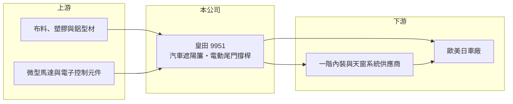

# 9951 皇田

> 上櫃｜[[產業索引-電機機械|電機機械]]｜上市（櫃）日期 2003/12/18

# 第一章：企業模式與商業藍圖

> [!info] 撰寫說明
> 精簡版，由 Claude 依公開資料整理，架構比照 [[2330台積電]]，資料截至 2026-10-08。來源：櫃買中心開放資料快照（基本資料、2026 年第二季資產負債與損益）、Goodinfo 經營績效頁、CMoney 2015 年個股文章；產品線與據點的部分描述依記憶整理，已標註待校對。公開資料有限。#待校對

皇田是全球主要的汽車遮陽簾製造商之一，理解它的關鍵在於：它做的是車廂內的功能性內裝件，雖然單價不高，但每一個車型都要重新設計與驗證，一旦取得車型就能穩定供貨好幾年。

- **核心業務：** 皇田成立於 1983 年，總部位於台南永康，2003 年在櫃買中心掛牌，英文品牌為 Macauto。主力產品是汽車[[遮陽簾]]，包括側窗、後擋風玻璃與全景天窗的手動與電動遮陽簾，CMoney 2015 年的文章稱其為「世界第 2 大汽車窗簾製造商」。公司另發展電動尾門撐桿等車身機電產品（#待校對），把遮陽簾累積的機構與馬達控制能力延伸到新品項。
- **營收結構：** 各產品的營收比重公開資料未查得。遮陽簾的需求與中高階車款、SUV 的配備率高度相關，全景天窗越普及，天窗遮陽簾的需求越大。客戶以歐系、美系與日系車廠及其一階內裝供應商為主（#待校對），德系車廠占比較高。
- **營運據點：** 依資料，公司生產基地涵蓋台灣、中國、美國與歐洲的斯洛伐克（#待校對）。汽車內裝件體積大、運費占比高，車廠也要求就近供貨，因此在主要汽車生產區域設廠是這個產業的必要條件，也構成新進者的門檻。
- **長期方向：** 皇田的長期課題是在電動化趨勢中提高每台車的供貨金額。電動車普遍採用大面積玻璃車頂，對電動遮陽簾的需求有利；電動尾門等機電產品則讓公司從純內裝件走向車身電子機構。歐美就近生產也讓公司能承接車廠分散供應鏈的需求。

# 第二章：護城河深度與競爭優勢

皇田的護城河來自車型認證、全球就近生產與在細分市場的規模，屬於利基型的中等護城河。

- **競爭優勢：** 汽車零件必須通過[[IATF 16949]]品質系統與車廠的長期驗證，遮陽簾還需與內裝、車窗玻璃的設計同步開發，因此供應商通常在車型設計階段就被選定，量產後很少更換。皇田在全球多地設廠，能同時供應同一車型在不同國家的生產線，這是小型對手難以做到的。長年專注在遮陽簾這個細分市場，也讓它在設計與成本上累積了規模優勢。
- **主要對手：** 全球遮陽簾市場的主要競爭者是歐洲的大型汽車內裝與天窗系統供應商，例如德國的 BOS 集團與天窗系統大廠（#待校對）。台灣同業中沒有直接以遮陽簾為主業的上市公司，較接近的是做汽車內外裝與機電零件的 [[1522堤維西]]、[[2228劍麟]]、[[4551智伸科]] 等。
- **觀察重點：** 長期最該追蹤的是毛利率能否守住 24% 以上，以及新車型（特別是電動車的大天窗與電動尾門）的接單情形。毛利率由 2020 年的 28.8% 逐步降到 2024 年的 24.0%，2025 年持平在 24.2%，顯示車廠降價與新廠成本的壓力。營收在 2025 年成長到 63.2 億元，若能同時維持毛利率，代表新產品已經進入收成期。

# 第三章：財務體質與盈利規模

資料日期：2026-10-08，表格是撰寫當時的快照；最新月營收、毛利率、累計 EPS 由自動排程寫在本筆記的屬性欄位（月營收、毛利率、累計EPS 等）。#待校對

皇田的財務是穩健型車用零件廠的樣貌：營收穩定成長、ROE 長期在一成上下、負債低，並維持穩定配息。

| 年度 | 營收（億元） | [[毛利率]] | [[營業利益率]] | EPS（元） | [[ROE]] |
|---|---|---|---|---|---|
| 2020 | 46.4 | 28.8% | 11.70% | 6.69 | 16.8% |
| 2021 | 47.7 | 28.5% | 10.60% | 5.33 | 12.9% |
| 2022 | 48.5 | 25.6% | 8.51% | 5.50 | 12.7% |
| 2023 | 52.1 | 25.9% | 8.91% | 5.77 | 12.4% |
| 2024 | 55.2 | 24.0% | 5.71% | 4.20 | 8.64% |
| 2025 | 63.2 | 24.2% | 6.85% | 5.27 | 10.4% |

（來源：Goodinfo 經營績效頁。2026 年上半年依櫃買中心資料：營收 32.5 億元、毛利率 23.2%、營業利益率 6.5%、EPS 2.54 元。）

- **營收規模：** 2020 至 2025 年營收由 46.4 億元增至 63.2 億元，年複合成長率約 6.4%（推算），成長平穩而且幾乎沒有衰退年，反映車型長約帶來的訂單穩定性。這個成長速度略高於全球汽車產量，代表每台車的配備率或市占率在緩步提升。
- **獲利：** 近五年（2021 至 2025）平均 ROE 約 11.4%（推算），在車用零件廠中屬於中上。營業利益率由 2020 年的 11.7% 降到 2024 年的 5.7%，是近年獲利最大的隱憂，可能與海外新廠的折舊、人力成本與車廠年降要求有關（推估）；2025 年回升到 6.85%。
- **財務特色：** 依 2026 年第二季資料，總資產約 64.0 億元、股東權益約 38.1 億元、負債約 25.9 億元，其中非流動負債僅約 2.2 億元，長期借款很少，財務結構保守。每股淨值約 53 元。Goodinfo 統計的歷年平均現金股利約 2.72 元，以 EPS 4 至 7 元計算，配息率約四成到六成（推算），配息穩定。自由現金流是否長期為正未查得。
- **[[ROIC]] 與 [[WACC]]：** 以 2025 年營業利益約 4.33 億元（63.2 億元 × 6.85%）、稅率 20% 計算，稅後營業利益約 3.46 億元。有息負債未查得，投入資本以股東權益 38.1 億元到「權益加全部負債」64.0 億元為區間，ROIC 約 5.4% 至 9.1%（推算）；由於長期借款很少，實際數字應接近區間上緣。2020 年同法約 7% 至 12%（推算）。WACC 以 [[CAPM]] 推估：無風險利率 1.75%、市場風險溢酬 6%、β 假設 0.8（車用零件股常見值），權益成本約 6.55%；稅後負債成本假設 2%、負債占兩成，WACC 約 5.6%（推算）。ROIC 大致高於 WACC，代表皇田長期能創造經濟價值，但利差已比 2020 年前後縮小。

# 第四章：總體風險與地緣政治

皇田的風險來自汽車產業週期、車廠議價與全球化生產的成本。

- **產業週期：** 遮陽簾屬於中高階車款的配備，汽車景氣下滑時，消費者降規或延後換車會同時影響產量與配備率。歐洲車市占皇田營收比重較高（#待校對），歐洲經濟與德系車廠的電動化轉型進度會直接影響訂單。
- **營運風險：** 車廠每年要求零件廠降價（[[年降]]），若新產品與自動化無法抵銷，毛利率就會像 2020 至 2024 年一樣逐年下滑。海外工廠在初期產能利用率不足時，會先拖累獲利；客戶集中在少數車廠與一階供應商，單一車型停產或延後量產也會造成營收波動。
- **其他風險：** 營收以歐元、美元計價，新台幣與人民幣匯率影響毛利；布料、鋁材與馬達等原料價格波動。美國關稅與在地化政策可能迫使公司調整產能配置，增加資本支出。

# 專有名詞解析

## 應用

- **[[遮陽簾]]**：裝在車窗或天窗內側、可收放的簾幕，用來遮光隔熱，分為手動與電動，常見於中高階車款與 SUV。
- **[[IATF 16949]]**：汽車產業的品質管理系統標準，車用零件供應商通常必須取得此認證才能進入車廠供應鏈。

## 金融

- **[[CAPM]]**：資本資產定價模型，以無風險利率加上 β 乘以市場風險溢酬估算股東要求報酬率。

## 產業

- **[[年降]]**：車廠要求零件供應商在量產期間每年調降售價的慣例，供應商須靠製程改善抵銷。

# 核心供應鏈

- 上游：遮光布料、塑膠粒、鋁型材，以及微型馬達與電子控制元件供應商。
- 下游／客戶：歐系、美系與日系車廠，以及汽車內裝與天窗系統的一階供應商（具體名單公開資料未點名，#待校對）。
- 同業：國際遮陽簾與天窗系統供應商；台灣汽車零組件同業 [[1522堤維西]]、[[2228劍麟]]、[[4551智伸科]]、[[1319東陽]]。

## 最新新聞
<!-- news:start（自動產生，請勿手動編輯此範圍） -->
- 2026-10-22 🏛️ 重訊 16:59｜代子公司MACAUTO DE MEXICO S.A.DE C.V.公告取得廠房及土地｜[觀測站](https://mops.twse.com.tw/mops/#/web/t05st01)
- 2026-10-22 🏛️ 重訊 16:55｜代子公司MACAUTO MEXICO S.A.DE C.V.公告出售土地予 關係人MACAUTO DEVELOPMENT MEXICO,S.A.DE C.V.｜[觀測站](https://mops.twse.com.tw/mops/#/web/t05st01)
- 2026-10-22 🏛️ 重訊 16:35｜代子公司MACAUTO DEVELOPMENT MEXICO,S.A.DE C.V.公告向 關係人MACAUTO MEXICO,S.A.DE C.V.取得土地｜[觀測站](https://mops.twse.com.tw/mops/#/web/t05st01)
- 2026-10-22 🏛️ 重訊 14:39｜公告本公司董事會決議註銷庫藏股暨訂定減資基準日｜[觀測站](https://mops.twse.com.tw/mops/#/web/t05st01)

完整紀錄：[[9951皇田 新聞]]
<!-- news:end -->

## 相關連結
- [公開資訊觀測站](https://mopsov.twse.com.tw/mops/web/t05st03?step=1&firstin=1&co_id=9951)
- [Goodinfo](https://goodinfo.tw/tw/StockDetail.asp?STOCK_ID=9951)
- [Yahoo 股市](https://tw.stock.yahoo.com/quote/9951)
- [鉅亨網新聞](https://www.cnyes.com/twstock/9951/news)
