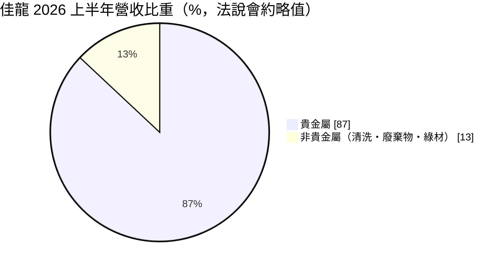
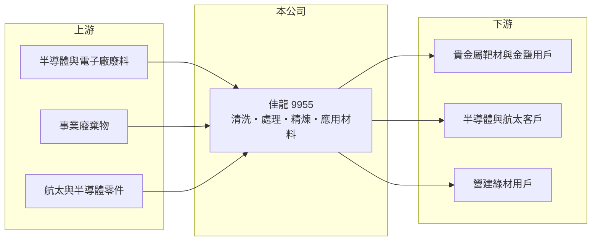

# 9955 佳龍

> 上市｜[[產業索引-綠能環保|綠能環保]]｜上市（櫃）日期 2008/01/21

# 第一章：企業模式與商業藍圖

> [!info] 撰寫說明
> 精簡版，由 Claude 依公開資料整理，架構比照 [[2330台積電]] 的四章研究，資料截至 2026-10-08。財務數字來源：Goodinfo 年度經營績效頁、富果研究整理的 2026 年 9 月法說會摘要、證交所開放資料（基本資料、2026 年第二季資產負債與綜合損益、營益分析、股利、本益比）。#待校對

在評估單一個股的長期價值時，首要步驟是拆解企業的獲利來源。本章說明佳龍科技（股票代號：9955，以下簡稱佳龍）如何從傳統的廢棄物回收處理，轉型為「全循環經濟應用材料供應商」，以及這個轉型為何是它能否長期獲利的關鍵。

- **核心業務：** 佳龍成立於 1996 年，廠區位於桃園觀音工業區，2008 年上市，董事長為吳界欣，實收資本額約 10.4 億元。依 2026 年 9 月法說會，公司的業務分為五大板塊：半導體與航太零件清洗、電子與事業廢棄物處理、回收、貴金屬精煉提純，以及應用材料（貴金屬靶材、金粒、金鹽，與非金屬的 CLGM 綠材）。
- **營收結構：** 營收中貴金屬約占 80% 至 90%，但這部分毛利率只有約 1% 至 5%，因為金價大部分轉嫁給客戶，公司只賺加工與回收價差。非貴金屬業務（清洗、廢棄物處理、綠材等）比重從過去約 5% 提升到 2026 年上半年的 13%，毛利率約 30% 至 50%。這說明佳龍的營收數字大，但真正決定獲利的是比重較小的非貴金屬業務。
- **轉型方向：** 公司以「一核四新、四四加一」為策略，目標在 2028 年把非貴金屬營收比重提高到 30%。已取得 AS9100 航太、IATF 16949 車用、R2V3 電子回收等認證，切入航太零件清洗與高純度金屬材料。另外，以玻纖粉等廢棄物製成的 CLGM 綠材若通過半導體廠房應用驗證，公司估計單一產品可貢獻年營收 10% 至 15%（公司說法，尚待驗證）。
- **轉投資：** 持有台灣精材約 19.4%、寶儲能源約 19.31%，以及水資源與大數據相關公司。2026 年上半年轉投資收益是業外獲利的主要來源。

# 第二章：護城河深度與競爭優勢

本章分析佳龍的競爭優勢與限制。它的護城河還在建立中，關鍵是認證與處理許可。

- **競爭優勢：** 事業廢棄物處理需要政府核發的處理許可，貴金屬精煉與半導體、航太零件清洗則需要客戶認證與品質系統，這些都需要數年時間累積。佳龍已取得多項國際認證，這是它切入高毛利業務的入場券。
- **限制與弱點：** 長期以來本業虧損，2020 至 2024 年營業利益率都是負值，保留盈餘為負約 6.7 億元。2026 年上半年營業利益僅約 42 萬元，雖然是近年首次半年度本業獲利，但仍處於損益兩平邊緣，轉型成果尚未穩固。
- **主要對手：** 貴金屬回收精煉與靶材同業如 [[1785光洋科]]，環保處理同業如 [[8341日友]]、[[8422可寧衛]]。
- **觀察重點：** 第一，非貴金屬營收比重能否如期往 30% 推進；第二，CLGM 綠材能否通過驗證並放量；第三，本業能否在沒有轉投資收益的情況下穩定獲利。

# 第三章：財務體質與盈利規模

資料日期：2026-10-08，表格是撰寫當時的快照；最新月營收、毛利率、累計 EPS 由自動排程寫在本筆記的屬性欄位（月營收、毛利率、累計EPS 等）。#待校對

本章用多年度三率、ROE 與資本報酬，檢視佳龍轉型期間的財務體質。

| 年度 | 營收（新台幣） | [[毛利率]] | [[營業利益率]] | EPS（元） | [[ROE]] |
|---|---|---|---|---|---|
| 2020 | 30.0 億 | -1.13% | -4.33% | -1.19 | -7.47% |
| 2021 | 14.8 億 | 0.69% | -5.82% | -0.95 | -6.39% |
| 2022 | 11.6 億 | 0.12% | -8.57% | -0.96 | -6.84% |
| 2023 | 11.4 億 | 3.47% | -6.51% | -0.79 | -6.03% |
| 2024 | 12.0 億 | 0.13% | -11.3% | -1.58 | -13.1% |
| 2025 | 15.1 億 | 8.51% | -1.14% | 0.54 | 4.67% |
| 2026 上半年 | 8.48 億 | 7.78% | 0.05% | 0.97 | 未查得 |

註：2020 至 2025 年取自 Goodinfo，2026 上半年取自證交所營益分析與綜合損益表。

- **營收規模：** 營收主要隨貴金屬處理量與金價變動，2020 年的 30 億元之後大幅縮小，2025 年回升到 15.1 億元。由於貴金屬營收毛利極低，營收規模對評估獲利的參考價值有限。
- **獲利結構：** 2025 年起毛利率從接近 0 提升到 8% 左右，反映非貴金屬業務比重提高。但 2025 年與 2026 年上半年的淨利主要來自業外（2026 年上半年業外收入約 1.01 億元，幾乎等於全部稅前淨利）。
- **長期指標：** 2021 至 2025 年平均 ROE 約 -5.5%（推算）；2025 年度未配發股利（證交所資料），累積虧損尚未彌補。
- **財務特色：** 2026 年第二季底總資產約 30.1 億元，負債約 16.6 億元，其中非流動負債約 13.6 億元，主要是 2025 年與台灣銀行簽訂的七年期聯貸；權益約 13.4 億元，負債比約 55%。公司另辦理約 1.5 億元的現金增資。

**[[ROIC]] 與 [[WACC]]：** 2025 年營業利益約 -0.17 億元（15.1 億 × -1.14%），稅後營業利益為負；投入資本以權益 13.4 億元加上假設占總負債七成五的有息負債約 12.5 億元，合計約 25.9 億元，ROIC 約 -0.7%（推算）。WACC 以 CAPM 推估：無風險利率 1.75%、市場風險溢酬 6%、β 取轉型中小型股常見值 1.0，股東權益成本約 7.75%；負債成本 3.0%、稅後 2.4%；權益約占 52%，WACC 約 5.2%（推算）。ROIC 為負代表本業仍在消耗股東價值，佳龍目前的獲利來自轉投資，要成為創造價值的公司，必須讓非貴金屬業務把本業 ROIC 推高到 5% 以上。

# 第四章：總體風險與地緣政治

本章分析佳龍長期面對的風險。

- **產業週期：** 貴金屬業務受金價與電子產業廢料量影響，半導體與電子業景氣下行時，可回收的廢料與零件清洗需求都會減少。
- **營運風險：** 轉型需要持續投資新產線（如 5N 高純度黃金與綠材），若新產品驗證不如預期，折舊與利息負擔會讓本業回到虧損。獲利依賴轉投資收益，代表盈餘品質不穩，轉投資公司表現轉差時 EPS 會明顯下滑。
- **其他風險：** 事業廢棄物處理許可、工安與環保法規趨嚴會提高營運成本；金價大幅波動會影響存貨評價與營運資金需求；增資與聯貸也會稀釋股東權益或增加財務壓力。

# 專有名詞解析

## 應用

- **[[AS9100]]**：航太產業的品質管理系統標準，是供應商進入航太供應鏈的基本門檻。

## 金融

- **[[ROIC]]**：投入資本報酬率，稅後營業利益除以股東權益與有息負債的合計，衡量本業對所有資金提供者的報酬。
- **[[WACC]]**：加權平均資金成本，依股東權益與負債的比重加權計算的資金成本，ROIC 高於它才代表創造價值。

## 產業

- **[[循環經濟]]**：把廢棄物或副產品重新變成原料或產品，減少資源消耗與廢棄物的經濟模式。
- **[[貴金屬精煉]]**：從電子廢料、製程廢液中回收金、銀、鈀等貴金屬，並提純到工業可用的純度。

# 核心供應鏈

- 上游：半導體、電子與 PCB 廠的含貴金屬廢料與廢液，以及一般事業廢棄物、待清洗的航太與半導體零件。
- 下游／客戶：半導體封裝與電子業（金粒、金鹽、靶材）、航太與半導體零件使用者、營建工程（CLGM 綠材）。
- 同業：[[8341日友]]、[[8422可寧衛]]、[[9930中聯資源]]，貴金屬回收與靶材可對照 [[1785光洋科]]。

## 最新新聞
<!-- news:start -->
<!-- news:end -->

## 相關連結
- [公開資訊觀測站](https://mopsov.twse.com.tw/mops/web/t05st03?step=1&firstin=1&co_id=9955)
- [Goodinfo](https://goodinfo.tw/tw/StockDetail.asp?STOCK_ID=9955)
- [Yahoo 股市](https://tw.stock.yahoo.com/quote/9955)
- [鉅亨網新聞](https://www.cnyes.com/twstock/9955/news)
