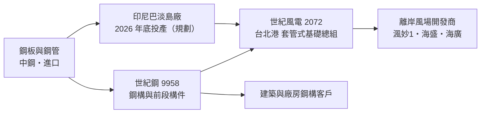
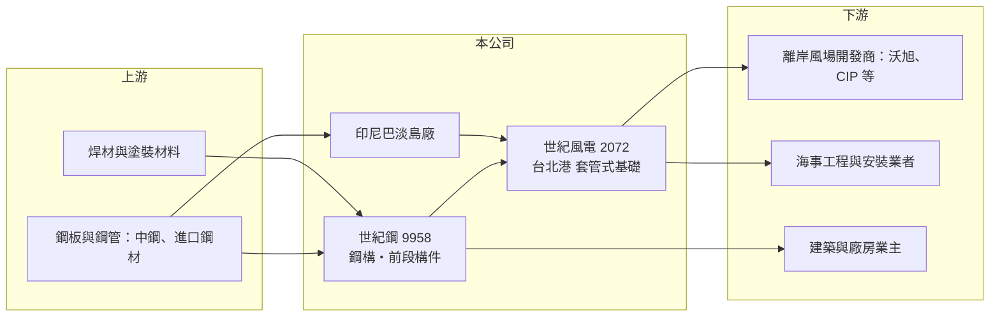

# 9958 世紀鋼

> 上市｜[[產業索引-鋼鐵工業|鋼鐵工業]]｜上市（櫃）日期 2008/03/12

# 第一章：企業模式與商業藍圖

> [!info] 撰寫說明
> 本文由 Claude 依公開資料整理，架構比照 [[2330台積電]] 的四章研究，資料截至 2026-10-08。財務數字來源：MoneyDJ（富邦證券）年度財務比率表、自由時報 2026 年 3 月 31 日法說會報導、科技新報 2026 年 4 月報導標題（世紀風電在手訂單排到 2029 年）、證交所開放資料（基本資料、資產負債、綜合損益、營益分析、股利、每月營收）。年營收以每股營業額推算，部分年度未查得；對世紀風電的持股比例與鋼構事業營收比重未查得；產業描述為整理性內容。#待校對

在評估單一個股的長期投資價值時，首要步驟是拆解企業的底層獲利邏輯。本章說明世紀鋼鐵結構（股票代號：9958，以下簡稱世紀鋼）如何從建築鋼構廠，轉型為台灣離岸風電水下基礎的主要供應商。

## 一、核心定位：從鋼構到離岸風電

世紀鋼成立於 1987 年 10 月，2008 年 3 月上市，董事長為賴文祥，2026 年實收資本額約 26.7 億元（2026 年第二季資產負債表股本為 24.7 億元，期間有股本增加，原因待校對）。世紀鋼原本以[[鋼構]]起家，製作建築與工業廠房的鋼結構；近十年把重心轉向[[離岸風電]]的[[水下基礎]]，集團包括 2026 年 3 月轉上市的 [[2072世紀風電]]、世紀樺欣與世紀重工國際等公司，能生產[[套管式基礎]]（Jacket）與基樁（Pin Pile），並具備整合能力。#待校對

水下基礎是把風機固定在海床上的鋼結構，每座重達上千噸，焊接品質攸關風機二十年以上的安全。這類產品有三個特性：

* **專案型營收：** 營收依風場施工進度認列，風場排程決定每年的營收高低。
* **重資本、重認證：** 需要大型廠房、碼頭、焊接機器人與國際認證，新進者很難在短期內建立。
* **政策驅動：** 台灣離岸風電的[[區塊開發]]要求國產化，讓本土供應商取得穩定的訂單來源。

## 二、集團分工與產能布局

* **台北港基地：** 世紀風電在台北港製造大型套管式基礎並組裝，母公司負責較前段的構件，集團分工讓高附加價值的總組集中在靠近風場的港口。
* **印尼巴淡島廠：** 依 2026 年 3 月法說會，預計 2026 年底投產，生產套管腿管與小管徑產品，再以散裝船運回台北港組裝，可享零關稅優勢，也降低人工成本。
* **擴廠：** 2026 年資本支出約 20 億元，主要用於桃園觀音廠購地。

## 三、長期方向：區塊開發的多年訂單

2026 年營收主要來自渢妙1、海盛與海廣三個風場，兩到三個風場同時施工，使公司預期 2026 年毛利率可維持三成以上。依 2026 年 4 月報導，世紀風電的在手訂單已排到 2029 年。往後的關鍵是政府第三階段 3-3 區塊的開發，沃旭與 CIP 被視為潛在開發商。在台灣離岸風電持續建置到 2035 年的前提下，世紀鋼集團有多年的訂單能見度；長期則要看印尼廠能否讓集團取得台灣以外的亞太風場訂單。

# 第二章：護城河深度與競爭優勢

在長期價值投資中，「護城河」指企業抵禦競爭、維持超額利潤的保護機制。本章分析世紀鋼在離岸風電水下基礎市場的護城河。

## 一、護城河組成

* **實績與認證：** 國際開發商對水下基礎的焊接品質、交期與安全要求極嚴，世紀鋼集團已完成多個風場的交貨，這種實績是新進者最難複製的資格。
* **港口與廠房：** 水下基礎體積巨大、陸運困難，必須在碼頭旁生產。台北港基地與觀音廠擴充，構成實體上的進入門檻。
* **國產化政策：** 區塊開發要求一定比例的本土製造，世紀鋼是少數具備大型產能的本土業者，政策提供了結構性的需求保障。
* **成本轉嫁：** 鋼板向中鋼採購或進口，合約有物價調整機制，可轉嫁大部分原料價格波動。

## 二、競爭對手格局

| 對手 | 定位 | 對世紀鋼的影響 |
|---|---|---|
| [[2208台船]] 與其轉投資 | 國營造船廠，承作水下基礎 | 本土國產化訂單的主要競爭者 |
| [[2013中鋼構]] | 中鋼集團鋼構廠 | 鋼構與風電構件的競爭者 |
| Sif、Smulders 等歐洲廠 | 國際水下基礎大廠 | 非國產化訂單與海外市場的競爭者 |
| 韓國與中國鋼構廠 | 成本低 | 若國產化要求放寬，價格競爭加劇 |

## 三、守得住與守不住的地方

* **守得住：** 台灣區塊開發的國產化訂單，以及已簽約風場的施工排程。2024 至 2025 年營業利益率維持在 23% 上下，顯示產能稀缺時的議價能力。
* **守不住：** 專案時程與成本。2022 年營業利益率只有 1%，代表專案延宕或成本失控時，獲利可以瞬間消失。
* **觀察重點：** 3-3 區塊的開發商與排程、印尼廠的投產進度，以及在手訂單能否延續到 2030 年以後。

# 第三章：財務體質與盈利規模

資料日期：2026-10-08，表格是撰寫當時的快照；最新月營收、毛利率、累計 EPS 由自動排程寫在本筆記的屬性欄位（月營收、毛利率、累計EPS 等）。#待校對

財務報表是檢驗護城河是否真實存在的最終標準。本章用多年度三率、ROE 與資本報酬，檢視世紀鋼專案型業務的獲利品質。

## 一、多年度獲利

| 年度 | 營收（新台幣） | [[毛利率]] | [[營業利益率]] | EPS（元） | [[ROE]] |
|---|---|---|---|---|---|
| 2019 | 未查得 | 15.41% | 4.85% | 3.66 | 13.78% |
| 2020 | 未查得 | 25.83% | 19.65% | 3.59 | 11.84% |
| 2021 | 未查得 | 21.54% | 17.60% | 5.46 | 16.03% |
| 2022 | 未查得 | 4.80% | 1.00% | 1.59 | 0.99% |
| 2023 | 未查得 | 17.00% | 13.48% | 4.46 | 11.20% |
| 2024 | 未查得 | 28.19% | 23.82% | 6.93 | 13.06% |
| 2025 | 約 145 億（推算） | 29.29% | 22.87% | 6.57 | 12.13% |
| 2026 上半年 | 101.8 億 | 25.91% | 21.68% | 4.08 | 未查得 |

註：2025 年營收以 MoneyDJ 每股營業額 58.58 元乘 2026 年第二季股本 2.47 億股推算；過去股本有變動，其他年度不推算。#待校對

* **專案型波動：** 2022 年毛利率只有 4.8%，2024 至 2025 年則接近 30%，同一家公司不同年度的獲利差異極大，反映風場排程、專案成本與焊接良率的影響。
* **2026 年營收大增：** 1 至 8 月營收 139.2 億元，年增約 41%，公司說明主要是風力事業案依進度交貨與工程收入挹注。上半年營業利益率 21.7%。
* **[[非控制權益]]比重高：** 2026 年第二季權益總計 253.3 億元中，非控制權益約 135.6 億元；2026 年上半年淨利 17.0 億元中約 6.9 億元歸屬非控制權益，主要來自世紀風電的外部股東。因此世紀鋼股東實際享有的獲利，明顯低於合併營業利益所顯示的規模。

## 二、長期指標

* **平均 ROE：** 2021 至 2025 年平均約 10.7%（推算），被 2022 年拉低。
* **股利：** 2025 年度擬配現金股利 4.5 元，配息率約 68%（推算）。
* **財務結構：** 2026 年第二季資產 581.4 億元、負債 328.0 億元，負債比約 56%，流動比率約 1.2 倍（推算）。負債比在 2021 至 2023 年曾達 61% 至 65%，2024 年因世紀風電引進外部資金而降到約 46%（推估）。
* **自由現金流：** 建廠與擴廠期資本支出大，加上專案預收與合約資產波動，自由現金流不穩定（具體數字未查得）。

## 三、[[ROIC]] 與 [[WACC]]：價值創造利差

**ROIC 推算：** 2025 年營業利益約 33.1 億元（約 145 億元 × 22.87%），稅後約 26.5 億元。投入資本以 2026 年第二季權益 253.3 億元加負債 328.0 億元計（以負債總額代替有息負債會高估投入資本，合約負債等非有息項目可能占相當比重），ROIC 約 4.6%（推算）；只以權益計算約 10.4%（推算）。以 2026 年上半年營業利益 22.1 億元年化計算，ROIC 約 6% 至 14%（推算）。

**WACC 推算：** 以 [[CAPM]] 推估，台灣 10 年期公債 1.75%、市場風險溢酬 6%、β 取 1.1（重工與綠能設備常見值，非來源數字），權益成本約 8.35%；負債成本假設 2.5%，稅後 2%。依帳面權益約 44%、負債約 56% 計算，WACC 約 4.8%；若只計有息負債，約 6% 至 7.5%（推算）。

**結論：** 世紀鋼在風場施工高峰年度（2020 至 2021 年、2024 年以後）的 ROIC 大致高於 WACC，但在 2022 年專案出問題時遠低於資金成本。長期價值取決於訂單能見度能否延續，以及能否避免再出現 2022 年式的專案虧損。

# 第四章：總體風險與地緣政治

任何企業都無法脫離宏觀環境獨立存在。本章分析世紀鋼必須面對的政策、專案與外部風險。

## 一、政策與產業週期

* **離岸風電政策：** 需求幾乎完全由台灣政府的區塊開發排程決定。政策延宕、開發商退出或融資困難，都會讓訂單延後或取消。
* **國產化要求：** 國產化保障了本土廠商，但若政府為了降低電價成本而放寬，國際與中國鋼構廠的低價競爭會加劇。
* **鋼構本業：** 建築鋼構跟著營建與廠房投資循環，是風電以外的另一個景氣來源。

## 二、營運風險

* **專案執行：** 大型焊接專案的工期、良率與工安是最大風險，2022 年的低獲利即是例證。
* **客戶集中：** 每年營收依賴少數風場與開發商，單一風場延期就會影響整年表現。
* **海外營運：** 印尼巴淡島廠面臨當地法規、勞工與匯率風險，投產時程也可能延後。

## 三、其他風險

* **原料價格：** 鋼板價格波動雖有物價調整機制，但機制若不完整或時間落差大，仍可能侵蝕固定價合約的利潤。
* **地緣政治：** 中東衝突、航運與能源價格會影響鋼材與運費成本；依 2026 年 3 月法說會，公司認為中東衝突影響不大。
* **利率：** 開發商的融資成本受利率影響，利率上升會降低風場的投資報酬，間接影響開發進度。

# 專有名詞解析

## 金融

- **[[非控制權益]]**：合併子公司中不屬於母公司股東的權益部分，相關獲利不計入母公司 EPS。

## 產業

- **[[鋼構]]**：以鋼材製作的建築、廠房與橋梁結構，經裁切、焊接與組裝後在工地吊裝。
- **[[離岸風電]]**：在海上設置風力發電機組，台灣西部海峽是重要的離岸風場，需要大量電力工程與海纜設備。
- **[[水下基礎]]**：把離岸風機固定在海床上的鋼結構，常見形式有單樁與套管式，是離岸風場最重的單一構件之一。
- **[[套管式基礎]]**：由鋼管焊成格狀塔架、以樁腳固定在海床的水下基礎，英文為 Jacket，適合台灣海峽較深與地質複雜的海域。
- **[[區塊開發]]**：台灣離岸風電第三階段的遴選制度，政府分批釋出容量並要求國產化，3-1、3-2、3-3 為不同批次。

# 核心供應鏈

## 1. 上游：鋼材
- [[2002中鋼]]（鋼板）、進口鋼板與鋼管

## 2. 本公司與集團
- 子公司：[[2072世紀風電]]（套管式水下基礎）、世紀樺欣、世紀重工國際
- 水下基礎同業：[[2208台船]]、[[2013中鋼構]]
- 離岸風電相關：[[6806森崴能源]]、[[1513中興電]]、[[1519華城]]

## 3. 下游：客戶
- 離岸風場開發商：沃旭（Ørsted）、CIP 等（3-3 區塊潛在開發商）
- 渢妙1、海盛、海廣等風場
- 建築與工業廠房鋼構客戶

## 最新新聞
<!-- news:start（自動產生，請勿手動編輯此範圍） -->
- 2026-10-07 📰 媒體 18:53｜營收速報 - 世紀鋼(9958)9月營收19.59億元年增率高達83.33％｜[鉅亨網](https://news.cnyes.com/news/id/6623876)

完整紀錄：[[9958世紀鋼 新聞]]
<!-- news:end -->

## 相關連結
- [公開資訊觀測站](https://mopsov.twse.com.tw/mops/web/t05st03?step=1&firstin=1&co_id=9958)
- [Goodinfo](https://goodinfo.tw/tw/StockDetail.asp?STOCK_ID=9958)
- [Yahoo 股市](https://tw.stock.yahoo.com/quote/9958)
- [鉅亨網新聞](https://www.cnyes.com/twstock/9958/news)
