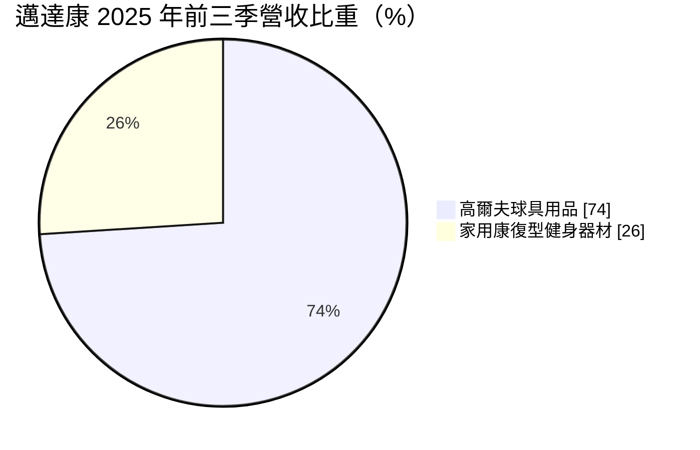
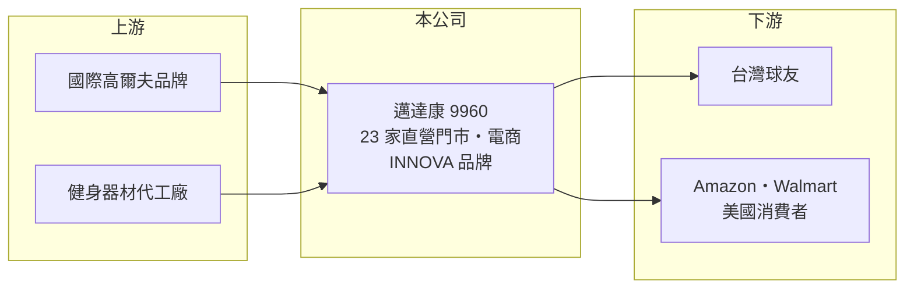

# 9960 邁達康

> 上櫃｜[[產業索引-運動休閒|運動休閒]]｜上市（櫃）日期 2004/12/06

# 第一章：企業模式與商業藍圖

> [!info] 撰寫說明
> 精簡版，由 Claude 依公開資料整理，架構比照 [[2330台積電]] 的四章研究，資料截至 2026-10-08。財務數字來源：Goodinfo 年度經營績效頁、富果研究整理的 2025 年 12 月法說會摘要、櫃買中心開放資料（基本資料、2026 年第二季資產負債與綜合損益、本益比）。公開資料有限，代理品牌名稱未查得。#待校對

本章說明邁達康網路事業（股票代號：9960，以下簡稱邁達康）如何以台灣高爾夫用品零售通路為本業，並透過併購北美健身器材品牌，建立第二個事業支柱。

- **核心業務：** 邁達康成立於 2000 年，2004 年上櫃，自稱是台灣最大的專業高爾夫球具通路商，銷售全球品牌的球桿、球袋、服飾、鞋類與配件。它不製造球具，而是靠選品、門市服務與通路規模賺取零售價差，屬於典型的通路商模式。
- **營收結構：** 依 2025 年前三季法說會資料，高爾夫球具用品營收約 3.66 億元、占 74%，家用康復型健身器材約 1.26 億元、占 26%。高爾夫業務的毛利率由品牌進貨條件與折扣決定，健身器材則是自有品牌，毛利結構不同。
- **營運據點：** 台灣直營門市 23 家，分布在百貨公司、高爾夫練習場與球場；線上通路包括官網 GolfShop.com.tw，以及 momo、PChome、Coupang 等電商平台。中國子公司經營代理業務，受當地景氣放緩影響。
- **長期方向：** 2021 年收購北美家用健身器材品牌 INNOVA，以[[自有品牌]]身分經營，主要透過 Amazon、Walmart 以賣斷方式銷售，主力產品倒立機在 Amazon 美國同類商品銷量居前。這項併購讓邁達康從單一的台灣高爾夫零售商，變成同時擁有海外電商品牌的公司。

# 第二章：護城河深度與競爭優勢

本章分析邁達康的競爭優勢：通路密度與品牌經營能力。

- **通路優勢：** 高爾夫球具單價高、需要試打與專業建議，實體門市仍有存在價值。邁達康在台灣經營二十多年，門市設在球友會出現的練習場與球場，加上與國際品牌的長期進貨關係，新進者要複製同等的通路密度並不容易。
- **品牌延伸：** INNOVA 在美國電商平台的經營，讓公司累積了跨境電商、產品開發與海外物流的能力，也讓營收不完全依賴台灣高爾夫人口的成長。
- **主要對手：** 台灣的其他高爾夫用品店、品牌直營店與電商平台；家用健身器材則面對美國電商平台上眾多中國品牌的價格競爭，以及 [[1736喬山]]、[[1598岱宇]] 等健身器材廠。
- **觀察重點：** 第一，高爾夫業務在品牌直營與電商擴張下能否維持毛利率；第二，INNOVA 新產品的開發與美國銷售；第三，門市數與坪效的變化。

# 第三章：財務體質與盈利規模

資料日期：2026-10-08，表格是撰寫當時的快照；最新月營收、毛利率、累計 EPS 由自動排程寫在本筆記的屬性欄位（月營收、毛利率、累計EPS 等）。#待校對

本章用多年度三率、ROE 與資本報酬，檢視邁達康的獲利能力。

| 年度 | 營收（新台幣） | [[毛利率]] | [[營業利益率]] | EPS（元） | [[ROE]] |
|---|---|---|---|---|---|
| 2019 | 4.10 億 | 33.9% | 7.41% | 0.82 | 6.09% |
| 2020 | 5.08 億 | 34.1% | 10.9% | 1.41 | 9.99% |
| 2021 | 9.92 億 | 28.4% | 12.0% | 2.54 | 16.9% |
| 2022 | 9.49 億 | 34.7% | 15.5% | 3.62 | 21.5% |
| 2023 | 8.08 億 | 36.4% | 12.5% | 2.52 | 13.7% |
| 2024 | 7.04 億 | 35.8% | 8.88% | 2.03 | 10.5% |
| 2025 | 6.80 億 | 35.4% | 9.46% | 1.75 | 8.9% |
| 2026 上半年 | 3.55 億 | 36.2% | 11.2% | 0.98 | 未查得 |

註：2019 至 2025 年取自 Goodinfo，2026 上半年由櫃買中心綜合損益表計算。

- **成長軌跡：** 2021 年營收從 5 億元跳升到近 10 億元，主要來自疫情期間高爾夫熱潮與 INNOVA 併入（推估）。2022 年後高爾夫熱度回落、美國居家健身需求降溫，營收連續三年減少到 6.8 億元。
- **獲利結構：** 毛利率長期穩定在 34% 至 36%，反映零售通路與自有品牌的加價空間；營業利益率則隨營收規模在 9% 至 15% 間變動，因為門市租金與人事費用相對固定。2026 年上半年營業利益率回升到約 11%。
- **長期指標：** 2019 至 2025 年營收年複合成長率約 8.8%（推算）；2021 至 2025 年平均 ROE 約 14.3%（推算）。2023 與 2024 年度現金股利都是 1.7 元，[[配息率]]分別約 67% 與 84%；2025 年度現金股利約 1.55 元，配息率約 89%（推算），公司偏好把大部分盈餘發給股東。
- **財務特色：** 2026 年第二季底總資產約 11.1 億元，負債約 4.0 億元，權益約 7.1 億元，負債比約 36%，每股淨值 21.03 元。非流動負債約 1.4 億元，推估主要為門市的[[租賃負債]]（推估）。

**[[ROIC]] 與 [[WACC]]：** 2025 年營業利益約 0.64 億元（6.8 億 × 9.46%），扣 20% 稅後約 0.51 億元。投入資本以權益 7.1 億元加上有息負債（明細未查得，以租賃負債為主，假設約 1.5 億元）合計約 8.6 億元，ROIC 約 6.0%（推算）。WACC 以 CAPM 推估：無風險利率 1.75%、市場風險溢酬 6%、β 取零售通路股常見值 0.8，權益成本約 6.55%；負債成本 2.5%、稅後 2.0%；權益約占 82%，WACC 約 5.7%（推算）。ROIC 與 WACC 大致打平，2022 年高峰時則明顯高於 WACC。由於流動資產中有相當比例是現金（推估），若扣除閒置現金，實際營運資本的報酬會更高。

# 第四章：總體風險與地緣政治

本章分析邁達康長期面對的風險。

- **產業週期：** 高爾夫用品屬於可選消費，需求隨景氣、股市與高爾夫參與人口起伏；居家健身器材在疫情後需求降溫，顯示這兩個市場都有明顯的熱潮與退潮。
- **通路競爭：** 國際品牌越來越重視直營門市與官方電商，零售通路商的進貨條件與定價空間可能被壓縮；電商平台的價格透明也會壓低毛利。
- **營運風險：** INNOVA 依賴 Amazon、Walmart 等平台，平台演算法、手續費與退貨政策的變化會直接影響銷售與獲利；海外產品多由外部工廠生產，品質與交期需要管理。
- **其他風險：** 美國關稅政策影響健身器材的進口成本；美元、日圓匯率影響進貨與海外營收；門市租約到期與租金上漲也會增加費用。

# 專有名詞解析

## 金融

- **[[配息率]]**：現金股利占每股盈餘的比例，反映公司把多少獲利分配給股東。
- **[[租賃負債]]**：依會計準則把長期租約（例如門市、辦公室）未來應付租金折現後列為負債，性質類似借款。
- **[[ROIC]]**：投入資本報酬率，稅後營業利益除以股東權益與有息負債的合計，衡量本業對所有資金提供者的報酬。
- **[[WACC]]**：加權平均資金成本，依股東權益與負債的比重加權計算的資金成本，ROIC 高於它才代表創造價值。

## 產業

- **[[自有品牌]]**：公司以自己的品牌直接銷售產品，承擔行銷與通路成本，但能保留較高的品牌溢價。

# 核心供應鏈

- 上游：國際高爾夫品牌的球桿、球袋、服飾與配件，以及替 INNOVA 生產健身器材的代工廠。
- 下游／客戶：台灣的高爾夫球友（直營門市、官網與 momo、PChome、Coupang 等平台），以及透過 Amazon、Walmart 購買 INNOVA 產品的美國消費者。
- 同業：台灣高爾夫用品零售同業；健身器材可對照 [[1736喬山]]、[[1598岱宇]]。

## 最新新聞
<!-- news:start -->
<!-- news:end -->

## 相關連結
- [公開資訊觀測站](https://mopsov.twse.com.tw/mops/web/t05st03?step=1&firstin=1&co_id=9960)
- [Goodinfo](https://goodinfo.tw/tw/StockDetail.asp?STOCK_ID=9960)
- [Yahoo 股市](https://tw.stock.yahoo.com/quote/9960)
- [鉅亨網新聞](https://www.cnyes.com/twstock/9960/news)
