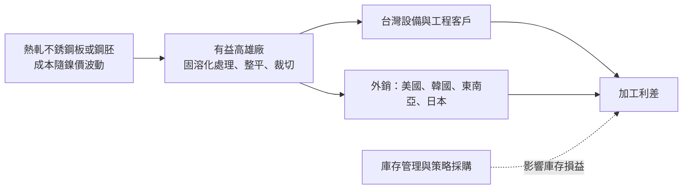
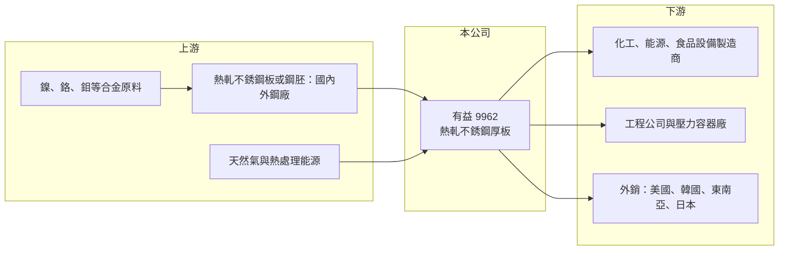

# 9962 有益

> 上櫃｜[[產業索引-鋼鐵工業|鋼鐵工業]]｜上市（櫃）日期 2006/07/10

# 第一章：企業模式與商業藍圖

> [!info] 撰寫說明
> 本文由 Claude 依公開資料整理，架構比照 [[2330台積電]] 的四章研究，資料截至 2026-10-08。財務數字來源：Goodinfo 年度經營績效頁、poorstock 整理的 2024 年 11 月法說會簡報摘要、櫃買中心開放資料（基本資料、2026 年第二季資產負債與綜合損益、本益比）。公開資料有限，查得的資料未揭露產能、原料來源與營收比重，產業描述為整理性內容。#待校對

在評估單一個股的長期投資價值時，首要步驟是拆解企業的底層獲利邏輯。本章說明有益鋼鐵（股票代號：9962，以下簡稱有益）這家小型[[不銹鋼]]厚板廠的商業模式，以及鎳價如何主導它的獲利循環。

## 一、核心定位：高雄的熱軋不銹鋼厚板專業廠

有益成立於 1996 年，總部與工廠位於高雄永安，2006 年在櫃買中心掛牌，實收資本額約 9.02 億元，員工約 94 人，董事長為劉憲同。公司的主要產品是熱軋不銹鋼厚板，材質以 304／304L 與 316L 為主，用於化工、食品、能源與各種工業生產設備的槽體、壓力容器與結構件。

和一貫作業的大型不銹鋼廠不同，有益規模小、產品集中在厚板這個利基市場。依法說會簡報的設備描述，公司擁有固溶化熱處理爐（A 爐採用蓄熱式燃燒器、B 爐於 2024 年第四季啟用）與鋼板整平設備，推估是向上游鋼廠採購熱軋板或鋼胚，再進行[[固溶化處理]]、整平與裁切等加工後銷售（推估，原料來源待校對）。這個模式的優點是資本支出小、能專注於厚板的品質與交期；缺點是原料成本受鎳價與上游報價主導，加工利潤空間有限。

## 二、市場與客戶結構

查得的資料未揭露產品或地區的營收比重，因此本章不放圓餅圖。依法說會簡報整理：

* **台灣市場占比最高：** 供應國內的設備製造商、工程公司與鋼材貿易商。
* **外銷市場：** 外銷 41 個國家，5 年間開發 88 家新客戶，主要出口國為美國、韓國與東南亞，並取得日本 JIS 認證，逐步擴大日本市場。外銷比重提高可以分散國內景氣的影響，但也讓公司暴露在國際貿易政策與匯率風險之下。
* **策略方向：** 擴大工程專案接單，拓展高質化產品市場。

## 三、資本轉化邏輯：鎳價主導的利差生意

* **鎳價決定成本與售價：** 304 與 316L 不銹鋼都含有鎳，316L 另含鉬，鎳價是成本中最大的變數。不銹鋼售價大致隨鎳價調整，有益賺取的是加工與交期的利差。
* **庫存損益：** 鎳價上漲時，低價庫存帶來額外利益；鎳價下跌時，則需承受庫存跌價。公司以供應商管理、策略採購與庫存管理因應鎳價波動，但這只能降低、無法消除風險。

## 四、企業長期藍圖

有益的營運策略包括：以新熱處理爐與整平設備提升產品品質與產能；擴大外銷與日本市場；承接更多工程專案；導入 ESG 管理系統，2023 年溫室氣體排放（範疇一、二）約 4,695 公噸二氧化碳當量。整體而言，有益是一家專注單一利基產品的小型加工廠，長期價值取決於能否在高規格厚板與外銷市場建立穩定客戶群，降低對鎳價循環的依賴。

# 第二章：護城河深度與競爭優勢

本章分析有益在不銹鋼厚板市場的競爭地位。

## 一、護城河的核心組成要素

* **利基產品專注：** 厚板的需求量比薄板小，大型鋼廠通常以標準品為主，專業厚板廠能以少量多樣、裁切加工與短交期服務客戶，形成一定的利基。
* **認證與外銷通路：** 取得 JIS 認證並外銷 41 國，代表品質已被多個市場接受，這是新進小廠難以快速複製的。
* **財務保守：** 2026 年第二季底總負債約 4.3 億元、權益約 10.7 億元，負債比約 28%（櫃買中心開放資料），在不景氣時有能力撐過低谷。

不過有益規模小、原料受制於上游，議價能力有限，屬於窄護城河。

## 二、主要競爭對手格局

| 對手 | 定位 | 對有益的影響 |
|---|---|---|
| [[2027大成鋼]] | 不銹鋼通路與加工，規模大 | 在國內不銹鋼板材通路上競爭 |
| [[2035唐榮]] | 不銹鋼一貫作業與熱軋 | 既是上游鋼材來源之一（推估），也可能直接供應厚板 |
| [[2034允強]]、[[2033佳大]] | 不銹鋼管與板材加工 | 國內不銹鋼加工同業 |
| 中國、印尼不銹鋼廠 | 鎳生鐵一貫作業、低成本 | 以低價壓縮全球不銹鋼售價 |

## 三、優勢轉化：守得住、守不住與觀察重點

* **守得住：** 特定規格厚板與外銷客戶的穩定訂單，特別是重視認證與品質的日本與美國客戶。
* **守不住：** 一般規格的價格。中國與印尼的低成本產能持續擴張，全球不銹鋼價格長期受壓。
* **觀察重點：** 第一，營業利益率能否回到 5% 以上；第二，外銷與日本市場的成長；第三，鎳價與不銹鋼價格的走勢。

# 第三章：財務體質與盈利規模

資料日期：2026-10-08。數字取自 Goodinfo 年度經營績效頁與櫃買中心開放資料，表格是撰寫當時的快照；最新月營收、毛利率、累計 EPS 由自動排程寫在本筆記的屬性欄位（月營收、毛利率、累計EPS 等）。#待校對

財務報表是檢驗護城河是否真實存在的最終標準。本章檢視有益在鎳價循環中的獲利波動。

## 一、多年度財務摘要

| 年度 | 營收（新台幣） | [[毛利率]] | [[營業利益率]] | EPS（元） | [[ROE]] |
|---|---|---|---|---|---|
| 2019 | 23.2 億 | 3.72% | 0.50% | 0.13 | 1.16% |
| 2020 | 20.3 億 | 2.92% | -0.36% | 0.01 | 0.13% |
| 2021 | 25.9 億 | 9.74% | 6.32% | 1.55 | 13.8% |
| 2022 | 35.3 億 | 10.3% | 7.11% | 2.36 | 18.6% |
| 2023 | 35.0 億 | 6.88% | 4.04% | 1.26 | 9.66% |
| 2024 | 24.4 億 | 6.69% | 2.55% | 0.68 | 5.41% |
| 2025 | 19.3 億 | 4.14% | -0.23% | -0.15 | -1.25% |
| 2026 上半年 | 9.0 億 | 7.46% | 2.68% | 0.23 | 未查得 |

註：2026 年上半年毛利率與營業利益率依櫃買中心綜合損益資料推算（營業毛利約 0.67 億元、營業利益約 0.24 億元）。

* **典型的商品循環：** 2021 至 2022 年鎳價與不銹鋼價格大漲，有益營收從 20 億元成長到 35 億元，毛利率超過 10%、ROE 接近兩成；2023 年起價格回落、需求轉弱，2025 年營收降到 19.3 億元並出現小幅虧損。
* **營收成長：** 2020 至 2025 年營收年複合成長率約 -1.0%（推算），長期大致持平，營收高低主要反映不銹鋼價格而非出貨量的長期成長。
* **2026 年回穩：** 上半年營業利益轉正，毛利率回到 7% 以上，顯示景氣可能自谷底回升，但規模仍小。

## 二、[[ROE]]：資本效率

2021 至 2025 年平均 ROE 約 9.2%（推算），但這個平均值由 2021 至 2022 年的高峰撐起。有益的 ROE 幾乎完全跟隨鎳價循環，缺乏穩定的基礎獲利。股價淨值比約 0.86 倍（2026 年 10 月初，櫃買中心資料），反映市場對獲利持續性的保守看法。

## 三、股利與現金流

櫃買中心資料顯示最近一期每股股利為 0 元，與 2025 年虧損一致。有益的配息政策跟隨獲利起伏，景氣好時配發、虧損年度停發，股利穩定度低。資本支出以熱處理爐與整平設備為主，規模不大，自由現金流主要受存貨與鎳價變動影響（推估）。

## 四、[[ROIC]] 與 [[WACC]]：價值創造利差

**ROIC 推算：** 2025 年營業利益率 -0.23%，ROIC 為負（約 -0.3%，推算）。以 2026 年上半年營業利益約 0.24 億元年化計算，稅後營業利益約 0.39 億元；權益約 10.7 億元，假設總負債中約三成為有息負債（推估，約 1.3 億元），投入資本約 12.0 億元，ROIC 約 3.2%（推算）。在 2022 年高峰期，營業利益約 2.5 億元，ROIC 可達約 15% 以上（推算，資本基礎以近期數字代替）。

**WACC 推算：** 台灣 10 年期公債殖利率取 1.75%、市場風險溢酬 6%、β 取鋼鐵業常見值 1.0，股東權益成本約 7.75%；負債成本 2.5%，稅後約 2.0%；權益約占 89%、負債約占 11%，WACC 約 7.1%（推算）。

**結論：** 有益只在不銹鋼景氣高峰期 ROIC 明顯高於 WACC，其他時間多半低於資金成本，2025 年更為負值。整個循環平均下來，ROIC 大致與 WACC 相當或略低（推估）。這是典型的景氣循環股，長期投資的關鍵在於買進的時點與鎳價循環的位置，而不是公司本身的成長性。

# 第四章：總體風險與地緣政治

任何企業都無法脫離宏觀環境獨立存在。本章分析有益長期面對的原物料、產業與貿易風險。

## 一、原物料風險

* **鎳價波動：** 鎳價受印尼產能、電動車電池需求與國際投機資金影響，波動劇烈。鎳價急跌時，有益的庫存價值下降，可能直接造成虧損，2025 年的虧損就發生在不銹鋼價格走弱期間。
* **上游供應：** 原料來自上游鋼廠或進口，上游報價與供貨穩定度會直接影響有益的成本與交期。

## 二、產業結構風險

* **中國與印尼的產能擴張：** 以[[鎳生鐵]]一貫作業的中國與印尼不銹鋼廠成本極低，持續擴產使全球不銹鋼價格長期承壓，小型加工廠的利潤空間被壓縮。
* **下游投資週期：** 不銹鋼厚板用於化工、能源與食品設備，這些產業的資本支出週期決定了需求高低。

## 三、貿易與匯率風險

* **貿易保護：** 美國、歐盟等市場對鋼鐵產品課徵關稅或反傾銷稅，外銷比重越高，受貿易政策影響越大。
* **碳邊境機制：** 歐盟[[碳邊境調整機制]]將鋼鐵納入範圍，出口到歐洲的產品需要申報碳排放並可能付費，排放管理能力將影響外銷競爭力。
* **匯率：** 原料與外銷多以美元計價，新台幣升貶會影響毛利與匯兌損益。

## 四、營運規模風險

有益員工不到百人，營收約 20 億元，規模小意味著固定成本分攤能力有限，景氣低迷時營業利益容易轉為虧損。若要擴大規模或升級產品，需要額外資本支出，而這在獲利不穩定的情況下風險較高。

# 專有名詞解析

## 金融

- **[[毛利率]]**：營業毛利占營收的比例，反映產品定價能力與生產成本控制。
- **[[營業利益率]]**：扣除營業費用後的營業利益占營收的比例，衡量本業整體獲利能力。
- **[[ROE]]**：股東權益報酬率，稅後淨利除以股東權益，衡量公司運用股東資金的效率。
- **[[ROIC]]**：投入資本報酬率，稅後營業利益除以股東權益與有息負債的合計，衡量本業對所有資金提供者的報酬。
- **[[WACC]]**：加權平均資金成本，依股東權益與負債的比重加權計算的資金成本，ROIC 高於它才代表創造價值。

## 產業

- **[[不銹鋼]]**：含鉻、鎳等合金元素的耐腐蝕鋼材，鎳價是主要成本，價格隨鎳價波動。
- **[[固溶化處理]]**：把不銹鋼加熱到高溫後急速冷卻的熱處理，讓合金元素均勻溶入，恢復耐蝕性與韌性，是厚板生產的關鍵工序。
- **[[鎳生鐵]]**：以紅土鎳礦冶煉出的含鎳生鐵，是生產不銹鋼的低成本鎳原料，印尼為主要產地。
- **[[碳邊境調整機制]]**：對進口產品依其生產過程碳排放課徵費用的制度，簡稱 CBAM，目的是避免高碳產品以低價進口。

# 核心供應鏈

## 1. 上游：原料
- 合金原料：鎳、鉻、鉬（國際報價）
- 不銹鋼鋼材：[[2035唐榮]]（推估）等國內外不銹鋼廠

## 2. 本公司與同業
- 國內不銹鋼同業：[[2027大成鋼]]、[[2034允強]]、[[2033佳大]]、[[2035唐榮]]
- 中國與印尼不銹鋼廠

## 3. 下游：客戶
- 化工、能源與食品設備製造商、工程公司與壓力容器廠
- 外銷客戶：美國、韓國、東南亞與日本

## 最新新聞
<!-- news:start -->
<!-- news:end -->

## 相關連結
- [公開資訊觀測站](https://mopsov.twse.com.tw/mops/web/t05st03?step=1&firstin=1&co_id=9962)
- [Goodinfo](https://goodinfo.tw/tw/StockDetail.asp?STOCK_ID=9962)
- [Yahoo 股市](https://tw.stock.yahoo.com/quote/9962)
- [鉅亨網新聞](https://www.cnyes.com/twstock/9962/news)
