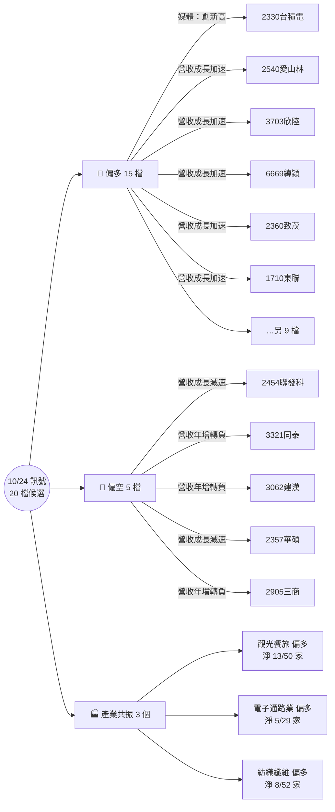

# 2026-10-24 台股異常訊號報告

> [!abstract] 報告摘要
> 新聞視窗 2026-10-23 13:30 ～ 2026-10-24 23:59；財務資料 2026-10-24（證交所、櫃買中心 OpenAPI）。視窗內 45 則新聞，773 家公司出現新訊號，454 家達入榜門檻，取前 20 名。資料檢核 ⚠️。

## 一、訊號導覽

| 入榜候選 | 🔺 偏多 | 🔻 偏空 | ◽ 中性／交錯 | 🔥 熱門題材 | 🏭 產業共振 | 官方來源訊號 | 資料檢核 |
|---|---|---|---|---|---|---|---|
| 20 | 15 | 5 | 0 | 0 | 3 | 26/28 | ⚠️ |

### 重點摘要

- **最強偏多**：[[2330台積電]]（7.82 分，可信度 A），薔琵攪局、台積電運動會取消！ 魏哲家照發「小禮物」金額再創新高（另有 1 則相關）。
- **最強偏空**：[[2454聯發科]]（6.11 分，可信度 A），2026-09 營收年增 1.97%，比前月放慢 42.1 個百分點。
- **熱門題材**：本期沒有題材同時達到公司數與倍數門檻。
- **產業共振**：觀光餐旅有 15 家出現營收偏多轉折（反向 2 家，產業共 50 家），淨比例最高。
- **資料檢核**：1 項需注意（月營收驗算），見〈七、資料檢核〉。

## 二、Top 候選總表

| # | 公司 | 產業 | 分數 | 方向 | 可信度 | 主要訊號 | 出處 |
|---|---|---|---|---|---|---|---|
| 1 | [[2330台積電]]⭐ | 半導體業 | 7.82 | 偏多 | A | 媒體：創新高、營收高成長、媒體：上修 | [^1][^2][^3] |
| 2 | [[2540愛山林]] | 建材營造業 | 6.5 | 偏多 | A | 營收成長加速、累計營收轉正 | [^2] |
| 3 | [[3703欣陸]] | 建材營造業 | 6.5 | 偏多 | A | 營收成長加速、累計營收轉正 | [^2] |
| 4 | [[6669緯穎]]⭐ | 電腦及週邊設備業 | 6.48 | 偏多 | A | 營收成長加速 | [^2] |
| 5 | [[2454聯發科]]⭐ | 半導體業 | 6.11 | 偏空 | A | 營收成長減速 | [^2] |
| 6 | [[2360致茂]]⭐ | 其他電子業 | 6.01 | 偏多 | A | 營收成長加速 | [^2] |
| 7 | [[1710東聯]] | 化學工業 | 6 | 偏多 | A | 營收成長加速、累計營收轉正 | [^2] |
| 8 | [[3702大聯大]] | 電子通路業 | 6 | 偏多 | A | 營收成長加速 | [^2] |
| 9 | [[3321同泰]] | 電子零組件業 | 5.99 | 偏空 | A | 營收年增轉負、重訊 C 級：會計主管 | [^2][^4] |
| 10 | [[2383台光電]]⭐ | 電子零組件業 | 5.95 | 偏多 | A | 營收成長加速 | [^2] |
| 11 | [[3062建漢]] | 通信網路業 | 5.8 | 偏空 | A | 營收年增轉負、累計營收轉負 | [^2] |
| 12 | [[2357華碩]]⭐ | 電腦及週邊設備業 | 5.67 | 偏空 | A | 營收成長減速 | [^2] |
| 13 | [[4938和碩]] | 電腦及週邊設備業 | 5.64 | 偏多 | A | 營收成長加速 | [^2] |
| 14 | [[6213聯茂]] | 電子零組件業 | 5.61 | 偏多 | A | 營收高成長、重訊 C 級：注意交易資訊 | [^2][^5] |
| 15 | [[2891中信金]]⭐ | 金融保險業 | 5.51 | 偏多 | A | 營收年增轉正 | [^2] |
| 16 | [[2101南港]] | 橡膠工業 | 5.5 | 偏多 | A | 營收成長加速 | [^2] |
| 17 | [[2344華邦電]]⭐ | 半導體業 | 5.5 | 偏多 | A | 營收高成長 | [^2] |
| 18 | [[2542興富發]] | 建材營造業 | 5.5 | 偏多 | A | 營收年增轉正 | [^2] |
| 19 | [[2547日勝生]] | 建材營造業 | 5.5 | 偏多 | A | 營收成長加速 | [^2] |
| 20 | [[2905三商]] | 貿易百貨業 | 5.5 | 偏空 | A | 營收年增轉負 | [^2] |

⭐ 0050 成分股。可信度：A 官方資料或多來源交叉確認；B 單一主流媒體或多家非主流來源；C 只有單一平台來源，引用前必須查證。

## 三、個股訊號明細

### 1. [[2330台積電]]⭐｜7.82 分｜偏多｜可信度 A
半導體業｜分數組成：訊號 3.82 ＋ 規模 +2 ＋ 新聞與財報共振 +2｜完整新聞：[[2330台積電 新聞]]

| 訊號 | 方向 | 強度 | 說明 | 來源檢核 | 出處 |
|---|---|---|---|---|---|
| 媒體：創新高 | 🔺 | 2.5 | 薔琵攪局、台積電運動會取消！ 魏哲家照發「小禮物」金額再創新高（另有 1 則相關） | A：2 家來源交叉確認（FTNN 新聞網、自由財經），含主流媒體 | [^1][^6] |
| 營收高成長 | 🔺 | 2.05 | 2026-09 營收年增 54.65%（前月 53.32%） | A：官方資料；月增率驗算一致（前月 5148.05 億 × (1-0.57%) ≈ 5118.71 億） | [^2] |
| 媒體：上修 | 🔺 | 1.2 | 台積電(2330)再度上修 AI 展望，先進製程需求全面爆發 | C：只有券商與資訊平台來源（CMoney），需查證 | [^3] |

### 2. [[2540愛山林]]｜6.5 分｜偏多｜可信度 A
建材營造業｜分數組成：訊號 6 ＋ 規模 +0.5｜完整新聞：[[2540愛山林 新聞]]

| 訊號 | 方向 | 強度 | 說明 | 來源檢核 | 出處 |
|---|---|---|---|---|---|
| 營收成長加速 | 🔺 | 5 | 2026-09 營收年增 238.7%，比前月加快 140.3 個百分點 | A：官方資料；月增率驗算一致（前月 15.19 億 × (1+114.75%) ≈ 32.62 億） | [^2] |
| 累計營收轉正 | 🔺 | 2 | 今年累計營收年增由 -25.15% 轉為 1.73% | A：官方資料；月增率驗算一致（前月 15.19 億 × (1+114.75%) ≈ 32.62 億） | [^2] |

### 3. [[3703欣陸]]｜6.5 分｜偏多｜可信度 A
建材營造業｜分數組成：訊號 6 ＋ 規模 +0.5｜完整新聞：[[3703欣陸 新聞]]

| 訊號 | 方向 | 強度 | 說明 | 來源檢核 | 出處 |
|---|---|---|---|---|---|
| 營收成長加速 | 🔺 | 5 | 2026-09 營收年增 89.32%，比前月加快 74.0 個百分點 | A：官方資料；月增率驗算一致（前月 24.54 億 × (1+75.47%) ≈ 43.06 億） | [^2] |
| 累計營收轉正 | 🔺 | 2 | 今年累計營收年增由 -6.39% 轉為 3.45% | A：官方資料；月增率驗算一致（前月 24.54 億 × (1+75.47%) ≈ 43.06 億） | [^2] |

### 4. [[6669緯穎]]⭐｜6.48 分｜偏多｜可信度 A
電腦及週邊設備業｜分數組成：訊號 4.48 ＋ 規模 +2｜完整新聞：[[6669緯穎 新聞]]

| 訊號 | 方向 | 強度 | 說明 | 來源檢核 | 出處 |
|---|---|---|---|---|---|
| 營收成長加速 | 🔺 | 4.48 | 2026-09 營收年增 99.99%，比前月加快 49.6 個百分點 | A：官方資料；月增率驗算一致（前月 1443.12 億 × (1+19.62%) ≈ 1726.26 億） | [^2] |

### 5. [[2454聯發科]]⭐｜6.11 分｜偏空｜可信度 A
半導體業｜分數組成：訊號 4.11 ＋ 規模 +2｜完整新聞：[[2454聯發科 新聞]]

| 訊號 | 方向 | 強度 | 說明 | 來源檢核 | 出處 |
|---|---|---|---|---|---|
| 營收成長減速 | 🔻 | 4.11 | 2026-09 營收年增 1.97%，比前月放慢 42.1 個百分點 | A：官方資料；月增率驗算一致（前月 641.83 億 × (1-13.69%) ≈ 553.96 億） | [^2] |

### 6. [[2360致茂]]⭐｜6.01 分｜偏多｜可信度 A
其他電子業｜分數組成：訊號 4.51 ＋ 規模 +1.5｜完整新聞：[[2360致茂 新聞]]

| 訊號 | 方向 | 強度 | 說明 | 來源檢核 | 出處 |
|---|---|---|---|---|---|
| 營收成長加速 | 🔺 | 4.51 | 2026-09 營收年增 206.47%，比前月加快 50.2 個百分點 | A：官方資料；月增率驗算一致（前月 56.32 億 × (1+21.79%) ≈ 68.59 億） | [^2] |

### 7. [[1710東聯]]｜6 分｜偏多｜可信度 A
化學工業｜分數組成：訊號 5.5 ＋ 規模 +0.5｜完整新聞：[[1710東聯 新聞]]

| 訊號 | 方向 | 強度 | 說明 | 來源檢核 | 出處 |
|---|---|---|---|---|---|
| 營收成長加速 | 🔺 | 4.5 | 2026-09 營收年增 73.97%，比前月加快 50.0 個百分點 | A：官方資料；月增率驗算一致（前月 23.9 億 × (1+26.61%) ≈ 30.26 億） | [^2] |
| 累計營收轉正 | 🔺 | 2 | 今年累計營收年增由 -2.44% 轉為 5.22% | A：官方資料；月增率驗算一致（前月 23.9 億 × (1+26.61%) ≈ 30.26 億） | [^2] |

### 8. [[3702大聯大]]｜6 分｜偏多｜可信度 A
電子通路業｜分數組成：訊號 5 ＋ 規模 +1｜完整新聞：[[3702大聯大 新聞]]

| 訊號 | 方向 | 強度 | 說明 | 來源檢核 | 出處 |
|---|---|---|---|---|---|
| 營收成長加速 | 🔺 | 5 | 2026-09 營收年增 146.49%，比前月加快 66.0 個百分點 | A：官方資料；月增率驗算一致（前月 1422.38 億 × (1+54.39%) ≈ 2196.01 億） | [^2] |

### 9. [[3321同泰]]｜5.99 分｜偏空｜可信度 A
電子零組件業｜分數組成：訊號 3.74 ＋ 規模 +0.25 ＋ 新聞與財報共振 +2｜完整新聞：[[3321同泰 新聞]]

| 訊號 | 方向 | 強度 | 說明 | 來源檢核 | 出處 |
|---|---|---|---|---|---|
| 營收年增轉負 | 🔻 | 3.24 | 2026-09 營收年增由 16.94% 轉為 -5.97% | A：官方資料；月增率驗算一致（前月 2.34 億 × (1-14.89%) ≈ 1.99 億） | [^2] |
| 重訊 C 級：會計主管 | ◽ | 1 | 公告本公司新任會計主管 | A：官方公告（公開資訊觀測站） | [^4] |

### 10. [[2383台光電]]⭐｜5.95 分｜偏多｜可信度 A
電子零組件業｜分數組成：訊號 3.95 ＋ 規模 +2｜完整新聞：[[2383台光電 新聞]]

| 訊號 | 方向 | 強度 | 說明 | 來源檢核 | 出處 |
|---|---|---|---|---|---|
| 營收成長加速 | 🔺 | 3.95 | 2026-09 營收年增 168.87%，比前月加快 39.0 個百分點 | A：官方資料；月增率驗算一致（前月 201.46 億 × (1+6.88%) ≈ 215.32 億） | [^2] |

### 11. [[3062建漢]]｜5.8 分｜偏空｜可信度 A
通信網路業｜分數組成：訊號 5.55 ＋ 規模 +0.25｜完整新聞：[[3062建漢 新聞]]

| 訊號 | 方向 | 強度 | 說明 | 來源檢核 | 出處 |
|---|---|---|---|---|---|
| 營收年增轉負 | 🔻 | 4.55 | 2026-09 營收年增由 34.74% 轉為 -38.77% | A：官方資料；月增率驗算一致（前月 3.42 億 × (1-25.89%) ≈ 2.53 億） | [^2] |
| 累計營收轉負 | 🔻 | 2 | 今年累計營收年增由 2.58% 轉為 -3.04% | A：官方資料；月增率驗算一致（前月 3.42 億 × (1-25.89%) ≈ 2.53 億） | [^2] |

### 12. [[2357華碩]]⭐｜5.67 分｜偏空｜可信度 A
電腦及週邊設備業｜分數組成：訊號 3.67 ＋ 規模 +2｜完整新聞：[[2357華碩 新聞]]

| 訊號 | 方向 | 強度 | 說明 | 來源檢核 | 出處 |
|---|---|---|---|---|---|
| 營收成長減速 | 🔻 | 3.67 | 2026-09 營收年增 17.73%，比前月放慢 33.4 個百分點 | A：官方資料；月增率驗算一致（前月 949.56 億 × (1+2.41%) ≈ 972.44 億） | [^2] |

### 13. [[4938和碩]]｜5.64 分｜偏多｜可信度 A
電腦及週邊設備業｜分數組成：訊號 4.64 ＋ 規模 +1｜完整新聞：[[4938和碩 新聞]]

| 訊號 | 方向 | 強度 | 說明 | 來源檢核 | 出處 |
|---|---|---|---|---|---|
| 營收成長加速 | 🔺 | 4.64 | 2026-09 營收年增 86.88%，比前月加快 52.8 個百分點 | A：官方資料；月增率驗算一致（前月 883.05 億 × (1+143.19%) ≈ 2147.49 億） | [^2] |

### 14. [[6213聯茂]]｜5.61 分｜偏多｜可信度 A
電子零組件業｜分數組成：訊號 3.11 ＋ 規模 +0.5 ＋ 新聞與財報共振 +2｜完整新聞：[[6213聯茂 新聞]]

| 訊號 | 方向 | 強度 | 說明 | 來源檢核 | 出處 |
|---|---|---|---|---|---|
| 營收高成長 | 🔺 | 2.61 | 2026-09 營收年增 110.74%（前月 97.93%） | A：官方資料；月增率驗算一致（前月 50.44 億 × (1+15.47%) ≈ 58.24 億） | [^2] |
| 重訊 C 級：注意交易資訊 | ◽ | 1 | 本公司有價證券於集中交易市場達公布注意交易資訊標準 故公布相關財務業務等重大訊息，以利投資人區別瞭解。 | A：官方公告（公開資訊觀測站） | [^5] |

### 15. [[2891中信金]]⭐｜5.51 分｜偏多｜可信度 A
金融保險業｜分數組成：訊號 3.51 ＋ 規模 +2｜完整新聞：[[2891中信金 新聞]]

| 訊號 | 方向 | 強度 | 說明 | 來源檢核 | 出處 |
|---|---|---|---|---|---|
| 營收年增轉正 | 🔺 | 3.51 | 2026-09 營收年增由 -32.01% 轉為 12.82% | A：官方資料；月增率驗算一致（前月 244.02 億 × (1-12.58%) ≈ 213.32 億） | [^2] |

### 16. [[2101南港]]｜5.5 分｜偏多｜可信度 A
橡膠工業｜分數組成：訊號 5 ＋ 規模 +0.5｜完整新聞：[[2101南港 新聞]]

| 訊號 | 方向 | 強度 | 說明 | 來源檢核 | 出處 |
|---|---|---|---|---|---|
| 營收成長加速 | 🔺 | 5 | 2026-09 營收年增 270.34%，比前月加快 186.1 個百分點 | A：官方資料；月增率驗算一致（前月 12.68 億 × (1+87.51%) ≈ 23.78 億） | [^2] |

### 17. [[2344華邦電]]⭐｜5.5 分｜偏多｜可信度 A
半導體業｜分數組成：訊號 3.5 ＋ 規模 +2｜完整新聞：[[2344華邦電 新聞]]

| 訊號 | 方向 | 強度 | 說明 | 來源檢核 | 出處 |
|---|---|---|---|---|---|
| 營收高成長 | 🔺 | 3.5 | 2026-09 營收年增 256.67%（前月 289.43%） | A：官方資料；月增率驗算一致（前月 273.09 億 × (1+3.44%) ≈ 282.48 億） | [^2] |

### 18. [[2542興富發]]｜5.5 分｜偏多｜可信度 A
建材營造業｜分數組成：訊號 5 ＋ 規模 +0.5｜完整新聞：[[2542興富發 新聞]]

| 訊號 | 方向 | 強度 | 說明 | 來源檢核 | 出處 |
|---|---|---|---|---|---|
| 營收年增轉正 | 🔺 | 5 | 2026-09 營收年增由 -20.88% 轉為 103.73% | A：官方資料；月增率驗算一致（前月 30.24 億 × (1+102.44%) ≈ 61.22 億） | [^2] |

### 19. [[2547日勝生]]｜5.5 分｜偏多｜可信度 A
建材營造業｜分數組成：訊號 5 ＋ 規模 +0.5｜完整新聞：[[2547日勝生 新聞]]

| 訊號 | 方向 | 強度 | 說明 | 來源檢核 | 出處 |
|---|---|---|---|---|---|
| 營收成長加速 | 🔺 | 5 | 2026-09 營收年增 157.14%，比前月加快 75.9 個百分點 | A：官方資料；月增率驗算一致（前月 10.67 億 × (1+3.91%) ≈ 11.09 億） | [^2] |

### 20. [[2905三商]]｜5.5 分｜偏空｜可信度 A
貿易百貨業｜分數組成：訊號 5 ＋ 規模 +0.5｜完整新聞：[[2905三商 新聞]]

| 訊號 | 方向 | 強度 | 說明 | 來源檢核 | 出處 |
|---|---|---|---|---|---|
| 營收年增轉負 | 🔻 | 5 | 2026-09 營收年增由 7187.4% 轉為 -81.25% | A：官方資料；月增率驗算一致（前月 154.66 億 × (1-79.61%) ≈ 31.54 億） | [^2] |

## 四、題材雷達

| 題材 | 本期公司數 | 前 7 天日均 | 倍數 | 公司 | 代表報導 |
|---|---|---|---|---|---|
| 本期沒有新聞提到題材關鍵字 | | | | | |

🔥 為熱門：本期公司數 ≥ 門檻，且是前 7 天日均的 2 倍以上。近 14 天走勢見 [[題材雷達]]。

## 五、產業共振

| 產業 | 方向 | 同向家數 | 反向家數 | 淨家數佔產業 | 公司 |
|---|---|---|---|---|---|
| 觀光餐旅 | 偏多 | 15/50 | 2 | 26% | [[2704國賓]]、[[2705六福]]、[[2712遠雄來]]、[[2722夏都]]、[[2736富野]]、[[2748雲品]]、[[3522御嵿]]、[[4530宏易]]、[[5701劍湖山]]、[[5706鳳凰]]… |
| 電子通路業 | 偏多 | 9/29 | 4 | 17% | [[2347聯強]]、[[2430燦坤]]、[[3010華立]]、[[3033威健]]、[[3209全科]]、[[3702大聯大]]、[[6270倍微]]、[[6908宏碁遊戲-創]]、[[8084巨虹]] |
| 紡織纖維 | 偏多 | 15/52 | 7 | 15% | [[1409新纖]]、[[1413宏洲]]、[[1414東和]]、[[1445大宇]]、[[1449佳和]]、[[1455集盛]]、[[1467南緯]]、[[1476儒鴻]]、[[1477聚陽]]、[[4414如興]]… |

## 六、財務訊號總表（797 筆，含未入榜）

| 公司 | 訊號 | 說明 | 來源檢核 | 出處 |
|---|---|---|---|---|
| [[1528恩德]] | 營收成長減速 | 2026-09 營收年增 9.37%，比前月放慢 61.5 個百分點 | A | [^2] |
| [[1599宏佳騰]] | 營收成長減速 | 2026-09 營收年增 32.07%，比前月放慢 66.4 個百分點 | A | [^7] |
| [[1709和益]] | 營收成長減速 | 2026-09 營收年增 6.61%，比前月放慢 76.1 個百分點 | A | [^2] |
| [[1789神隆]] | 營收年增轉正 | 2026-09 營收年增由 -42.18% 轉為 74.45% | A | [^2] |
| [[2025千興]] | 營收成長加速 | 2026-09 營收年增 163.03%，比前月加快 60.5 個百分點 | A | [^2] |
| [[2073雄順]] | 營收成長加速 | 2026-09 營收年增 314.04%，比前月加快 64.3 個百分點 | A | [^7] |
| [[2101南港]] | 營收成長加速 | 2026-09 營收年增 270.34%，比前月加快 186.1 個百分點 | A | [^2] |
| [[2363矽統]] | 營收成長減速 | 2026-09 營收年增 5.98%，比前月放慢 75.1 個百分點 | A | [^2] |
| [[2419仲琦]] | 營收成長減速 | 2026-09 營收年增 0.15%，比前月放慢 245.4 個百分點 | A | [^2] |
| [[2468華經]] | 營收年增轉正 | 2026-09 營收年增由 -28.59% 轉為 68.77% | A | [^2] |
| [[2485兆赫]] | 營收年增轉負 | 2026-09 營收年增由 38.41% 轉為 -50.39% | A | [^2] |
| [[2495普安]] | 營收成長減速 | 2026-09 營收年增 15.21%，比前月放慢 91.0 個百分點 | A | [^2] |
| [[2534宏盛]] | 營收成長加速 | 2026-09 營收年增 85.86%，比前月加快 85.2 個百分點 | A | [^2] |
| [[2540愛山林]] | 營收成長加速 | 2026-09 營收年增 238.7%，比前月加快 140.3 個百分點 | A | [^2] |
| [[2542興富發]] | 營收年增轉正 | 2026-09 營收年增由 -20.88% 轉為 103.73% | A | [^2] |
| [[2547日勝生]] | 營收成長加速 | 2026-09 營收年增 157.14%，比前月加快 75.9 個百分點 | A | [^2] |
| [[2905三商]] | 營收年增轉負 | 2026-09 營收年增由 7187.4% 轉為 -81.25% | A | [^2] |
| [[3024憶聲]] | 營收年增轉正 | 2026-09 營收年增由 -44.12% 轉為 54.33% | A | [^2] |
| [[3041揚智]] | 營收成長減速 | 2026-09 營收年增 39.02%，比前月放慢 104.3 個百分點 | A | [^2] |
| [[3052夆典]] | 營收年增轉正 | 2026-09 營收年增由 -10.79% 轉為 145.43% | A | [^2] |
| [[3176基亞]] | 營收成長減速 | 2026-09 營收年增 49.6%，比前月放慢 147.8 個百分點 | A | [^7] |
| [[3209全科]] | 營收成長加速 | 2026-09 營收年增 90.48%，比前月加快 63.0 個百分點 | A | [^2] |
| [[3219倚強科]] | 營收成長加速 | 2026-09 營收年增 151.15%，比前月加快 131.4 個百分點 | A | [^7] |
| [[3311閎暉]] | 營收成長加速 | 2026-09 營收年增 446.47%，比前月加快 342.1 個百分點 | A | [^2] |
| [[3380明泰]] | 營收成長減速 | 2026-09 營收年增 6.57%，比前月放慢 60.3 個百分點 | A | [^2] |
| [[3570大塚]] | 營收成長減速 | 2026-09 營收年增 3.77%，比前月放慢 69.6 個百分點 | A | [^7] |
| [[3661世芯-KY]] | 營收成長加速 | 2026-09 營收年增 496%，比前月加快 222.4 個百分點 | A | [^2] |
| [[3664安瑞-KY]] | 營收成長減速 | 2026-09 營收年增 16.6%，比前月放慢 252.7 個百分點 | A | [^7] |
| [[3702大聯大]] | 營收成長加速 | 2026-09 營收年增 146.49%，比前月加快 66.0 個百分點 | A | [^2] |
| [[3703欣陸]] | 營收成長加速 | 2026-09 營收年增 89.32%，比前月加快 74.0 個百分點 | A | [^2] |
| [[4119旭富]] | 營收成長減速 | 2026-09 營收年增 33.05%，比前月放慢 154.5 個百分點 | A | [^2] |
| [[4442竣邦-KY]] | 營收成長減速 | 2026-09 營收年增 48.36%，比前月放慢 83.0 個百分點 | A | [^7] |
| [[4526東台]] | 營收成長加速 | 2026-09 營收年增 81.03%，比前月加快 63.1 個百分點 | A | [^2] |
| [[4768晶呈科技]] | 營收成長減速 | 2026-09 營收年增 23.88%，比前月放慢 69.2 個百分點 | A | [^7] |
| [[4770上品]] | 營收年增轉正 | 2026-09 營收年增由 -29.5% 轉為 69.02% | A | [^2] |
| [[4807日成-KY]] | 營收成長減速 | 2026-09 營收年增 39.98%，比前月放慢 65.5 個百分點 | A | [^2] |
| [[4903聯光通]] | 營收年增轉正 | 2026-09 營收年增由 -51.78% 轉為 93.83% | A | [^7] |
| [[4973廣穎]] | 營收成長加速 | 2026-09 營收年增 277.71%，比前月加快 73.7 個百分點 | A | [^7] |
| [[4979華星光]] | 營收成長加速 | 2026-09 營收年增 97.78%，比前月加快 60.3 個百分點 | A | [^7] |
| [[4991環宇-KY]] | 營收成長加速 | 2026-09 營收年增 112.94%，比前月加快 67.3 個百分點 | A | [^7] |
| [[5213亞昕]] | 營收年增轉正 | 2026-09 營收年增由 -27.69% 轉為 424.53% | A | [^7] |
| [[5516雙喜]] | 營收成長加速 | 2026-09 營收年增 145.86%，比前月加快 103.4 個百分點 | A | [^7] |
| [[5522遠雄]] | 營收年增轉正 | 2026-09 營收年增由 -46.74% 轉為 262.47% | A | [^2] |
| [[5534長虹]] | 營收年增轉負 | 2026-09 營收年增由 88.58% 轉為 -50.46% | A | [^2] |
| [[6016康和證]] | 營收成長減速 | 2026-09 營收年增 49.16%，比前月放慢 166.2 個百分點 | A | [^7] |
| [[6163華電網]] | 營收年增轉正 | 2026-09 營收年增由 -26.5% 轉為 87.35% | A | [^7] |
| [[6177達麗]] | 營收年增轉正 | 2026-09 營收年增由 -8.72% 轉為 249.5% | A | [^2] |
| [[6215和椿]] | 營收成長減速 | 2026-09 營收年增 28.87%，比前月放慢 103.9 個百分點 | A | [^2] |
| [[6234高僑]] | 營收成長加速 | 2026-09 營收年增 133.52%，比前月加快 65.1 個百分點 | A | [^7] |
| [[6581鋼聯]] | 營收成長減速 | 2026-09 營收年增 26.12%，比前月放慢 62.1 個百分點 | A | [^2] |
| [[6589台康生技]] | 營收成長減速 | 2026-09 營收年增 43.16%，比前月放慢 82.8 個百分點 | A | [^2] |
| [[6637醫影]] | 營收成長加速 | 2026-09 營收年增 141.6%，比前月加快 140.7 個百分點 | A | [^7] |
| [[6640均華]] | 營收成長加速 | 2026-09 營收年增 87.19%，比前月加快 68.5 個百分點 | A | [^7] |
| [[6658聯策]] | 營收成長減速 | 2026-09 營收年增 5.44%，比前月放慢 98.6 個百分點 | A | [^2] |
| [[6715嘉基]] | 營收成長減速 | 2026-09 營收年增 40.94%，比前月放慢 72.1 個百分點 | A | [^2] |
| [[6751智聯服務]] | 營收成長加速 | 2026-09 營收年增 158.43%，比前月加快 132.8 個百分點 | A | [^7] |
| [[6874倍力]] | 營收成長減速 | 2026-09 營收年增 35.76%，比前月放慢 146.7 個百分點 | A | [^7] |
| [[6937天虹]] | 營收成長減速 | 2026-09 營收年增 29.06%，比前月放慢 94.2 個百分點 | A | [^2] |
| [[7734印能科技]] | 營收年增轉正 | 2026-09 營收年增由 -1.27% 轉為 122.27% | A | [^7] |
| [[7740熙特爾-創]] | 營收年增轉負 | 2026-09 營收年增由 869.63% 轉為 -52.67% | A | [^2] |
| [[8050廣積]] | 營收成長加速 | 2026-09 營收年增 167.1%，比前月加快 72.6 個百分點 | A | [^7] |
| [[8084巨虹]] | 營收成長加速 | 2026-09 營收年增 252.26%，比前月加快 107.1 個百分點 | A | [^7] |
| [[8099大世科]] | 營收年增轉正 | 2026-09 營收年增由 -26.6% 轉為 123.46% | A | [^7] |
| [[8499鼎炫-KY]] | 營收成長減速 | 2026-09 營收年增 1.84%，比前月放慢 89.4 個百分點 | A | [^2] |
| [[8940新天地]] | 營收年增轉正 | 2026-09 營收年增由 -3.76% 轉為 75.23% | A | [^2] |
| [[9950萬國通]] | 營收成長加速 | 2026-09 營收年增 78.66%，比前月加快 59.6 個百分點 | A | [^7] |
| [[4426利勤]] | 營收成長加速 | 2026-09 營收年增 76.06%，比前月加快 58.5 個百分點 | A | [^2] |
| [[6486互動]] | 營收年增轉負 | 2026-09 營收年增由 825.81% 轉為 -47.75% | A | [^7] |
| [[7703銳澤]] | 營收成長減速 | 2026-09 營收年增 25.53%，比前月放慢 57.7 個百分點 | A | [^7] |
| [[5314世紀]] | 營收成長減速 | 2026-09 營收年增 45.71%，比前月放慢 56.8 個百分點 | A | [^7] |
| [[6924榮惠-KY創]] | 營收成長加速 | 2026-09 營收年增 141.52%，比前月加快 56.5 個百分點 | A | [^2] |
| [[2501國建]] | 營收年增轉負 | 2026-09 營收年增由 60.18% 轉為 -44.77% | A | [^2] |
| [[4432銘旺實]] | 營收成長加速 | 2026-09 營收年增 63.61%，比前月加快 55.8 個百分點 | A | [^7] |
| [[4142國光生]] | 營收成長加速 | 2026-09 營收年增 90.14%，比前月加快 55.7 個百分點 | A | [^2] |
| [[4417金洲]] | 營收成長減速 | 2026-09 營收年增 2.67%，比前月放慢 55.6 個百分點 | A | [^7] |
| [[6957裕慶-KY]] | 營收年增轉正 | 2026-09 營收年增由 -31.15% 轉為 43.98% | A | [^2] |
| [[3303岱稜]] | 營收年增轉正 | 2026-09 營收年增由 -1.41% 轉為 43.33% | A | [^7] |
| [[3147大綜]] | 營收成長加速 | 2026-09 營收年增 287.94%，比前月加快 54.5 個百分點 | A | [^7] |
| [[1436華友聯]] | 營收年增轉正 | 2026-09 營收年增由 -87.9% 轉為 42.74% | A | [^2] |
| [[2349錸德]] | 營收年增轉正 | 2026-09 營收年增由 -1.27% 轉為 42.29% | A | [^2] |
| … | 其餘 717 筆見 `系統/資料/訊號/2026-10-24.json` | | | |

## 七、資料檢核

| 檢核項目 | 狀態 | 說明 |
|---|---|---|
| 新聞資料新鮮度 | ✅ | 新聞檔最後更新 2026-10-24 13:19（距報告時間 0 小時；超過 16 小時代表排程延遲或失敗） |
| 新聞抓取排程 | ✅ | 最近一次排程沒有來源失敗紀錄 |
| 新聞來源組成 | ✅ | 視窗內 45 則：官方 22、主流媒體 10、其他 6、券商與資訊平台 6、聚合與社群 1 |
| 雜訊過濾 | ✅ | 排除雜訊 14 則（例行重訊、零股排行等），彙整文 2 則只算題材熱度，營收速報 0 則只算新聞量 |
| 新聞檔重複行 | ℹ️ | 讀檔時略過同日同標題的重複行 113 筆（舊版去重錯誤留下的，不影響計分） |
| 財務資料新鮮度 | ✅ | `系統/資料/財務摘要.json` 抓取日期 2026-10-24（0 天前） |
| 月營收覆蓋 | ✅ | 99% 的個股筆記已有 2026-09 月營收 |
| 月營收驗算 | ⚠️ | 10 家不一致（可能是公司更正前月營收）：[[2392正崴]]、[[2530華建]]、[[3609三一東林]]、[[3712永崴投控]]、[[4946辣椒]]、[[5704老爺知]]、[[6264富裔]]、[[6901鑽石投資]]… |
| 季報比較基礎 | ℹ️ | 歷史快照還沒有前一季，季報轉折要等下一季財報公布後才會出現 |
| 入榜訊號可信度 | ✅ | A 級 27、B 級 0、C 級 1（C 級只有單一平台來源，引用前要查證） |
| Google 新聞轉址 | ℹ️ | 3 筆出處是 Google 新聞轉址連結，需用瀏覽器開啟才會導到原始媒體 |
| 連結可用性 | ✅ | 檢查 3 個引用連結，3 個可開啟 |

✅ 通過　⚠️ 需注意　❌ 失敗　ℹ️ 說明

## 八、方法與限制

- 訊號由程式依 `系統/資料/訊號規則.json` 的規則篩出，是值得追蹤的候選，不是投資建議；寫成文章前要回原始來源確認，未查證內容標 #待校對。
- 分數＝同一家公司各訊號強度遞減加總（1、½、¼…）＋規模加分＋新聞與財報共振加分＋熱門題材加分；入榜只看訊號本身的分數。
- 媒體訊號強度乘上可信度係數（A 1.0、B 0.85、C 0.6）。財務數字以官方開放資料為準，並用前月營收驗算月增率。
- Google 新聞只抓關注清單，清單外公司的媒體新聞較少；重訊連結統一指向公開資訊觀測站查詢頁。
- 架構說明見 `系統/規範/篩選架構說明.md`。

## 九、資料來源

### 資料集

| 資料 | 用途 | 位置 |
|---|---|---|
| 證交所、櫃買中心 OpenAPI 月營收與綜合損益表 | 營收、季報訊號 | `系統/資料/財務摘要.json`（抓取日 2026-10-24） |
| 公開資訊觀測站重大訊息 | 重訊分級 | `新聞/<代號名稱> 新聞.md` 的 🏛️ 重訊 |
| 鉅亨網 API、Google 新聞（關注清單） | 媒體訊號、新聞量、題材熱度 | `新聞/<代號名稱> 新聞.md` 的 📰 媒體 |
| 個股筆記 frontmatter「產業」、`系統/資料/0050成分股.txt` | 產業共振、規模加分 | `個股/台股/` |

### 引用明細（共 7 筆）

[^1]: FTNN 新聞網（其他），2026-10-24 11:40，〈薔琵攪局、台積電運動會取消！ 魏哲家照發「小禮物」金額再創新高〉。[Google 新聞轉址連結](https://news.google.com/rss/articles/CBMiS0FVX3lxTE52cHYyNjV6b2JTa2s5cG9vWmNkelYtbTZ5WmthWElrT1NIeTdGQWJxdkdGNUV0bUJBdGhfN0JXNVE0RlVhcE5zVzZOYw?oc=5)　✅ 連結可開啟
[^2]: 證交所 OpenAPI｜上市公司每月營業收入彙總表（t187ap05_L）。官方開放資料，排程抓取日 2026-10-24，repo 快照 `系統/資料/財務摘要.json`；轉折比較用 `系統/資料/訊號/財務歷史.json`。[https://openapi.twse.com.tw/v1/opendata/t187ap05_L](https://openapi.twse.com.tw/v1/opendata/t187ap05_L)
[^3]: CMoney（券商與資訊平台），2026-10-23 19:39，〈台積電(2330)再度上修 AI 展望，先進製程需求全面爆發〉。[Google 新聞轉址連結](https://news.google.com/rss/articles/CBMiWEFVX3lxTFAzMFc5elkwWmFCQThJT09pNklIU0YzQVlnYVNIdGlDQWVwanBjTEJNQzEya0RRTzFkakY1M3NIU0FqN3libmc3aTJBQzhWaGZpNVd2eUI5TW8?oc=5)　✅ 連結可開啟
[^4]: 公開資訊觀測站重大訊息（官方），2026-10-23 16:21，代號 3321：〈公告本公司新任會計主管〉。[公開資訊觀測站](https://mops.twse.com.tw/mops/#/web/t05st01)（以代號與日期查詢原文）
[^5]: 公開資訊觀測站重大訊息（官方），2026-10-23 17:59，代號 6213：〈本公司有價證券於集中交易市場達公布注意交易資訊標準 故公布相關財務業務等重大訊息，以利投資人區別瞭解。〉。[公開資訊觀測站](https://mops.twse.com.tw/mops/#/web/t05st01)（以代號與日期查詢原文）
[^6]: 自由財經（主流媒體），2026-10-23 21:45，〈台積電24日運動會取消不影響獎金！魏哲家宣布加碼至3萬元創新高〉。[Google 新聞轉址連結](https://news.google.com/rss/articles/CBMiX0FVX3lxTFBDLU1fNlV3M245UHpMNFpjV3hucjdhSW1TOU45eTRqYngtVVhXV3dHdjFORkpodnh0WHRSdFdSZ2lkaWRQbEhqYUt6OWZkUDltWEpucmRoX3BjSno1Z3Fv0gFkQVVfeXFMUFluQ0RPVjFOYXNBSDhob2J2MF9yUS1fWEdUNWVxa2xjYWFtY3RkZHlRM1dUckhXRHp2WThlQjdVWVh6eVRwc1J5N1ZuNzE3VXJmeHdjbHRlZjNDVkxTV0MyU0E5Yg?oc=5)　✅ 連結可開啟
[^7]: 櫃買中心 OpenAPI｜上櫃公司每月營業收入彙總表（mopsfin_t187ap05_O）。官方開放資料，排程抓取日 2026-10-24，repo 快照 `系統/資料/財務摘要.json`；轉折比較用 `系統/資料/訊號/財務歷史.json`。[https://www.tpex.org.tw/openapi/v1/mopsfin_t187ap05_O](https://www.tpex.org.tw/openapi/v1/mopsfin_t187ap05_O)
