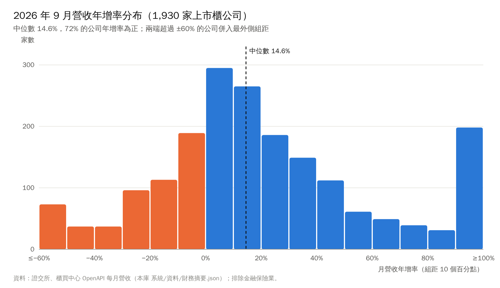
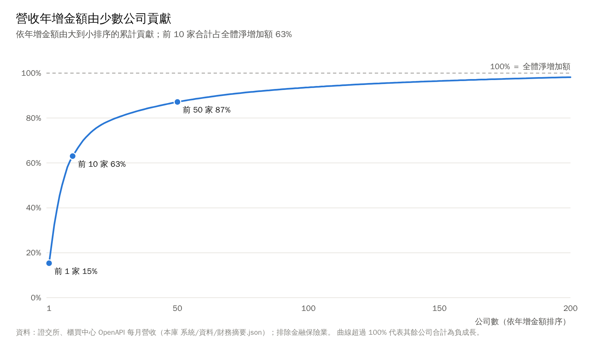
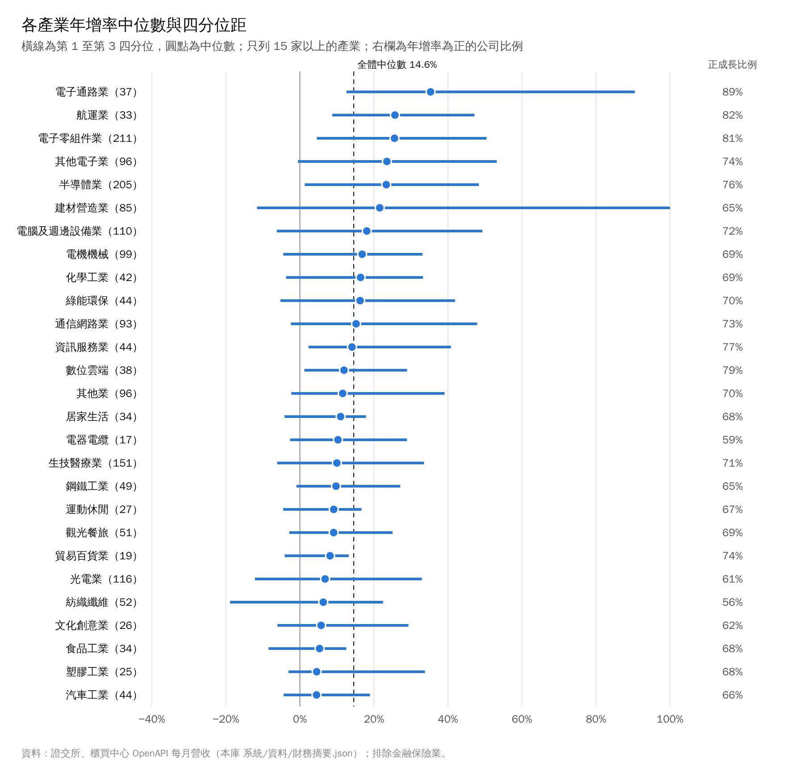
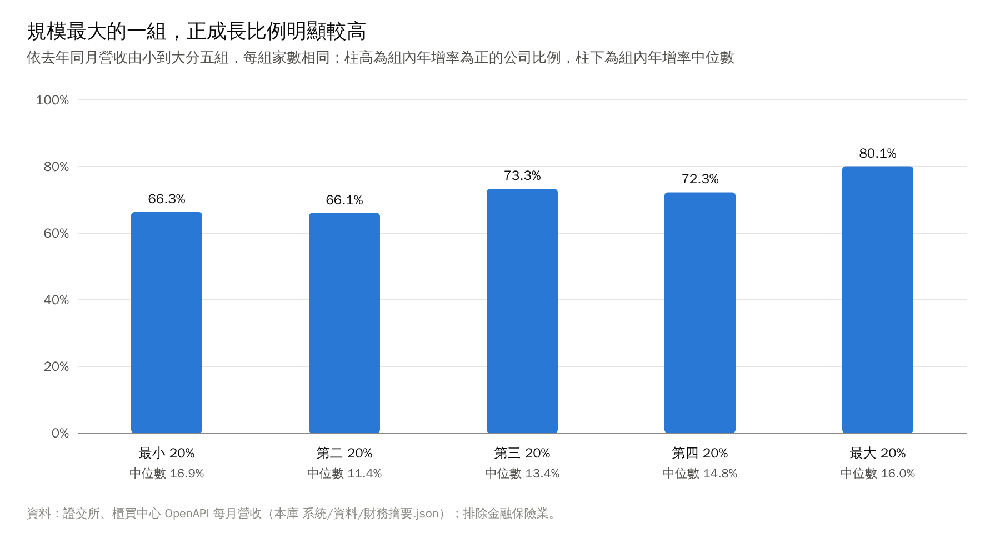

# 2026 年 9 月營收統計：成長的廣度與集中度

> **資料基準日**
> - 月營收：2026 年 9 月，證交所與櫃買中心 OpenAPI〔1〕〔2〕，本庫於 2026/10/21 抓取〔3〕。
> - 毛利率：2026 年第 2 季，同一來源〔3〕。
> - 產業分類：證交所／櫃買中心產業別，取自本庫個股筆記〔4〕。
> - 樣本：1,930 家有 9 月營收與去年同月營收的上市櫃公司，排除金融保險業（營收定義與一般產業不同）。
>
> 所有統計由 `系統/scripts/統計/營收廣度.py` 從上述資料重算，可重現。#待校對

## 重點摘要

1. **成長很普遍。** 9 月營收年增率的中位數為 14.6%（自助法 95% 信賴區間 13.1% 至 16.1%），71.6% 的公司年增率為正，42.7% 的公司年增 20% 以上〔3〕。
2. **但加總數字被少數大公司放大。** 全體營收合計年增 46.9%，是中位數的三倍以上；前 10 家公司貢獻了全體營收淨增加額的 63%，前 50 家貢獻 87%〔3〕。
3. **營收口徑的貢獻者以組裝與通路為主。** 鴻海、緯創、廣達、大聯大、和碩、文曄、聯強等毛利率 3% 至 6% 的公司占前 10 名的 8 席；台積電只占營收淨增加額的 8.6%〔3〕。
4. **換成毛利口徑，結論改變。** 以第 2 季毛利率粗略換算，台積電一家占毛利增加額約 30%，記憶體的南亞科、群聯、華邦電進入前五名（此換算假設兩期毛利率相同，偏差可能很大）〔3〕 #待校對
5. **規模最大的一組公司，正成長比例明顯較高。** 依營收規模分五組，最大組的正成長比例 80.1%，最小組 66.3%，差異在統計上顯著（z = 4.31，p < 0.001）；但各組年增率中位數都在 11% 至 17% 之間，沒有隨規模單調上升〔3〕。
6. **產業差異明顯，但產業內部差異更大。** 電子通路、航運、電子零組件、半導體的中位數超過 23%；汽車、塑膠、食品、紡織在 4% 至 6%。但 27 個產業中有 21 個的第 1 四分位數低於 0%，熱門產業裡也有四分之一以上的公司營收衰退〔3〕。

## 一、問題與資料

每月 10 日前後，上市櫃公司公布前一個月營收。市場通常引用兩種數字：一是「全體營收合計年增率」，二是個別大公司的年增率。兩者都容易讓人以為成長是全面的。本文要回答的是：

- **廣度**：典型的上市櫃公司成長多少？成長的公司占多少比例？
- **集中度**：加總的成長有多少來自少數公司？
- **異質性**：成長在產業與公司規模之間如何分布？

資料為 2026 年 9 月的公司層級月營收與年增率，共 1,930 家。年增率直接採用官方公布值；去年同月營收以「當月營收 ÷（1 ＋ 年增率）」回推，用來計算加總年增率與增加金額。

## 二、分布：中位數與平均數差很多

| 統計量 | 數值 |
|---|---:|
| 公司數 | 1,930 |
| 中位數 | 14.6% |
| 中位數的 95% 信賴區間（自助法 2,000 次） | 13.1% 至 16.1% |
| 第 1 四分位數／第 3 四分位數 | −3.3%／40.5% |
| 年增率為正的公司比例 | 71.6% |
| 年增 20% 以上的比例 | 42.7% |
| 年減 20% 以上的比例 | 12.6% |
| 截尾平均（去掉兩端各 10%） | 18.8% |
| 簡單平均 | 1,964% |
| 年增率絕對值超過 100% 的公司 | 164 家 |

分布明顯右偏。簡單平均高達 1,964%，是因為少數公司去年同月營收接近零，年增率可以是數千甚至數萬個百分點。這類數字在數學上正確，但不能代表任何「典型」公司。因此本文以**中位數**和**正成長比例**描述廣度，平均數只作為說明偏態的對照。

圖 1 中最右側的「≥100%」組距有近 200 家，主要是去年基期很低的小公司，以及營收在一年內倍增的 AI 伺服器與電子通路公司。這兩種情況的意義完全不同，解讀單一公司的高年增率時必須先看基期。

## 三、集中度：加總年增率由少數公司決定

全體營收合計年增 46.9%，遠高於中位數 14.6%。差距來自加權方式：加總年增率等於以去年營收為權重的加權平均，營收越大的公司權重越高。

|  排名 | 公司      | 營收年增金額（億元） | 占全體淨增加額 |    年增率 | 第 2 季毛利率 |
| --: | ------- | ---------: | ------: | -----: | -------: |
|   1 | 鴻海      |    3,215.9 |   15.4% |  38.4% |     6.2% |
|   2 | 台積電     |    1,808.8 |    8.6% |  54.7% |    67.0% |
|   3 | 緯創      |    1,773.7 |    8.5% |  87.2% |     5.4% |
|   4 | 廣達      |    1,411.9 |    6.7% |  76.7% |     4.9% |
|   5 | 大聯大     |    1,305.1 |    6.2% | 146.5% |     4.5% |
|   6 | 和碩      |      998.4 |    4.8% |  86.9% |     4.4% |
|   7 | 緯穎      |      863.1 |    4.1% | 100.0% |     8.4% |
|   8 | 文曄      |      809.8 |    3.9% |  60.0% |     3.4% |
|   9 | 聯強      |      554.0 |    2.6% | 158.7% |     3.7% |
|  10 | 代號 8112 |      462.4 |    2.2% | 233.5% |     3.8% |

全體淨增加額約 2.09 兆元。前 10 家合計 63%，前 50 家 87%，排到第 294 家時累計已達 100%；其後的公司加總為負成長，把曲線稍微拉回。

這張表的共同點是**組裝與通路**。這些公司的營收包含大量轉手的零組件成本（例如伺服器裡的 GPU 與記憶體），所以營收規模大、毛利率低。營收加總年增率在這種結構下，主要反映 AI 伺服器出貨金額，而不是整體產業的附加價值。

另一個檢查是扣除台積電：台積電占樣本營收的 7.8%，扣除後加總年增率仍有 46.3%。也就是說，加總數字偏高的主因不是台積電，而是組裝與通路。

### 換成毛利口徑

營收衡量的是交易金額，毛利較接近公司實際創造的價值。財報毛利是季資料，無法與月營收直接對應，本文用一個粗略換算：**營收年增金額 × 2026 年第 2 季毛利率**。

| 排名 | 公司 | 毛利增加額近似（億元） | 占全體 | 累計 |
|---:|---|---:|---:|---:|
| 1 | 台積電 | 1,212.4 | 30.5% | 30.5% |
| 2 | 南亞科 | 288.8 | 7.3% | 37.7% |
| 3 | 鴻海 | 197.8 | 5.0% | 42.7% |
| 4 | 群聯 | 153.9 | 3.9% | 46.6% |
| 5 | 華邦電 | 124.5 | 3.1% | 49.7% |

在毛利口徑下，台積電的貢獻從 8.6% 升到約 30%，記憶體公司進入前五名，組裝廠的排名大幅下降。這個換算假設去年同月的毛利率等於今年第 2 季，對毛利率大幅改善的公司（例如記憶體）會高估其貢獻，只能用來說明方向，不能當成精確數字。#待校對

## 四、異質性：產業與規模

依中位數排序，前段是電子通路（35.3%）、航運（25.7%）、電子零組件（25.6%）、其他電子（23.5%）與半導體（23.4%）；後段是汽車與塑膠（各 4.5%）、食品（5.3%）、文化創意（5.7%）、紡織（6.3%）與光電（6.8%）。

但產業標籤的解釋力有限。27 個產業中，有 21 個的第 1 四分位數低於 0%，也就是即使在中位數很高的產業裡，仍有四分之一以上的公司營收衰退。半導體業的四分位距從 1.3% 到 48.3%；建材營造業因認列時點集中，四分位距從 −11.6% 到 145.4%，是所有產業中最寬的。

產業加總年增率與中位數也可能相反。貿易百貨業的中位數為 8.2%，但合計年增率是 −19.3%，代表業內少數大公司衰退，而多數公司小幅成長。只看產業加總數字的讀者會得到相反的結論。

依去年同月營收把公司分成五組（每組 386 家）：

| 規模組 | 去年同月營收範圍（億元） | 正成長比例 | 年增率中位數 |
|---|---|---:|---:|
| 最小 20% | 0 至 0.6 | 66.3% | 16.9% |
| 第二 20% | 0.6 至 1.5 | 66.1% | 11.4% |
| 第三 20% | 1.5 至 3.3 | 73.3% | 13.4% |
| 第四 20% | 3.3 至 9.1 | 72.3% | 14.8% |
| 最大 20% | 9.1 以上 | 80.1% | 16.0% |

最大組與最小組的正成長比例差 13.8 個百分點，雙尾兩比例 z 檢定 z = 4.31、p < 0.001，差異不太可能是抽樣誤差。不過中位數並沒有隨規模上升：最小組的中位數反而最高，因為小公司的年增率變異大，基期效應更常見。合理的解讀是：**大公司「成長的機率」較高，但成長的「幅度」與規模沒有穩定關係。**

## 五、穩健性檢查

| 檢查 | 結果 | 對結論的影響 |
|---|---|---|
| 改用 1 至 9 月累計年增率 | 中位數 9.3%，正成長比例 70.9% | 廣度結論不變；單月中位數高於累計，代表典型公司的年增率在年內後段較高 |
| 扣除台積電 | 加總年增率由 46.9% 變為 46.3% | 加總數字偏高的原因在組裝與通路，不在台積電 |
| 中位數的抽樣誤差 | 自助法 95% 信賴區間 13.1% 至 16.1% | 「典型公司年增 1 成以上」的結論穩定 |
| 極端值 | 164 家年增率絕對值超過 100% | 只影響平均數，不影響中位數與正成長比例 |

## 六、研究限制

- **單月雜訊。** 月營收受出貨時點、工作天數、認列方式影響，單月年增率波動大；建材營造業尤其明顯。累計年增率較穩定。
- **基期效應。** 去年同月營收很低的公司，年增率會被放大；本文用中位數降低其影響，但個別公司仍需回看基期。
- **營收不等於價值。** 組裝與通路的營收含大量轉手成本，營收加權的統計會高估其重要性。毛利口徑的換算假設兩期毛利率相同，是粗略近似。#待校對
- **匯率。** 營收以新台幣計，出口比重高的公司年增率含匯率影響，本文未調整。
- **合併營收。** 公司公布的是合併營收，控股公司與子公司可能同時在樣本中（例如投控與旗下子公司），加總時會有重複計算。#待校對
- **因果。** 本文只描述分布，不推論成長原因。產業與規模的差異是相關，不是因果。

## 方法附註

- 年增率 g 採官方公布值；去年同月營收 = 當月營收 ÷（1 ＋ g）。
- 加總年增率 = Σ 當月營收 ÷ Σ 去年同月營收 − 1，等同以去年營收為權重的加權平均。
- 年增金額 = 當月營收 − 去年同月營收；累計貢獻依年增金額由大到小排序後除以全體淨增加額。
- 中位數信賴區間：自助法重抽 2,000 次，取第 2.5 與第 97.5 百分位，亂數種子 7。
- 兩比例 z 檢定：z =（p₅ − p₁）÷ √[p̄(1 − p̄)(1/n₁ + 1/n₅)]，p̄ 為合併比例。
- 產業圖只列 15 家以上的產業；年增率 ≤ −100% 與去年同月營收為 0 的公司剔除。

## 資料來源

1. 臺灣證券交易所 OpenAPI，上市公司每月營業收入彙總表（t187ap05_L），2026 年 9 月資料。https://openapi.twse.com.tw/
2. 證券櫃檯買賣中心 OpenAPI，上櫃公司每月營業收入彙總表，2026 年 9 月資料。https://www.tpex.org.tw/openapi/
3. 本庫 `系統/資料/財務摘要.json`（由 `系統/scripts/update_financials.py` 從〔1〕〔2〕及證交所、櫃買中心營益分析資料抓取），抓取日期 2026/10/21；統計由 `系統/scripts/統計/營收廣度.py` 計算。
4. 本庫個股筆記 frontmatter 的「產業」欄（證交所、櫃買中心產業別）；沒有筆記的公司用 `系統/資料/公司資料/*_每月營收.json` 的產業別。
