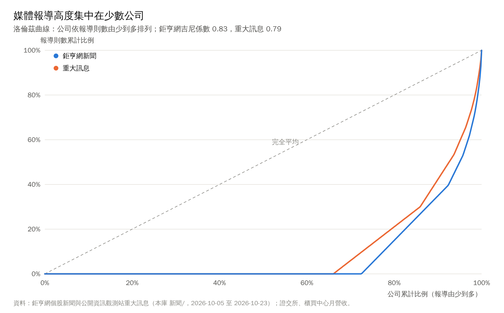
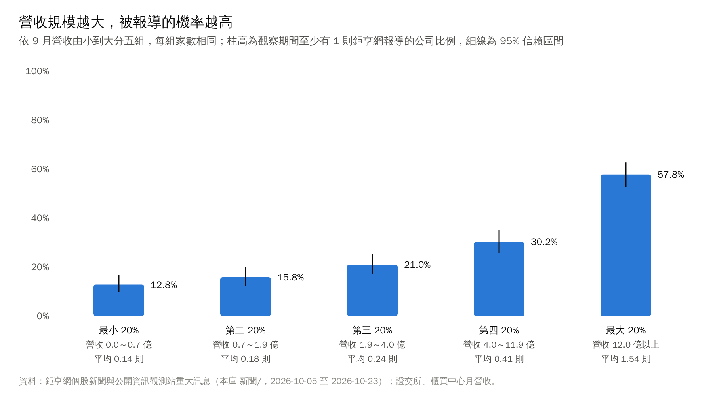
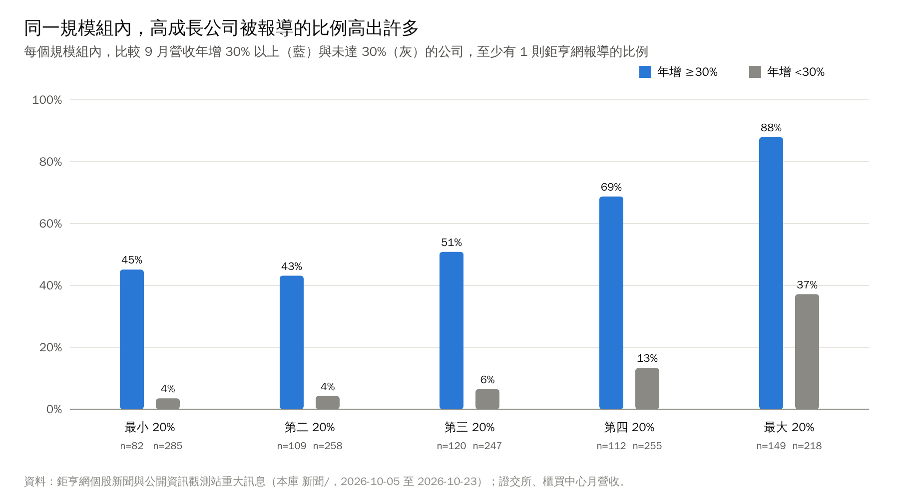
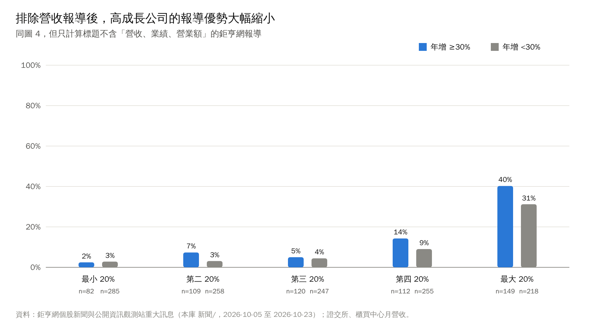
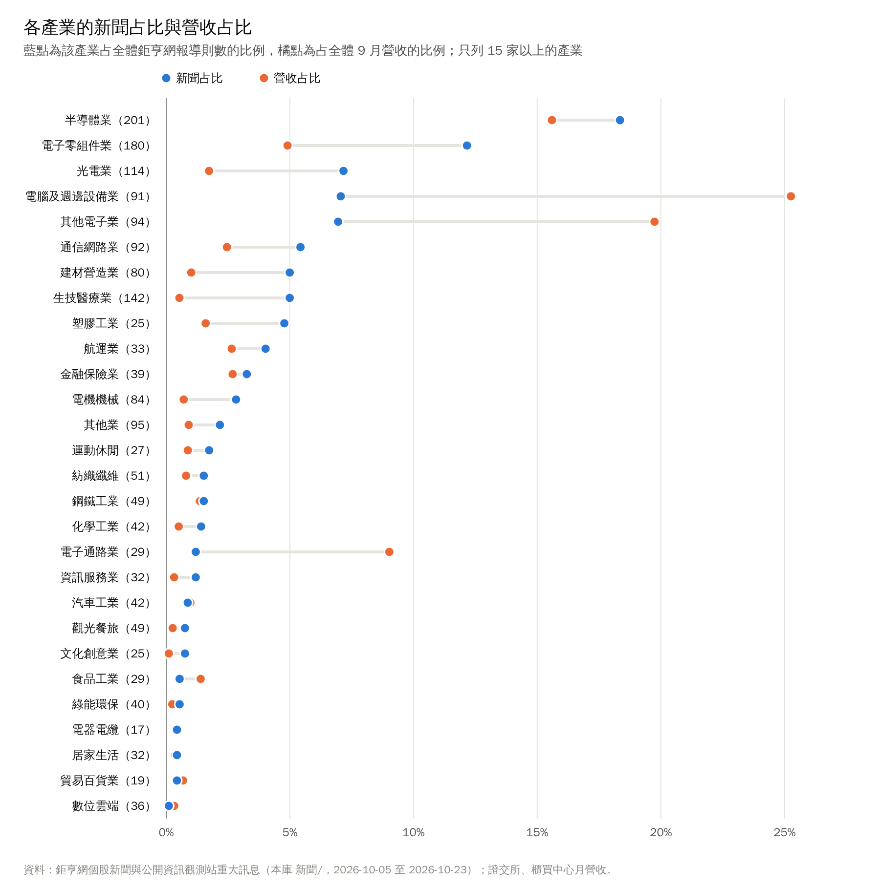

# 媒體關注度統計：報導集中在誰身上，成長如何被看見

> **資料基準日**
> - 新聞：2026/10/05 至 2026/10/23 的鉅亨網個股新聞與公開資訊觀測站重大訊息，由本庫新聞排程收集〔1〕〔2〕〔3〕。
> - 月營收：2026 年 9 月，證交所與櫃買中心 OpenAPI，本庫於 2026/10/21 抓取〔4〕。
> - 產業分類：本庫個股筆記的「產業」欄〔5〕。
> - 樣本：1,835 家有個股筆記且有 9 月營收的上市櫃公司（含金融保險業）。同一公司同一標題只算一次。
>
> 統計由 `系統/scripts/統計/關注度.py` 計算，可重現。#待校對

## 重點摘要

1. **多數公司在三週內沒有任何一則鉅亨網報導。** 1,835 家中有 72.5% 在觀察期間沒有被報導；重大訊息也有 66.0% 的公司一則都沒有〔1〕〔2〕。
2. **報導集中度很高。** 鉅亨網報導的吉尼係數為 0.83，前 1%（18 家）公司占全部報導的 21.4%；台積電一家就有 34 則〔1〕。
3. **規模是被報導的主要條件。** 依 9 月營收分五組，至少有 1 則報導的比例由最小組的 12.8% 升到最大組的 57.8%；報導則數與營收規模的等級相關係數為 0.37〔1〕〔4〕。
4. **營收成長與被報導的關聯更強，但主要來自營收快訊。** 控制規模後，營收年增率與報導則數的偏相關仍有 0.44；但約一半的鉅亨網報導是營收相關標題，排除後偏相關降到 0.07〔1〕〔4〕。
5. **組裝與通路的報導量遠低於其營收占比。** 電腦及週邊設備業占全體 9 月營收 25.3%，報導占比只有 7.1%；電子通路業營收占 9.0%，報導占 1.2%。電子零組件、光電、生技則相反〔1〕〔4〕。
6. **本庫的資訊盲點。** 121 家營收 5 億元以上、9 月年增 50% 以上且前九月累計年增 30% 以上的公司中，有 19 家在觀察期間沒有任何鉅亨網報導〔1〕〔4〕。

## 一、問題與資料

本庫的目的之一，是用最快的方式取得市場資訊，並利用資訊落差。要知道落差在哪裡，先要知道資訊本身怎麼分布。本文回答三個問題：

- **集中度**：報導集中在多少家公司身上？
- **決定因素**：公司規模與營收成長，哪一個和被報導的關係較強？
- **盲點**：哪些基本面變化很大的公司，在資料裡幾乎看不到？

新聞資料來自本庫的新聞排程（`系統/scripts/update_news.py`），每天收集兩次。三種來源的收集方式不同：

| 來源 | 收集方式 | 本文用途 |
|---|---|---|
| 鉅亨網 | 全體公司一致：抓鉅亨網台股新聞列表，標題含公司名稱或代號才算 | 主分析 |
| 公開資訊觀測站重大訊息 | 全體公司一致：抓當日重大訊息 | 對照 |
| Google 新聞 | 只替「關注清單」內 58 檔公司額外搜尋 | 只用於穩健性檢查 |

Google 新聞只替特定公司收集，若一併計入，被報導的多寡會反映本庫的設定而不是媒體行為，因此不放入主分析。

## 二、集中度：七成公司沒有被報導

| 統計量 | 鉅亨網新聞 | 重大訊息 |
|---|---:|---:|
| 總則數（去除重複標題） | 921 | 1,216 |
| 一則都沒有的公司比例 | 72.5% | 66.0% |
| 吉尼係數 | 0.83 | 0.79 |
| 前 1%（18 家）占比 | 21.4% | — |
| 前 10 家占比 | 15.1% | — |
| 有效公司數（1 ÷ HHI） | 189.9 | — |

吉尼係數 0 代表每家公司報導量相同，1 代表全部報導集中在一家。0.83 是非常高的集中度，但它主要來自「大量的零」，而不是少數公司壟斷：前 10 家只占 15%，有效公司數約 190 家。換句話說，**報導的分布是「多數公司沒有、少數公司有幾則」**，而不是「幾家公司占走全部」。

觀察期間報導最多的公司：

| 公司 | 鉅亨網 | 重大訊息 | 9 月營收（億元） |
|---|---:|---:|---:|
| 台積電 | 34 | 2 | 5,118.6 |
| 南亞 | 17 | 6 | 344.2 |
| 台塑 | 14 | 2 | 150.2 |
| 鴻海 | 14 | 12 | 11,586.3 |
| 聯茂 | 12 | 4 | 58.2 |
| 大立光 | 11 | 1 | 57.8 |
| 長榮 | 10 | 0 | 497.1 |
| 台達電 | 9 | 8 | 654.0 |
| 南亞科 | 9 | 4 | 450.9 |
| 友達 | 9 | 0 | 234.0 |

重大訊息的分布比媒體報導平均一些（吉尼係數 0.79），因為它由公司依法申報，不由編輯選擇。兩者的等級相關只有 0.24，代表公司自己公告的事情多，不等於媒體報導多。

## 三、規模與成長：誰會被看見

| 規模組 | 9 月營收（億元） | 至少 1 則報導 | 95% 信賴區間 | 平均則數 |
|---|---|---:|---|---:|
| 最小 20% | 0.0 至 0.7 | 12.8% | 9.8% 至 16.6% | 0.14 |
| 第二 20% | 0.7 至 1.9 | 15.8% | 12.4% 至 19.9% | 0.18 |
| 第三 20% | 1.9 至 4.0 | 21.0% | 17.1% 至 25.4% | 0.24 |
| 第四 20% | 4.0 至 11.9 | 30.2% | 25.8% 至 35.1% | 0.41 |
| 最大 20% | 12.0 以上 | 57.8% | 52.7% 至 62.7% | 1.54 |

覆蓋率隨規模單調上升，最大組與第四組的信賴區間不重疊。規模（取對數）與報導則數的 Spearman 等級相關係數為 0.37（p < 0.001）。

成長的關聯更強。營收年增率與報導則數的等級相關為 0.48；由於大公司的成長率也略高（兩者等級相關 0.24），本文以偏相關控制規模，結果仍有 0.44（p < 0.001）。圖 4 把每個規模組再分成「年增 30% 以上」與「未達 30%」：在最小的一組，高成長公司有 45% 被報導，其餘公司只有 4%；在最大的一組是 88% 對 37%。

### 這個關聯從哪裡來

鉅亨網的報導中，標題含「營收、業績、營業額」的約占一半（921 則中的 459 則）。每月上旬公司公布營收時，媒體會針對成長顯著的公司發出營收快訊，這會機械性地讓高成長公司「被報導」。

| 指標 | 全部鉅亨網報導 | 排除營收相關標題 |
|---|---:|---:|
| 則數 | 921 | 462 |
| 一則都沒有的公司比例 | 72.5% | 88.6% |
| 與規模的等級相關 | 0.37 | 0.34 |
| 與營收年增率的等級相關 | 0.48 | 0.15 |
| 控制規模後，與年增率的偏相關 | 0.44 | 0.07 |

排除營收快訊後，規模的關聯幾乎不變，成長的關聯則大幅下降。合理的解讀是：**高成長公司「被看見」，主要靠每月一次的營收快訊；營收以外的深度報導，仍然以大公司為主。** 對使用者而言，這表示小型高成長公司在營收公布週之外，幾乎沒有持續的媒體追蹤。

## 四、產業：報導量與經濟規模不成比例

| 產業 | 家數 | 新聞占比 | 營收占比 | 被報導公司比例 |
|---|---:|---:|---:|---:|
| 半導體業 | 201 | 18.4% | 15.6% | 35.3% |
| 電子零組件業 | 180 | 12.2% | 4.9% | 26.1% |
| 光電業 | 114 | 7.2% | 1.7% | 26.3% |
| 電腦及週邊設備業 | 91 | 7.1% | 25.3% | 34.1% |
| 其他電子業 | 94 | 7.0% | 19.8% | 34.0% |
| 生技醫療業 | 142 | 5.0% | 0.5% | 21.8% |
| 建材營造業 | 80 | 5.0% | 1.0% | 51.3% |
| 電子通路業 | 29 | 1.2% | 9.0% | 31.0% |

營收占比高、報導占比低的是組裝與通路：電腦及週邊設備（25.3% 對 7.1%）、其他電子（含鴻海，19.8% 對 7.0%）、電子通路（9.0% 對 1.2%）。這與上週〈九月營收的廣度與集中度〉的結論一致：這些產業的營收含大量轉手成本，營收規模不代表附加價值，媒體也較少把它們當成主角。

相反地，生技醫療業營收只占 0.5%，報導占 5.0%；光電、建材營造、電子零組件也明顯高於營收占比。這些產業的報導多與新藥進度、建案、題材相關，不完全由營收驅動。

## 五、資訊盲點：成長明顯卻沒有報導的公司

條件：9 月營收 5 億元以上（避免基期過小）、9 月年增 50% 以上、前九月累計年增 30% 以上（排除單月跳動）。符合的 121 家中，19 家在觀察期間沒有任何鉅亨網報導。依營收排序的前 12 家：

| 公司 | 產業 | 9 月營收（億元） | 9 月年增 | 累計年增 | 重大訊息則數 |
|---|---|---:|---:|---:|---:|
| 定穎投控 | 電子零組件業 | 32.3 | 84.7% | 51.3% | 0 |
| 光聖 | 通信網路業 | 20.6 | 97.3% | 50.2% | 1 |
| 宏碁資訊 | 數位雲端 | 15.3 | 97.4% | 33.5% | 0 |
| 世紀風電 | 綠能環保 | 13.3 | 64.8% | 69.7% | 2 |
| 穎崴 | 半導體業 | 12.5 | 87.7% | 96.7% | 1 |
| 金居 | 電子零組件業 | 11.0 | 64.6% | 48.9% | 0 |
| 聯友金屬-創 | 綠能環保 | 10.7 | 722.8% | 586.9% | 5 |
| 家登 | 半導體業 | 9.9 | 67.7% | 35.6% | 0 |
| 富喬 | 電子零組件業 | 9.4 | 82.1% | 54.9% | 0 |
| 松川精密 | 電子零組件業 | 8.8 | 73.3% | 44.0% | 3 |
| 湧德 | 電子零組件業 | 8.3 | 62.1% | 45.5% | 2 |
| 豐祥-KY | 電機機械 | 7.5 | 60.2% | 37.7% | 0 |

這張表的意義要謹慎解讀。它代表的是「在本庫一致收集的來源中沒有出現」，不代表市場不知道這些公司：例如光聖、穎崴在其他媒體與法人報告中可能有大量討論。它最直接的用途是**資料管理**：這些公司是本庫新聞覆蓋最薄弱、而基本面變化最大的地方，適合優先加入 `新聞/關注清單.md`，讓 Google 新聞補足。本表不構成任何投資意見。#待校對

## 六、穩健性檢查

| 檢查 | 結果 | 對結論的影響 |
|---|---|---|
| 加入 Google 新聞 | 吉尼係數 0.91；與規模的等級相關 0.39；控制規模後與成長的偏相關 0.44 | 集中度更高（因為只替關注清單收集），規模與成長的關係不變 |
| 排除營收相關標題 | 成長的偏相關由 0.44 降到 0.07 | 成長與報導的關聯主要來自營收快訊 |
| 改看重大訊息 | 吉尼係數 0.79；與媒體報導的等級相關 0.24 | 公司公告的多寡與媒體報導是兩回事 |
| 覆蓋率的抽樣誤差 | 五組的 Wilson 95% 信賴區間見第三節 | 最大組與其他組的差距遠大於誤差 |

## 七、研究限制

- **觀察期間短。** 只有 19 天（含連假與颱風休市），而且涵蓋 9 月營收公布週，營收快訊的比重可能高於其他月份。累積更長的資料後應重做。
- **比對方式。** 鉅亨網報導以「標題含公司名稱或代號」判定，名稱很短或很常見的公司（例如「統一」「大成」）可能被高估或低估；大盤綜合報導裡順帶提到的公司不會被計入。#待校對
- **只有一家媒體。** 鉅亨網的選題偏好不代表全體媒體；Google 新聞的收集方式不一致，只能作為對照。
- **母體。** 本庫只替有個股筆記的公司建立新聞檔，沒有筆記的公司不在樣本中；新上市公司的觀察期間可能較短。
- **相關不等於因果。** 本文只描述報導量與規模、成長的關聯，不推論媒體的選題動機。
- **營收標題的判定。** 以關鍵字「營收、業績、營業額」判斷，可能漏掉以「出貨」「接單」等字眼報導業績的新聞。

## 方法附註

- 報導則數：同一公司、同一標題只算一次；日期以新聞檔的日期標題為準，取 2026/10/05 至 2026/10/23。
- 吉尼係數 G = Σᵢ(2i − n − 1)xᵢ ÷（n Σxᵢ），xᵢ 依小到大排序；有效公司數 = 1 ÷ Σ(sᵢ²)，sᵢ 為各公司報導占比。
- Spearman 等級相關：同值取平均等級後計算 Pearson 相關；規模以 9 月營收的自然對數表示。
- 偏相關：ρ(新聞, 成長 | 規模) =（ρ_ng − ρ_ns ρ_gs）÷ √[(1 − ρ_ns²)(1 − ρ_gs²)]；p 值以 Fisher z 轉換近似，同值很多時只能視為近似。
- 覆蓋率的信賴區間：Wilson 95% 區間。
- 盲點條件：9 月營收 ≥ 5 億元、9 月年增 ≥ 50%、累計年增 ≥ 30%、觀察期間鉅亨網 0 則。

## 資料來源

1. 鉅亨網台股新聞列表（news.cnyes.com），2026/10/05 至 2026/10/23，經本庫 `系統/scripts/update_news.py` 收集並存於 `新聞/<代號名稱> 新聞.md`。https://news.cnyes.com/news/cat/tw_stock
2. 公開資訊觀測站，上市櫃公司每日重大訊息，2026/10/05 至 2026/10/23，同上收集。https://mops.twse.com.tw/
3. Google 新聞 RSS（只限 `新聞/關注清單.md` 內公司），同期間，只用於穩健性檢查。https://news.google.com/
4. 臺灣證券交易所 OpenAPI 與證券櫃檯買賣中心 OpenAPI，每月營業收入，2026 年 9 月；本庫 `系統/資料/財務摘要.json`，抓取日期 2026/10/21。https://openapi.twse.com.tw/ 、https://www.tpex.org.tw/openapi/
5. 本庫個股筆記 frontmatter 的「產業」欄（證交所、櫃買中心產業別）。
